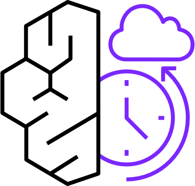
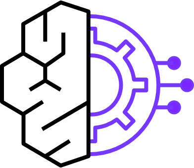
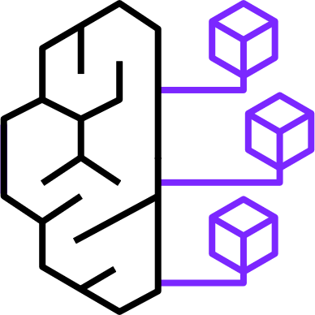
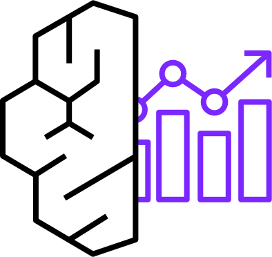
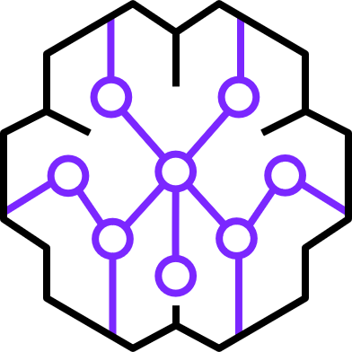
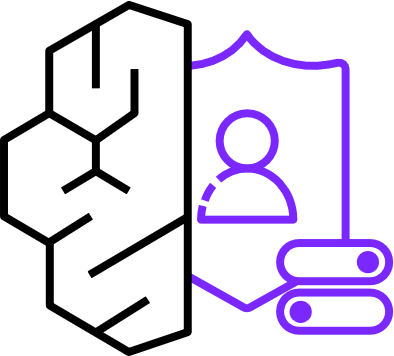
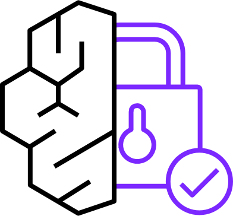
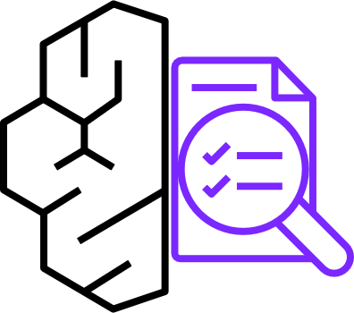
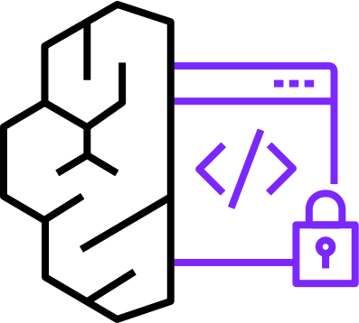
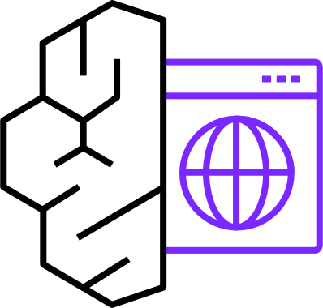

---
<!-- Slide 1: 세션 커버 -->
@type: cover

# 사례로 보는 AI 에이전트

8주 AI 에이전트 PoC 세션: AWS에서 만들고 운영하는 법, 온톨로지의 원리, 그리고 6개 과제와 닮은 사례

오준석, Senior Solutions Architect, AWS Korea | October 2026

:::script
(function () {
  // Hover (or focus) glossary: elements with data-tip show a one-line explanation near the term.
  if (window.__rpTips) return;
  window.__rpTips = true;
  var css = document.createElement('style');
  css.textContent =
    '.rp-tip { border-bottom: 2px dotted var(--accent); cursor: help; }' +
    '.rp-tipbox { position: fixed; z-index: 100001; max-width: min(38vw, 720px); padding: .6em .9em; border-radius: 8px;' +
    ' background: var(--text-primary); color: var(--bg-primary); font-size: clamp(14px, 1.75vh, 38px); line-height: 1.45;' +
    ' box-shadow: 0 6px 24px color-mix(in srgb, black 35%, transparent); pointer-events: none; opacity: 0; transition: opacity .12s; word-break: keep-all; }' +
    '.rp-tipbox.on { opacity: 1; }';
  document.head.appendChild(css);
  var box = document.createElement('div');
  box.className = 'rp-tipbox';
  box.setAttribute('role', 'tooltip');
  function show(t) {
    box.textContent = t.getAttribute('data-tip');
    box.classList.add('on');
    var r = t.getBoundingClientRect(), b = box.getBoundingClientRect();
    var x = Math.min(Math.max(8, r.left + r.width / 2 - b.width / 2), window.innerWidth - b.width - 8);
    var y = r.top - b.height - 10;
    if (y < 8) y = r.bottom + 10;
    box.style.left = x + 'px'; box.style.top = y + 'px';
  }
  function hide() { box.classList.remove('on'); }
  function mount() {
    document.body.appendChild(box);
    document.addEventListener('mouseover', function (e) { var t = e.target.closest && e.target.closest('.slide [data-tip]'); if (t) show(t); });
    document.addEventListener('mouseout', function (e) { if (e.target.closest && e.target.closest('.slide [data-tip]')) hide(); });
    document.addEventListener('focusin', function (e) { var t = e.target.closest && e.target.closest('.slide [data-tip]'); if (t) show(t); });
    document.addEventListener('focusout', hide);
    window.addEventListener('hashchange', hide);
  }
  if (document.readyState === 'loading') document.addEventListener('DOMContentLoaded', mount); else mount();
})();
:::

:::notes
{timing: 1min}
[요약]
- 75분 세션: 8주 PoC 과정 중 한 회차
- 앞: AWS에서 에이전트를 만들고 운영하는 기본 구조, 온톨로지를 쉽게 풀어 보기(직접 돌린 데모 포함)
- 가운데: LG전자, 신한카드, 미래에셋증권, Canva 네 사례를 아키텍처까지
- 뒤: 6개 과제와 닮은 사례, 온톨로지 앱 데모, PoC 실행 팁

안녕하세요, AWS 솔루션즈 아키텍트 오준석입니다. 오늘은 8주 PoC 과정 중 한 세션으로, 75분 동안 실제로 운영 중인 에이전트 사례를 중심으로 말씀드리겠습니다.
앞부분은 AWS에서 에이전트를 어떻게 만들고 운영하는지 짧게 보고, 이어서 오늘 사례에 반복해서 나오는 온톨로지라는 말을 쉽게 풀어 보겠습니다. 제가 직접 돌려 본 데모 결과도 같이 보여 드립니다.
{cue: pause}
가운데는 LG전자, 신한카드, 미래에셋증권, Canva 네 사례를 아키텍처까지 깊게 보고, 뒷부분은 이번 6개 과제와 닮은 사례를 과제별로 하나씩 짚겠습니다.
{cue: transition}
결론부터 말씀드리겠습니다.
:::

---
<!-- Slide 2: 오늘 가져가실 세 가지 -->
@type: content
@title: 오늘 가져가실 세 가지

## 오늘 가져가실 세 가지

네 사례에서 반복해서 보인 패턴, 과제가 달라도 똑같이 적용

:::html

  

    01
    
지식을 먼저 구조화한다

    
모델을 바꾸기 전에, 용어와 관계와 근거를 AI가 읽을 수 있는 형태로 만듭니다.

    
45% → 84.7%

    
미래에셋증권 ETF 질의 정답률

  

  

    02
    
역할을 나누고 검증자를 둔다

    
계획, 실행, 검증 에이전트를 분리하고, 사람 승인은 필요한 곳에만 둡니다.

    
3일 → 30분

    
LG전자 데이터 분석 업무

  

  

    03
    
평가 루프로 운영한다

    
합성 고객이 테스트하고, 진단부터 수정과 재검증까지 하나의 루프로 돌립니다.

    
7턴 → 4턴

    
신한카드 한도 상향 처리 (실패에서 완료로)

  

:::

:::notes
{timing: 1.5min}
[요약]
- 지식 구조화: 미래에셋증권은 같은 모델로 정답률 45%에서 84.7%, 바뀐 것은 데이터 구조
- 역할 분리와 검증자: LG전자 분석 업무 3일에서 30분
- 평가 루프: 신한카드 합성 고객 테스트, 7턴 실패에서 4턴 완료

결론부터 말씀드리면 세 가지입니다. 첫째, 모델보다 지식이 먼저입니다. 미래에셋증권은 같은 모델로 정답률을 45%에서 84.7%까지 올렸는데, 바뀐 건 모델이 아니라 데이터 구조였습니다. 오늘 이 부분은 온톨로지 파트에서 제가 직접 작게 재현한 결과로도 보여 드리겠습니다.
둘째, 에이전트 하나에 다 시키지 말고 역할을 나누고 검증자를 따로 둡니다. LG전자는 이렇게 분석 업무를 3일에서 30분으로 줄였습니다.
{cue: pause}
셋째, 평가 루프입니다. 신한카드는 합성 고객이 챗봇을 테스트하고 에이전트가 진단과 수정까지 하게 만들어서, 7턴 동안 못 풀던 한도 상향을 4턴에 끝냈습니다.
{cue: transition}
이 세 가지를 기억하시고, 먼저 이번 과제들을 패턴으로 묶어 보겠습니다.
:::

---
<!-- Slide 3: 6개 과제 3가지 패턴 -->
@type: content
@title: 6개 과제, 3가지 에이전트 패턴

## 6개 과제, 3가지 에이전트 패턴

현업 PoC 3개와 IT 팀 과제 3개, 패턴이 같으면 참고할 사례도 같음

:::html

  

    
지식 기반 응답

    
근거를 찾아 출처와 함께 답한다

    
TASK 01<b>마이데이터 비대면 자산관리 상담</b>현업 부서, 현업 PoC

    
TASK 05<b>IT 운영지식 위키</b>IT 개발팀, IT 팀 과제

  

  

    
조사와 생성

    
자료를 모아 초안과 시안을 만든다

    
TASK 02<b>UX 디자인 기획</b>UX 부서, 현업 PoC

    
TASK 03<b>보고서 작성(리서치)</b>현업 부서, 현업 PoC

  

  

    
판독과 진단

    
규칙과 신호로 누락과 이상을 찾는다

    
TASK 04<b>고객 제출서류 누락 자동 점검</b>IT 개발팀, IT 팀 과제

    
TASK 06<b>AI 기반 통합관제</b>IT 인프라팀, IT 팀 과제, 내부망

  

:::

:::notes
{timing: 1.5min}
[요약]
- 최종 선정 6개 과제를 에이전트 관점에서 세 패턴으로 묶음
- 지식 기반 응답: TASK 01 마이데이터 상담, TASK 05 IT 운영지식 위키
- 조사와 생성: TASK 02 UX 기획, TASK 03 리서치 보고서 / 판독과 진단: TASK 04 서류 누락 점검, TASK 06 통합관제

이번에 최종 선정된 6개 과제입니다. 주관 부서도 내용도 달라 보이지만, 에이전트 관점에서 보면 세 가지 패턴으로 묶입니다.
마이데이터 상담과 IT 운영지식 위키는 근거를 찾아 출처와 함께 답하는 지식 기반 응답 패턴, UX 기획과 리서치 보고서는 자료를 모아 초안을 만드는 조사와 생성 패턴, 서류 누락 점검과 통합관제는 규칙과 신호로 이상을 찾는 판독과 진단 패턴입니다.
{cue: pause}
패턴이 같으면 참고할 사례와 아키텍처도 비슷하니, 다른 팀 과제의 사례도 같이 보시면 도움이 됩니다.
{cue: transition}
오늘 순서입니다.
:::

---
<!-- Slide 4: 오늘의 순서 -->
@type: agenda

## 오늘의 순서

1. AWS에서 에이전트 만들기 (11분)
2. 온톨로지 쉽게 이해하기 (19분)
3. 대표 사례 4선 (25분)
4. 과제별 닮은 사례 (11분)
5. 데모 앱, PoC 팁, Q&A (9분)

:::notes
{timing: 1min}
[요약]
- 다섯 파트, 11분, 19분, 25분, 11분, 9분
- 점선 밑줄 용어는 마우스를 올리면 한 줄 설명이 뜸(질문이 나오면 활용)
- 2부 온톨로지는 L100에서 L200 수준으로, 수식이나 표준 문법 대신 예시와 데모로
- 마지막에 온톨로지 위에서 도는 에이전트 앱 화면 데모와 체크리스트

순서는 다섯 파트입니다. 먼저 AWS에서 에이전트를 만들고 운영하는 기본 구조를 짧게 봅니다.
2부는 온톨로지입니다. 신한카드와 미래에셋증권 사례가 모두 온톨로지를 썼는데, 이 말이 어렵게 들리시는 분이 많아서 예시와 데모로 쉽게 풀어 보겠습니다.
{cue: pause}
3부에서 대표 사례 네 개를 아키텍처까지 깊게 보고, 4부에서 6개 과제별로 닮은 사례를 하나씩 매칭해 드립니다. 마지막으로 온톨로지 위에서 도는 에이전트 앱을 화면으로 보고, 남은 PoC 기간에 바로 쓸 수 있는 체크리스트를 공유하겠습니다.
{cue: transition}
1부부터 시작하겠습니다.
:::

---
<!-- Slide 5: 1부 구분 -->
@type: section

# AWS에서 에이전트 만들고 운영하기

Strands Agents, Amazon Bedrock AgentCore, 관측과 평가

:::notes
{timing: 0.5min}
[요약]
- 1부: 에이전트의 구성 요소, 운영에 필요한 AgentCore 구성요소, 관측과 평가 루프
- 사례를 이해하기 위한 최소한의 공통 언어

1부는 사례를 보기 위한 공통 언어를 맞추는 시간입니다. 에이전트가 무엇으로 이루어지는지, 만든 에이전트를 운영에 올릴 때 무엇이 필요한지, 그리고 데모와 운영을 가르는 관측과 평가를 짧게 보겠습니다.
{cue: transition}
에이전트의 정의부터 보겠습니다.
:::

---
<!-- Slide 6: 에이전트 = 모델 + 도구 + 루프 -->
@type: content
@title: 에이전트 = 모델 + 도구 + 루프

## 에이전트 = 모델 + 도구 + 루프

루프는 SDK에 맡기고, 팀은 도구와 지식에 집중

:::html

  

    

모델: Amazon Bedrock

목표를 이해하고 다음 행동을 추론하고 계획

    

도구: Tools (MCP)

지식 검색, DB 조회, 사내 API 호출

    

지식: Knowledge

약관, 절차, 항목 정의서. 답의 품질을 결정

    

루프: Agent loop

실행, 관찰, 다음 행동을 목표 달성까지 반복

  

  

<pre class="code-block"># strands_agent.py
from strands import Agent, tool

@tool
def search_terms(query: str) -> str:
    """상품 약관에서 관련 조항을 찾는다"""
    return kb_search(query)  # 예시 함수

agent = Agent(
    model="&lt;Bedrock 모델 ID&gt;",
    tools=[search_terms],
    system_prompt="근거 조항을 인용해 답한다",
)
agent("ISA 중도 인출 조건 알려줘")</pre>
    
Strands Agents: AWS 오픈소스 SDK (Python, TypeScript). 멀티 에이전트 패턴: Agents-as-Tools, Graph, Swarm, Workflow. 출처: strandsagents.com

  

:::

:::notes
{timing: 2min}
[요약]
- 에이전트는 모델, 도구, 루프. 여기에 지식이 답의 품질을 결정
- Strands Agents: 파이썬 함수에 @tool, 함수 설명(docstring)을 모델이 읽고 언제 쓸지 판단
- 멀티 에이전트 패턴: Agents-as-Tools, Graph, Swarm, Workflow. LG전자 사례가 Graph와 Agents-as-Tools를 함께 사용

에이전트를 한 줄로 정의하면 모델, 도구, 그리고 루프입니다. 모델이 목표를 보고 다음 행동을 정하면 도구를 호출하고, 결과를 관찰해서 다시 다음 행동을 정하는 걸 목표를 이룰 때까지 반복합니다.
여기에 하나를 더하면 지식인데, 오늘 사례들을 보면 답의 품질은 대부분 여기서 갈립니다. 그래서 2부에서 지식을 구조화하는 방법인 온톨로지를 따로 다룹니다.
{cue: pause}
오른쪽은 Strands Agents라는 AWS 오픈소스 SDK 코드입니다. 도구는 파이썬 함수에 @tool만 붙이면 되고, 함수 설명을 모델이 읽고 언제 쓸지 판단합니다. 루프는 SDK가 돌려주니, PoC에서는 어떤 도구와 어떤 지식을 줄지에 시간을 쓰시면 됩니다.
여러 에이전트를 묶는 패턴도 Agents-as-Tools, Graph, Swarm, Workflow로 제공되는데, 오늘 볼 LG전자 사례가 Graph와 Agents-as-Tools를 같이 씁니다.
{cue: transition}
만든 에이전트를 운영에 올릴 때 필요한 것들을 보겠습니다.
:::

---
<!-- Slide 7: AgentCore -->
@type: content
@title: AgentCore: 만든 에이전트를 운영으로

## AgentCore: 만든 에이전트를 운영으로

프레임워크와 모델 무관, Strands, LangGraph, OpenAI Agents SDK 등으로 만든 에이전트에 그대로

:::html

  

<b>Runtime</b>세션 격리 서버리스 실행, 장시간 비동기 작업

  

<b>Gateway</b>API와 Lambda를 MCP 도구로 변환, 기존 MCP 서버 연결

  

<b>Memory</b>멀티턴 단기 기억과 세션을 넘는 장기 기억

  

<b>Observability</b>단계별 실행 경로 추적과 디버깅 (OTel)

  

<b>Harness</b>모델, 도구, 프롬프트만 지정하면 도는 관리형 루프

  

<b>Identity</b>기존 IdP와 연동한 에이전트 인증과 접근 관리

  

<b>Policy</b>도구 호출을 규칙으로 결정적 통제 (Cedar 호환)

  

<b>Evaluations</b>LLM-as-a-Judge와 커스텀 평가기로 자동 채점

  

<b>Code Interpreter</b>격리 샌드박스에서 분석 코드 실행

  

<b>Browser</b>관리형 클라우드 브라우저로 웹 작업

  

<b>Optimization</b>trace 기반 개선 추천과 A/B 테스트

  
<strong class="text-accent">은행 관점 핵심</strong>: Policy와 Identity로 도구 사용을 결정적으로 통제합니다.

  
출처: AWS 문서, What is Amazon Bedrock AgentCore (2026.10 기준, 일부 구성요소 생략). 서울 리전 제공 여부는 사용 전 확인 필요

:::

:::notes
{timing: 2min}
[요약]
- AgentCore: 만든 에이전트를 운영에 올릴 때 필요한 구성요소 모음, 프레임워크와 모델 무관
- 실행: Runtime(세션 격리), Harness(관리형 루프) / 연결: Gateway(API, Lambda를 MCP 도구로), Identity, Policy
- 은행 관점: Policy가 "이 에이전트는 이 도구를 이 조건에서만"을 결정적으로 강제
- 운영 쪽(Observability, Evaluations, Optimization)은 다음 장

만든 에이전트를 실제 운영 환경에 올릴 때 필요한 것들을 모아 놓은 게 Amazon Bedrock AgentCore입니다. 프레임워크나 모델을 가리지 않아서 Strands든 LangGraph든 그대로 올릴 수 있습니다.
실행은 Runtime이 세션 단위로 격리해서 돌려주고, 최근에는 모델과 도구와 프롬프트만 지정하면 루프까지 관리해 주는 Harness도 나왔습니다.
{cue: pause}
연결 쪽은 Gateway가 기존 API나 Lambda를 MCP 도구로 바꿔 주고, Identity가 사내 IdP와 연동한 인증을, Policy가 "이 에이전트는 이 도구를 이 조건에서만 쓴다" 같은 규칙을 결정적으로 강제합니다. 은행 입장에선 Policy가 특히 중요합니다.
운영 쪽 Observability, Evaluations, Optimization은 다음 장에서 보겠습니다. 리전별 제공 여부는 사용 전에 문서에서 한 번 확인하시길 권합니다.
{cue: transition}
데모와 운영을 가르는 관측과 평가입니다.
:::

---
<!-- Slide 8: 관측 평가 개선 -->
@type: content
@title: 데모에서 운영으로: 관측, 평가, 개선

## 데모에서 운영으로: 관측, 평가, 개선

같은 trace 위에서 운영 지표와 품질 점수를 함께 확인

:::html

  
01 TRACE
계측

ADOT(OpenTelemetry)로 모든 단계를 기록. AgentCore 밖 에이전트도 가능

  
02 OBSERVE
관측

CloudWatch GenAI Observability: 지연, 토큰, 오류율, 단계별 trace

  
03 EVALUATE
평가

Online, On-demand, Batch 평가. Goal success, Correctness, Faithfulness, Helpfulness

  
04 IMPROVE
개선

Optimization: 개선 추천, 설정 버전 관리, A/B 테스트

  TASK 01
  
<strong class="text-accent">User Simulation: 합성 고객으로 미리 검증</strong>
actor_profile(context, goal, traits)로 가상 고객을 정의하면 멀티턴 대화를 하고, 끝나면 같은 평가기로 채점합니다.

출처: AWS 문서, AgentCore Observability, Evaluations, User simulation

:::

:::notes
{timing: 1.5min}
[요약]
- 데모는 잘 도는 한 번, 운영은 수천 번을 다 잘해야 함: 관측과 평가를 같이
- ADOT(OpenTelemetry) trace, CloudWatch GenAI Observability에서 지연, 토큰, 오류율, 단계별 경로
- AgentCore Evaluations: Online(운영 샘플링), On-demand(CI/CD), Batch(쌓인 세션)
- User Simulation: TASK 01 마이데이터 상담에 바로 연결

데모는 잘 돌아가는 한 번을 보여주지만, 운영은 수천 번을 다 잘해야 합니다. 그래서 관측과 평가가 같이 가야 합니다.
OpenTelemetry 기반 ADOT로 모든 단계를 trace로 남기면, CloudWatch GenAI Observability에서 지연, 토큰, 오류율과 단계별 실행 경로를 볼 수 있습니다. AgentCore Evaluations는 그 trace에 바로 점수를 매깁니다. 운영 트래픽을 샘플링하는 Online, CI/CD에서 특정 trace만 보는 On-demand, 쌓인 세션을 한 번에 보는 Batch가 있습니다.
{cue: pause}
점수가 나오면 Optimization으로 설정을 바꿔 A/B 테스트까지 돌릴 수 있습니다. 아래 User Simulation은 마이데이터 상담 과제에 바로 연결됩니다. 가상 고객의 배경, 목표, 성향을 정의하면 LLM이 그 고객을 연기하면서 멀티턴 대화를 하고, 끝나면 같은 평가기로 채점합니다.
{cue: transition}
이제 오늘 사례들의 공통 열쇠인 지식 구조화, 온톨로지를 쉽게 풀어 보겠습니다.
:::
