---
<!-- Slide 1: 3부 구분 -->
@type: section

# 대표 사례 4선

LG전자, 신한카드, 미래에셋증권, Canva. 원문 아키텍처로 보기

:::script
(function () {
  // Click-to-zoom for architecture figures: opens the image over the whole viewport.
  if (window.__rpLightbox) return;
  window.__rpLightbox = true;
  var css = document.createElement('style');
  css.textContent =
    '.slide img.rp-zoomable { cursor: zoom-in; }' +
    '.rp-lb { position: fixed; inset: 0; z-index: 100000; display: none; align-items: center; justify-content: center; background: color-mix(in srgb, black 95%, transparent); cursor: zoom-out; }' +
    '.rp-lb.open { display: flex; }' +
    '.rp-lb img { width: 96vw; height: 92vh; object-fit: contain; }' +
    '.rp-lb span { position: fixed; bottom: 12px; left: 50%; transform: translateX(-50%); color: white; font-size: 14px; opacity: .7; }';
  document.head.appendChild(css);
  var lb = document.createElement('div');
  lb.className = 'rp-lb';
  lb.innerHTML = '클릭하거나 Esc를 누르면 닫힙니다';
  var big = lb.querySelector('img');
  function close() { lb.classList.remove('open'); }
  lb.addEventListener('click', close);
  function mount() {
    document.body.appendChild(lb);
    document.querySelectorAll('.slide img[src^="media/"]').forEach(function (img) {
      if (/\/ac-/.test(img.getAttribute('src'))) return;
      img.classList.add('rp-zoomable');
      img.title = '클릭하면 크게 보기';
      img.addEventListener('click', function (e) {
        e.stopPropagation();
        big.src = img.src; big.alt = img.alt;
        lb.classList.add('open');
      });
    });
  }
  if (document.readyState === 'loading') document.addEventListener('DOMContentLoaded', mount); else mount();
  // While open, swallow deck keys so arrows do not change slides; Esc closes.
  document.addEventListener('keydown', function (e) {
    if (!lb.classList.contains('open')) return;
    e.stopPropagation(); e.preventDefault();
    if (e.key === 'Escape' || e.key === 'Enter' || e.key === ' ') close();
  }, true);
})();
:::

:::script
(function () {
  // Hover (or focus) glossary: elements with data-tip show a one-line explanation near the term.
  if (window.__rpTips) return;
  window.__rpTips = true;
  var css = document.createElement('style');
  css.textContent =
    '.rp-tip { border-bottom: 2px dotted var(--accent); cursor: help; }' +
    '.rp-tipbox { position: fixed; z-index: 100001; max-width: min(38vw, 720px); padding: .6em .9em; border-radius: 8px;' +
    ' background: var(--text-primary); color: var(--bg-primary); font-size: clamp(14px, 1.75vh, 38px); line-height: 1.45;' +
    ' box-shadow: 0 6px 24px color-mix(in srgb, black 35%, transparent); pointer-events: none; opacity: 0; transition: opacity .12s; word-break: keep-all; }' +
    '.rp-tipbox.on { opacity: 1; }';
  document.head.appendChild(css);
  var box = document.createElement('div');
  box.className = 'rp-tipbox';
  box.setAttribute('role', 'tooltip');
  function show(t) {
    box.textContent = t.getAttribute('data-tip');
    box.classList.add('on');
    var r = t.getBoundingClientRect(), b = box.getBoundingClientRect();
    var x = Math.min(Math.max(8, r.left + r.width / 2 - b.width / 2), window.innerWidth - b.width - 8);
    var y = r.top - b.height - 10;
    if (y < 8) y = r.bottom + 10;
    box.style.left = x + 'px'; box.style.top = y + 'px';
  }
  function hide() { box.classList.remove('on'); }
  function mount() {
    document.body.appendChild(box);
    document.addEventListener('mouseover', function (e) { var t = e.target.closest && e.target.closest('.slide [data-tip]'); if (t) show(t); });
    document.addEventListener('mouseout', function (e) { if (e.target.closest && e.target.closest('.slide [data-tip]')) hide(); });
    document.addEventListener('focusin', function (e) { var t = e.target.closest && e.target.closest('.slide [data-tip]'); if (t) show(t); });
    document.addEventListener('focusout', hide);
    window.addEventListener('hashchange', hide);
  }
  if (document.readyState === 'loading') document.addEventListener('DOMContentLoaded', mount); else mount();
})();
:::

:::notes
{timing: 0.5min}
[요약]
- 3부: 네 사례를 원문 아키텍처로. 그림은 클릭하면 전체 화면으로 확대(다시 클릭하거나 Esc로 닫기)
- LG전자(역할 분리와 검증), 신한카드(인텐트 온톨로지와 자율 개선 루프), 미래에셋증권(지식DB와 Grounding), Canva(PoC에서 프로덕션으로)
- 2부의 네 자리(의도 이해, 값 확정, 관계 탐색, 규칙 강제)가 어디에 쓰였는지 함께 보기

3부는 대표 사례 네 개입니다. 원문 블로그와 발표의 아키텍처 그림을 그대로 가져왔습니다.
2부에서 말씀드린 온톨로지의 네 자리, 의도 이해, 값 확정, 관계 탐색, 규칙 강제가 각 사례의 어디에 들어갔는지 같이 보시면 좋습니다.
{cue: transition}
첫 번째는 LG전자입니다.
:::

---
<!-- Slide 2: LG전자 개요 -->
@type: content
@title: CASE 1 LG전자: 질문에서 보고서까지

## CASE 1 LG전자: 질문에서 보고서까지

Data Rich, Insight Poor. 무엇을 물어야 할지부터 막히던 마케터의 데이터 분석

:::html

  

    
BEFORE
요구사항 정의부터 결과 해석까지 평균 2~3주, 데이터 과학자에게 의존

    
AFTER
데이터 분석 업무 3일 → 30분

    
초기 구조
Coordinator가 복잡도를 판단하고, Planner가 계획과 추적, Supervisor가 Coder와 Reporter에 배분

    
적용
워시콤보, 식기세척기 구매 고객 분석, CRM 캠페인 성과 비교 등 실무

  

  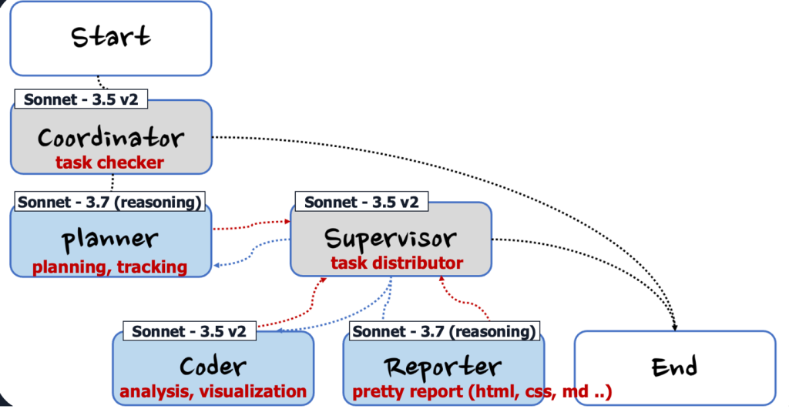

출처: AWS 기술 블로그, <a href="https://aws.amazon.com/ko/blogs/tech/lge-agentic-report-automation/" target="_blank" rel="noopener">LG전자 Agentic AI 리포트 자동화 (2025-08)</a>, <a href="https://aws.amazon.com/ko/blogs/tech/practical-design-lessons-from-the-deep-insight-arch/" target="_blank" rel="noopener">Deep Insight 아키텍처 설계 교훈 (2026-04)</a>

:::

:::notes
{timing: 1min}
[요약]
- LG전자 한국영업본부: Data Rich, Insight Poor. 요청부터 해석까지 평균 2~3주
- 자연어 SQL 도구가 있어도 "무엇을 물어야 할지"에서 막힘
- 초기 구조: Coordinator, Planner, Supervisor, Coder, Reporter. 계획과 리포트에만 추론 모델
- 결과: 데이터 분석 업무 3일에서 30분

첫 번째 사례는 LG전자 한국영업본부입니다. 데이터는 많은데 인사이트가 안 나오는, 이른바 Data Rich, Insight Poor 상황이었습니다. 마케터가 데이터 과학자에게 요청하고 결과를 해석받기까지 평균 2~3주가 걸렸고, 자연어로 SQL을 만들어 주는 도구가 있어도 무엇을 물어야 할지에서 막혔습니다.
{cue: pause}
오른쪽이 초기 구조입니다. Coordinator가 간단한 질문인지 판단하고, 복잡하면 Planner가 계획을 세우고, Supervisor가 코딩 에이전트와 리포트 에이전트에 일을 나눕니다. 계획과 리포트에만 추론 모델을 썼습니다. 결과적으로 데이터 분석 업무가 3일에서 30분으로 줄었습니다.
{cue: transition}
이 구조가 발전한 Deep Insight 전체 아키텍처입니다.
:::

---
<!-- Slide 3: Deep Insight 전체 -->
@type: content
@title: Deep Insight 전체 아키텍처

## Deep Insight 전체 아키텍처

8개 에이전트, 3계층. AgentCore Runtime 위의 Strands 그래프와 격리된 Code Interpreter

:::html

  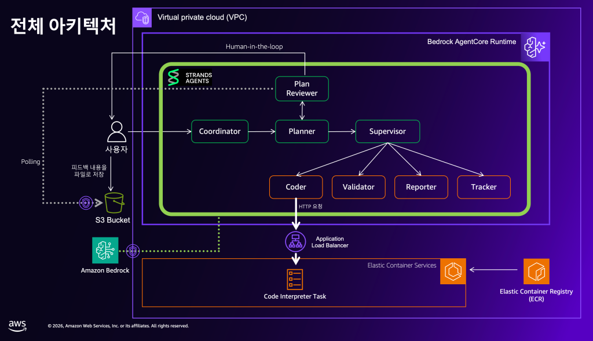
  
출처: AWS 기술 블로그, <a href="https://aws.amazon.com/ko/blogs/tech/lge-agentic-report-automation/" target="_blank" rel="noopener">LG전자 Agentic AI 리포트 자동화 (2025-08)</a>, <a href="https://aws.amazon.com/ko/blogs/tech/practical-design-lessons-from-the-deep-insight-arch/" target="_blank" rel="noopener">Deep Insight 아키텍처 설계 교훈 (2026-04)</a>

:::

:::notes
{timing: 1min}
[요약]
- VPC 안 AgentCore Runtime에 Strands Agents 그래프
- Coder가 만든 코드는 ALB를 거쳐 ECS Code Interpreter Task에서 따로 실행
- 사용자 피드백은 S3 파일로, Plan Reviewer가 읽어 계획 수정(Human-in-the-loop)

AWS가 오픈소스로 공개한 Deep Insight의 전체 아키텍처입니다. VPC 안의 AgentCore Runtime에 Strands Agents 그래프가 올라가 있고, Coder가 만든 분석 코드는 ALB를 거쳐 ECS의 Code Interpreter Task에서 따로 실행됩니다.
{cue: pause}
사용자 피드백은 S3에 파일로 저장되고 Plan Reviewer가 이걸 읽어서 계획을 고칩니다. 이게 Human-in-the-loop 구간입니다.
{cue: transition}
계층을 나눠서 보겠습니다.
:::

---
<!-- Slide 4: 계층형 멀티 에이전트 -->
@type: content
@title: 계층형 멀티 에이전트와 Agents as Tools

## 계층형 멀티 에이전트와 Agents as Tools

계획 계층이 계획하고 승인받은 뒤, 실행 에이전트는 도구처럼 호출

:::html

  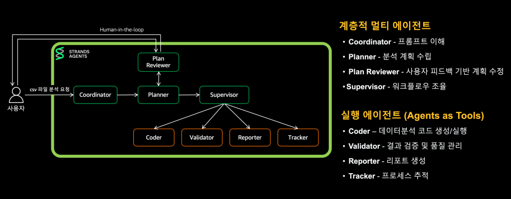
  
출처: AWS 기술 블로그, <a href="https://aws.amazon.com/ko/blogs/tech/lge-agentic-report-automation/" target="_blank" rel="noopener">LG전자 Agentic AI 리포트 자동화 (2025-08)</a>, <a href="https://aws.amazon.com/ko/blogs/tech/practical-design-lessons-from-the-deep-insight-arch/" target="_blank" rel="noopener">Deep Insight 아키텍처 설계 교훈 (2026-04)</a>

:::

:::notes
{timing: 1min}
[요약]
- 계획 계층: Coordinator, Planner, Plan Reviewer, Supervisor
- 실행 에이전트 4개: Coder(코드), Validator(원본으로 재계산 검증), Reporter(보고서), Tracker(진행 체크)
- Supervisor가 실행 에이전트를 도구처럼 호출해 context가 섞이지 않음

계층을 나눠 보면 위쪽이 Coordinator, Planner, Plan Reviewer, Supervisor이고 아래가 실행 에이전트 네 개입니다.
Coder는 분석 코드를 만들고 실행하고, Validator는 결과를 원본 데이터로 다시 계산해서 검증하고, Reporter가 보고서를 쓰고, Tracker가 진행 상황을 체크합니다.
{cue: pause}
Supervisor가 이들을 도구처럼 호출하기 때문에 각 에이전트의 context가 섞이지 않습니다. 1부에서 말씀드린 Agents-as-Tools 패턴입니다.
{cue: transition}
여기서 가져갈 설계 패턴 여섯 가지입니다.
:::

---
<!-- Slide 5: 6가지 패턴 -->
@type: content
@title: Deep Insight에서 가져올 6가지 패턴

## Deep Insight에서 가져올 6가지 패턴

과제 3(보고서), 4(서류 점검), 6(관제)에 그대로 적용 가능

:::html

  

라우팅 먼저

가벼운 모델(Haiku)이 요청을 분류. 단순 요청엔 비싼 오케스트레이션을 생략

  

계획 + 사람 승인

Planner가 5~10단계로 분해하고, 사용자가 승인하거나 수정한 뒤 실행

  

요약 말고 원본 누적

에이전트 간 결과를 요약해 넘기지 않고 파일에 누적. 세부 맥락 손실 방지

  

검증 에이전트 분리

Validator가 원본 데이터로 다시 계산(허용 오차 0.01). 검증된 값만 인용

  

역할별 모델 + 선택적 캐싱

반복 호출되는 에이전트만 Prompt Caching. 입력 토큰 비용 최대 90% 절감

  

격리된 코드 실행

세션별 컨테이너를 Private VPC에서 실행, 인터넷 차단, 1시간 후 자동 종료

출처: AWS 기술 블로그, <a href="https://aws.amazon.com/ko/blogs/tech/lge-agentic-report-automation/" target="_blank" rel="noopener">LG전자 Agentic AI 리포트 자동화 (2025-08)</a>, <a href="https://aws.amazon.com/ko/blogs/tech/practical-design-lessons-from-the-deep-insight-arch/" target="_blank" rel="noopener">Deep Insight 아키텍처 설계 교훈 (2026-04)</a>

:::

:::notes
{timing: 1.5min}
[요약]
- 라우팅 먼저, 계획과 사람 승인, 요약 말고 원본 누적
- 검증 에이전트 분리(원본 재계산, 허용 오차 0.01): 리서치 보고서 과제의 핵심
- 역할별 모델과 선택적 캐싱(입력 토큰 비용 최대 90% 절감), 격리된 코드 실행
- 주의: 사람 승인이 300초 후 자동 승인. 은행에서는 타임아웃 시 보류 권장

Deep Insight에서 바로 가져갈 만한 설계 패턴 여섯 가지입니다. 하나, 라우팅을 먼저 둡니다. 인사말 같은 단순 요청에 비싼 멀티 에이전트를 돌리지 않도록 가벼운 모델이 먼저 분류합니다. 둘, 복잡한 작업은 실행 전에 계획으로 쪼개고 사람이 승인합니다. 셋, 에이전트끼리 결과를 요약해서 넘기면 세부 정보가 사라집니다. 원본을 파일에 계속 쌓고 다음 에이전트가 읽게 했습니다.
{cue: pause}
넷, 검증 에이전트를 따로 둡니다. 리서치 보고서 과제라면 이 부분이 핵심입니다. 다섯, 역할마다 모델을 다르게 쓰고 반복 호출되는 에이전트에만 캐싱을 적용합니다. 여섯, LLM이 만든 코드는 세션별로 격리된 컨테이너에서 인터넷 없이 실행합니다.
참고로 이 구조의 사람 승인은 300초가 지나면 자동 승인되는데, 은행에서는 타임아웃 시 보류로 바꾸는 걸 권합니다.
{cue: transition}
실제 운영 화면입니다.
:::

---
<!-- Slide 6: 운영 화면 -->
@type: content
@title: 운영 화면: 보고서와 관리자 대시보드

## 운영 화면: 보고서와 관리자 대시보드

작업별 소요시간, 토큰, Cache Hit을 같은 화면에서

:::html

  <figure>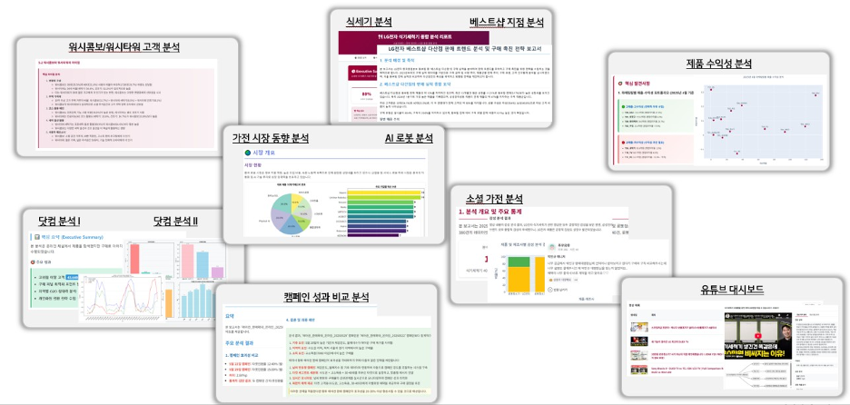<figcaption>워시타워 고객분석, 캠페인 비교, 수익성 분석 보고서</figcaption></figure>
  <figure>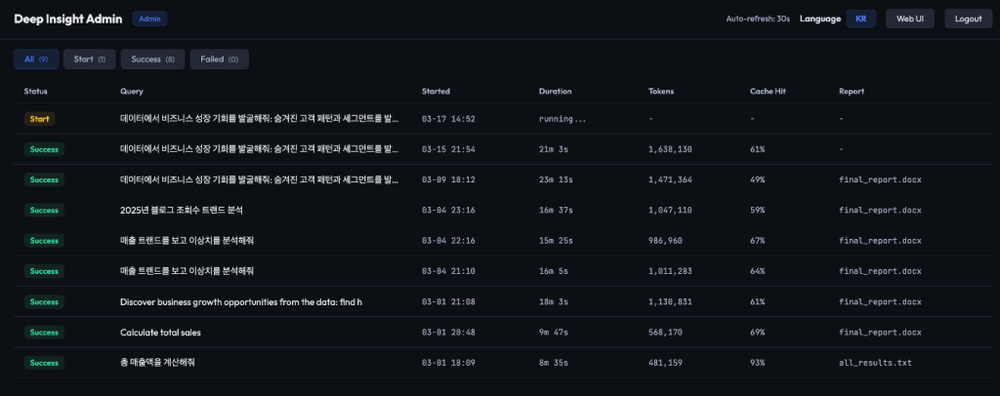<figcaption>관리자 대시보드: 작업당 15~23분, 토큰 100만 개 이상, Cache Hit 50~70%</figcaption></figure>

<strong class="text-danger">리스크</strong>: HITL 300초 자동 승인은 금융권에서 무승인 실행으로 해석될 수 있습니다. 타임아웃 시 보류로 바꾸세요. 블로그의 288배 표기는 산술상 144배이므로, 3일에서 30분으로 줄었다는 표현만 인용하세요.

출처: AWS 기술 블로그, <a href="https://aws.amazon.com/ko/blogs/tech/lge-agentic-report-automation/" target="_blank" rel="noopener">LG전자 Agentic AI 리포트 자동화 (2025-08)</a>, <a href="https://aws.amazon.com/ko/blogs/tech/practical-design-lessons-from-the-deep-insight-arch/" target="_blank" rel="noopener">Deep Insight 아키텍처 설계 교훈 (2026-04)</a>

:::

:::notes
{timing: 1min}
[요약]
- 왼쪽: 실제 생성된 보고서들 / 오른쪽: 관리자 대시보드
- 작업당 15~23분, 토큰 100만 개 이상, Cache Hit 50~70%: 캐싱이 비용의 핵심
- 운영하려면 이런 화면이 처음부터 필요
- 인용 주의: 288배 표기는 산술상 144배, "3일에서 30분"만 인용

왼쪽은 실제로 만들어진 보고서들이고, 오른쪽은 관리자 대시보드입니다. 작업 하나에 15분에서 23분, 토큰은 100만 개 넘게 쓰고 캐시 적중률이 50에서 70% 정도입니다.
{cue: pause}
캐싱이 비용에 얼마나 중요한지 보여주는 화면이고, 운영하려면 이런 화면이 처음부터 있어야 한다는 점도 같이 말씀드립니다. 블로그에 나온 288배라는 표기는 계산해 보면 144배라서, 인용하실 때는 3일에서 30분이라는 표현만 쓰시길 권합니다.
{cue: transition}
두 번째, 신한카드입니다.
:::

---
<!-- Slide 7: 신한카드 개요 -->
@type: content
@title: CASE 2 신한카드: 세 가지 혁신

## CASE 2 신한카드: 세 가지 혁신

온톨로지 인텐트 분류, 분산형 에이전트 워크플로우, 에이전트 간 대화 기반 self-healing

:::html

  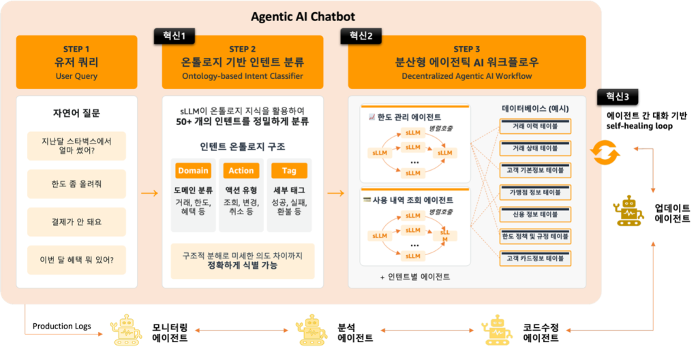
  
출처: AWS 기술 블로그, <a href="https://aws.amazon.com/ko/blogs/tech/shinhan-card-ontology-based-decentralized-agentic-ai-chatbot/" target="_blank" rel="noopener">신한카드 온톨로지 기반 분산형 Agentic AI 챗봇 (2026-06)</a>

:::

:::notes
{timing: 1min}
[요약]
- AWS 생성형 AI 이노베이션 센터와 만든 차세대 챗봇
- 제약: 상담 의도 51개, 문맥이 비슷한데 처리가 다른 의도(결제 취소, 결제 실패), 규제 부담이 적은 소형 모델, 5초 응답
- 세 가지 혁신: 온톨로지 인텐트 분류, 중앙 오케스트레이터 없는 분산형, 에이전트 간 대화로 스스로 개선

두 번째는 신한카드가 AWS 생성형 AI 이노베이션 센터와 만든 차세대 챗봇입니다. 제약이 많았습니다. 상담 의도가 51개로 잘게 나뉘어 있고, 결제 취소와 결제 실패처럼 문맥은 비슷한데 처리가 다른 경우가 있습니다.
{cue: pause}
고객 데이터를 다루려면 규제 승인 부담이 적은 소형 모델이 유리했고, 응답은 5초 안에 나와야 했습니다. 그래서 세 가지를 했습니다. 온톨로지로 의도를 분류하고, 중앙 오케스트레이터 없는 분산형 구조를 쓰고, 에이전트끼리 대화하면서 스스로 개선하는 루프를 만들었습니다.
{cue: transition}
2부의 첫 번째 자리, 의도 이해입니다.
:::

---
<!-- Slide 8: 인텐트 온톨로지 -->
@type: content
@title: 51개 상담 의도를 온톨로지로 쪼개 분류

## 51개 상담 의도를 온톨로지로 쪼개 분류

규제, 비용, 5초 응답 제약 속에서 소형 모델(sLLM)로 정확도를 올린 방법

:::html

  

    

1. 3속성 병렬 추출

sLLM이 Domain, Action, Tag를 각각 독립적으로 고른다

    

2. 그래프 매칭으로 후보 축소

Tag로 거르고, Domain과 Action이 맞는 인텐트만 남긴다

    

3. 남은 후보만 LLM이 비교

하나면 확정, 여럿이면 원문과 후보 설명을 비교해 선택

    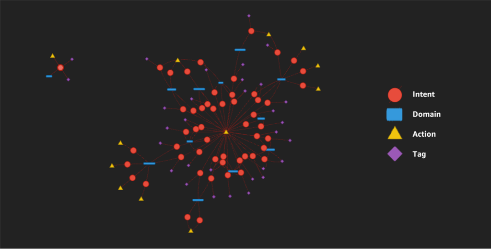
  

  

    

      
<small>Qwen3 32B 기존</small>84.2%

      
<small>Qwen3 32B 온톨로지</small>91.0%

      
<small>Qwen3 235B A22B 기존</small>77.4%

      
<small>Qwen3 235B A22B 온톨로지</small>88.7%

    

    

<b>5초 이내</b>요청당 응답

<b>약 18배</b>비용 절감 (Opus 4.5 대비)

<b>~98%</b>topic switching 감지

    
작은 32B 모델이 약 7배 큰 235B 모델보다 2.3%p 높음. 측정 조건 비공개 수치이므로 참고용. 2부 D2처럼 조건(51개, 유사 의도, sLLM)이 효과를 만든다는 점도 함께

  

출처: AWS 기술 블로그, <a href="https://aws.amazon.com/ko/blogs/tech/shinhan-card-ontology-based-decentralized-agentic-ai-chatbot/" target="_blank" rel="noopener">신한카드 온톨로지 기반 분산형 Agentic AI 챗봇 (2026-06)</a>

:::

:::notes
{timing: 1.5min}
[요약]
- 모델에게 51개 중 하나를 고르게 하지 않음: 인텐트를 Domain, Action, Tag로 분해한 온톨로지 맵
- sLLM이 세 속성을 병렬로 고르고, 규칙 기반 그래프 매칭으로 후보 축소, 남은 후보만 LLM 비교
- 32B 정확도 84.2%에서 91.0%, 약 7배 큰 235B(88.7%)보다 높음 (원문 표기는 약 8배, 235/32 = 7.3)
- 5초 이내, Opus 4.5 대비 약 18배 비용 절감(측정 조건 비공개, 참고만)

해법은 모델에게 51개 중 하나를 고르게 하지 않는 것이었습니다. 모든 인텐트를 도메인, 액션, 태그 세 속성으로 분해한 온톨로지 맵을 만들고, 소형 모델은 세 속성만 병렬로 고르게 한 뒤, 규칙 기반 그래프 매칭으로 후보를 좁혔습니다. 왼쪽 아래가 그 온톨로지 맵의 일부입니다.
{cue: pause}
결과적으로 32B 모델 정확도가 84.2%에서 91.0%로 올라, 약 7배 큰 235B 모델보다 높아졌습니다. 원문에는 약 8배로 적혀 있는데, 235를 32로 나누면 7.3이라 저는 약 7배로 말씀드립니다. 응답은 5초 이내, Opus 4.5 대비 약 18배 비용 절감이라고 밝혔습니다. 측정 조건이 공개되지 않은 수치라 인용하실 때 참고만 해 주세요.
2부 D2에서 보셨듯이, 이 효과는 51개로 잘게 나뉜 의도와 소형 모델이라는 조건에서 나온다는 점도 같이 기억해 주세요.
{cue: transition}
두 번째 혁신, 분산형 구조입니다.
:::

---
<!-- Slide 9: 분산형 -->
@type: content
@title: 중앙 오케스트레이터 대신 분산형 구조

## 중앙 오케스트레이터 대신 분산형 구조

각 전문 에이전트가 "내 일인가"만 병렬 판단, 에이전트가 늘어도 응답 시간은 거의 그대로

:::html

  <figure>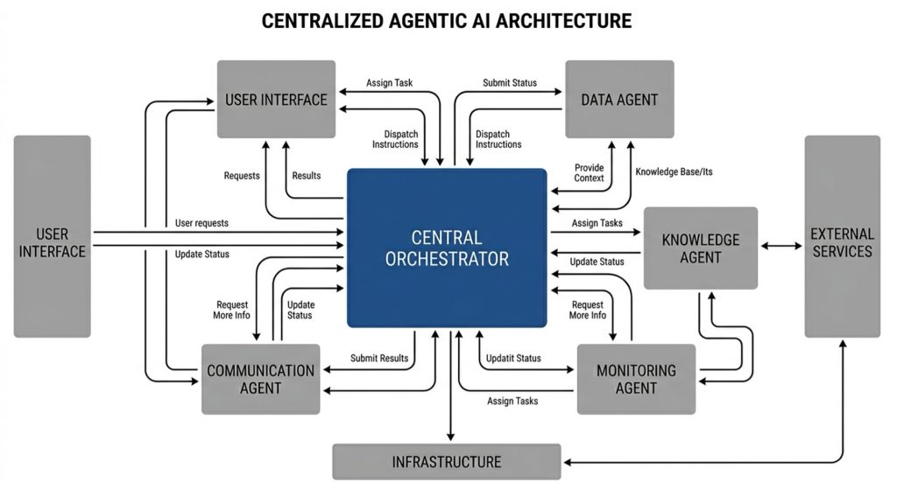<figcaption>중앙집중형: Orchestrator가 모든 위임을 맡아 병목</figcaption></figure>
  <figure class="fragment fade-up" data-fragment-index="1">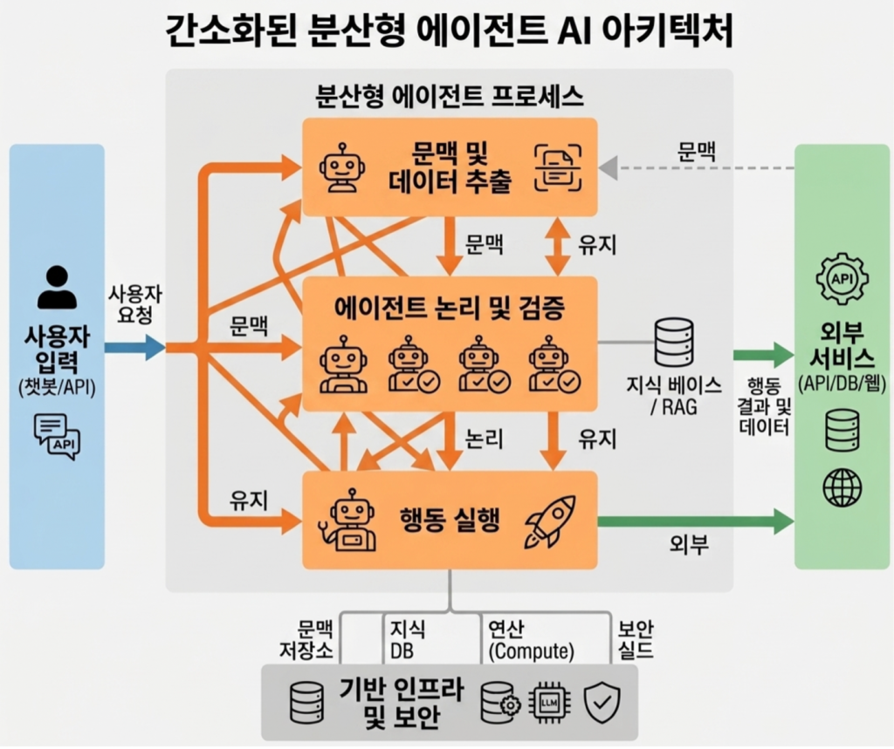<figcaption>분산형: 관련 에이전트만 후속 처리 후 통합</figcaption></figure>

출처: AWS 기술 블로그, <a href="https://aws.amazon.com/ko/blogs/tech/shinhan-card-ontology-based-decentralized-agentic-ai-chatbot/" target="_blank" rel="noopener">신한카드 온톨로지 기반 분산형 Agentic AI 챗봇 (2026-06)</a>

:::

:::notes
{timing: 1min}
[요약]
- 중앙 오케스트레이터가 모든 위임을 맡으면 병목
- 분산형: 모든 전문 에이전트가 동시에 "내 일인가"만 판단, 해당 에이전트만 후속 처리
- 에이전트 수가 늘어도 응답 시간이 크게 늘지 않음
- 미공개: 51개로 확장 시 여러 에이전트가 동시에 "내 일"이라고 할 때의 정리 방식

왼쪽처럼 중앙 오케스트레이터가 모든 걸 나눠 주면 그게 병목이 됩니다.
{cue: click}
신한카드는 오른쪽처럼 모든 전문 에이전트가 동시에 이 질문이 내 일인가만 판단하게 했습니다. 해당되는 에이전트만 이어서 처리하니, 에이전트 수가 늘어도 응답 시간이 크게 늘지 않습니다.
{cue: pause}
다만 51개로 확장했을 때 여러 에이전트가 동시에 내 일이라고 하면 어떻게 정리하는지는 아직 공개되지 않았습니다.
{cue: transition}
실제 AWS 구성입니다.
:::

---
<!-- Slide 10: 신한카드 AWS 아키텍처 -->
@type: content
@title: 신한카드 AWS 아키텍처

## 신한카드 AWS 아키텍처

Router Agent, 전문 에이전트(AgentCore Runtime), AgentCore Gateway(MCP), Bedrock

:::html

  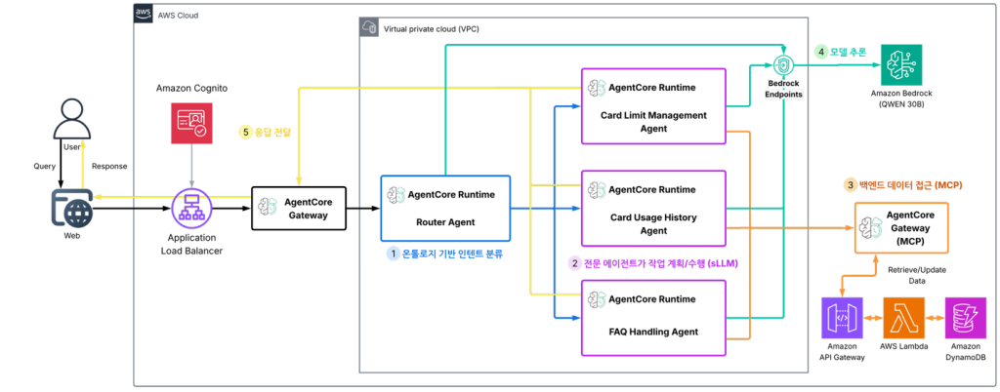
  
출처: AWS 기술 블로그, <a href="https://aws.amazon.com/ko/blogs/tech/shinhan-card-ontology-based-decentralized-agentic-ai-chatbot/" target="_blank" rel="noopener">신한카드 온톨로지 기반 분산형 Agentic AI 챗봇 (2026-06)</a>. 다이어그램의 QWEN 30B 표기와 달리 본문 수치는 Qwen3 32B 기준

:::

:::notes
{timing: 1min}
[요약]
- 1 Router Agent가 온톨로지로 의도 분류
- 2 한도 관리, 이용내역 조회, FAQ 등 전문 에이전트가 각각 AgentCore Runtime 위에서 소형 모델로
- 3 백엔드 데이터는 AgentCore Gateway(MCP)로 API Gateway, Lambda, DynamoDB
- 4 모델 추론은 VPC 엔드포인트로 Bedrock

실제 AWS 구성입니다. 번호 순서대로 보시면, 1번 Router Agent가 온톨로지로 의도를 분류하고, 2번 한도 관리, 이용내역 조회, FAQ 같은 전문 에이전트가 각각 AgentCore Runtime 위에서 소형 모델로 일을 수행합니다.
{cue: pause}
3번 백엔드 데이터는 AgentCore Gateway를 MCP로 거쳐 API Gateway, Lambda, DynamoDB에 접근하고, 4번 모델 추론은 VPC 엔드포인트로 Bedrock을 부릅니다. 다이어그램에는 QWEN 30B로 적혀 있고 본문 수치는 Qwen3 32B 기준입니다.
{cue: transition}
세 번째 혁신, 마이데이터 과제와 가장 가까운 부분입니다.
:::

---
<!-- Slide 11: Tikitaka -->
@type: content
@title: 자율 개선 루프 Tikitaka

## 자율 개선 루프 Tikitaka

합성 고객이 테스트하고 에이전트가 고친다: 수일에서 수주 걸리던 멀티턴 테스트를 자동 루프로

:::html

  
01 SIMULATE
시뮬레이션

실제 고객 데이터에서 도출한 페르소나의 Test Agent가 멀티턴 대화

  
02 DIAGNOSE
진단

Analyzer Agent가 비정상 패턴과 원인 코드, 함수까지 특정

  
03 PROPOSE
해결책 제안

Code Reviewer, Solution Designer Agent가 라우팅 로직과 수정안 제시

  
04 VERIFY
검증과 배포

같은 페르소나로 재테스트, Update Agent가 적용하고 모니터링

  

한도 조회와 상향 시나리오

7턴 실패 → 4턴 완료

개선 전: 고객번호 입력 요청만 반복. 개선 후: 조회와 상향까지 처리 (AI 평가자 확인)

  
TASK 01 마이데이터 상담
합성 고객 페르소나, 응답 품질 평가, 코칭과 같은 구조. AgentCore User Simulation과 Evaluations로 시뮬레이션과 채점 구간을 바로 구성

<strong class="text-danger">리스크</strong>: AI가 코드를 고쳐 배포하는 루프는 금융 변경관리 통제와 충돌합니다. Update 단계에는 사람 승인 게이트를 두세요.

출처: AWS 기술 블로그, <a href="https://aws.amazon.com/ko/blogs/tech/shinhan-card-ontology-based-decentralized-agentic-ai-chatbot/" target="_blank" rel="noopener">신한카드 온톨로지 기반 분산형 Agentic AI 챗봇 (2026-06)</a>

:::

:::notes
{timing: 1.5min}
[요약]
- 정적 스크립트로는 주제를 바꾸는 멀티턴 대화를 테스트하기 어려움. 실패 분석부터 재배포까지 수일에서 수주
- 시뮬레이션, 진단, 해결책 제안, 검증과 배포의 자동 루프
- 한도 상향: 개선 전 고객번호만 반복하며 7턴 실패, 개선 후 4턴 완료(AI 평가자 기준, 두 유즈케이스 검증)
- 은행에서는 Update 단계에 사람 승인 게이트 필수

신한카드 사례에서 마이데이터 상담 과제와 가장 가깝다고 본 부분이 이 자율 개선 루프, 티키타카입니다. 실제 고객처럼 주제를 바꿔 가며 여러 턴 대화하는 걸 정적 스크립트로 테스트하기는 어렵고, 실패를 분석해서 다시 배포하기까지 수일에서 수주가 걸렸습니다.
그래서 페르소나를 가진 테스트 에이전트가 챗봇과 대화하고, 분석 에이전트가 원인 코드까지 찾고, 리뷰 에이전트가 수정안을 내고, 같은 페르소나로 다시 테스트하는 루프를 만들었습니다.
{cue: click}
한도 상향 시나리오에서 개선 전에는 고객번호만 계속 묻다가 7턴 동안 처리를 못 했는데, 개선 후에는 4턴 만에 끝났습니다.
{cue: pause}
다만 AI 평가자 기준이고 두 개 유즈케이스에서 검증된 결과라는 점, 그리고 은행에서는 마지막 배포 단계에 사람 승인이 꼭 있어야 한다는 점을 같이 말씀드립니다.
{cue: transition}
세 번째 사례, 미래에셋증권입니다.
:::

---
<!-- Slide 12: 미래에셋 망분리 -->
@type: content
@title: CASE 3 미래에셋증권: 망분리 지식DB

## CASE 3 미래에셋증권: 망분리 지식DB

5호망 AWS Private Cloud의 지식DB, 망분리 예외 구간에서만 LLM 호출

:::html

  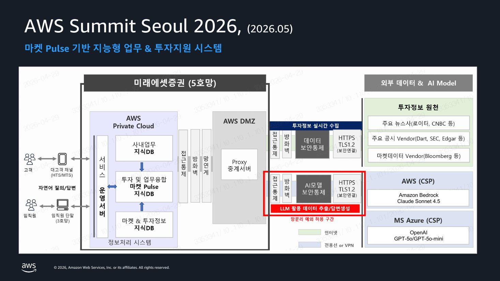
  
출처: 미래에셋증권 「AI-Ready Data: 온톨로지 기반 금융상품 지식 데이터 혁신 여정」 AWS FSI Forum 발표 (공개 링크 없음)

:::

:::notes
{timing: 1min}
[요약]
- 문제 정의: "LLM이 똑똑하지 않다"가 아니라 "데이터가 AI를 쓸 준비가 안 됐다"
- 5호망 AWS Private Cloud 안에 사내업무, 마켓 Pulse, 마켓과 투자정보 지식DB
- AWS DMZ 프록시를 거쳐 망분리 예외 허용 구간(빨간 박스)에서만 Bedrock Claude, Azure OpenAI 호출
- 혁신금융서비스로 지정받은 구조, 은행에도 참고

세 번째는 미래에셋증권입니다. 이 팀은 문제를 LLM이 똑똑하지 않다가 아니라 데이터가 AI를 쓸 준비가 안 됐다로 정의했습니다. 2부에서 본 세 가지 간극을 데이터 쪽에서 메운 사례입니다.
{cue: pause}
먼저 망 구성부터 보시면, 5호망 AWS Private Cloud 안에 사내업무, 마켓 Pulse, 마켓과 투자정보 지식DB가 있고, AWS DMZ의 프록시를 거쳐 빨간 박스로 표시된 망분리 예외 허용 구간에서만 Bedrock Claude와 Azure OpenAI를 호출합니다. 혁신금융서비스로 지정받은 구조라 은행에서도 참고가 되실 겁니다.
{cue: transition}
지식 파이프라인 네 단계입니다.
:::

---
<!-- Slide 13: 4-Task 파이프라인 -->
@type: content
@title: 4-Task 지식 파이프라인

## 4-Task 지식 파이프라인

AI-Ready Data: 수집과 파싱, 온톨로지 설계, 지식 추출, 질의와 검색

:::html

  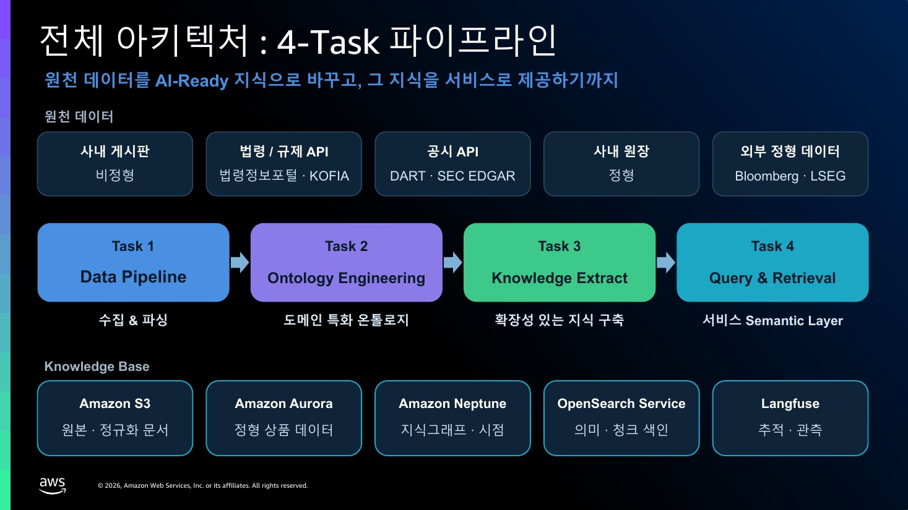
  
출처: 미래에셋증권 「AI-Ready Data: 온톨로지 기반 금융상품 지식 데이터 혁신 여정」 AWS FSI Forum 발표 (공개 링크 없음)

:::

:::notes
{timing: 1min}
[요약]
- Task 1: 간이투자설명서 PDF를 내부망 GPU의 OCR과 VLM으로 표와 그림까지 Markdown과 메타데이터로
- Task 2: 온톨로지가 답해야 할 질문 목록을 먼저 뽑고, 금융 표준 FIBO 위에서 개념 설계 후 검증
- Task 3: 원장 정형 데이터와 문서 사실을 하나의 개체로, 항상 참인 구조와 지금만 참인 사실을 다른 그래프에
- Task 4: 의도 파악, 대상 확정, 여러 저장소 동시 조회, 근거 목록 반환

네 단계 파이프라인입니다. 첫째, 간이투자설명서 같은 PDF를 내부망 GPU의 OCR과 VLM으로 표와 그림까지 읽어 Markdown과 메타데이터로 바꿉니다.
둘째, 온톨로지가 답해야 할 질문 목록을 먼저 뽑고, 금융 표준인 FIBO 위에서 개념을 설계한 뒤 그 질문에 답할 수 있는지 검증합니다. 2부 마지막에 "질문부터"라고 말씀드린 게 이 단계입니다.
{cue: pause}
셋째, 사내 원장의 정형 데이터와 문서의 사실을 하나의 개체로 합치고, 항상 참인 구조와 지금만 참인 시점 사실을 다른 그래프에 담습니다. 넷째, 질문 의도를 파악하고 대상을 확정한 뒤 여러 저장소를 동시에 조회해 근거 목록을 돌려줍니다.
{cue: transition}
이 과정에서 부딪힌 여섯 가지 문제입니다.
:::

---
<!-- Slide 14: 6대 Challenge -->
@type: content
@title: 6대 Challenge와 해법

## 6대 Challenge와 해법

법령과 업무 상식을 결정적인 규칙으로 옮기기

:::html

<table class="data-table rp-ch">
  <thead><tr><th>Challenge</th><th>해법</th></tr></thead>
  <tbody>
    <tr><td>1 Ontology Axioms</td><td>자본시장법 §229 집합투자기구 유형을 폐쇄집합으로. 별칭은 출처별 구분, 단일값과 상호배타 제약</td></tr>
    <tr><td>2 Ontology Sampler</td><td>축 기반 표본: AUM 상위 50개는 23개 축값 중 11개, Sampler 50개는 22개 커버</td></tr>
    <tr><td>3 Mapping Rules</td><td>YAML 규칙표로 코드 수정 없이 확장 (7 네임스페이스, 6 도메인, 이름 맞추기 12종)</td></tr>
    <tr><td>4 Thin, Temporal Graph</td><td>항상 참인 구조와 유효기간 있는 사실을 분리. 새 사실이 옛 사실을 자동 만료</td></tr>
    <tr class="hl"><td>5 Ontology Grounding</td><td>vocabulary.ttl로 미국국채를 해외채권으로 확정한 뒤 LLM은 질의만 조립. 실패 시 되묻기</td></tr>
    <tr class="hl"><td>6 Semantic Layer</td><td>배당은 분배율, 배당 질의에 투자지역 필터 금지, 브랜드에서 운용사 매핑</td></tr>
  </tbody>
</table>

<strong class="text-accent">TASK 01, 05</strong>: 사내 용어가 많은 과제일수록 5번 Grounding과 6번 Semantic Layer부터. 2부 D1이 바로 이 두 가지를 작게 재현한 것입니다.

출처: 미래에셋증권 「AI-Ready Data: 온톨로지 기반 금융상품 지식 데이터 혁신 여정」 AWS FSI Forum 발표 (공개 링크 없음)

:::

:::notes
{timing: 1min}
[요약]
- 1 Axioms(폐쇄집합, 단일값, 상호배타). 발표 원문은 "6종"으로 표기, 조문상 집합투자기구 종류는 5종(증권, 부동산, 특별자산, 혼합자산, 단기금융)이라 숫자는 생략, 2 Sampler(축 기반 표본), 3 YAML Mapping Rules, 4 Thin, Temporal Graph
- 5 Ontology Grounding: 사전으로 값을 확정한 뒤 LLM은 질의만 조립, 실패 시 되묻기
- 6 Semantic Layer: 담당자가 아는 업무 상식(배당은 분배율, 투자지역 필터 금지 등)
- 은행 과제에는 5번과 6번부터. 2부 D1이 이 둘을 재현

이 과정에서 부딪힌 여섯 가지 문제와 해법입니다. 은행 과제에 특히 가져가실 건 5번과 6번입니다.
사용자가 미국국채 알려줘라고 하면 DB에는 그런 값이 없습니다. 이걸 모델에게 설명하는 게 아니라, 질의를 만들기 전에 시스템이 사전을 조회해서 해외채권으로 확정해 주고, 확정이 안 되면 되묻게 했습니다.
{cue: pause}
그리고 담당자는 당연히 아는 업무 상식, 예를 들어 배당 질문엔 투자지역 필터를 걸면 안 된다 같은 걸 Semantic Layer로 따로 넣었습니다. 2부에서 보신 D1 데모가 바로 이 두 가지를 작게 재현한 것입니다. 마이데이터 상담이나 운영지식 위키처럼 사내 용어가 많은 과제에 그대로 적용됩니다.
{cue: transition}
검색 단계 구조입니다.
:::

---
<!-- Slide 15: Federated Query -->
@type: content
@title: Federated Query Architecture

## Federated Query Architecture

하나의 질문이 네 저장소를 동시에 조회하고, 근거로 합쳐짐

:::html

  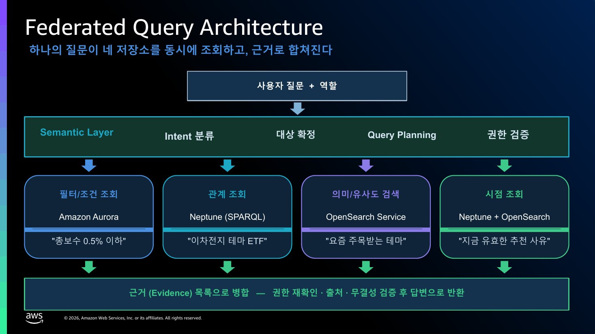
  
출처: 미래에셋증권 「AI-Ready Data: 온톨로지 기반 금융상품 지식 데이터 혁신 여정」 AWS FSI Forum 발표 (공개 링크 없음)

:::

:::notes
{timing: 1min}
[요약]
- 질문과 사용자 역할, Semantic Layer, 의도 분류, 대상 확정, 질의 계획, 권한 검증
- 조건 조회는 Aurora, 관계 조회는 Neptune(SPARQL), 의미 검색은 OpenSearch, 시점 조회는 Neptune과 OpenSearch
- 결과는 답변이 아니라 근거 목록, 권한을 한 번 더 확인 후 반환

검색 단계 구조입니다. 질문과 사용자 역할이 들어오면 Semantic Layer, 의도 분류, 대상 확정, 질의 계획, 권한 검증을 거쳐 네 저장소를 동시에 조회합니다.
{cue: pause}
총보수 0.5% 이하 같은 조건은 Aurora, 이차전지 테마 ETF 같은 관계는 Neptune, 요즘 주목받는 테마 같은 의미 검색은 OpenSearch, 지금 유효한 추천 사유 같은 시점 조회는 Neptune과 OpenSearch를 같이 씁니다. 2부에서 "벡터, 그래프, 온톨로지는 층"이라고 말씀드린 그림이 이것입니다. 결과는 답변이 아니라 근거 목록으로 합쳐지고, 권한을 한 번 더 확인한 뒤 반환됩니다.
{cue: transition}
무엇이 정확도를 올렸는지 보겠습니다.
:::

---
<!-- Slide 16: 45 → 84.7 -->
@type: content
@title: 무엇이 정확도를 끌어올렸나

## 무엇이 정확도를 끌어올렸나

국내 ETF 도메인, 자체 벤치마크 72문항, 구성요소를 하나씩 더하며 측정

:::html

  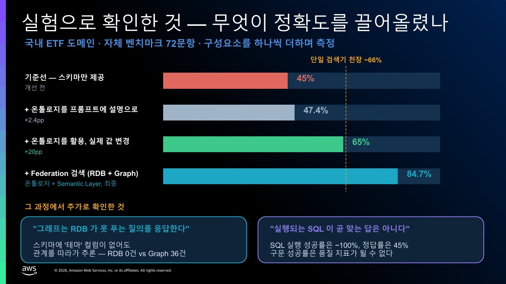
  
출처: 미래에셋증권 「AI-Ready Data: 온톨로지 기반 금융상품 지식 데이터 혁신 여정」 AWS FSI Forum 발표 (공개 링크 없음)

:::

:::notes
{timing: 1min}
[요약]
- 스키마만 45%, 온톨로지를 프롬프트 설명으로 +2.4%p, 실제 DB 값으로 확정 65%, 연합 검색과 Semantic Layer 84.7%
- SQL 실행 성공률은 거의 100%인데 정답률은 45%: 에러 없이 돈다고 맞는 답이 아님
- 72문항, 국내 ETF 한정 결과
- 2부 D1(50%, 33%, 92%)과 같은 방향

구성요소를 하나씩 더하면서 측정한 결과입니다. 테이블 스키마만 주면 정답률 45%입니다. 여기에 온톨로지를 프롬프트에 설명으로 넣어 주면 고작 2.4%p 오릅니다. 그런데 온톨로지를 써서 사용자가 쓴 말을 실제 DB 값으로 확정해 주면 65%로 뛰고, 관계형 DB와 그래프를 함께 조회하는 연합 검색과 업무 상식을 담은 Semantic Layer까지 붙이면 84.7%가 됩니다. 2부 D1에서 보신 결과와 같은 방향입니다.
{cue: pause}
가장 강조하고 싶은 건 아래 왼쪽입니다. SQL이 에러 없이 실행된다고 맞는 답은 아닙니다. 실행 성공률은 거의 100%인데 정답률은 45%였습니다. 72문항, 국내 ETF 한정 결과라는 점은 감안해 주세요.
{cue: transition}
이 서비스가 상용화되는 과정입니다.
:::

---
<!-- Slide 17: 혁신금융서비스 여정 -->
@type: content
@title: PoC 이후: 혁신금융서비스 여정

## PoC 이후: 혁신금융서비스 여정

기술 트랙과 규제 트랙을 병렬로, 일정은 발표 시점 기준

:::html

  
2025.12<b>서비스 신청</b>완료

  
2026.03<b>지정 고시</b>완료

  
2026.07<b>금융보안원 보안대책 평가</b>완료

  
2026.08<b>금감원 개시 신청</b>진행 중

  
2026.09<b>임직원 오픈</b>예정

  
2027.1Q<b>대고객 오픈</b>예정

<table class="data-table rp-ph fragment fade-up" data-fragment-index="2">
  <thead><tr><th>Phase</th><th>기간</th><th>내용</th></tr></thead>
  <tbody>
    <tr><td>Phase 1</td><td>2026.02~03</td><td>상품지식 EBA: GraphRAG Toolkit으로 Ontology, ER, Search 방법론 검증</td></tr>
    <tr><td>Phase 2</td><td>2026.04~09</td><td>지식DB와 지식검색서비스 구축 (AWS Professional Services 협업)</td></tr>
    <tr><td>Phase 3</td><td>2026.10~</td><td>전사 AI 표준 지식 기반, AI-Ready Data 거버넌스</td></tr>
  </tbody>
</table>

출처: 미래에셋증권 「AI-Ready Data: 온톨로지 기반 금융상품 지식 데이터 혁신 여정」 AWS FSI Forum 발표 (공개 링크 없음). 최신 상황은 별도 확인 필요

:::

:::notes
{timing: 1min}
[요약]
- 2025.12 신청, 2026.03 지정, 2026.07 금융보안원 생성형 AI 보안대책 평가, 2026.08 금감원 개시 신청
- 임직원 오픈 후 2027년 1분기 대고객 오픈 목표
- 신청부터 대고객 오픈까지 1년 이상: 기술 PoC와 규제 트랙을 처음부터 병렬로
- 일정은 발표 시점 기준

이 서비스가 혁신금융서비스로 상용화되는 과정입니다. 이번 과제가 PoC로 끝나지 않으려면 이 부분을 미리 보셔야 해서 넣었습니다.
작년 12월에 신청해서 올해 3월에 지정됐고, 7월에 금융보안원 생성형 AI 보안대책 평가를 마쳤고, 8월에 금감원 개시 신청을 했습니다. 임직원 오픈 후 내년 1분기 대고객 오픈이 목표입니다.
{cue: pause}
신청부터 대고객 오픈까지 1년이 넘게 걸리기 때문에, 기술 PoC와 규제 트랙을 처음부터 같이 굴려야 한다는 게 핵심입니다. 일정은 발표 시점 기준이라 최신 상황은 따로 확인이 필요합니다.
{cue: transition}
네 번째, 금융은 아니지만 꼭 보여드리고 싶은 Canva입니다.
:::

---
<!-- Slide 18: Canva 세 가지 실패 -->
@type: content
@title: CASE 4 Canva: 프로덕션의 세 가지 실패

## CASE 4 Canva: 프로덕션의 세 가지 실패

Canva Code가 스케일 전에 먼저 만든 것, Amazon Bedrock 기반

:::html

  

    

Monolithic prompt

한 모델이 다섯 가지 일을 하며 최고가 모델 요금을 다섯 번 낸다

    

기계적 작업에 확률적 생성

CSS 클래스 하나 바꾸려고 HTML 8,000 토큰을 다시 생성

    

Vibes 기반 마이그레이션

평가가 없으니 신호도 없고, 새 모델이 나오면 hype로 배포

  

  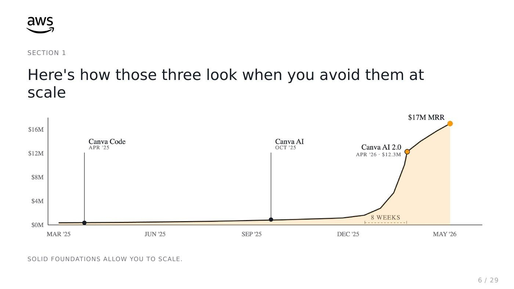

출처: <a href="https://youtu.be/4EJJwXseuzw" target="_blank" rel="noopener">ANT105 Agentic Engineering, Lessons from Canva (Bryn Price, AWS)</a>; AWS Prescriptive Guidance, Agentic Design Patterns (2026-05); <a href="https://aws.amazon.com/ko/solutions/case-studies/innovators/canva/" target="_blank" rel="noopener">Canva 고객 사례</a>

:::

:::notes
{timing: 1min}
[요약]
- Canva Code(코드 생성 기능)는 Bedrock 기반, 출시 후 매출 급증, 8주 만에 트래픽 6배
- 버틴 이유: PoC에서 프로덕션으로 갈 때 흔한 세 실패를 미리 피함
- 한 모델에 다 시키는 프롬프트, 기계적 작업까지 모델이 새로 쓰기, 평가 없이 느낌으로 모델 교체

네 번째는 금융은 아니지만 꼭 보여드리고 싶은 Canva입니다. 디자인 플랫폼 Canva의 코드 생성 기능인 Canva Code는 Bedrock 위에서 돌아가는데, 오른쪽처럼 출시 후 매출이 급격히 늘었고 8주 만에 트래픽이 6배가 됐습니다.
{cue: pause}
그때 버틸 수 있었던 건 PoC에서 프로덕션으로 갈 때 흔히 무너지는 세 가지를 미리 피했기 때문이라고 합니다. 한 모델에 다 시키는 프롬프트, 기계적인 작업까지 모델이 새로 쓰게 하는 것, 그리고 평가 없이 느낌으로 모델을 바꾸는 것입니다.
{cue: transition}
첫 번째 교훈입니다.
:::

---
<!-- Slide 19: Lesson 1 -->
@type: content
@title: Lesson 1: 모델 말고 에이전트를 분해하라

## Lesson 1: 모델 말고 에이전트를 분해하라

Architect(Opus)가 계획, Builder와 Editor(Haiku)가 실행

:::html

  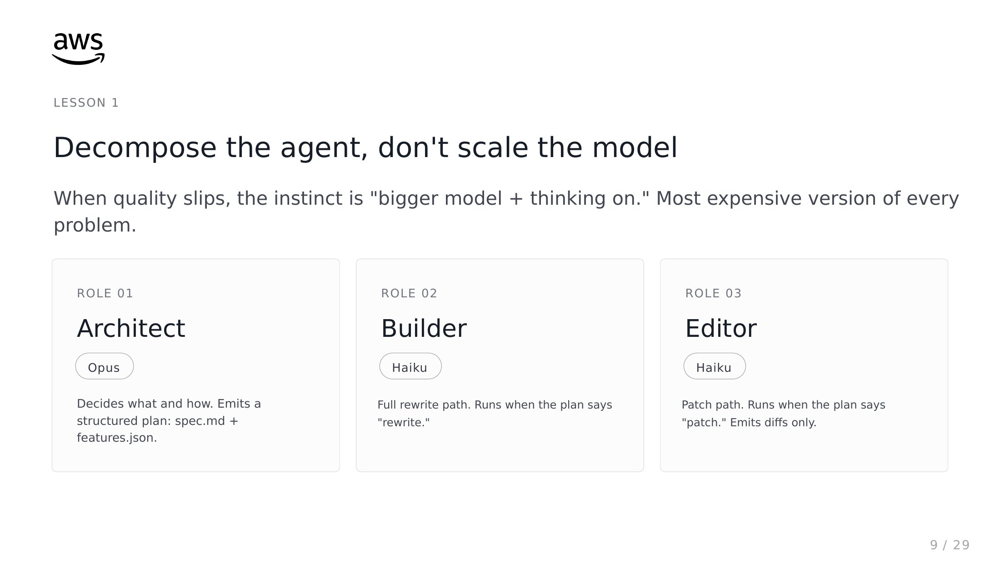
  
출처: <a href="https://youtu.be/4EJJwXseuzw" target="_blank" rel="noopener">ANT105 Agentic Engineering, Lessons from Canva (Bryn Price, AWS)</a>; AWS Prescriptive Guidance, Agentic Design Patterns (2026-05); <a href="https://aws.amazon.com/ko/solutions/case-studies/innovators/canva/" target="_blank" rel="noopener">Canva 고객 사례</a>

:::

:::notes
{timing: 1min}
[요약]
- 품질이 떨어지면 더 큰 모델에 thinking을 켜는 게 본능이지만 가장 비싼 해법
- Architect(Opus)는 계획만, 전체를 다시 쓸 일은 Builder, 일부만 고칠 일은 Editor(Haiku)
- LG전자의 Planner, Coder 구조와 같은 생각

품질이 떨어지면 더 큰 모델에 thinking을 켜는 게 본능인데, 그게 가장 비싼 해법입니다.
{cue: pause}
Canva는 역할을 셋으로 나눴습니다. Architect는 Opus로 무엇을 어떻게 만들지 계획만 하고, 전체를 다시 쓸 일이면 Builder, 일부만 고칠 일이면 Editor가 Haiku로 실행합니다. LG전자의 Planner, Coder 구조와 같은 생각입니다.
{cue: transition}
최종적으로 도달한 구조입니다.
:::

---
<!-- Slide 20: 최종 구조 -->
@type: content
@title: 최종 구조: Sonnet + sub-agent

## 최종 구조: Sonnet + sub-agent

Sonnet 주 스레드, 평균 총비용 −46%, 사용자 성공 지표 +9%

:::html

  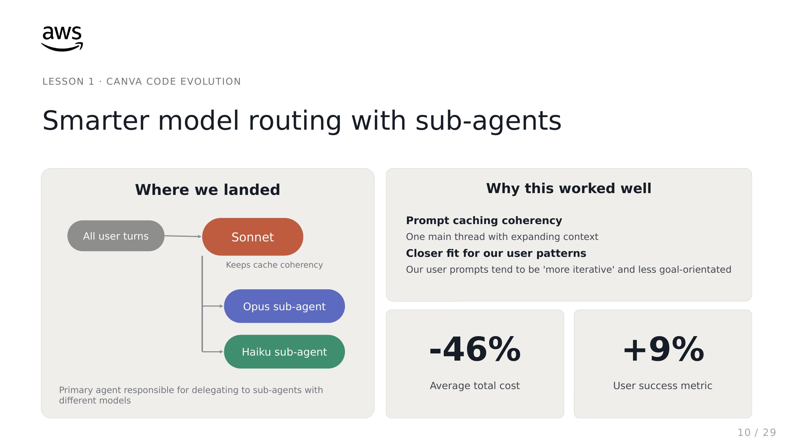
  
출처: <a href="https://youtu.be/4EJJwXseuzw" target="_blank" rel="noopener">ANT105 Agentic Engineering, Lessons from Canva (Bryn Price, AWS)</a>; AWS Prescriptive Guidance, Agentic Design Patterns (2026-05); <a href="https://aws.amazon.com/ko/solutions/case-studies/innovators/canva/" target="_blank" rel="noopener">Canva 고객 사례</a>

:::

:::notes
{timing: 1min}
[요약]
- Sonnet 하나가 모든 대화를 하나의 스레드로, 어려운 추론은 Opus, 단순 작업은 Haiku sub-agent
- 스레드가 하나라 같은 캐시를 탐: 비용 절감의 큰 부분이 캐시
- 평균 총비용 46% 감소, 사용자 성공 지표 9% 상승

최종적으로는 Sonnet 하나가 모든 대화를 하나의 스레드로 처리하고, 어려운 추론은 Opus, 단순 작업은 Haiku sub-agent에 맡기는 구조가 됐습니다.
{cue: pause}
대화 스레드가 하나로 유지되니 매번 같은 캐시를 타서, 비용 절감의 큰 부분이 모델이 싸서가 아니라 캐시에서 나왔다고 합니다. 평균 총비용이 46% 줄고 사용자 성공 지표는 9% 올랐습니다.
{cue: transition}
두 번째와 세 번째 교훈입니다.
:::

---
<!-- Slide 21: Lesson 2, 3 -->
@type: content
@title: Lesson 2, 3: 결정론적 도구와 평가

## Lesson 2, 3: 결정론적 도구와 평가

모델은 확률적 권한, 주변 코드는 결정론적 권한

:::html

  

    LESSON 2
    
replace_text: 정확히 일치하는 부분만 교체

    
유일하게 일치하지 않으면 에러를 내고 모델이 재시도합니다.

    
~40× patch 경로 출력 토큰 감소 (약 8,000에서 약 200)

  

  

    LESSON 3
    
Eval이 마이그레이션의 활주로다

    <table class="data-table">
      <thead><tr><th>Opus 4.6 High</th><th>출력 토큰</th><th>지연</th><th>WCAG AA</th></tr></thead>
      <tbody>
        <tr><td>thinking 끔</td><td>11k</td><td>138s</td><td>1 / 10</td></tr>
        <tr><td>thinking 켬</td><td>37k (3.4×)</td><td>530s (3.8×)</td><td>2 / 10</td></tr>
      </tbody>
    </table>
    
토큰 3.4배, 지연 3.8배로 10개 중 1건 더 통과해서 thinking을 끈 채로 배포. 품질(WCAG, axe-core), 토큰 비용, 지연 3축으로 모든 모델 교체를 검증

  

<strong class="text-accent">같은 원리</strong>: 신한카드 규칙 매칭, 미래에셋 Grounding, 2부의 "규칙 강제" 자리. 지켜야 할 것은 코드로, 판단만 모델에게

출처: <a href="https://youtu.be/4EJJwXseuzw" target="_blank" rel="noopener">ANT105 Agentic Engineering, Lessons from Canva (Bryn Price, AWS)</a>; AWS Prescriptive Guidance, Agentic Design Patterns (2026-05); <a href="https://aws.amazon.com/ko/solutions/case-studies/innovators/canva/" target="_blank" rel="noopener">Canva 고객 사례</a>

:::

:::notes
{timing: 1.5min}
[요약]
- Lesson 2: replace_text, 정확히 한 군데 일치할 때만 교체, 아니면 에러로 재시도. 출력 토큰 약 40분의 1
- Lesson 3: 새 모델마다 품질, 토큰 비용, 지연 3축 평가. thinking 켜면 토큰 3.4배, 지연 3.8배, 10개 중 1건만 더 통과해 끈 채로 배포
- 신한카드 규칙 매칭, 미래에셋 값 확정과 같은 원리: 지켜야 할 것은 코드로

두 번째 교훈은 결정론입니다. 대부분의 편집은 창의적인 일이 아닙니다. 그래서 정확히 일치하는 부분만 바꾸는 replace_text 도구를 만들었고, 원래 코드가 정확히 한 군데만 맞지 않으면 에러를 내서 모델이 다시 시도하게 했습니다. 모델이 엉뚱한 코드를 고칠 수 없는 구조라서 출력 토큰이 40분의 1로 줄었습니다.
{cue: click}
세 번째는 평가입니다. 새 모델이 나올 때마다 품질, 토큰 비용, 지연 세 축으로 평가했는데, thinking을 켜니 토큰 3.4배, 지연 3.8배를 쓰고 10개 중 1건만 더 통과했습니다. 그래서 thinking을 끄고 배포했습니다.
{cue: pause}
앞에서 본 신한카드의 규칙 매칭, 미래에셋의 값 확정, 그리고 2부의 규칙 강제 자리와 같은 원리입니다. 지켜야 할 것은 코드로, 판단만 모델에게 맡깁니다.
{cue: transition}
Canva 발표에서 소개된 디자인 패턴 여덟 가지를 과제에 연결해 봤습니다.
:::

---
<!-- Slide 22: Agentic Design Patterns 8 -->
@type: content
@title: Agentic Design Patterns 8종

## Agentic Design Patterns 8종

AWS Prescriptive Guidance, 과제의 어느 지점에 어떤 패턴을 쓸지

:::html

<table class="data-table rp-pt">
  <thead><tr><th>패턴</th><th>해법</th><th>PoC 과제 연결</th></tr></thead>
  <tbody>
    <tr><td>Agentic Loop</td><td>도구 결과를 한 메시지로 묶어 재호출, 반복 상한</td><td>모든 과제의 뿌리</td></tr>
    <tr><td>Deterministic Override</td><td>pre-tool hook으로 반드시 지킬 규칙 강제</td><td>TASK 01 상담 금지 표현, 고액 처리</td></tr>
    <tr><td>Tool Gate</td><td>선행 도구가 성공하기 전 호출 차단</td><td>TASK 04 분류, 추출, 대조 순서</td></tr>
    <tr><td>Validation-Retry</td><td>앱 코드로 검증 후 원문 에러로 재시도, 2회 상한</td><td>TASK 03 수치 검증, TASK 04 필드 검증</td></tr>
    <tr><td>Structured Error</td><td>transient, validation, permission, prerequisite 4분류</td><td>TASK 06 조치 권한 오류 재시도 금지</td></tr>
    <tr><td>Confidence Routing</td><td>0~1 점수 대신 4개 이름 라벨로 사람 검토 선별</td><td>TASK 04 불확실 서류만 사람 검토</td></tr>
    <tr><td>Review Pass</td><td>이진 루브릭 5개 이내로 2차 검토</td><td>TASK 02 디자인 규칙, TASK 03 인용 점검</td></tr>
    <tr><td>Coordinator-Subagent</td><td>병렬 디스패치, 겹치지 않는 영역</td><td>TASK 05, 06 지식, 코드, DB 에이전트 분리</td></tr>
  </tbody>
</table>

출처: <a href="https://youtu.be/4EJJwXseuzw" target="_blank" rel="noopener">ANT105 Agentic Engineering, Lessons from Canva (Bryn Price, AWS)</a>; AWS Prescriptive Guidance, Agentic Design Patterns (2026-05); <a href="https://aws.amazon.com/ko/solutions/case-studies/innovators/canva/" target="_blank" rel="noopener">Canva 고객 사례</a>

:::

:::notes
{timing: 1min}
[요약]
- 8개 패턴을 이번 PoC 과제에 연결한 표
- 서류 점검: Tool Gate로 분류, 추출, 대조 순서 강제 + Confidence Routing으로 불확실한 서류만 사람에게
- 관제: Structured Error로 권한 오류 재시도 금지
- 공유 자료에 표가 있으니 과제 설계 체크리스트로

Canva 발표에서 소개된 에이전트 디자인 패턴 여덟 가지를 이번 PoC 과제에 연결해 봤습니다.
예를 들어 서류 점검 과제라면 분류, 추출, 대조 순서를 Tool Gate로 강제하고, 확신이 낮은 서류만 Confidence Routing으로 사람에게 넘기면 됩니다.
{cue: pause}
관제 과제라면 권한 오류를 재시도하지 않도록 오류를 구조화하는 패턴이 중요합니다. 이 표는 공유 자료에 넣어 두었으니 과제 설계하실 때 체크리스트처럼 써 주세요.
{cue: transition}
이 패턴들이 어떻게 조합되는지 보겠습니다.
:::

---
<!-- Slide 23: 루프 -->
@type: content
@title: 모든 패턴은 루프의 한 단계를 고친다

## 모든 패턴은 루프의 한 단계를 고친다

Agentic Loop를 먼저 제대로 만들고, 필요한 지점에만 패턴을 추가

:::html

  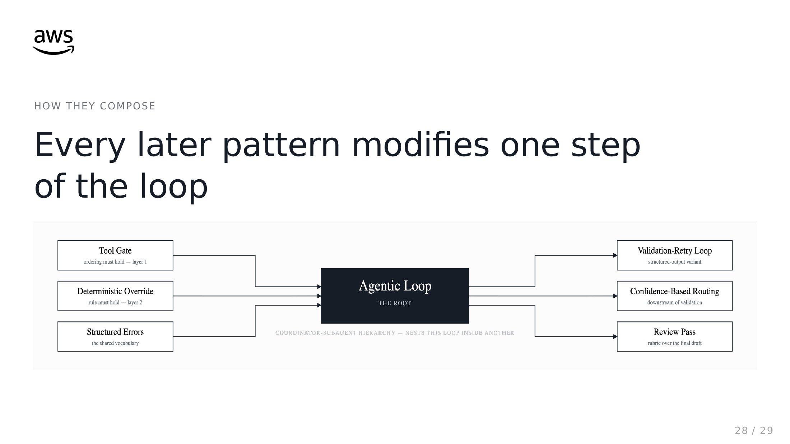
  
출처: <a href="https://youtu.be/4EJJwXseuzw" target="_blank" rel="noopener">ANT105 Agentic Engineering, Lessons from Canva (Bryn Price, AWS)</a>; AWS Prescriptive Guidance, Agentic Design Patterns (2026-05); <a href="https://aws.amazon.com/ko/solutions/case-studies/innovators/canva/" target="_blank" rel="noopener">Canva 고객 사례</a>

:::

:::notes
{timing: 0.5min}
[요약]
- 가운데 기본 루프, 도구 호출 지점에 Tool Gate, Deterministic Override, 오류 분류
- 결과 지점에 검증 재시도, 신뢰도 라우팅, 리뷰
- 루프를 먼저 단단하게 만드는 게 출발점

여덟 가지 패턴이 어떻게 조합되는지 보여주는 그림입니다. 가운데 기본 루프가 있고, 도구를 호출하는 지점에 Tool Gate, Deterministic Override, 오류 분류가 붙고, 결과가 나오는 지점에 검증 재시도, 신뢰도 라우팅, 리뷰가 붙습니다.
{cue: pause}
결국 루프를 먼저 단단하게 만드는 게 출발점입니다.
{cue: transition}
네 사례를 나란히 놓고 정리하겠습니다.
:::

---
<!-- Slide 24: 공통점 -->
@type: content
@title: 네 사례의 공통점: 지식, 역할, 평가

## 네 사례의 공통점: 지식, 역할, 평가

모델을 바꾸기 전에 세 가지를 먼저 설계

:::html

<table class="data-table rp-cm">
  <thead><tr><th>패턴</th><th>LG전자</th><th>신한카드</th><th>미래에셋증권</th><th>Canva</th></tr></thead>
  <tbody>
    <tr class="fragment fade-up" data-fragment-index="1"><td>지식 구조화</td><td>에이전트 간 원본 누적 기록</td><td>Domain, Action, Tag 인텐트 온톨로지</td><td>FIBO 기반 온톨로지 + Semantic Layer</td><td>features.json 스펙, 프로젝트 파일 3종</td></tr>
    <tr class="fragment fade-up" data-fragment-index="2"><td>역할 분리와 검증</td><td>Planner, Supervisor, Validator</td><td>내 일인가 판단하는 분산형 에이전트</td><td>근거, 권한, 출처 검증 후 반환</td><td>Architect, Builder, Editor + exact-match 도구</td></tr>
    <tr class="fragment fade-up" data-fragment-index="3"><td>평가 루프</td><td>계획 대비 Task Tracking</td><td>페르소나 시뮬레이션 후 재테스트</td><td>72문항 벤치마크로 단계별 측정</td><td>품질, 비용, 지연 3축 eval</td></tr>
    <tr class="num fragment fade-up" data-fragment-index="4"><td>대표 수치</td><td>3일 → 30분</td><td>84.2% → 91.0%</td><td>45% → 84.7%</td><td>비용 −46%, 성공 +9%</td></tr>
  </tbody>
</table>
:::

:::notes
{timing: 1min}
[요약]
- 지식 구조화: 원본 누적(LG), 인텐트 온톨로지(신한), FIBO 온톨로지와 Semantic Layer(미래에셋), 스펙 파일(Canva)
- 역할 분리와 검증: Planner와 Validator, 분산형, 근거와 권한 검증, Architect와 exact-match 도구
- 평가 루프: Task Tracking, 페르소나 시뮬레이션, 72문항 벤치마크, 3축 eval
- 이 세 가지가 데모의 설득력을 만든다

네 사례를 나란히 놓으면 공통점이 분명합니다. 모두 모델을 바꾸는 것보다 먼저 지식을 구조화했습니다. LG전자는 에이전트 사이 정보를 원본 그대로 쌓았고, 신한카드는 의도를 세 속성으로 쪼갠 온톨로지를, 미래에셋증권은 금융 표준 위에 온톨로지와 업무 상식 계층을, Canva는 만들 화면을 스펙 파일로 정의했습니다.
{cue: click}
둘째, 역할을 나누고 검증을 붙였습니다. 셋째, 평가 루프가 있었습니다.
{cue: pause}
이 세 가지가 데모의 설득력을 만든다고 생각합니다. 이제 과제별로 닮은 사례를 보겠습니다.
{cue: transition}
4부, 과제별 닮은 사례입니다.
:::
