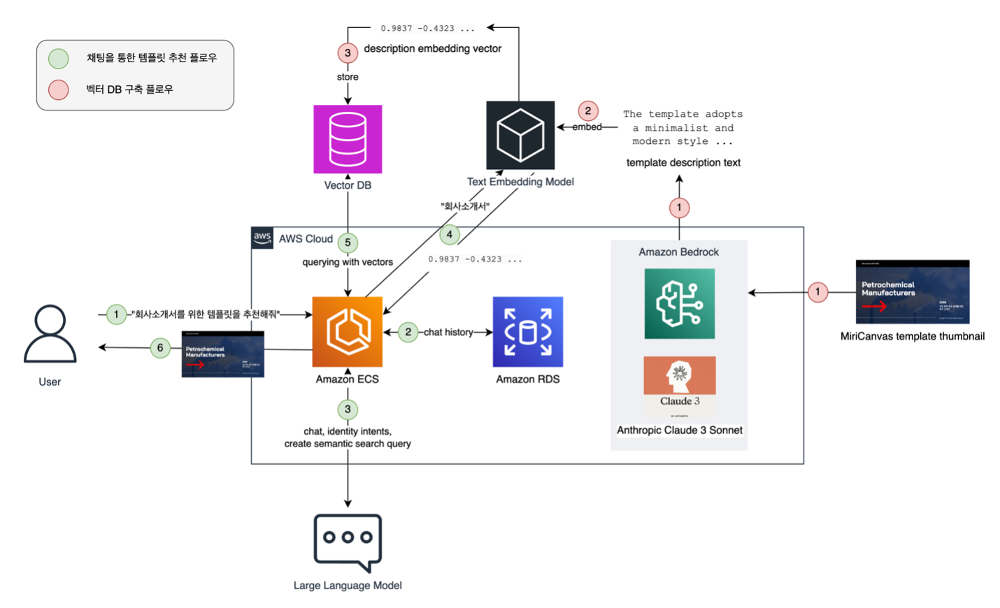

---
<!-- Slide 1: 4부 구분 -->
@type: section

# 과제별 닮은 사례

6개 과제와 국내외 사례, 각 과제에 가져올 포인트

:::script
(function () {
  // Click-to-zoom for architecture figures: opens the image over the whole viewport.
  if (window.__rpLightbox) return;
  window.__rpLightbox = true;
  var css = document.createElement('style');
  css.textContent =
    '.slide img.rp-zoomable { cursor: zoom-in; }' +
    '.rp-lb { position: fixed; inset: 0; z-index: 100000; display: none; align-items: center; justify-content: center; background: color-mix(in srgb, black 95%, transparent); cursor: zoom-out; }' +
    '.rp-lb.open { display: flex; }' +
    '.rp-lb img { width: 96vw; height: 92vh; object-fit: contain; }' +
    '.rp-lb span { position: fixed; bottom: 12px; left: 50%; transform: translateX(-50%); color: white; font-size: 14px; opacity: .7; }';
  document.head.appendChild(css);
  var lb = document.createElement('div');
  lb.className = 'rp-lb';
  lb.innerHTML = '클릭하거나 Esc를 누르면 닫힙니다';
  var big = lb.querySelector('img');
  function close() { lb.classList.remove('open'); }
  lb.addEventListener('click', close);
  function mount() {
    document.body.appendChild(lb);
    document.querySelectorAll('.slide img[src^="media/"]').forEach(function (img) {
      if (/\/ac-/.test(img.getAttribute('src'))) return;
      img.classList.add('rp-zoomable');
      img.title = '클릭하면 크게 보기';
      img.addEventListener('click', function (e) {
        e.stopPropagation();
        big.src = img.src; big.alt = img.alt;
        lb.classList.add('open');
      });
    });
  }
  if (document.readyState === 'loading') document.addEventListener('DOMContentLoaded', mount); else mount();
  // While open, swallow deck keys so arrows do not change slides; Esc closes.
  document.addEventListener('keydown', function (e) {
    if (!lb.classList.contains('open')) return;
    e.stopPropagation(); e.preventDefault();
    if (e.key === 'Escape' || e.key === 'Enter' || e.key === ' ') close();
  }, true);
})();
:::

:::script
(function () {
  // Hover (or focus) glossary: elements with data-tip show a one-line explanation near the term.
  if (window.__rpTips) return;
  window.__rpTips = true;
  var css = document.createElement('style');
  css.textContent =
    '.rp-tip { border-bottom: 2px dotted var(--accent); cursor: help; }' +
    '.rp-tipbox { position: fixed; z-index: 100001; max-width: min(38vw, 720px); padding: .6em .9em; border-radius: 8px;' +
    ' background: var(--text-primary); color: var(--bg-primary); font-size: clamp(14px, 1.75vh, 38px); line-height: 1.45;' +
    ' box-shadow: 0 6px 24px color-mix(in srgb, black 35%, transparent); pointer-events: none; opacity: 0; transition: opacity .12s; word-break: keep-all; }' +
    '.rp-tipbox.on { opacity: 1; }';
  document.head.appendChild(css);
  var box = document.createElement('div');
  box.className = 'rp-tipbox';
  box.setAttribute('role', 'tooltip');
  function show(t) {
    box.textContent = t.getAttribute('data-tip');
    box.classList.add('on');
    var r = t.getBoundingClientRect(), b = box.getBoundingClientRect();
    var x = Math.min(Math.max(8, r.left + r.width / 2 - b.width / 2), window.innerWidth - b.width - 8);
    var y = r.top - b.height - 10;
    if (y < 8) y = r.bottom + 10;
    box.style.left = x + 'px'; box.style.top = y + 'px';
  }
  function hide() { box.classList.remove('on'); }
  function mount() {
    document.body.appendChild(box);
    document.addEventListener('mouseover', function (e) { var t = e.target.closest && e.target.closest('.slide [data-tip]'); if (t) show(t); });
    document.addEventListener('mouseout', function (e) { if (e.target.closest && e.target.closest('.slide [data-tip]')) hide(); });
    document.addEventListener('focusin', function (e) { var t = e.target.closest && e.target.closest('.slide [data-tip]'); if (t) show(t); });
    document.addEventListener('focusout', hide);
    window.addEventListener('hashchange', hide);
  }
  if (document.readyState === 'loading') document.addEventListener('DOMContentLoaded', mount); else mount();
})();
:::

:::notes
{timing: 0.5min}
[요약]
- 4부: 과제별로 한 장씩 닮은 사례
- 국내 금융사 사례 우선, 없으면 국내 비금융이나 해외 금융사 사례
- 모두 AWS 공식 블로그나 고객 발표에서 확인한 사례, 수치는 원문 그대로

여기서부터는 과제별로 한 장씩 닮은 사례를 보겠습니다. 국내 금융사 사례를 우선 찾았고, 없는 과제는 국내 비금융이나 해외 금융사 사례로 채웠습니다.
모두 AWS 공식 블로그나 고객 발표에서 확인한 사례이고, 수치는 원문 그대로 옮겼습니다.
{cue: transition}
한눈에 먼저 보겠습니다.
:::

---
<!-- Slide 2: 한눈에 -->
@type: content
@title: 6개 과제와 국내외 사례 한눈에

## 6개 과제와 국내외 사례 한눈에

패턴이 같은 과제(1과 5, 2와 3, 4와 6)는 서로의 사례도 함께 보기

:::html

<table class="data-table rp-map">
  <thead><tr><th>과제</th><th>닮은 사례</th><th>가져올 포인트</th></tr></thead>
  <tbody>
    <tr><td>TASK 01<b>마이데이터 자산관리 상담</b></td><td>PropHero, NewDay, 신한카드</td><td>근거 기반 답변 + 대화마다 자동 채점</td></tr>
    <tr><td>TASK 02<b>UX 디자인 기획</b></td><td>미리디(미리캔버스), 위메이드플레이, 카카오스타일, Canva</td><td>화면 자산을 구조화 스펙으로, 그 위에서 생성과 점검</td></tr>
    <tr><td>TASK 03<b>보고서 작성(리서치)</b></td><td>LG전자, 링크알파, 서울경제신문</td><td>작성자와 검증자 분리, 인용 자동 점검</td></tr>
    <tr><td>TASK 04<b>고객 제출서류 누락 점검</b></td><td>Rocket Close, Sun Finance, 카카오페이손해보험</td><td>문서 분류, 항목 정의서 기반 추출과 대조</td></tr>
    <tr><td>TASK 05<b>IT 운영지식 위키</b></td><td>카카오페이증권 춘시리, A1Mobilsoft</td><td>위키 주기 동기화 + 좋은 답만 지식으로 승격</td></tr>
    <tr><td>TASK 06<b>AI 기반 통합관제</b></td><td>GS리테일, 삼성계정, 토스뱅크 ZeroOps</td><td>로그, 지표, 변경 이력 교차 분석. 조치는 사람 승인</td></tr>
  </tbody>
</table>

사례 출처는 각 과제 장 하단에 표기

:::

:::notes
{timing: 0.5min}
[요약]
- 6개 과제마다 닮은 사례 두세 개(UX는 네 개)와 가져올 포인트 한 줄
- 패턴이 같은 과제는 서로의 사례도 참고: 1과 5(지식 기반 응답), 2와 3(조사와 생성), 4와 6(판독과 진단)
- 각 장 하단에 원문 출처

한 장으로 정리한 표입니다. 과제마다 닮은 사례 두세 개와 가져올 포인트를 한 줄씩 적었습니다.
{cue: pause}
패턴이 같은 과제, 1번과 5번, 2번과 3번, 4번과 6번은 서로의 사례도 같이 보시면 좋습니다. 하나씩 보겠습니다.
{cue: transition}
과제 1, 마이데이터 상담입니다.
:::

---
<!-- Slide 3: TASK 01 -->
@type: content
@title: TASK 01 마이데이터: 근거로 답하고 채점

## TASK 01 마이데이터: 근거로 답하고 채점

과제 목표: 합성 고객 페르소나로 자산 현황 진단, 근거와 함께 답하는 상담 봇, 품질 평가와 코칭

:::html

  
해외 금융, 부동산 투자 자문
PropHero

멀티 에이전트 상담 + Knowledge Bases 근거 답변. 대화가 저장될 때마다 LLM-as-a-Judge가 채점하고 CloudWatch 알림

<b>90%</b>목표 달성 정확도

<b>−30%</b>고객 상담 업무량

  
해외 금융, 영국 소비자 신용
NewDay

상담원 지원(Agent Assist) RAG. 100문항 이상 골든셋으로 평가해 기준을 넘어야 배포, 운영 중엔 사용자 피드백 수집

<b>90초 → 4초</b>답을 찾는 시간

<b>90%+</b>정확도 (초기 60% 미만)

  
AWS 기능, 바로 실험
User Simulation

합성 고객을 정의하면 LLM이 고객을 연기하며 멀티턴 대화. 예: context 40대 직장인, 은행 3곳 연동 / goal 노후 대비 상품 조합 / traits 금융 초보, 인내심 낮음

<b>Goal success</b>종료 후 자동 채점

<b>멀티턴</b>같은 평가기로 반복 측정

<strong class="text-accent">가져올 것</strong>: 골든셋 + 합성 페르소나로 채점되는 상담봇부터. 근거와 점수가 곧 코칭 피드백입니다. 상품과 자산 용어는 2부의 어휘 사전으로 확정하세요.

출처: AWS ML Blog, <a href="https://aws.amazon.com/blogs/machine-learning/how-prophero-built-an-intelligent-property-investment-advisor-with-continuous-evaluation-using-amazon-bedrock/" target="_blank" rel="noopener">PropHero (2025.09)</a>, <a href="https://aws.amazon.com/blogs/machine-learning/newday-builds-a-generative-ai-based-customer-service-agent-assist-with-over-90-accuracy/" target="_blank" rel="noopener">NewDay (2025.06)</a>; AWS 문서, <a href="https://docs.aws.amazon.com/bedrock-agentcore/latest/devguide/user-simulation.html" target="_blank" rel="noopener">AgentCore User simulation</a>. 예시 페르소나는 발표자 작성

:::

:::notes
{timing: 1.5min}
[요약]
- PropHero: 멀티 에이전트 상담 + Knowledge Bases, 대화 저장마다 Lambda가 LLM-as-a-Judge로 채점(문맥 관련성, 근거 충실성, 목표 달성), 목표 달성 정확도 90%, 업무량 30% 감소
- NewDay: Agent Assist RAG, 100문항 이상 골든셋으로 배포 기준, 정확도 60% 미만에서 90% 이상
- User Simulation: 합성 고객 페르소나로 멀티턴 대화 후 자동 채점(예시 페르소나는 발표자 작성)

과제 1, 마이데이터 비대면 자산관리 상담입니다. 첫 번째는 부동산 투자 자문 서비스 PropHero입니다. 멀티 에이전트 상담에 Knowledge Bases로 근거를 붙였고, 눈여겨볼 건 평가 방식입니다. 대화가 저장될 때마다 Lambda가 LLM-as-a-Judge로 문맥 관련성, 근거 충실성, 목표 달성 여부를 채점하고 알림을 겁니다. 목표 달성 정확도 90%, 상담 업무량 30% 감소를 보고했습니다.
{cue: pause}
두 번째 NewDay는 영국 소비자 신용 회사로, 상담원이 통화 중에 지식 문서를 찾는 걸 돕는 RAG를 만들었습니다. 100문항 넘는 골든셋을 만들어 기준을 넘어야 배포했고, 정확도를 60% 미만에서 90% 이상까지 올렸습니다. 세 번째는 1부에서 본 User Simulation입니다. 예시 페르소나는 제가 만든 것입니다.
{cue: transition}
과제 2, UX 디자인 기획입니다.
:::

---
<!-- Slide 4: TASK 02 -->
@type: content
@title: TASK 02 UX 기획: 화면 자산을 스펙으로

## TASK 02 UX 기획: 화면 자산을 스펙으로

과제 목표: 모바일 뱅킹 앱 화면 자산 정리, 기획 초안, 와이어프레임, 대안 시안 생성 + 디자인 규칙 점검

:::html

  
국내, 디자인 플랫폼
미리디 (미리캔버스)

템플릿 썸네일을 Claude가 color, technique, target, purpose, elements JSON으로 캡셔닝, 임베딩 후 대화형 검색

<b>5만 개+</b>구조화한 템플릿

<b>8~10%</b>DAU 중 챗봇 이용

  
국내, 게임 UI QA
위메이드플레이

화면 캡처를 Claude가 규칙(구매 팝업, 재화, 아이템 수 변화)으로 판정, 성공과 실패, 단계별 이유를 JSON으로

<b>20분 → 5분</b>게임당 결제 테스트

<b>주 300분</b>절감 예상치

  
국내, 패션 플랫폼
카카오스타일

이미지 소재, 기획전, 상품 정보로 지면별 포맷과 여러 콘셉트 시안을 생성, 추천 문구 오탈자까지 점검

<b>몇 주 → 몇 시간</b>콘텐츠 제작 시간

<b>다중 콘셉트</b>지면별 시안 자동 생성

<strong class="text-accent">가져올 것</strong>: 디자인 시스템을 구조화 스펙(JSON)으로 먼저. 초안 생성과 규칙 점검이 같은 데이터 위에서 돕니다. Canva의 features.json도 같은 생각입니다.

출처: AWS 기술 블로그, <a href="https://aws.amazon.com/ko/blogs/tech/amazon-bedrock-miri-canvas-design-template-chatbot/" target="_blank" rel="noopener">미리디 템플릿 추천 챗봇 (2024.06)</a>, <a href="https://aws.amazon.com/ko/blogs/tech/wemadeplay-game-ui-aq-automation-with-amazon-bedrock/" target="_blank" rel="noopener">위메이드플레이 UI QA (2024.11)</a>, <a href="https://aws.amazon.com/ko/blogs/tech/kakaostyle-leverage-genai-with-amazon-bedrock/" target="_blank" rel="noopener">카카오스타일 (2024.12)</a>

:::

:::notes
{timing: 1.5min}
[요약]
- 금융권 공개 사례가 없어 국내 비금융 세 사례
- 미리캔버스: 5만 개 넘는 템플릿을 5개 키 JSON으로 캡셔닝, 임베딩, 대화형 검색
- 위메이드플레이: 화면 캡처를 규칙으로 판정해 이유를 JSON으로, 디자인 규칙 점검기로 응용 가능
- 카카오스타일: 여러 콘셉트의 배너와 카피 시안, 오탈자 점검
- 핵심: 디자인 시스템을 먼저 구조화된 스펙으로

과제 2, UX 디자인 기획입니다. 금융권 공개 사례는 찾지 못해서 국내 비금융 사례 세 개를 골랐습니다.
미리캔버스는 5만 개 넘는 템플릿 썸네일을 Claude가 보고 색상, 기법, 대상, 목적, 요소 다섯 개 키의 JSON으로 설명하게 한 뒤, 임베딩해서 대화형으로 찾게 했습니다. 모바일 뱅킹 앱 화면 자산을 AI가 읽을 수 있게 정리하는 첫 단계와 같습니다.
{cue: pause}
위메이드플레이는 게임 화면 캡처를 Claude가 규칙에 따라 판정해서 이유를 JSON으로 돌려주게 했고, 디자인 규칙 점검기로 그대로 응용할 수 있습니다. 카카오스타일은 기획전 정보로 여러 콘셉트의 배너와 카피 시안을 만들고 오탈자까지 점검했습니다. 핵심은 디자인 시스템을 먼저 구조화된 스펙으로 만드는 것입니다. 이것도 넓게 보면 화면 자산의 온톨로지입니다.
{cue: transition}
UX 팀을 위해 미리캔버스 아키텍처를 한 장 더 넣었습니다.
:::

---
<!-- Slide 5: TASK 02 참고 아키텍처 -->
@type: content
@title: TASK 02 참고: 미리캔버스 추천 챗봇

## TASK 02 참고: 미리캔버스 추천 챗봇

멀티모달 캡셔닝으로 화면 자산을 검색 가능한 메타데이터로

:::html

  

    

벡터 DB 구축 (빨간 번호)

템플릿 썸네일을 Claude 3 Sonnet이 묘사 텍스트로, 임베딩 후 벡터 DB 저장

    

채팅 추천 (초록 번호)

ECS 챗봇이 RDS의 대화 이력을 보며 유형, 주제, 색상을 되물어 수집, 검색 쿼리 생성, 유사도 + 메타데이터 필터

    

모바일 뱅킹 앱에 적용하면

화면 캡처와 Figma 프레임을 같은 방식으로 캡셔닝해 화면 자산 DB를 먼저 구축

  

  

출처: AWS 기술 블로그, <a href="https://aws.amazon.com/ko/blogs/tech/amazon-bedrock-miri-canvas-design-template-chatbot/" target="_blank" rel="noopener">Amazon Bedrock 기반 미리캔버스 디자인 템플릿 추천 챗봇 구현하기 (2024-06)</a>

:::

:::notes
{timing: 1min}
[요약]
- 빨간 번호: 썸네일을 Claude가 글로 묘사, 임베딩, 저장
- 초록 번호: 챗봇이 대화 이력을 보며 유형, 색상을 되묻고 정리된 쿼리로 검색
- 모바일 뱅킹 앱: 화면 캡처, Figma 프레임을 같은 방식으로 캡셔닝해 화면 자산 DB부터
- 이 사례는 외부 벡터 DB 사용, 은행에서는 OpenSearch 같은 AWS 내 서비스로

빨간 번호가 벡터 DB를 만드는 흐름으로, 썸네일을 Claude가 글로 묘사하고 임베딩해서 저장합니다. 초록 번호가 채팅 흐름으로, 챗봇이 대화 이력을 보면서 원하는 유형과 색상을 되묻고, 정리된 쿼리로 검색합니다.
{cue: pause}
모바일 뱅킹 앱이라면 화면 캡처나 Figma 프레임을 같은 방식으로 캡셔닝해서 화면 자산 DB를 먼저 만드는 데서 시작하시면 됩니다. 이 사례는 외부 벡터 DB를 썼는데, 은행에서는 OpenSearch 같은 AWS 내 서비스로 바꾸셔야 합니다.
{cue: transition}
과제 3, 리서치 보고서입니다.
:::

---
<!-- Slide 6: TASK 03 -->
@type: content
@title: TASK 03 보고서: 쓰는 쪽과 검증하는 쪽

## TASK 03 보고서: 쓰는 쪽과 검증하는 쪽

과제 목표: 공개 자료 조사와 구조화, 출처와 함께 보고서 초안, 품질 자동 점검

:::html

  
국내, 가전 마케팅 분석
LG전자 Deep Insight

Planner 계획, Coder 실행, Validator가 원본으로 재계산, 검증된 값만 인용한 DOCX 보고서

<b>3일 → 30분</b>데이터 분석 업무

<b>공개</b>aws-samples 오픈소스

  
금융 리서치, AI 스타트업
링크알파

뉴스, 애널리스트 리포트, 공시를 요약하고, Audit Agent가 인용 출처를 점검. 원문을 팝업으로 확인

<b>20분 이내</b>종목별 기초 조사 (기존 2시간+)

<b>약 3배</b>같은 시간 다루는 종목 수

  
국내, 언론
서울경제신문

14개 항목 자가검증 체크리스트 + 수치는 원문과 100% 일치 규칙 + 사람 이중 검수

<b>환각, 오보 0건</b>연간 2,500건 기사 기준, 자체 집계

<b>14개 항목</b>자가검증 체크리스트

<strong class="text-accent">가져올 것</strong>: "출처 없는 문장은 쓰지 않는다"를 규칙, 체크리스트, 검증 에이전트로 강제하세요.

출처: AWS 기술 블로그, <a href="https://aws.amazon.com/ko/blogs/tech/lge-agentic-report-automation/" target="_blank" rel="noopener">LG전자 (Deep Insight)</a>, <a href="https://aws.amazon.com/ko/blogs/tech/linqalpha-company-screener-ai-agent-with-amazon-opensearch/" target="_blank" rel="noopener">링크알파(LinqAlpha) Company Screener (2025.04)</a>, <a href="https://aws.amazon.com/ko/blogs/tech/ai-news-service-using-amazon-bedrock-prompt-engineering-case/" target="_blank" rel="noopener">서울경제신문 (2026.04)</a>

:::

:::notes
{timing: 1.5min}
[요약]
- LG전자 Deep Insight: 가장 가까운 사례, 코드가 오픈소스로 공개되어 출발점으로 사용 가능
- 링크알파: 요약 에이전트 뒤에 Audit Agent, 인용 출처와 과장 점검, 원문 팝업. 종목별 기초 조사 2시간 이상에서 20분 이내
- 서울경제신문: 14개 항목 자가검증 체크리스트, 수치 원문 100% 일치 규칙, 사람 이중 검수. 연간 2,500건 중 환각과 오보 0건(자체 집계)
- 공통점: 쓰는 쪽과 검증하는 쪽 분리

과제 3, 리서치 보고서입니다. 앞에서 본 LG전자 Deep Insight가 가장 가까운 사례이고, 코드가 오픈소스로 공개돼 있어 바로 출발점으로 쓰실 수 있습니다.
링크알파는 금융 리서치 AI 회사로, 요약 에이전트 뒤에 Audit Agent를 따로 두어 인용 출처가 맞는지, 과장이 없는지 점검하고 원문을 팝업으로 보여줍니다. 종목별 기초 조사가 2시간 이상에서 20분 이내로 줄었다고 합니다.
{cue: pause}
서울경제신문은 14개 항목 자가검증 체크리스트와 수치는 원문과 100% 일치 같은 규칙, 그리고 사람의 이중 검수를 붙였고, 연간 2,500건 기사 중 환각과 오보 0건이라고 자체 집계했습니다. 공통점은 쓰는 쪽과 검증하는 쪽을 분리했다는 것입니다.
{cue: transition}
과제 4, 서류 누락 점검입니다.
:::

---
<!-- Slide 7: TASK 04 -->
@type: content
@title: TASK 04 서류 점검: 정의서가 곧 정답지

## TASK 04 서류 점검: 정의서가 곧 정답지

과제 목표: 제출 문서 판독과 분류, 필수 항목과 서명 누락을 항목 정의서와 대조해 검증

:::html

  
해외 금융, 모기지 서류
Rocket Close

Textract가 레이아웃, 표, 서명 감지, Bedrock이 60여 문서 유형 분류, 필드 정의와 데이터 사전 기반 추출, 대조 검증

<b>15배</b>처리 속도 (30분에서 2분 미만)

<b>89.71%</b>정확도 (4.4만+ 필드)

  
해외 금융, 온라인 대출 KYC
Sun Finance

신분증 OCR, Claude로 필드 구조화, 고객 입력값과 대조해 불일치 검출 + 위변조 탐지

<b>90.8%</b>추출 정확도 (기존 79.7%)

<b>5초 미만</b>처리 시간 (기존 최대 20시간)

  
국내 보험, 보험금 청구
카카오페이손해보험

영수증 여부 판별, 수리처, 발행일, 결제금액 추출, 자동 지급 연결 (자체 OCR 모델 + AWS GPU 인스턴스)

<b>10분 이내</b>고객 대기 시간 (기존 하루+)

<b>3개 필수 항목</b>자동 추출 후 지급 연결

<strong class="text-accent">가져올 것</strong>: 서류 유형별 필수 항목과 서명 위치를 표로 먼저. 이 표가 서류의 온톨로지이자 정답지입니다. 한국어 서류는 OCR 엔진의 한국어 지원부터 확인하세요.

출처: AWS ML Blog, <a href="https://aws.amazon.com/blogs/machine-learning/rocket-close-transforms-mortgage-document-processing-with-amazon-bedrock-and-amazon-textract/" target="_blank" rel="noopener">Rocket Close</a>, <a href="https://aws.amazon.com/blogs/machine-learning/sun-finance-automates-id-extraction-and-fraud-detection-with-generative-ai-on-aws/" target="_blank" rel="noopener">Sun Finance</a> (2026.04); 카카오페이 기술블로그 <a href="https://tech.kakaopay.com/post/ifkakao2024-document-ai/" target="_blank" rel="noopener">Document AI (if(kakao) 2024)</a>

:::

:::notes
{timing: 1.5min}
[요약]
- Rocket Close: Textract로 레이아웃, 표, 서명 감지, Bedrock이 60여 문서 유형 분류, 필드 정의와 데이터 사전으로 추출과 대조. 30분에서 2분 미만, 4.4만+ 필드 정확도 89.71%
- Sun Finance: 신분증 추출값을 고객 입력값과 대조, 위변조 탐지. 정확도 79.7%에서 90.8%
- 카카오페이손해보험: 영수증 판별, 필수 항목 3개 추출, 자동 지급
- 한국어 서류: OCR 엔진의 한국어 지원 확인, 멀티모달 모델 직접 판독과 비교

과제 4, 고객 제출서류 누락 점검입니다. 가장 구조가 닮은 건 미국 모기지 서류를 처리하는 Rocket Close입니다. Textract가 레이아웃, 표, 서명을 감지하고, Bedrock 모델이 60여 개 문서 유형으로 분류한 뒤, 필드 정의와 데이터 사전을 프롬프트에 넣어 값을 뽑고 대조합니다. 패키지당 수작업 30분이 2분 미만으로 줄었고, 4.4만 개가 넘는 필드에서 정확도 89.71%를 보고했습니다.
{cue: pause}
Sun Finance는 온라인 대출 KYC 사례로, 신분증에서 뽑은 값을 고객 입력값과 대조해 불일치를 잡고 위변조도 탐지합니다. 국내 사례로는 카카오페이손해보험이 휴대폰 수리비 영수증을 판별하고 필수 항목 세 개를 뽑아 자동 지급으로 연결했습니다.
한국어 서류라면 쓰려는 OCR 엔진이 한국어를 지원하는지부터 확인하시고, 멀티모달 모델로 직접 판독하는 방법과 비교해 보시길 권합니다.
{cue: transition}
과제 5, IT 운영지식 위키입니다.
:::

---
<!-- Slide 8: TASK 05 -->
@type: content
@title: TASK 05 운영 위키: 좋은 답을 지식으로

## TASK 05 운영 위키: 좋은 답을 지식으로

과제 목표: 운영 절차와 장애 대응 지식을 출처와 함께 답하고, 질의 이력으로 지식을 보강

:::html

  
국내 증권, DevOps팀
카카오페이증권 춘시리

Confluence 위키를 주기적으로 스캔해 벡터 DB 반영. 문서화 안 된 지식은 학습/ 명령으로 즉시 추가. Bedrock Guardrails

<b>1시간</b>위키 동기화 주기

<b>학습/</b>즉석 지식 추가

  
국내, 차량관리 솔루션
A1Mobilsoft

총괄 에이전트 + 지식, 코드, DB 에이전트. 과거 해결 사례를 KB 번호로 인용. AgentCore Runtime

<b>2초</b>1차 응답 중앙값 (사람 10분)

<b>31초</b>원인과 해결 제시 (사람 42분)

  
A1Mobilsoft의 지식 보강 루프
쓸수록 똑똑해지는 위키
<ol><li>질문, 출처 인용 답변</li><li>좋아요 = 도움 됐다는 명시 신호</li><li>스레드 정제, KB 동기화</li><li>다음 질문부터 반영</li></ol>

<b>14건</b>사람 답변 비교 표본 (작음)

<b>좋아요</b>지식 승격 기준

<strong class="text-accent">가져올 것</strong>: 위키는 정기 동기화, 빈칸은 학습하기, 좋은 답은 자동 승격. 질의 이력이 곧 지식 보강 데이터이고, 시스템명과 장애 용어는 어휘 사전으로 묶으세요.

출처: 카카오페이 기술블로그 <a href="https://tech.kakaopay.com/post/choonsiri/" target="_blank" rel="noopener">춘시리 (2025.01)</a>; AWS 기술 블로그, A1Mobilsoft 운영 자동화 <a href="https://aws.amazon.com/ko/blogs/tech/a1mobilsoft-ops-automation-1/" target="_blank" rel="noopener">1부</a>, <a href="https://aws.amazon.com/ko/blogs/tech/a1mobilsoft-ops-automation-2/" target="_blank" rel="noopener">2부</a> (2026.07)

:::

:::notes
{timing: 1.5min}
[요약]
- 카카오페이증권 춘시리: Confluence 1시간마다 스캔해 벡터 DB 반영, "학습/" 메시지로 즉석 지식 추가
- A1Mobilsoft: Slack 운영 문의 멀티 에이전트(AgentCore Runtime), 14건 비교에서 1차 응답 중앙값 사람 10분, AI 2초(표본 작음)
- 추천: 좋아요 받은 스레드만 정제해 KB에 동기화하는 루프. 질의 이력으로 지식 보강이라는 과제 목표와 일치

과제 5, IT 운영지식 위키입니다. 카카오페이증권 DevOps팀의 춘시리는 사내 Confluence 문서를 1시간마다 스캔해서 벡터 DB에 반영하고, 아직 문서화되지 않은 정보는 학습/으로 시작하는 메시지로 바로 가르칠 수 있게 했습니다.
A1Mobilsoft는 Slack 운영 문의에 답하는 멀티 에이전트를 AgentCore Runtime 위에 만들었습니다. 14건을 사람 답변과 비교했더니 1차 응답 중앙값이 사람 10분, AI 2초였습니다. 표본이 작다는 점은 감안해 주세요.
{cue: pause}
제가 가장 추천하는 건 세 번째 칸의 루프입니다. 좋아요를 받은 스레드만 정제해서 지식베이스에 동기화하기 때문에, 질의 이력이 쌓일수록 위키가 좋아집니다. 질의 이력으로 지식 보강이라는 과제 목표와 정확히 맞습니다. 2부 D1의 되묻기 로그도 같은 방식으로 사전 보강 재료가 됩니다.
{cue: transition}
마지막 과제 6, 통합관제입니다.
:::

---
<!-- Slide 9: TASK 06 -->
@type: content
@title: TASK 06 관제: 진단은 자동, 조치는 사람

## TASK 06 관제: 진단은 자동, 조치는 사람

과제 목표: 사내 컨테이너 플랫폼의 로그와 지표를 AI로 진단해 이상 징후와 대응을 돕는 관제 도구

:::html

  
국내, 유통 클라우드인프라팀
GS리테일

Bedrock + MCP로 Datadog, EKS, DB 연동, 가설과 검증 루프로 RCA, 보고서 자동 작성

<b>198초</b>평균 분석 (기존 30분+)

<b>1분 58초</b>EKS Pod Pending 사례

  
국내, 대규모 계정 서비스
삼성전자 삼성계정

Strands Agents-as-Tools로 수집, 분석, 조치 제안 에이전트 분리. 재시작과 롤백은 범위에서 제외

<b>3분 47초</b>단일 장애 전체 분석

<b>사람</b>최종 실행 권한

  
국내 은행
토스뱅크 ZeroOps

Bedrock 기반 에이전트가 로그, 지표, 코드 변경, 에러 정보를 조회해 원인 추정과 조치 권고

<b>혁신금융서비스</b>2026.07 금융위원회 지정 (임직원용)

<b>국내 은행</b>규제 틀 안의 관제 에이전트 선례

<strong class="text-accent">가져올 것</strong>: 내부망 환경이라면 기존 로그와 지표 도구를 MCP로 감싸는 것부터. 실행 권한은 사람에게 둡니다.

출처: AWS 기술 블로그, <a href="https://aws.amazon.com/ko/blogs/tech/gsretail-aiops-sre-agent/" target="_blank" rel="noopener">GS리테일 (2026.04)</a>, <a href="https://aws.amazon.com/ko/blogs/tech/part2-agentic-aiops-samsung-account-service/" target="_blank" rel="noopener">삼성계정 Part 2 (2026.03)</a>; <a href="https://www.fntimes.com/html/view.php?ud=2026090816062073095e6e69892f_18" target="_blank" rel="noopener">한국금융신문 (2026.09)</a>; 참고 AWS DevOps Agent 고객 사례 (Banco Bmg, Commonwealth Bank)

:::

:::notes
{timing: 1.5min}
[요약]
- GS리테일: Bedrock과 MCP로 Datadog, EKS, DB 연동, 가설과 검증 루프로 RCA, 평균 30분 이상에서 198초
- 삼성계정: Strands Agents-as-Tools로 수집, 분석, 조치 제안 분리, 재시작과 롤백은 범위 제외, 최종 실행 권한은 사람
- 토스뱅크 ZeroOps: 2026년 7월 혁신금융서비스 지정(임직원용)
- 내부망 환경: 기존 로그와 지표 도구를 MCP 서버로 감싸는 데서 시작. AWS DevOps Agent는 리전 확인 필요

과제 6, AI 기반 통합관제입니다. GS리테일은 인시던트마다 여러 도구를 오가며 평균 30분 이상 걸리던 분석을, Bedrock과 MCP로 Datadog, EKS, DB를 연동한 SRE 에이전트로 자동화했습니다. 에이전트가 가설을 세우고 검증하는 루프로 근본 원인을 찾고 보고서까지 씁니다.
삼성계정 사례는 Strands의 Agents-as-Tools 패턴으로 수집, 분석, 조치 제안 에이전트를 나눴고, 재시작이나 롤백처럼 운영에 영향을 주는 조치는 일부러 범위에서 뺐습니다. 최종 실행 권한은 항상 사람에게 둔다고 명시했고, 은행 관제에 그대로 가져올 원칙입니다.
{cue: pause}
토스뱅크 ZeroOps는 Bedrock 기반 장애 원인 분석 서비스로 올해 7월 혁신금융서비스로 지정됐습니다. 내부망 환경이라면 기존 로그와 지표 도구를 MCP 서버로 감싸서 에이전트가 읽게 하는 데서 시작하시길 권합니다. 참고로 AWS DevOps Agent라는 관리형 서비스도 있는데, 서비스 제공 리전은 사전에 확인이 필요합니다.
{cue: transition}
마지막 5부에서 온톨로지 위의 에이전트 앱을 화면으로 보겠습니다.
:::
