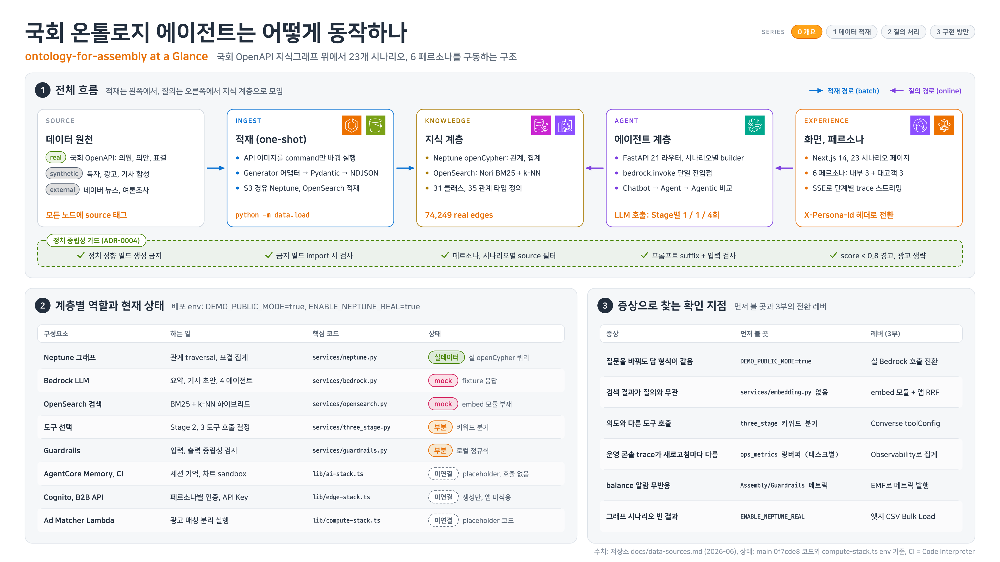
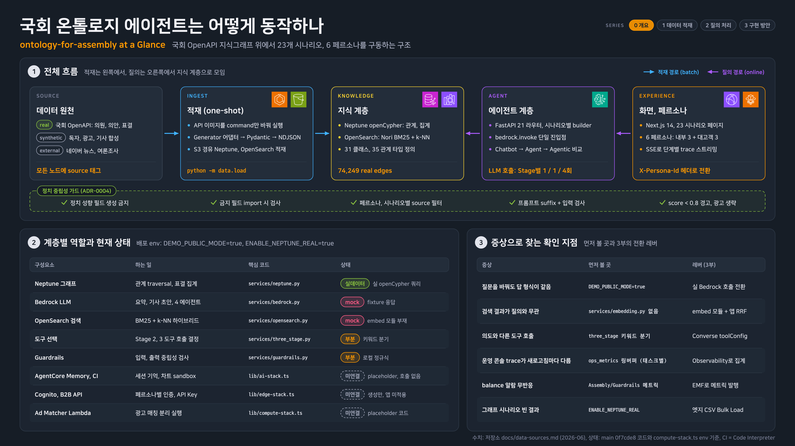
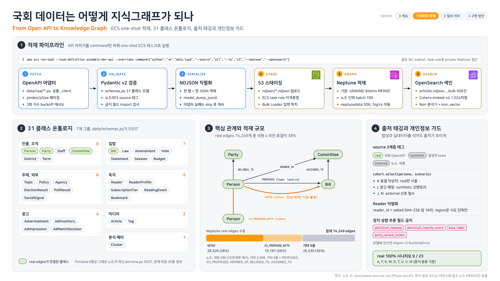
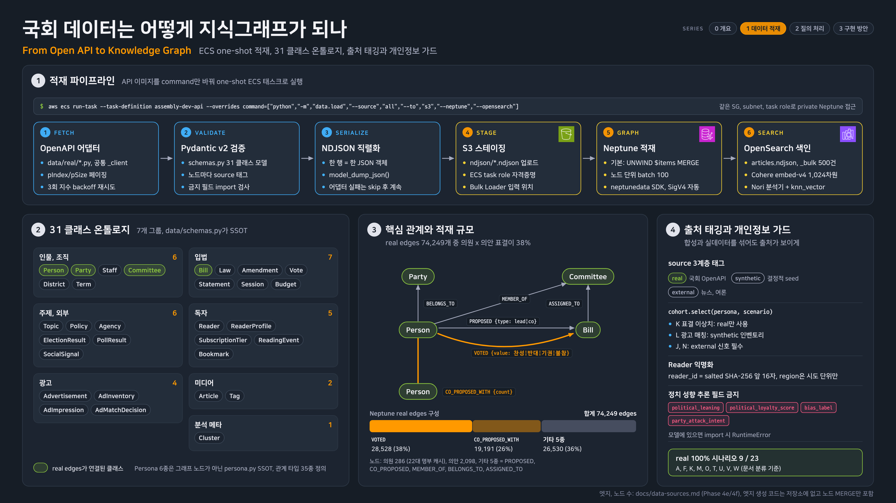
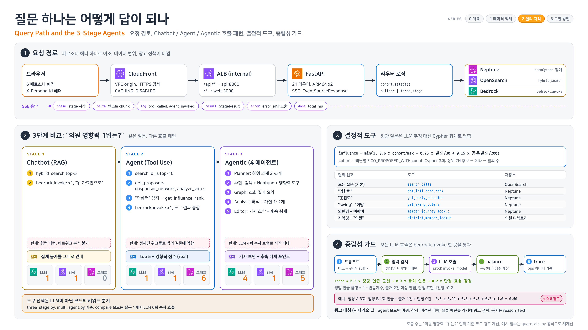
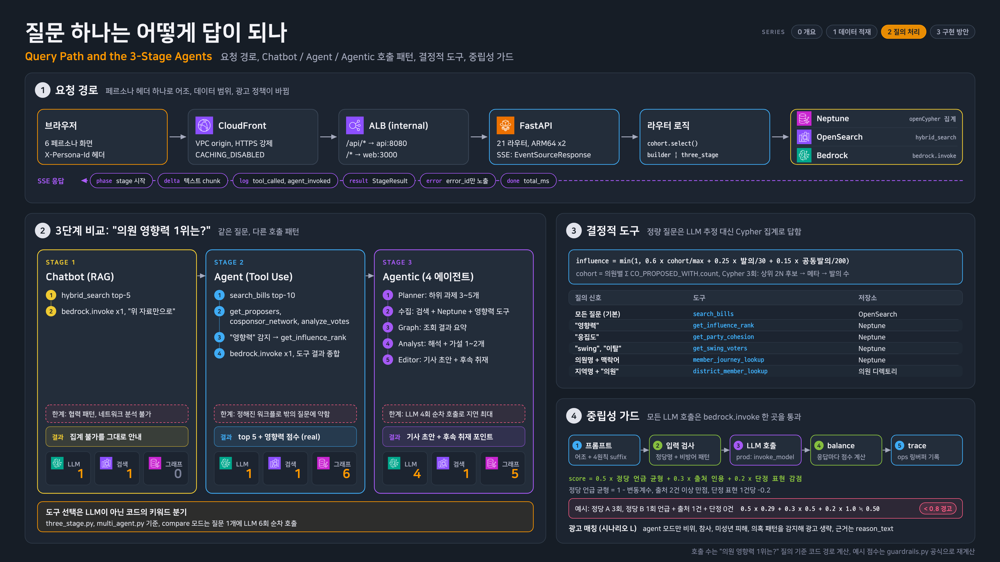
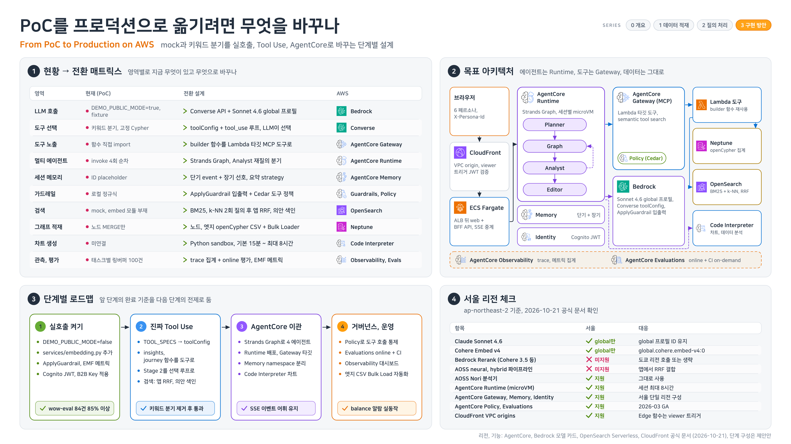
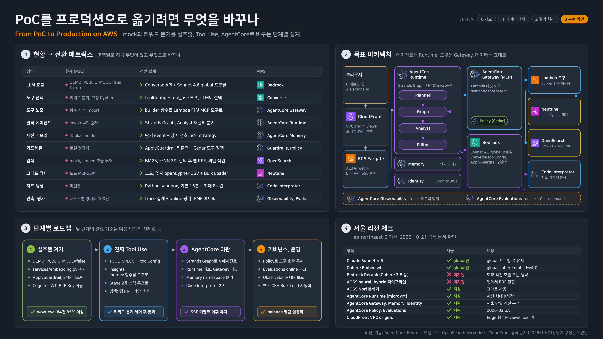

---
<!-- Slide 1: 5부 구분 -->
@type: section

# 온톨로지 위의 에이전트, 그리고 PoC 실행 팁

화면 데모 한 편, 구조 설명서 네 장, 체크리스트, 바로 쓸 자료

:::script
(function () {
  // Hover (or focus) glossary: elements with data-tip show a one-line explanation near the term.
  if (window.__rpTips) return;
  window.__rpTips = true;
  var css = document.createElement('style');
  css.textContent =
    '.rp-tip { border-bottom: 2px dotted var(--accent); cursor: help; }' +
    '.rp-tipbox { position: fixed; z-index: 100001; max-width: min(38vw, 720px); padding: .6em .9em; border-radius: 8px;' +
    ' background: var(--text-primary); color: var(--bg-primary); font-size: clamp(14px, 1.75vh, 38px); line-height: 1.45;' +
    ' box-shadow: 0 6px 24px color-mix(in srgb, black 35%, transparent); pointer-events: none; opacity: 0; transition: opacity .12s; word-break: keep-all; }' +
    '.rp-tipbox.on { opacity: 1; }';
  document.head.appendChild(css);
  var box = document.createElement('div');
  box.className = 'rp-tipbox';
  box.setAttribute('role', 'tooltip');
  function show(t) {
    box.textContent = t.getAttribute('data-tip');
    box.classList.add('on');
    var r = t.getBoundingClientRect(), b = box.getBoundingClientRect();
    var x = Math.min(Math.max(8, r.left + r.width / 2 - b.width / 2), window.innerWidth - b.width - 8);
    var y = r.top - b.height - 10;
    if (y < 8) y = r.bottom + 10;
    box.style.left = x + 'px'; box.style.top = y + 'px';
  }
  function hide() { box.classList.remove('on'); }
  function mount() {
    document.body.appendChild(box);
    document.addEventListener('mouseover', function (e) { var t = e.target.closest && e.target.closest('.slide [data-tip]'); if (t) show(t); });
    document.addEventListener('mouseout', function (e) { if (e.target.closest && e.target.closest('.slide [data-tip]')) hide(); });
    document.addEventListener('focusin', function (e) { var t = e.target.closest && e.target.closest('.slide [data-tip]'); if (t) show(t); });
    document.addEventListener('focusout', hide);
    window.addEventListener('hashchange', hide);
  }
  if (document.readyState === 'loading') document.addEventListener('DOMContentLoaded', mount); else mount();
})();
:::

:::notes
{timing: 0.5min}
[요약]
- 5부: 온톨로지 위에서 도는 에이전트 앱 화면 데모(D3)
- PoC 실행 체크리스트 다섯 가지와 바로 시작할 자료
- 마무리와 Q&A

마지막 5부입니다. 2부에서 개념, 관계, 그래프를 말씀드렸는데, 그게 실제 앱에서는 어떻게 보이는지 화면 데모 한 편을 보고, 남은 PoC 기간에 바로 쓸 체크리스트와 자료로 마무리하겠습니다.
{cue: transition}
데모 앱부터 소개하겠습니다.
:::

---
<!-- Slide 2: D3 데모 앱 소개 -->
@type: content
@title: D3 데모 앱: 국회 데이터 온톨로지

## D3 데모 앱: 국회 데이터 온톨로지

ontology-assembly (assembly.whchoi.net): 22대 국회 의원, 의안, 표결, 주제, 기사를 하나의 온톨로지로

:::html

  
개념 (2부 3장)
Object Explorer

인물, 입법, 주제, 미디어, 독자, 광고 영역의 클래스와 필드. 클래스를 누르면 인스턴스 목록

31 클래스

Person 인스턴스 306개

  
관계 탐색 (2부 7장, 세 번째 자리)
온톨로지 관계 그래프

의원, 의안, 표결, 주제, 기사에서 출발해 1~3 hop 관계를 펼침. 2 hop 이상은 Neptune Cypher multi-hop 조회

1~3 hop

노드 더블클릭으로 추가 확장

  
에이전트 (1부)
데스크 챗봇

같은 온톨로지를 도구로 조회하는 에이전트. planner, graph, analyst, editor 단계와 도구 호출 로그를 화면에 표시

10 도구

답변에 수치와 출처(실 데이터, 합성) 표시

<strong class="text-accent">보는 포인트</strong>: 은행 과제로 바꾸면 의원은 고객, 의안은 상품, 표결은 거래입니다. 개념, 관계, 에이전트가 같은 데이터 위에 있다는 점을 보세요.

:::

:::notes
{timing: 1min}
[요약]
- ontology-assembly: 22대 국회 데이터(의원, 의안, 표결, 주제, 기사)를 하나의 온톨로지로 묶은 데모 앱
- Object Explorer(31 클래스, Person 306개), 관계 그래프(1~3 hop, 2 hop 이상은 Neptune Cypher), 데스크 챗봇(10 도구)
- 2부의 개념, 관계 탐색, 1부의 에이전트가 같은 데이터 위에
- 은행으로 바꾸면 의원은 고객, 의안은 상품, 표결은 거래
- 수치는 2026-10-21 녹화 화면 기준

D3는 제가 만든 데모가 아니라, 국회 데이터로 만든 온톨로지 데모 앱 ontology-assembly의 화면 녹화입니다. 22대 국회의 의원, 의안, 표결, 주제, 기사를 하나의 온톨로지로 묶었습니다.
세 화면을 봅니다. Object Explorer는 2부에서 말한 개념, 즉 클래스 목록입니다. 관계 그래프는 2부의 세 번째 자리, 관계 탐색입니다. 1 hop부터 3 hop까지 펼치고, 2 hop 이상은 Neptune에서 multi-hop으로 조회한다고 화면에 적혀 있습니다.
{cue: pause}
데스크 챗봇은 같은 온톨로지를 도구로 조회하는 에이전트이고, 어떤 단계와 도구를 거쳤는지 화면에 남깁니다.
은행 과제로 바꿔 생각하면 의원은 고객, 의안은 상품, 표결은 거래입니다. 개념, 관계, 에이전트가 같은 데이터 위에 있다는 점을 보시면 됩니다.
근거: demo/FACTS.md D3 (2026-10-21 녹화 화면 값)
{cue: transition}
영상을 보겠습니다.
:::

---
<!-- Slide 3: D3 영상 -->
@type: content
@fit: off
@title: D3 영상: 개념, 관계, 에이전트

## D3 영상: 개념, 관계, 에이전트

:::html

  
<video class="rp-video3" src="media/d3-assembly.mp4" poster="media/d3-assembly.jpg" aria-label="D3 영상: ontology-assembly 앱 화면 녹화, Object Explorer, 관계 그래프, 데스크 챗봇, 무음, 74초" title="D3 영상: ontology-assembly 앱 화면 녹화, 무음, 74초" controls preload="metadata" muted playsinline tabindex="-1"></video>

  
assembly.whchoi.net 화면 녹화(2026-10-21), 노란 자막과 커서만 덧붙임, 무음, 74초

:::

:::script
(function () {
  // Native video controls keep focus and swallow arrow and Space keys: hand focus back to the deck.
  document.querySelectorAll('video.rp-video3').forEach(function (v) {
    var release = function () { setTimeout(function () { if (document.activeElement === v) v.blur(); }, 0); };
    ['focus', 'play', 'pause', 'seeked', 'volumechange', 'click', 'pointerup'].forEach(function (ev) { v.addEventListener(ev, release); });
  });
  // Pause any video left playing on a slide that is no longer active.
  window.addEventListener('hashchange', function () {
    document.querySelectorAll('.slide:not(.active) video.rp-video3').forEach(function (v) { if (!v.paused) v.pause(); });
  });
})();
:::

:::notes
{timing: 1.5min}
[요약]
- 0:00 Object Explorer 31 클래스, 0:12 Person 인스턴스 306개
- 0:16 관계 그래프에서 의원 선택, 0:24 1-hop(정당, 위원회, 발의 의안, 표결, 주제), 0:32 2-hop(공동발의 의원, 그 의원의 위원회와 발의 의안)
- 0:44 데스크 챗봇, 0:48 planner, graph, analyst, editor 단계와 도구 호출 로그, 1:00 답변의 근거 수치와 출처
- 챗봇 응답 내용은 녹화 시점 그대로, 데모 앱의 데이터에는 합성 데이터가 섞여 있음
- 녹화 환경(headless Chromium) 폰트 문제로 표결 노드 라벨 "가결"의 자모가 분리되어 보임. 사이트 데이터 문제 아님

Play를 누르고 노란 자막에 맞춰 설명합니다. 영상은 무음입니다.
처음 12초는 Object Explorer입니다. 인물, 입법, 주제, 미디어 영역의 클래스가 보이고, Person을 누르면 인스턴스 목록이 나옵니다. 2부의 클래스와 인스턴스 구분이 그대로 화면입니다.
{cue: pause}
16초부터 관계 그래프입니다. 의원 한 명을 고르면 1-hop으로 정당, 위원회, 발의 의안, 표결, 주제가 이어지고, 32초에 2-hop을 누르면 의안을 거쳐 공동발의 의원, 그 의원의 위원회와 다른 의안까지 펼쳐집니다. 화면 자막에는 "다른 주제까지"라고 적혀 있지만 이 의원의 2-hop에는 새 주제가 없습니다. 트리플 슬라이드에서 질문을 따라갔던 것과 같은 일입니다.
44초부터는 데스크 챗봇입니다. AI 관련 의안 발의 상위 5명과 공동발의 네트워크를 물으면 planner, graph, analyst, editor 단계를 거치고, 오른쪽에 호출한 도구가 남습니다. 마지막에는 답변 속 수치와 출처를 보여 줍니다.
데모 앱 데이터에는 실 데이터와 합성 데이터가 섞여 있고, 화면에도 출처가 구분되어 있습니다. 은행에서도 이렇게 출처를 구분해 보여 주는 것이 설명 가능성의 출발점입니다.
근거: demo/FACTS.md D3 (자막 시각)
{cue: transition}
이 앱이 안에서 어떻게 움직이는지, 구조 설명서 네 장으로 보겠습니다.
:::

---
<!-- Slide 4: 구조 설명서 1, 개요 -->
@type: content
@fit: off
@title: 구조 설명서 1: 전체 흐름

## 구조 설명서 1: 전체 흐름

:::html

  

    
    
  

  
ontology-for-assembly 구조 설명서, 그림을 누르면 전체 화면으로 보입니다

:::

:::script
(function () {
  // Click-to-zoom for architecture figures: opens the image over the whole viewport.
  if (window.__rpLightbox) return;
  window.__rpLightbox = true;
  var css = document.createElement('style');
  css.textContent =
    '.slide img.rp-zoomable { cursor: zoom-in; }' +
    '.rp-lb { position: fixed; inset: 0; z-index: 100000; display: none; align-items: center; justify-content: center; background: color-mix(in srgb, black 95%, transparent); cursor: zoom-out; }' +
    '.rp-lb.open { display: flex; }' +
    '.rp-lb img { width: 96vw; height: 92vh; object-fit: contain; }' +
    '.rp-lb span { position: fixed; bottom: 12px; left: 50%; transform: translateX(-50%); color: white; font-size: 14px; opacity: .7; }';
  document.head.appendChild(css);
  var lb = document.createElement('div');
  lb.className = 'rp-lb';
  lb.innerHTML = '클릭하거나 Esc를 누르면 닫힙니다';
  var big = lb.querySelector('img');
  function close() { lb.classList.remove('open'); }
  lb.addEventListener('click', close);
  function mount() {
    document.body.appendChild(lb);
    document.querySelectorAll('.slide img[src^="media/"]').forEach(function (img) {
      if (/\/ac-/.test(img.getAttribute('src'))) return;
      img.classList.add('rp-zoomable');
      img.title = '클릭하면 크게 보기';
      img.addEventListener('click', function (e) {
        e.stopPropagation();
        big.src = img.src; big.alt = img.alt;
        lb.classList.add('open');
      });
    });
  }
  if (document.readyState === 'loading') document.addEventListener('DOMContentLoaded', mount); else mount();
  // While open, swallow deck keys so arrows do not change slides; Esc closes.
  document.addEventListener('keydown', function (e) {
    if (!lb.classList.contains('open')) return;
    e.stopPropagation(); e.preventDefault();
    if (e.key === 'Escape' || e.key === 'Enter' || e.key === ' ') close();
  }, true);
})();
:::

:::notes
{timing: 1min}
[요약]
- 방금 영상의 앱을 다섯 계층으로: 데이터 원천, 적재(one-shot), 지식 계층, 에이전트 계층, 화면과 페르소나
- 적재는 왼쪽에서, 질의는 오른쪽에서 지식 계층으로 모임
- 지식 계층: Neptune openCypher(관계, 집계), OpenSearch(Nori BM25 + k-NN), 31 클래스, 35 관계 타입, real edges 74,249
- 모든 노드에 source 태그(real, synthetic, external), 정치 중립성 가드가 전 계층을 가로지름
- 아래 표: 계층별 현재 상태(실데이터, mock, 부분, 미연결)를 숨기지 않고 적어 둠

그림을 눌러 크게 띄우고 설명합니다.
방금 영상으로 본 앱을 다섯 칸으로 나눈 그림입니다. 왼쪽부터 데이터 원천, 적재, 지식 계층, 에이전트 계층, 화면입니다. 파란 화살표가 적재 경로, 보라 화살표가 질의 경로인데, 둘 다 가운데 지식 계층으로 모입니다. 2부에서 말씀드린 "온톨로지가 가운데 있고 에이전트는 그것을 조회한다"는 그림이 실제 구조로 이렇게 생깁니다.
{cue: pause}
눈여겨볼 점이 두 가지입니다. 하나는 모든 노드에 출처 태그가 붙는다는 점, 실데이터인지 합성인지 외부인지가 데이터 자체에 남습니다. 다른 하나는 아래 표처럼 어떤 계층이 실데이터로 돌고 어떤 계층이 아직 mock인지를 숨기지 않고 적어 두었다는 점입니다. PoC 중간 보고에서 이런 표 한 장이 있으면 "어디까지 진짜냐"는 질문에 바로 답할 수 있습니다.
근거: 첨부 구조 설명서 00-overview (저장소 docs/data-sources.md 2026-06, main 0f7cde8 기준)
{cue: transition}
다음은 데이터가 그래프가 되는 과정입니다.
:::

---
<!-- Slide 5: 구조 설명서 2, 데이터 적재 -->
@type: content
@fit: off
@title: 구조 설명서 2: 데이터가 지식그래프가 되기까지

## 구조 설명서 2: 데이터가 지식그래프가 되기까지

:::html

  

    
    
  

  
ECS one-shot 적재, 31 클래스 온톨로지, 출처 태깅과 개인정보 가드

:::

:::notes
{timing: 1min}
[요약]
- 적재는 API 이미지를 command만 바꿔 one-shot ECS 태스크로 실행
- 6단계: OpenAPI 어댑터, Pydantic v2 검증, NDJSON 직렬화, S3 스테이징, Neptune 적재(UNWIND MERGE), OpenSearch 색인(Cohere embed-v4 1,024차원, Nori)
- 31 클래스를 7개 그룹으로, data/schemas.py 한 곳이 기준(SSOT)
- 핵심 관계: Person BELONGS_TO Party, MEMBER_OF Committee, PROPOSED Bill, VOTED Bill, CO_PROPOSED_WITH Person
- real edges 74,249개 중 VOTED 38%, CO_PROPOSED_WITH 26%
- 출처 3계층 태그, 독자 익명화(salted SHA-256), 정치 성향 추론 필드는 모델에 있으면 import 시 오류

2부의 "개념, 관계, 규칙"이 코드로 어디에 있는지 보는 장입니다.
가운데 왼쪽의 31 클래스가 개념입니다. 클래스 정의는 schemas.py 한 파일에만 있고, 검증, 직렬화, 적재가 모두 이 정의를 따릅니다. 가운데 그래프가 관계입니다. 의원이 정당에 속하고, 의안을 발의하고, 표결합니다. 트리플 슬라이드에서 본 "주어, 관계, 목적어"가 74,249개 엣지로 들어가 있습니다.
{cue: pause}
오른쪽은 규칙입니다. 정치 성향 같은 필드는 아예 모델에 정의되면 import 단계에서 실패하게 막아 두었습니다. 은행 과제라면 이 자리가 개인정보, 신용정보 필드 금지 규칙이 됩니다. 규칙을 프롬프트가 아니라 스키마에 두면 실수로 새어 나갈 길이 줄어듭니다.
근거: 첨부 구조 설명서 01-ingest (docs/data-sources.md Phase 4e/4f)
{cue: transition}
이제 질문 하나가 답이 되는 경로입니다.
:::

---
<!-- Slide 6: 구조 설명서 3, 질의 처리 -->
@type: content
@fit: off
@title: 구조 설명서 3: 질문 하나가 답이 되기까지

## 구조 설명서 3: 질문 하나가 답이 되기까지

:::html

  

    
    
  

  
요청 경로, Chatbot, Agent, Agentic 3단계 비교, 결정적 도구, 중립성 가드

:::

:::notes
{timing: 1min}
[요약]
- 요청 경로: 브라우저, CloudFront(VPC origin), 내부 ALB, FastAPI, 라우터, Neptune, OpenSearch, Bedrock. 응답은 SSE로 단계별 스트리밍
- 같은 질문 "의원 영향력 1위는?"을 3단계로 비교
- Stage 1 Chatbot(RAG): LLM 1, 검색 1, 그래프 0. 집계가 안 되니 "집계 불가"라고 안내
- Stage 2 Agent(Tool Use): LLM 1, 검색 1, 그래프 6. 영향력 점수(real) 포함 top 5
- Stage 3 Agentic(4 에이전트): LLM 4, 검색 1, 그래프 5. 기사 초안과 후속 취재 포인트, 대신 지연 최대
- 정량 질문은 LLM 추정 대신 Cypher 집계 공식으로 답함(결정적 도구)
- 현재 도구 선택은 LLM이 아니라 코드의 키워드 분기라는 한계도 그림에 적혀 있음

가운데 비교가 이 장의 핵심입니다. 같은 질문을 챗봇, 에이전트, 멀티 에이전트로 던졌을 때 무엇이 달라지는지 호출 수로 보여 줍니다.
챗봇은 문서만 찾아서 답하니 "1위"를 셀 방법이 없고, 그래서 솔직하게 집계 불가라고 합니다. 에이전트가 되면 그래프 조회를 여섯 번 하고 실제 점수로 순위를 냅니다. 2부 D1 결과에서 본 것처럼 확정해야 하는 질문은 모델이 추정하지 말고 조회해야 한다는 이야기와 같습니다.
{cue: pause}
오른쪽 위가 그 조회를 맡는 결정적 도구입니다. 영향력은 공식으로 정해져 있고, 질문 신호에 따라 어떤 도구가 불리는지도 표로 정해 두었습니다. 다만 그 아래에 "도구 선택은 LLM이 아닌 키워드 분기"라는 한계를 적어 두었습니다. 다음 장이 바로 이것을 고치는 이야기입니다.
근거: 첨부 구조 설명서 02-query (호출 수는 "의원 영향력 1위는?" 질의 기준 코드 경로 계산)
{cue: transition}
마지막 장, PoC를 프로덕션으로 옮기는 설계입니다.
:::

---
<!-- Slide 7: 구조 설명서 4, 구현 방안 -->
@type: content
@fit: off
@title: 구조 설명서 4: PoC에서 프로덕션으로

## 구조 설명서 4: PoC에서 프로덕션으로

:::html

  

    
    
  

  
mock과 키워드 분기를 실호출, Tool Use, AgentCore로 바꾸는 단계별 설계

:::

:::notes
{timing: 1min}
[요약]
- 전환 매트릭스: LLM 호출(fixture에서 Converse API), 도구 선택(키워드 분기에서 toolConfig 루프), 도구 노출(Gateway MCP), 멀티 에이전트(Runtime, Strands Graph), 메모리, 가드레일, 검색, 그래프 적재, 차트, 관측과 평가
- 목표 아키텍처: 에이전트는 AgentCore Runtime, 도구는 Gateway(Lambda 타깃), 데이터(Neptune, OpenSearch)는 그대로
- 4단계 로드맵: 실호출 켜기, 진짜 Tool Use, AgentCore 이관, 거버넌스와 운영. 앞 단계의 완료 기준이 다음 단계의 전제
- 서울 리전 체크(2026-10-21 공식 문서 기준): AgentCore Runtime, Gateway, Memory, Identity, Policy, Evaluations 지원, Bedrock Rerank와 AOSS neural 하이브리드는 미지원이라 대응 방안 표기
- 단계 구성은 제안안, 리전과 기능은 공식 문서 기준

1부에서 본 AgentCore 구성 요소가 실제 PoC에서 어디에 들어가는지 보여 주는 장입니다.
왼쪽 표는 지금 무엇이 있고 무엇으로 바꾸는지를 영역별로 한 줄씩 적었습니다. 핵심은 도구 선택입니다. 지금은 코드가 키워드로 도구를 고르는데, 이것을 toolConfig로 모델이 고르게 바꾸고, 도구는 Gateway 뒤로 보냅니다. 데이터 계층은 바꾸지 않습니다. 온톨로지를 먼저 잘 만들어 두면 에이전트 계층을 갈아 끼워도 지식은 그대로 남는다는 뜻입니다.
{cue: pause}
아래 로드맵은 네 단계이고, 각 단계에 완료 기준이 체크 박스로 붙어 있습니다. 예를 들어 1단계는 평가셋 84건에서 85% 이상입니다. 오른쪽 아래는 서울 리전에서 되는 것과 안 되는 것입니다. 금융권 과제는 리전 제약이 먼저 걸리니, 설계 초기에 이런 표를 한 번 만들어 두시길 권합니다.
근거: 첨부 구조 설명서 03-plan (AgentCore, Bedrock 모델 카드, OpenSearch Serverless, CloudFront 공식 문서 2026-10-21 기준, 단계 구성은 제안안)
{cue: transition}
이제 PoC 실행 체크리스트입니다.
:::

---
<!-- Slide 8: PoC 실행 체크리스트 -->
@type: content
@title: PoC 실행 체크리스트

## PoC 실행 체크리스트

오늘 사례에서 뽑은 다섯 가지, 과제가 달라도 순서는 같음

:::html

  
1
평가셋부터

질문, 정답, 근거로 된 작은 골든셋과 실패 사례 목록을 첫 주에 만든다

NewDay, 미래에셋

  
2
지식을 구조화

용어 사전, 항목 정의서, 메타데이터. 사용자 말을 실제 값으로 확정

신한카드, 미래에셋, D1 데모

  
3
작게 시작, 검증은 따로

단일 에이전트로 시작해 필요할 때만 분리. 검증 에이전트는 별도로

LG전자, 링크알파, Canva

  
4
근거를 화면에

답마다 출처와 조항 표시. 확정 못 하면 되묻고, 없는 건 모른다고

미래에셋, 서울경제

  
5
첫날부터 trace

관측을 켜고 평가 점수를 대시보드로. 조치성 도구엔 승인 단계

PropHero, 삼성계정

<strong class="text-accent">데모 데이에 함께 보여주세요</strong>: 평가 점수, 근거가 보이는 응답, trace 화면

:::

:::notes
{timing: 1.5min}
[요약]
- 1 평가셋부터: 작은 골든셋과 실패 사례 목록만 있어도 개선이 측정됨
- 2 지식을 구조화: 용어 사전, 항목 정의서, 메타데이터, 값 확정 단계(D1에서 확인)
- 3 작게 시작, 검증은 따로 / 4 근거를 화면에(금융에서 설명 가능성은 요건) / 5 첫날부터 trace, 조치성 도구엔 사람 승인
- 데모 데이: 잘 도는 화면 + 평가 점수, 근거, trace

마지막으로 실행 체크리스트입니다. 오늘 본 사례에서 뽑은 다섯 가지이고, 과제가 달라도 순서는 같다고 생각합니다.
첫째, 평가셋을 먼저 만드세요. 질문, 정답, 근거로 된 작은 골든셋과 실패 사례 목록만 있어도 개선이 측정됩니다. 둘째, 지식을 구조화하세요. 용어 사전, 항목 정의서, 메타데이터를 만들고, 사용자 말을 실제 값으로 확정하는 단계를 두세요. D1에서 같은 모델이 50%에서 92%로 달라지는 걸 보셨습니다.
{cue: pause}
셋째, 단일 에이전트로 작게 시작하고, 필요할 때만 나누되 검증 에이전트는 따로 두세요. 넷째, 근거를 화면에 보여주세요. 금융에서는 설명 가능성이 곧 요건입니다. 다섯째, 첫날부터 trace를 켜고, 실제 조치를 하는 도구에는 사람 승인 단계를 두세요.
데모 데이에는 잘 돌아가는 화면과 함께 평가 점수, 근거, trace를 같이 보여주시면 설득력이 확 올라갑니다.
{cue: transition}
바로 시작할 수 있는 자료입니다.
:::

---
<!-- Slide 9: 자료 -->
@type: content
@title: 바로 시작할 수 있는 자료

## 바로 시작할 수 있는 자료

링크는 공유 자료에서 클릭 가능

:::html

  

    
코드와 워크숍

    <ul>
      <li><a href="https://github.com/awslabs/agentcore-samples" target="_blank" rel="noopener">awslabs/agentcore-samples</a>AgentCore 튜토리얼, 유즈케이스, 블루프린트</li>
      <li><a href="https://github.com/strands-agents/samples" target="_blank" rel="noopener">strands-agents/samples</a>Strands Agents 예제 (Python, TypeScript)</li>
      <li><a href="https://github.com/aws-samples/sample-deep-insight" target="_blank" rel="noopener">aws-samples/sample-deep-insight</a>Deep Insight 멀티 에이전트 분석과 보고서 (TASK 03)</li>
      <li><a href="https://github.com/aws-samples/sample-strands-agent-with-agentcore" target="_blank" rel="noopener">aws-samples/sample-strands-agent-with-agentcore</a>Strands + AgentCore 멀티 에이전트 챗봇 참조 구현</li>
      <li><a href="https://catalog.workshops.aws/agentcore-getting-started" target="_blank" rel="noopener">catalog.workshops.aws/agentcore-getting-started</a>AgentCore 입문 워크숍</li>
      <li><a href="demo/README.md" target="_blank" rel="noopener">오늘 데모 D1, D2 코드와 기록 (demo/)</a>가상 ETF 원장, etf_ontology.ttl, 실행 결과 JSON</li>
    </ul>
  

  

    
사례 원문

    <ul>
      <li><b>LG전자</b><a href="https://aws.amazon.com/ko/blogs/tech/lge-agentic-report-automation/" target="_blank" rel="noopener">Agentic AI 리포트 자동화</a> / <a href="https://aws.amazon.com/ko/blogs/tech/practical-design-lessons-from-the-deep-insight-arch/" target="_blank" rel="noopener">Deep Insight 설계 교훈</a></li>
      <li><b>신한카드</b><a href="https://aws.amazon.com/ko/blogs/tech/shinhan-card-ontology-based-decentralized-agentic-ai-chatbot/" target="_blank" rel="noopener">온톨로지 기반 분산형 Agentic AI 챗봇</a></li>
      <li><b>미래에셋증권</b>AI-Ready Data (AWS FSI Forum 발표, 공개 링크 없음)</li>
      <li><b>Canva</b><a href="https://aws.amazon.com/ko/solutions/case-studies/innovators/canva/" target="_blank" rel="noopener">Canva 고객 사례</a>ANT105 Agentic Engineering 발표 (공개 영상 미확인)</li>
      <li><b>미리디(미리캔버스)</b><a href="https://aws.amazon.com/ko/blogs/tech/amazon-bedrock-miri-canvas-design-template-chatbot/" target="_blank" rel="noopener">디자인 템플릿 추천 챗봇</a> / <a href="https://youtu.be/4EJJwXseuzw" target="_blank" rel="noopener">AI 서비스 소개 영상</a></li>
      <li><b>과제별 사례</b><a href="https://aws.amazon.com/blogs/machine-learning/how-prophero-built-an-intelligent-property-investment-advisor-with-continuous-evaluation-using-amazon-bedrock/" target="_blank" rel="noopener">PropHero</a>, <a href="https://aws.amazon.com/blogs/machine-learning/newday-builds-a-generative-ai-based-customer-service-agent-assist-with-over-90-accuracy/" target="_blank" rel="noopener">NewDay</a>, <a href="https://aws.amazon.com/ko/blogs/tech/wemadeplay-game-ui-aq-automation-with-amazon-bedrock/" target="_blank" rel="noopener">위메이드플레이</a>, <a href="https://aws.amazon.com/ko/blogs/tech/kakaostyle-leverage-genai-with-amazon-bedrock/" target="_blank" rel="noopener">카카오스타일</a>, <a href="https://aws.amazon.com/ko/blogs/tech/linqalpha-company-screener-ai-agent-with-amazon-opensearch/" target="_blank" rel="noopener">링크알파(LinqAlpha)</a>, <a href="https://aws.amazon.com/ko/blogs/tech/ai-news-service-using-amazon-bedrock-prompt-engineering-case/" target="_blank" rel="noopener">서울경제신문</a>, <a href="https://aws.amazon.com/blogs/machine-learning/rocket-close-transforms-mortgage-document-processing-with-amazon-bedrock-and-amazon-textract/" target="_blank" rel="noopener">Rocket Close</a>, <a href="https://aws.amazon.com/blogs/machine-learning/sun-finance-automates-id-extraction-and-fraud-detection-with-generative-ai-on-aws/" target="_blank" rel="noopener">Sun Finance</a>, <a href="https://tech.kakaopay.com/post/ifkakao2024-document-ai/" target="_blank" rel="noopener">카카오페이손해보험</a>, <a href="https://tech.kakaopay.com/post/choonsiri/" target="_blank" rel="noopener">춘시리</a>, <a href="https://aws.amazon.com/ko/blogs/tech/a1mobilsoft-ops-automation-1/" target="_blank" rel="noopener">A1Mobilsoft 1부</a>, <a href="https://aws.amazon.com/ko/blogs/tech/a1mobilsoft-ops-automation-2/" target="_blank" rel="noopener">2부</a>, <a href="https://aws.amazon.com/ko/blogs/tech/gsretail-aiops-sre-agent/" target="_blank" rel="noopener">GS리테일</a>, <a href="https://aws.amazon.com/ko/blogs/tech/part2-agentic-aiops-samsung-account-service/" target="_blank" rel="noopener">삼성계정</a>, <a href="https://www.fntimes.com/html/view.php?ud=2026090816062073095e6e69892f_18" target="_blank" rel="noopener">토스뱅크 ZeroOps</a></li>
      <li><b>온톨로지 도구</b>Amazon Neptune, Bedrock Knowledge Bases GraphRAG, GraphRAG Toolkit</li>
    </ul>
  

:::

:::notes
{timing: 1min}
[요약]
- 코드: AgentCore 샘플(튜토리얼, 유즈케이스, 블루프린트), Strands 예제, Deep Insight(TASK 03 출발점), Strands + AgentCore 참조 구현, AgentCore 입문 워크숍
- 오늘 데모 D1, D2 코드와 실행 기록: 이 덱의 demo 폴더
- 사례 원문: LG전자, 신한카드, 미래에셋증권, Canva, 과제별 사례
- 미리캔버스 AI 서비스 소개 영상: https://youtu.be/4EJJwXseuzw (PPTX 노트에는 Canva 영상으로 적혀 있었음)

바로 쓰실 수 있는 자료입니다. 왼쪽은 코드입니다. AgentCore 샘플 저장소에 튜토리얼부터 유즈케이스, 블루프린트까지 있고, Strands 예제 저장소에는 파이썬과 타입스크립트 예제가 있습니다. 리서치 보고서 과제 팀은 Deep Insight 저장소를 출발점으로 쓰시면 시간을 많이 아끼실 수 있습니다.
{cue: pause}
오늘 2부에서 보여 드린 D1, D2 데모 코드와 실행 기록도 이 덱의 demo 폴더에 넣어 두었습니다. 온톨로지 파일 하나와 파이썬 파일 몇 개라서, 과제 데이터로 바꿔서 바로 돌려 보실 수 있습니다. 오른쪽은 오늘 소개한 사례의 원문입니다.
참고: PPTX 노트의 영상 링크(https://youtu.be/4EJJwXseuzw)는 Canva 발표가 아니라 미리캔버스 AI 서비스 소개 영상이라 미리디 항목에 연결했습니다. Canva ANT105 공개 영상은 확인하지 못했습니다
{cue: transition}
정리하겠습니다.
:::

---
<!-- Slide 10: 마무리 -->
@type: content
@title: 작게 만들고, 채점하고, 운영처럼

## 작게 만들고, 채점하고, 운영처럼

8주 PoC를 마무리하며

:::html

  
작게 만들고
질문에 나온 개념부터

어휘 사전과 규칙 파일 하나, 단일 에이전트 하나로 시작합니다.

  
채점하고
첫 주부터 골든셋

모델을 바꾸기 전에 지식, 역할, 평가를 바꾸고 그때마다 점수를 잽니다.

  
운영처럼 데모
점수, 근거, trace를 함께

데모 데이에 잘 도는 화면과 함께 근거와 실행 경로를 보여 줍니다.

오준석, Senior Solutions Architect, AWS Korea: <b>Q&A</b>

:::

:::notes
{timing: 1min}
[요약]
- 작게 만들고, 첫 주부터 채점하고, 데모는 운영처럼(점수, 근거, trace)
- 네 사례 모두 모델보다 지식, 역할, 평가를 먼저 설계해서 결과를 냄
- 남은 기간 질문은 언제든, 이어서 Q&A

정리하겠습니다. 작게 만들고, 첫 주부터 채점하고, 데모는 운영처럼, 점수와 근거와 trace를 같이 보여주세요.
오늘 보신 LG전자, 신한카드, 미래에셋증권, Canva 모두 모델보다 지식과 역할과 평가를 먼저 설계해서 결과를 냈습니다. 그리고 제가 직접 돌려 본 데모에서도 같은 모델이 지식을 어떻게 주느냐에 따라 50%에서 92%까지 달라졌습니다.
{cue: pause}
남은 기간 동안 언제든 질문 주시면 함께 고민하겠습니다.
{cue: question}
질문 받겠습니다. 온톨로지를 우리 과제의 어디부터 적용하면 좋을지 같은 질문도 환영합니다.
:::

---
<!-- Slide 11: Thank You -->
@type: thankyou
@toc: toc.html
@message: 사례로 보는 AI 에이전트, 감사합니다

# Thank You

:::notes
{timing: 0.5min}
[요약]
- 세션 마무리

들어 주셔서 감사합니다. 오늘 데모 코드와 기록은 공유 자료의 demo 폴더에 있으니, 과제 데이터로 바꿔 직접 돌려 보시길 권합니다.
:::
