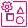
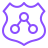

---
<!-- Slide 1: 섹션 03 -->
@type: section

# 03 멀티 어카운트와 Control Tower

OU 구조, 통제, 계정 발급 자동화

:::notes
{timing: 0.5min}
[요약]
- 3장: 권장 OU와 계정 구조, Control Tower 구성 요소, 통제 유형, Landing Zone 4.0
- 매핑표의 계정 구조, 신원과 권한 계층을 구체화

3장은 매핑표의 위쪽 두 계층, 계정 구조와 권한을 구체적으로 보는 장입니다.
{cue: transition}
권장 OU 구조부터 보겠습니다.
:::

---
<!-- Slide 2: OU 구조 -->
@type: content
@title: OU마다 다른 통제를 건다

## OU마다 다른 통제를 건다

:::html

  

    
    
<strong>Management Account</strong>
Organizations, Control Tower, 결제 통합. 워크로드와 보안 도구는 두지 않음

  

  

    
<b>Security OU</b>Log ArchiveAudit로그 삭제, 변경 차단

    
<b>Infrastructure OU</b>Network HubShared Services네트워크 변경 권한 분리

    
<b>Workloads Prod OU</b>업무계 Prod채널계 Prod서울 리전 외 차단, 암호화 강제

    
<b>Workloads NonProd OU</b>업무계 Dev업무계 Stg운영 데이터 접근 차단

    
<b>Sandbox OU</b>개발자 SandboxPoC Sandbox예산 한도, 사내망 연결 차단

    
<b>Policy Staging, Suspended</b>통제 검증용폐기 대기신규 통제 사전 검증, 모든 작업 거부

  

  

    

    
<strong class="lz-t-warning">관리 계정에는 SCP가 적용되지 않습니다</strong>
그래서 관리 계정에는 워크로드를 두지 않고, 접근 인원을 최소화합니다.

  

업무계, 채널계 명칭은 예시이며 실제 분류는 시스템 구성에 맞춰 조정. OU를 클릭하면 통제 예시가 표시됩니다.

:::

:::script
(function () {
  var ous = document.getElementById('lzOus'), out = document.getElementById('lzOuOut');
  if (!ous || !out) return;
  var D = [
    ['Security OU', '탐지와 로그를 관리 계정 밖으로', 'Log Archive S3 버킷 삭제, 수명주기 변경 거부 SCP', 'CloudTrail, Config 중지 거부'],
    ['Infrastructure OU', '네트워크 변경은 네트워크팀만', 'TGW, DX, 라우팅 변경은 지정 역할만 허용', 'Shared Services는 배포 파이프라인 전용'],
    ['Workloads Prod OU', '운영은 가장 강한 상한', 'ap-northeast-2 외 리전 리소스 생성 거부 (글로벌 서비스 예외)', '미암호화 리소스 생성 거부, 업무계 IGW(인터넷 게이트웨이) 생성 거부'],
    ['Workloads NonProd OU', '개발과 운영을 섞지 않는다', 'Prod 계정 리소스 접근 거부 SCP (aws:ResourceAccount 조건)', 'Prod와 직접 라우팅 없음. 외부 계정 접근 상한은 Prod OU의 RCP로'],
    ['Sandbox OU', '실험은 자유롭게, 경계는 확실하게', 'Budgets 한도와 알림', 'TGW 연결 금지로 사내망 차단'],
    ['Policy Staging, Suspended', '통제를 먼저 시험하는 곳', '신규 SCP를 이 OU에서 먼저 적용하고 영향 확인 후 승격', 'Suspended: 모든 작업 거부 후 폐기 대기']
  ];
  function pick(i) {
    [].forEach.call(ous.children, function (o, j) { o.classList.toggle('lz-sel', j === i); });
    var d = D[i];
    out.innerHTML = '<strong class="lz-t-accent">' + d[0] + ': ' + d[1] + '</strong>
SCP, RCP 예시

' + d[2] + '

' + d[3] + '
';
  }
  ous.addEventListener('click', function (e) { var o = e.target.closest('.lz-ou'); if (o) pick(+o.dataset.i); });
  pick(2);
})();
:::

:::notes
{timing: 3.5min}
[요약]
- AWS 권장 Organizational Unit 모델 기반: Security, Infrastructure, Workloads Prod, NonProd, Sandbox, Policy Staging, Suspended
- OU별로 서로 다른 SCP, RCP 상한을 적용 (클릭해 예시 확인, Prod부터)
- Prod와 NonProd 분리가 망분리, 개발과 운영 분리 요건 대응의 출발점
- SCP는 관리 계정에 적용되지 않으므로 관리 계정에는 워크로드를 두지 않음
- 업무계, 채널계 명칭은 예시

AWS가 권장하는 OU 모델을 금융회사 환경에 맞춰 그려 본 구조입니다. 맨 위 관리 계정 아래에 여섯 묶음의 OU가 있고, 핵심은 OU마다 서로 다른 통제를 건다는 점입니다.
{cue: demo}
Workloads Prod OU를 보면 서울 리전 외 리소스 생성을 막고, 암호화되지 않은 리소스와 업무계 IGW 생성을 막습니다. NonProd는 SCP로 Prod 계정 리소스 접근을 막고, Sandbox는 예산 한도와 사내망 연결 차단입니다. 외부 계정이 우리 리소스에 접근하는 것을 막는 RCP는 보호 대상인 Prod OU 쪽에 겁니다.
{cue: pause}
Prod와 NonProd를 OU부터 나누는 것이 망분리, 개발과 운영 분리 요건에 대응하는 출발점입니다. 업무계, 채널계라는 이름은 예시이고 실제 분류는 시스템 구성에 맞춰 조정하면 됩니다.
{cue: click}
한 가지 꼭 기억하실 점은, SCP는 관리 계정에는 적용되지 않는다는 것입니다. 그래서 관리 계정에는 워크로드나 보안 도구를 두지 않고 접근 인원을 최소화합니다.
{cue: transition}
이 구조를 실제로 만들어 주는 서비스가 Control Tower입니다.
:::

---
<!-- Slide 3: Control Tower 구성 요소 -->
@type: content
@title: Control Tower, 네 가지 구성 요소

## Control Tower, 네 가지 구성 요소

:::html

  

    
<h4>Landing Zone</h4>
관리, 로그, 감사 계정과 OU 기본 구조를 자동 구성

    
<h4>Controls</h4>
예방, 탐지, 사전 통제를 OU 단위로 적용

    
<h4>Account Factory</h4>
표준 기준선이 적용된 신규 계정을 자동 발급

    
<h4>Dashboard, Drift</h4>
OU, 계정별 준수 현황과 기준선 이탈 탐지

  

  
<strong>AWS Control Tower</strong>Landing Zone 구성, 통제 적용, 계정 발급을 자동화하는 관리형 서비스

  
<strong>AWS Organizations</strong>계정, OU, SCP, RCP, 통합 결제의 기반

  

:::

:::script
(function () {
  var g = document.getElementById('lzCt'), out = document.getElementById('lzCtOut');
  if (!g || !out) return;
  var D = [
    '<strong class="lz-t-accent">Landing Zone</strong>
관리, Log Archive, Audit 계정과 기본 OU를 만들고 IAM Identity Center를 연동합니다. 4.0부터 Config, CloudTrail, Backup, SecurityRoles 통합을 선택해 켤 수 있습니다.
',
    '<strong class="lz-t-accent">Controls</strong>
Controls Catalog에서 예방(SCP, RCP, 선언적 정책), 탐지(Config Rules), 사전(CloudFormation Hooks) 통제를 OU에 적용합니다. 산업별 프레임워크 매핑을 지원합니다.
',
    '<strong class="lz-t-accent">Account Factory</strong>
계정 요청 한 번으로 표준 OU, 기준선, 네트워크 설정이 적용된 계정을 발급합니다. AFT(Account Factory for Terraform)로 GitOps 방식 확장이 가능합니다.
',
    '<strong class="lz-t-accent">Dashboard, Drift</strong>
OU와 계정별 통제 준수 현황을 보고, 콘솔 수동 변경 같은 기준선 이탈(Drift)을 탐지해 EventBridge로 알립니다.
'
  ];
  function pick(i) { [].forEach.call(g.children, function (c, j) { c.classList.toggle('lz-sel', j === i); }); out.innerHTML = D[i]; }
  g.addEventListener('click', function (e) { var c = e.target.closest('.lz-ctc'); if (c) pick(+c.dataset.i); });
  pick(1);
})();
:::

:::notes
{timing: 2.5min}
[요약]
- Control Tower는 Organizations 위에서 동작하는 관리형 서비스
- 네 구성 요소: Landing Zone, Controls, Account Factory, Dashboard와 Drift
- Controls Catalog는 2025년 이후 Config 기반 통제가 크게 늘었고 산업 프레임워크 매핑 지원
- Landing Zone 4.0: 서비스 통합 선택 적용, 기존 Organizations에 통제만 먼저 도입 가능

Control Tower는 Organizations 위에 얹혀 동작하는 관리형 서비스입니다. 아래 두 층이 기반이고, 위의 네 구성 요소가 실제로 쓰는 기능입니다.
{cue: demo}
Landing Zone은 핵심 계정과 OU를 자동으로 만들고, Controls는 통제를 OU 단위로 겁니다. Account Factory는 표준 계정을 찍어 내고, Dashboard와 Drift는 누가 기준선에서 벗어났는지 보여 줍니다.
{cue: pause}
Controls Catalog는 2025년 이후 Config 기반 통제가 크게 늘었고, 산업별 프레임워크와 매핑도 지원합니다.
{cue: transition}
그 통제가 어떤 종류로 나뉘는지 보겠습니다.
:::

---
<!-- Slide 4: 통제 유형 -->
@type: content
@title: 같은 요건을 세 겹으로 막는다

## 같은 요건을 세 겹으로 막는다

:::html

  <button class="lz-btn on" data-k="0">암호화</button>
  <button class="lz-btn" data-k="1">퍼블릭 노출</button>
  <button class="lz-btn" data-k="2">리전, 감사 추적</button>

배포 전

API 호출 시

배포 후 지속

  

<strong class="lz-t-info">사전적 Proactive</strong>
CloudFormation Hooks

  

<strong class="lz-t-info">예방적 Preventive</strong>
SCP, RCP, Declarative Policy

  

<strong class="lz-t-info">탐지적 Detective</strong>
AWS Config Rules

  신규 통제 작성
  Policy Staging OU 검증
  운영 OU로 승격
  서비스 영향 없이 통제를 늘리는 순서

:::

:::script
(function () {
  var btns = document.getElementById('lzCtlBtns'), g = document.getElementById('lzCtl');
  if (!btns || !g) return;
  var S = [
    [['암호화 미설정 리소스가 포함된 템플릿 배포 거부'], ['미암호화 리소스 생성 차단 (SCP)'], ['미암호화 EBS 볼륨 탐지']],
    [['퍼블릭 접근 허용 리소스가 포함된 템플릿 배포 거부'], ['업무계 IGW 생성 차단'], ['퍼블릭 S3 버킷 탐지', '0.0.0.0/0 허용 보안그룹 탐지']],
    [[], ['서울 리전 외 리소스 생성 차단', 'CloudTrail 중지 차단', 'Root 사용자 사용 차단'], ['MFA 미설정 사용자 탐지']]
  ];
  function pick(k) {
    [].forEach.call(btns.children, function (b, j) { b.classList.toggle('on', j === k); });
    [].forEach.call(g.querySelectorAll('.lz-ctl-ex'), function (ex, j) {
      var items = S[k][j];
      ex.innerHTML = items.length ? items.map(function (t) { return '' + t + ''; }).join('') : '이 시나리오에서는 다른 두 겹이 담당';
    });
  }
  btns.addEventListener('click', function (e) { var b = e.target.closest('.lz-btn'); if (b) pick(+b.dataset.k); });
  pick(0);
})();
:::

:::notes
{timing: 3.5min}
[요약]
- 통제 세 유형: 사전적(배포 전, CloudFormation Hooks), 예방적(API 호출 시, SCP, RCP, 선언적 정책), 탐지적(배포 후, Config Rules)
- 같은 요건을 겹겹이 적용해 우회 경로를 줄임: 암호화, 퍼블릭 노출, 리전과 감사 추적 세 시나리오로 시연
- 리전 차단 시 IAM, Organizations 등 글로벌 서비스와 us-east-1 의존 서비스는 Region deny 통제의 예외 목록으로 처리
- RCP는 리소스 측 상한(외부 계정 접근 차단 등)
- 신규 통제는 Policy Staging OU 검증 후 운영 OU로 승격

Control Tower의 통제는 동작 시점에 따라 세 가지입니다. 배포 전에 템플릿을 검사하는 사전적 통제, API 호출 순간에 막는 예방적 통제, 배포 후 계속 평가하는 탐지적 통제입니다.
{cue: demo}
암호화를 예로 들면, 템플릿 단계에서 암호화가 빠진 리소스를 거부하고, API 호출 단계에서 미암호화 리소스 생성을 막고, 그래도 생긴 미암호화 EBS는 Config가 찾아냅니다. 퍼블릭 노출 버튼을 누르면 같은 방식으로 세 겹이 보입니다.
{cue: pause}
리전 차단을 걸 때는 IAM이나 Organizations 같은 글로벌 서비스, us-east-1에 의존하는 서비스는 Control Tower Region deny 통제의 예외 목록으로 처리된다는 점을 같이 기억해 주세요. RCP는 리소스 쪽 상한으로, 외부 계정이 우리 리소스에 접근하는 것을 막는 용도입니다.
{cue: click}
그리고 새 통제는 바로 운영에 걸지 않고, Policy Staging OU에서 먼저 검증한 뒤 운영 OU로 승격합니다.
{cue: transition}
다음은 작년 11월에 나온 Landing Zone 4.0입니다.
:::

---
<!-- Slide 5: Landing Zone 4.0 -->
@type: content
@title: Landing Zone 4.0, 필요한 것만 고른다

## Landing Zone 4.0, 필요한 것만 고른다

:::html

  

    
2025년 11월 출시, 주요 변경 사항 (항목을 누르면 이전과 비교)

    

      
<strong>서비스 통합</strong>선택 적용

      
<strong>OU 구조</strong>고객 정의

      
<strong>리소스 분리</strong>전용 버킷, 토픽

      
<strong>도입 방식</strong>통제만 먼저

      
<strong>준수 데이터 집계</strong>Service-linked

    

    

      

이전 (3.x)

      

Landing Zone 4.0

    

  

  

    <h4>기존 계정이 있다면, 현실적인 도입 경로</h4>
    

      
1
<strong>기존 Organizations 유지</strong>
현재 계정과 결제 구조 그대로

      
2
<strong>예방, 사전 통제부터 적용</strong>
Landing Zone 전체 구성 없이 Controls만 먼저

      
3
<strong>Config 통합으로 확장</strong>
탐지 통제, Account Factory, Backup을 쓰려면 Config 통합 활성화

    

    
<strong class="lz-t-warning">Config 통합 없이 쓸 수 있는 것</strong>
예방, 사전 통제, CloudTrail 통합, OU 단위 Region Deny 탐지 통제, Account Factory, AFT, CfCT, Identity Center 연동, Backup은 Config 통합 필요

    
<strong class="lz-t-info">권장</strong>: 신규 구성은 처음부터 4.0으로 하되, 금융 규제상 Config와 CloudTrail 통합은 켜 둡니다.

  

출처: AWS Control Tower User Guide, Landing Zone v4.0 migration guide

:::

:::script
(function () {
  var L = document.getElementById('lz40'), O = document.getElementById('lz40Out');
  if (!L || !O) return;
  var D = [
    ['Config, CloudTrail 통합 필수', 'Config, CloudTrail, Backup, SecurityRoles를 선택해 켜고 끔'],
    ['Security OU 등 정해진 구조 필수', '고객이 OU 구조를 정의. 허브 계정들은 같은 OU에만 있으면 됨'],
    ['공용 로깅 리소스 사용', 'Config, CloudTrail 전용 S3 버킷과 서비스별 SNS 토픽으로 분리'],
    ['전체 Landing Zone 구성 필요', '기존 Organizations에 통제만 먼저 적용 가능'],
    ['기존 조직, 계정 Aggregator 방식', 'Config 허브 계정의 Service-linked Config Aggregator']
  ];
  function pick(i) {
    [].forEach.call(L.children, function (r, j) { r.classList.toggle('lz-sel', j === i); });
    O.querySelector('[data-k="a"]').textContent = D[i][0];
    O.querySelector('[data-k="b"]').textContent = D[i][1];
  }
  L.addEventListener('click', function (e) { var r = e.target.closest('.lz-req'); if (r) pick(+r.dataset.i); });
  pick(0);
})();
:::

:::notes
{timing: 2min}
[요약]
- Landing Zone 4.0: 2025년 11월 17일 출시, 필요한 기능만 선택해 구성
- 다섯 가지 변경: 서비스 통합 선택, 고객 정의 OU, 전용 리소스, 통제만 먼저 도입, Service-linked Config Aggregator
- 기존 3.x 사용자는 4.0 업데이트 필요
- 신규 고객은 처음부터 4.0, 단 Config와 CloudTrail은 금융 규제상 활성화 권장
- 기존 계정이 있으면 통제부터 적용하고 단계적으로 확장하는 경로가 현실적
- Config 통합 없이 가능: 예방, 사전 통제, CloudTrail 통합, OU 단위 Region Deny. 탐지 통제, Account Factory, AFT, CfCT, Identity Center 연동, Backup은 Config 통합 필요

Landing Zone 4.0은 작년 11월에 나온 큰 변경입니다. 한마디로 필요한 것만 골라 쓰는 Landing Zone이 됐습니다.
{cue: demo}
왼쪽 항목을 눌러 보면 이전과 차이가 보입니다. Config나 CloudTrail 통합이 필수였던 것이 선택이 됐고, Security OU 같은 고정 구조 대신 OU를 직접 정의할 수 있습니다. 가장 의미 있는 변화는 기존 Organizations에 통제만 먼저 적용할 수 있다는 점입니다.
{cue: click}
그래서 지금 AWS 계정을 운영 중이라면 오른쪽 순서가 현실적입니다. 기존 조직은 그대로 두고 예방, 사전 통제부터 적용한 뒤 통합을 단계적으로 켭니다. Config 통합 없이도 예방, 사전 통제와 CloudTrail 통합, OU 단위 Region Deny는 쓸 수 있지만, 탐지 통제, Account Factory, Identity Center 연동, Backup은 Config 통합이 있어야 한다는 점을 같이 계획해야 합니다. 다만 금융 규제를 생각하면 Config와 CloudTrail 통합은 켜 두시길 권합니다. 기존 3.x를 쓰고 있다면 4.0으로 업데이트가 필요합니다.
{cue: transition}
여기까지가 계정과 통제였고, 4장 네트워크로 넘어가겠습니다.
:::

---
<!-- Slide 6: 섹션 04 -->
@type: section

# 04 네트워크 아키텍처

온프레미스 연동과 중앙 집중형 트래픽 통제

:::notes
{timing: 0.5min}
[요약]
- 4장: Hub and Spoke 구조, 네트워크 설계 포인트
- 매핑표의 망분리와 대체 통제 행을 구체화

4장은 매핑표에서 망분리와 대체 통제 행을 구체화하는 장입니다.
{cue: transition}
전체 구조부터 보겠습니다.
:::

---
<!-- Slide 7: Hub and Spoke -->
@type: content
@title: 모든 길은 Network 계정을 지난다

## 모든 길은 Network 계정을 지난다

:::html

  <button class="lz-btn on" data-k="0">IDC에서 업무계 Prod</button>
  <button class="lz-btn" data-k="1">DX 장애 시 VPN</button>
  <button class="lz-btn" data-k="2">Prod에서 인터넷</button>
  <button class="lz-btn" data-k="3">NonProd에서 Prod</button>

  

    
사내 IDC

    

업무계 시스템<small>사내 DNS</small>

    

보안관제, SIEM

  

  

    
Network Account (서울 리전)

    

      

Direct Connect<small>2회선 이중화</small>

      

인터넷

      

Site-to-Site VPN<small>백업 경로</small>

      

Egress VPC<small>NAT Gateway</small>

      

Transit Gateway<small>RT 분리: Prod, NonProd, Shared</small>

      

Inspection VPC<small>Network Firewall</small>

      

Route 53 Resolver<small>인바운드, 아웃바운드</small>

    

  

  

    
Workload Accounts

    

Prod VPC<small>업무계: IGW 없음 채널계</small>

    

Shared Services VPC

    

NonProd VPC<small>Dev, Stg</small>

  

:::

:::script
// lzFlow: SVG connectors between DOM nodes ([data-n]) inside a root, with packets that travel along them.
// Coordinates are measured in the root's own CSS pixels, so deck scaling and fit zoom do not skew the lines.
window.lzFlow = window.lzFlow || (function () {
  var NS = 'http://www.w3.org/2000/svg';
  var reduce = window.matchMedia && matchMedia('(prefers-reduced-motion: reduce)').matches;
  function box(root, el) {
    var R = root.getBoundingClientRect(), r = el.getBoundingClientRect(), k = root.offsetWidth / (R.width || 1);
    return { x: (r.left - R.left) * k, y: (r.top - R.top) * k, w: r.width * k, h: r.height * k };
  }
  function route(a, b, via) {
    var ax = a.x + a.w / 2, ay = a.y + a.h / 2, bx = b.x + b.w / 2, by = b.y + b.h / 2;
    if (via === 'r') {
      var X = Math.max(a.x + a.w, b.x + b.w) + 28;
      return 'M' + (a.x + a.w) + ',' + ay + ' H' + X + ' V' + by + ' H' + (b.x + b.w);
    }
    if (via === 'v') {
      var sy = by > ay ? a.y + a.h : a.y, ey = by > ay ? b.y : b.y + b.h, my = (sy + ey) / 2;
      return 'M' + ax + ',' + sy + ' V' + my + ' H' + bx + ' V' + ey;
    }
    var sx = bx > ax ? a.x + a.w : a.x, ex = bx > ax ? b.x : b.x + b.w, mx = (sx + ex) / 2;
    return 'M' + sx + ',' + ay + ' H' + mx + ' V' + by + ' H' + ex;
  }
  return function (root, edges) {
    var svg = document.createElementNS(NS, 'svg'), P = {}, gen = 0, active = false, hooks = {};
    svg.setAttribute('class', 'lz-flow-svg'); svg.setAttribute('aria-hidden', 'true');
    root.appendChild(svg);
    edges.forEach(function (e) {
      var p = document.createElementNS(NS, 'path'); p.setAttribute('class', 'lz-edge'); svg.appendChild(p); P[e.id] = { el: p, e: e };
    });
    function node(id) { return root.querySelector('[data-n="' + id + '"]'); }
    function layout() {
      svg.setAttribute('viewBox', '0 0 ' + root.offsetWidth + ' ' + root.offsetHeight);
      Object.keys(P).forEach(function (k) {
        var a = node(P[k].e.from), b = node(P[k].e.to);
        P[k].el.setAttribute('d', a && b && a.offsetParent && b.offsetParent ? route(box(root, a), box(root, b), P[k].e.via) : '');
      });
    }
    function clear() {
      gen++;
      svg.querySelectorAll('.lz-pkt, .lz-x').forEach(function (n) { n.remove(); });
      Object.keys(P).forEach(function (k) { P[k].el.setAttribute('class', 'lz-edge'); });
      root.querySelectorAll('.lz-hit, .lz-blocked').forEach(function (n) { n.classList.remove('lz-hit', 'lz-blocked'); });
    }
    function packet(id, cls, my) {
      var E = P[id]; if (!E) return Promise.resolve();
      var path = E.el, len = path.getTotalLength ? path.getTotalLength() : 0, bad = cls === 'bad';
      path.setAttribute('class', 'lz-edge on' + (cls ? ' ' + cls : ''));
      var c = document.createElementNS(NS, 'circle'); c.setAttribute('r', '9'); c.setAttribute('class', 'lz-pkt' + (cls ? ' ' + cls : '')); svg.appendChild(c);
      var stop = bad ? 0.5 : 1, dur = reduce ? 1 : 900 * stop, t0 = null;
      return new Promise(function (done) {
        function frame(ts) {
          if (my !== gen) { c.remove(); return done(); }
          if (t0 === null) t0 = ts;
          var f = Math.min(1, (ts - t0) / dur), q = f < 0.5 ? 2 * f * f : 1 - Math.pow(-2 * f + 2, 2) / 2;
          var pt = len ? path.getPointAtLength(q * len * stop) : { x: 0, y: 0 };
          c.setAttribute('cx', pt.x); c.setAttribute('cy', pt.y);
          if (f < 1) return requestAnimationFrame(frame);
          var to = node(E.e.to);
          if (bad) {
            var x = document.createElementNS(NS, 'path'); x.setAttribute('class', 'lz-x');
            x.setAttribute('d', 'M' + (pt.x - 11) + ',' + (pt.y - 11) + ' l22,22 M' + (pt.x + 11) + ',' + (pt.y - 11) + ' l-22,22'); svg.appendChild(x);
            if (to) to.classList.add('lz-blocked');
          } else if (to) to.classList.add('lz-hit');
          setTimeout(function () { c.remove(); done(); }, 180);
        }
        requestAnimationFrame(frame);
      });
    }
    // seq: [[edgeId, cls], ...] played one after another.
    function play(seq) {
      clear(); var my = gen;
      return seq.reduce(function (pr, s) { return pr.then(function () { if (my === gen) return packet(s[0], s[1], my); }); }, Promise.resolve());
    }
    function sync() {
      var s = root.closest('.slide'), now = !!(s && s.classList.contains('active'));
      if (now && !active) { active = true; requestAnimationFrame(function () { layout(); if (hooks.enter) hooks.enter(); }); }
      else if (!now && active) { active = false; clear(); }
    }
    var sl = root.closest('.slide');
    if (sl && window.MutationObserver) new MutationObserver(sync).observe(sl, { attributes: true, attributeFilter: ['class'] });
    if (window.ResizeObserver) new ResizeObserver(function () { if (active) layout(); }).observe(root);
    setTimeout(sync, 300);
    return { layout: layout, play: play, clear: clear, on: function (k, f) { hooks[k] = f; } };
  };
})();
(function () {
  var root = document.getElementById('lzNet'), btns = document.getElementById('lzNetBtns'), msg = document.getElementById('lzNetMsg');
  if (!root || !btns || !window.lzFlow) return;
  var f = window.lzFlow(root, [
    { id: 'idc-dx', from: 'idc', to: 'dx' }, { id: 'idc-vpn', from: 'idc', to: 'vpn' },
    { id: 'dx-tgw', from: 'dx', to: 'tgw' }, { id: 'vpn-tgw', from: 'vpn', to: 'tgw' },
    { id: 'tgw-insp', from: 'tgw', to: 'insp' }, { id: 'insp-prod', from: 'insp', to: 'prod' },
    { id: 'tgw-egress', from: 'tgw', to: 'egress', via: 'v' }, { id: 'insp-egress', from: 'insp', to: 'egress', via: 'v' },
    { id: 'egress-inet', from: 'egress', to: 'inet' }, { id: 'prod-tgw', from: 'prod', to: 'tgw' },
    { id: 'non-prod', from: 'nonprod', to: 'prod', via: 'r' }, { id: 'tgw-shared', from: 'tgw', to: 'shared' }, { id: 'tgw-r53', from: 'tgw', to: 'r53', via: 'v' }
  ]);
  var S = [
    { seq: [['idc-dx', 'ok'], ['dx-tgw', 'ok'], ['tgw-insp', 'ok'], ['insp-prod', 'ok']], m: '<strong class="lz-t-success">주 경로</strong>: IDC에서 Direct Connect, Transit Gateway, Inspection VPC 검사를 거쳐 Prod VPC로. 업무계 트래픽은 전용선 경유' },
    { seq: [['idc-vpn', 'info'], ['vpn-tgw', 'info'], ['tgw-insp', 'info'], ['insp-prod', 'info']], m: '<strong class="lz-t-info">백업 경로</strong>: DX 장애 시 Site-to-Site VPN으로 절체. 서로 다른 로케이션 DX 2회선 권장, 회선 절체 시험은 정례화' },
    { seq: [['prod-tgw', 'ok'], ['tgw-insp', 'ok'], ['insp-egress', 'ok'], ['egress-inet', 'ok']], m: '<strong class="lz-t-success">인터넷 향 트래픽</strong>: 업무계 VPC는 IGW 없이 검사 후 Egress VPC로만 나감(SCP로 IGW 생성 차단). 고객 대면 채널계의 인바운드 경로는 별도 설계' },
    { seq: [['non-prod', 'bad']], m: '<strong class="lz-t-danger">차단</strong>: Prod와 NonProd 사이에는 TGW 라우팅 테이블 분리로 직접 경로가 없음. 운영과 개발 간 통신 차단' }
  ];
  var cur = 0;
  function run(k) { cur = k; [].forEach.call(btns.children, function (b, j) { b.classList.toggle('on', j === k); }); msg.innerHTML = S[k].m; f.layout(); f.play(S[k].seq); }
  btns.addEventListener('click', function (e) { var b = e.target.closest('.lz-btn'); if (b) run(+b.dataset.k); });
  f.on('enter', function () { run(cur); });
  msg.innerHTML = S[0].m;
})();
:::

:::notes
{timing: 4.5min}
[요약]
- Network 계정에 연결, 검사, 인터넷 경로를 집중하고 워크로드 VPC는 Transit Gateway로만 통신
- 주 경로: IDC, DX, TGW, Inspection VPC, 워크로드 VPC (버튼으로 경로 애니메이션)
- DX는 서로 다른 로케이션 2회선, VPN은 백업
- 인터넷 향 트래픽은 Egress VPC로만, 업무계 VPC에는 IGW 없음. 고객 대면 채널계 인바운드 경로는 별도 설계
- Prod와 NonProd 간 직접 라우팅 없음, DNS는 Route 53 Resolver 인바운드, 아웃바운드 엔드포인트로 사내 DNS와 양방향 조회

네트워크는 Hub and Spoke 구조입니다. 가운데 Network 계정에 온프레미스 연결, 트래픽 검사, 인터넷 출구를 모두 모으고, 오른쪽 워크로드 VPC는 Transit Gateway로만 통신합니다.
{cue: demo}
첫 번째 버튼이 주 경로입니다. IDC에서 Direct Connect로 들어와 Transit Gateway를 지나 Inspection VPC의 Network Firewall에서 검사를 받고 Prod VPC로 갑니다. 두 번째는 DX 장애 시 VPN으로 넘어가는 백업 경로입니다. DX는 서로 다른 로케이션에 2회선을 권장합니다.
{cue: pause}
세 번째, 업무계 VPC에는 IGW가 없기 때문에 인터넷으로 나갈 때 반드시 검사를 거쳐 Egress VPC로만 나갑니다. 고객이 들어오는 채널계는 인바운드 경로가 필요하니 따로 설계합니다. 네 번째는 막히는 경로입니다. NonProd에서 Prod로는 TGW 라우팅 테이블이 분리돼 있어 직접 갈 수 없습니다.
{cue: pause}
DNS는 Route 53 Resolver의 인바운드, 아웃바운드 엔드포인트로 사내 DNS와 양방향 조회를 구성합니다.
{cue: transition}
이 구조를 만들 때 미리 정해야 할 설계 포인트를 보겠습니다.
:::

---
<!-- Slide 8: 네트워크 설계 포인트 -->
@type: content
@title: IP 대역은 가장 먼저, 가장 넓게

## IP 대역은 가장 먼저, 가장 넓게

:::html

  
<strong>IP 대역 계획 (개념도, 칸 너비는 실제 크기와 무관)</strong>사내 IPAM 현황 확인 후 AWS VPC IPAM으로 할당 관리

  

    
사내 기존 대역<small>중복 금지</small>

    
AWS Prod

    
AWS NonProd

    
Shared, Network

    
향후 계정 확장 예약

  

  

<strong>온프레미스 연결</strong>
DX 2회선, 서로 다른 로케이션, VPN 백업. 절체 시험 정례화

  

<strong>라우팅 분리</strong>
TGW RT를 Prod, NonProd, Shared로 분리. 운영과 개발 간 직접 통신 차단

  

<strong>트래픽 검사</strong>
Inspection VPC에 Network Firewall 집중. 동서, 남북 트래픽 검사 증적

  

<strong>인터넷 경로</strong>
Egress VPC 중앙화, 업무계 IGW 금지. SCP 차단이 망분리 대체 통제 근거

  

<strong>AWS 서비스 접근</strong>
VPC Endpoint, PrivateLink로 인터넷 없이 S3, KMS 등에 접근

  

<strong>DNS</strong>
Route 53 Resolver로 사내 DNS와 양방향 조회

:::

:::notes
{timing: 3min}
[요약]
- IP 대역과 연결 구조는 운영 이후 변경 비용이 가장 큰 영역, 가장 먼저 필요한 의사결정
- 사내와 중복 없는 대역을 사전 할당하고 향후 계정 확장 대역까지 예약 (그림은 개념도)
- 사내 IPAM 현황 확인 요청, AWS VPC IPAM으로 할당 관리
- 설계 포인트 여섯: 온프레미스 연결, 라우팅 분리, 트래픽 검사, 인터넷 경로, AWS 서비스 접근, DNS

네트워크에서 가장 먼저 필요한 의사결정은 IP 대역입니다. 위 막대는 개념도인데, 사내에서 이미 쓰는 대역과 겹치지 않게 AWS 대역을 정하고, 앞으로 계정이 늘어날 것을 생각해 넓게 예약해 두는 것이 핵심입니다.
{cue: question}
사내 IP 관리 현황, IPAM 같은 도구를 쓰고 계신지 확인 부탁드립니다. AWS 쪽은 VPC IPAM으로 할당을 관리할 수 있습니다.
{cue: click}
아래 여섯 가지는 앞 슬라이드 구조의 설계 포인트입니다. 특히 인터넷 경로에서 업무계 IGW를 SCP로 막아 두는 것이 망분리 대체 통제의 근거가 되고, AWS 서비스 접근은 VPC Endpoint로 인터넷을 거치지 않게 합니다.
{cue: transition}
이제 5장, 보안과 감사로 넘어가겠습니다.
:::
