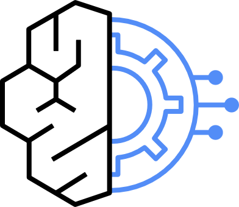

---
<!-- Slide 1: 2부 섹션 -->
@type: section
@theme: dark

# 2부: 타사 사례와 랜딩존, 네트워크

KB증권이 지나간 길, 그리고 5호 단말에서 Bedrock까지

:::notes
{timing: 0.5min}
[요약]
- 2부 질문 두 가지: 타사는 무엇을 갖췄나, 랜딩존을 만들면 5호 단말에서 쓸 수 있나
- 순서: KB증권 구조, 조직 범위, 전제조건, SI 견적, 랜딩존, OU, SCP, 네트워크, PrivateLink

2부는 두 질문에 답합니다. 먼저 KB증권이 실제로 무엇을 갖췄는지 보고, 그다음 "랜딩존을 만들면 5호 단말에서 쓸 수 있느냐"는 질문에 답하면서 OU, SCP, 네트워크까지 내려가 보겠습니다.
{cue: transition}
KB증권의 공개 아키텍처부터 보겠습니다.
:::

---
<!-- Slide 2: KB증권 아키텍처 -->
@type: content
@theme: dark
@title: KB증권: 도구와 모델, 두 갈래 경로

## KB증권: 도구와 모델, 두 갈래 경로

:::html

  <button class="cf-btn" data-r="tool">도구 호출 경로</button>
  <button class="cf-btn" data-r="model">모델 호출 경로</button>

  

    
<b>5호 단말</b>전산실, Claude Code

    
<b>보안영역</b>운영망, 개발망과 분리

  

  
→

  

    
<b>DXG</b>전용회선

    
<b>TGW</b>

  

  
→

  

    
<h5>Data Center VPC (서울 리전)</h5>
      
<b>AgentCore Gateway</b>→ Lambda, ECS 컨테이너(MCP Hub)

    

    
<h5>Shared VPC</h5>
      
<b>LLM Gateway → VPC Endpoint → Bedrock</b>Foundation Models

    

  

  
<strong class="cf-success">승인 핵심 조건</strong>
① 혁신금융 지정 ② 금보원 '적합' ③ 단말에서 Bedrock 엔드포인트 직접 호출 불가

  
<strong class="cf-info">두 갈래 경로</strong>
도구: 단말 → AgentCore Gateway → MCP Hub. 모델: 단말 → LLM Gateway → VPC Endpoint → Bedrock

  
<strong class="cf-danger">인터넷 ✕</strong>
외부 통신은 전부 차단

출처: KB증권 「망분리를 넘어, AI를 안전하게 확장하다: KB의 AI Ops와 AI Code Assistant 실전 사례」, AWS Financial Services Forum Seoul 2026, MCP Hub 요약 아키텍처

:::

:::notes
{timing: 2.5min}
[요약]
- KB증권이 포럼에서 발표한 요약 아키텍처를 재구성
- 5호 단말 → 보안영역 → DXG, TGW → AWS
- 도구 호출: Data Center VPC의 AgentCore Gateway → Lambda, ECS 컨테이너(MCP Hub)
- 모델 호출: Shared VPC의 LLM Gateway → VPC Endpoint → Bedrock
- 인터넷 통신 전부 차단, 단말의 직접 호출 불가가 승인 조건

KB증권이 포럼에서 발표한 요약 아키텍처입니다. 5호 단말에서 나간 트래픽은 보안영역을 지나 전용회선 DXG와 TGW로 AWS에 들어옵니다.
{cue: demo}
위 버튼을 눌러 두 경로를 나눠 보겠습니다. 도구 호출은 Data Center VPC의 AgentCore Gateway로 가고, 그 뒤에 Lambda와 ECS 컨테이너로 띄운 MCP Hub가 있습니다. 모델 호출은 Shared VPC의 LLM Gateway를 거쳐 VPC Endpoint로 Bedrock을 부릅니다.
{cue: pause}
인터넷으로 나가는 통신은 전부 막혀 있고, 단말이 Bedrock을 직접 부르지 못하게 한 것이 승인 조건 중 하나였습니다. 이 두 갈래 구조가 오늘 3부의 뼈대입니다.
근거: KB증권 발표 자료(AWS Financial Services Forum Seoul 2026) MCP Hub 요약 아키텍처
{cue: transition}
누가 썼는지, 계정은 어떻게 나눴는지 보겠습니다.
:::

---
<!-- Slide 3: 조직 범위와 계정 분리 -->
@type: content
@theme: dark
@title: 계정 경계는 승인 책임을 따른다

## 계정 경계는 승인 책임을 따른다

:::html

  

    <strong class="cf-accent">사용 조직 범위: 공개 사례의 확산 순서</strong>
    

      
<b>1 IT 개발 직원</b>지정서 사용자 범위

      
<b>2 베타테스터</b>소수 파일럿, 성과 측정

      
<b>3 확산</b>하네스 정착 후 팀 단위

    

    
인원 규모는 공개되지 않았습니다.

    
<strong class="cf-info">원칙</strong>: 계정 구조는 기술보다 "누가 승인하고 누가 책임지는가"에 맞춥니다. 타사 계정 구조는 비공개라 일반 요인으로 정리했습니다.

  

  <table class="data-table fragment fade-left" data-fragment-index="1">
    <thead><tr><th>계정 분리 요인</th><th>계정 설계에 미친 영향</th></tr></thead>
    <tbody>
      <tr><td>망 구분 (3호 / 5호 / 연구개발)</td><td>망별 OU 분리, OU마다 다른 SCP</td></tr>
      <tr><td>그룹 공통 vs 계열사 단독</td><td>그룹 공통 AI 플랫폼 계정 + 계열사별 소비 계정</td></tr>
      <tr><td>보안 조직 R&amp;R</td><td>Audit, Log Archive 소유권, 위임 관리자 지정</td></tr>
      <tr><td>데이터 등급 (가명 / 실데이터)</td><td>데이터 계정과 추론 계정 분리</td></tr>
      <tr><td>비용 배분 (본부 / 프로젝트)</td><td>계정 = 과금 단위, 태그 정책</td></tr>
    </tbody>
  </table>

:::

:::notes
{timing: 2min}
[요약]
- 고객 질문 1-1(조직 범위), 1-2(계정 분리)에 대한 답
- 공개 사례 순서: IT 개발 직원 → 베타테스터 → 하네스 정착 후 확산. 인원 규모 비공개
- 계정 분리 요인 5가지: 망 구분, 그룹 공통 여부, 보안 R&R, 데이터 등급, 비용 배분
- 결국 망 구분과 승인 책임이 계정 경계를 정함

고객 질문 1-1과 1-2에 대한 답입니다. 왼쪽은 조직 범위입니다. 공개된 사례는 IT 개발 직원에서 시작해서 베타테스터로 성과를 측정하고, 하네스가 정착된 뒤 팀 단위로 확산하는 순서였습니다. 인원 규모는 공개되지 않았습니다.
{cue: pause}
오른쪽은 계정을 나눌 때 실제로 영향을 주는 요인입니다. 망 구분, 그룹 공통인지 계열사 단독인지, 보안 조직의 역할, 데이터 등급, 비용 배분입니다. 결국 계정 경계는 기술보다 누가 승인하고 책임지는지에 맞춰집니다.
{cue: transition}
그럼 코딩 에이전트를 쓰려면 무엇을 갖춰야 하는지 보겠습니다.
:::

---
<!-- Slide 4: 전제조건 -->
@type: content
@theme: dark
@title: 사용자 범위는 신청서에서 정해진다

## 사용자 범위는 신청서에서 정해진다

:::html

  <button class="compare-btn active" data-compare="a">연구개발망</button>
  <button class="compare-btn" data-compare="b">5호망 혁신금융</button>

  

    
<strong class="cf-accent">승인, 사용자 범위</strong>
정보보호위원회 의결. 연구개발 목적 인력(내부 정의)

    
<strong class="cf-accent">단말, 계정</strong>
연구개발 전용 단말: NAC, EDR, DLP, DRM, MDM. IdP + MFA, 역할별 권한 분리

    
<strong class="cf-warning">도구 설정, 데이터</strong>
관리 설정 배포(모델, MCP 고정). 더미, 가명만(실데이터 금지)

    
<strong class="cf-success">로그, 운영 장치</strong>
접속, 전송 기록 1년 이상. 하네스(CLAUDE.md, Skills, 테스트) 권장

  

  

    
<strong class="cf-accent">승인, 사용자 범위</strong>
금융위 지정 + 금보원 이행점검 '적합'. 지정 신청서에 명시한 범위. 확대 시 변경 절차 필요

    
<strong class="cf-accent">단말, 계정</strong>
기존 5호 단말 통제 + AI 이용 통제. IdP + MFA + 직원별 MCP 도구 허용 목록

    
<strong class="cf-warning">도구 설정, 데이터</strong>
관리 설정 배포 필수(Hub 외 MCP 차단). 지정 범위 업무 데이터, 개인정보 필터링 전제

    
<strong class="cf-success">로그, 운영 장치</strong>
프롬프트, 응답, 도구 호출 단위 감사 로그. 하네스 + 보안 교육, 이용 안내서 게시

  

<strong class="cf-warning">기간을 줄이는 방법</strong>: 파일럿 범위와 확산 범위를 처음부터 구분해 신청서에 함께 담습니다. 나중에 넓히려면 변경 절차를 다시 밟아야 합니다.

:::

:::notes
{timing: 2min}
[요약]
- 고객 질문 1-3: 두 경로에서 각각 무엇을 갖춰야 하나
- 같은 항목(승인, 단말, 계정, 도구 설정, 데이터, 로그, 운영 장치)을 토글로 비교
- 5호망 고유 요구: 관리 설정 배포 필수, 도구 호출 단위 감사 로그, 사용자 범위가 신청서에 고정
- 관리 설정과 감사 로그는 3부 데모에서 실제로 보여 줌

고객 질문 1-3, 각 경로에서 무엇을 갖춰야 하느냐에 대한 답입니다. 같은 항목을 토글로 바꿔 보겠습니다.
{cue: demo}
5호망 쪽으로 바꾸면 세 군데가 달라집니다. 관리 설정 배포가 권장이 아니라 필수가 되고, 로그는 프롬프트와 도구 호출 단위로 남겨야 하며, 사용자 범위가 신청서에 적은 범위로 고정됩니다.
{cue: pause}
가장 중요한 건 사용자 범위입니다. 나중에 넓히려면 절차를 다시 밟아야 하니, 처음부터 파일럿과 확산 범위를 같이 적어 두시길 권합니다. 관리 설정과 감사 로그가 실제로 어떻게 동작하는지는 3부 데모에서 보여 드리겠습니다.
{cue: transition}
코딩 에이전트가 발주 방식까지 바꾸는 흐름도 짚고 가겠습니다.
:::

---
<!-- Slide 5: 외주 SI 견적 -->
@type: content
@theme: dark
@title: 코드 어시스턴트가 발주 조건이 된다

## 코드 어시스턴트가 발주 조건이 된다

:::html

  
<b>1 발주사</b>AI 개발환경 제공 (랜딩존, Gateway, Hub)

  
<b>2 RFP</b>"AI 코딩 도구 활용 전제" 명시

  
<b>3 수행사 견적</b>공정별 MH 조정

  
<b>4 계약, 검수</b>품질 기준 강화 (테스트 커버리지, 리뷰)

  

    <strong class="cf-accent">공정별 MH 조정 여지 (정성)</strong>
    
구현<i class="l"></i>대

    
테스트<i class="l"></i>대

    
분석, 설계<i class="m"></i>중

    
이행, 안정화<i class="s"></i>소

    
구현: 반복 코드, 변환, 리팩토링. 테스트: 단위 테스트 생성. 분석: 레거시 분석, 문서화. 막대는 정성 등급이며 수치가 아닙니다.

  

  

    
<strong class="cf-warning">리스크 1</strong>: 절감분이 품질 저하로 이어지지 않도록 SENSORS(테스트, 리뷰) 기준을 계약에 반영합니다.

    
<strong class="cf-warning">리스크 2</strong>: 토큰 비용을 발주사와 수행사 중 누가 부담하는지 계약에 명시합니다.

    
출처를 확인할 수 있는 절감률 수치는 아직 없어 넣지 않았습니다.

  

:::

:::notes
{timing: 1.5min}
[요약]
- 발주사가 AI 환경을 제공하고 RFP에 활용을 전제하면 수행사가 MH를 낮춰 견적하는 사례가 나옴
- MH 조정 여지: 구현, 테스트 대 / 분석, 설계 중 / 이행 소 (정성)
- 계약에 넣을 것: SENSORS 품질 기준, 토큰 비용 부담 주체
- 공개된 절감률 수치는 출처 확인 불가라 제외
- 용어: MH(Man-Hour), SENSORS(테스트, 리뷰처럼 결과를 자동 검증하는 장치, 4부에서 설명)

코드 어시스턴트가 개발자 도구를 넘어 발주 조건으로 바뀌고 있습니다. 발주사가 AI 환경을 제공하고 RFP에 활용을 전제하면, 수행사가 구현과 테스트 공정의 MH를 낮춰 견적하는 방식입니다.
{cue: pause}
다만 두 가지는 계약에 꼭 넣으셔야 합니다. 품질 기준, 즉 테스트와 리뷰 같은 SENSORS 기준, 그리고 토큰 비용을 누가 부담하는지입니다. 절감률 수치는 출처를 확인할 수 있는 것이 아직 없어서 넣지 않았습니다.
{cue: transition}
이제 "랜딩존을 구축하면 5호망 단말에서 쓸 수 있느냐"는 질문으로 넘어가겠습니다.
:::

---
<!-- Slide 6: 랜딩존은 필요조건 -->
@type: content
@theme: dark
@title: 랜딩존은 고속도로, 지정은 통행 허가

## 랜딩존은 고속도로, 지정은 통행 허가

:::html

3개 모두 충족</strong>: 5호망 단말에서 Claude Code를 쓸 수 있는 상태입니다.':'<strong>'+n+' / 3 충족</strong>: 아직 5호망 단말에서는 쓸 수 없습니다. 카드를 눌러 조건을 채워 보세요.'})(event)">
  
✓<small>기술 조건</small><strong class="cf-accent">랜딩존</strong>
계정 구조, 로그, 가드레일. 5호망 AI Platform의 기반

  
✓<small>법적 조건</small><strong class="cf-accent">혁신금융 + 금보원 적합</strong>
5호망 단말의 외부 LLM 연결은 지정과 이행점검이 전제

  
✓<small>승인 조건</small><strong class="cf-accent">전산실 중계 구조</strong>
단말에서 Bedrock 직접 호출 금지. Gateway, MCP Hub 경유

<strong>0 / 3 충족</strong>: 카드를 눌러 조건을 채워 보세요.

<strong class="cf-info">직답</strong>: 랜딩존은 필요조건이지 충분조건이 아닙니다. 연구개발망을 택하면 완전한 망분리 때문에 랜딩존 위의 Network, Security, Gateway를 별도로 새로 만들어야 합니다.

:::

:::notes
{timing: 1.5min}
[요약]
- 고객 질문 직답: 랜딩존만으로는 안 됨. 필요조건이지 충분조건이 아님
- 세 조건: 기술(랜딩존), 법적(혁신금융 + 금보원 적합), 승인(전산실 중계 구조)
- 카드를 하나씩 눌러 3/3이 되어야 "사용 가능"으로 바뀜
- 연구개발망을 택하면 구성을 공유하지 못하고 별도 구축

질문에 바로 답하면, 랜딩존만으로는 안 됩니다. 랜딩존은 고속도로고, 혁신금융 지정이 통행 허가입니다.
{cue: demo}
카드를 하나씩 눌러 보겠습니다. 랜딩존만 누르면 1/3, 혁신금융과 적합 판정을 더해도 2/3입니다. 마지막으로 단말이 직접 부르지 않는 중계 구조까지 갖춰야 3/3이 되면서 "쓸 수 있는 상태"로 바뀝니다.
{cue: pause}
그래서 권장은 5호망입니다. 연구개발망으로 가면 이 구성을 공유하지 못하고 별도로 새로 만들어야 합니다.
{cue: transition}
고속도로인 랜딩존을 어떻게 설계하는지, OU 구조부터 보겠습니다.
:::

---
<!-- Slide 7: OU 구조 -->
@type: content
@theme: dark
@title: AI는 별도 OU가 아니라 Workloads OU에

## AI는 별도 OU가 아니라 Workloads OU에

:::html

<strong>Management 계정, AWS Control Tower</strong>

  
<h5>Security OU</h5>
    <button class="cf-acct" data-k="log">Log Archive</button>
    <button class="cf-acct" data-k="sec">Security Tooling</button>
  

  
<h5>Infrastructure OU</h5>
    <button class="cf-acct" data-k="net">Network: DX, TGW, Inspection</button>
    <button class="cf-acct" data-k="shared">Shared Services: IdP 연동, DNS</button>
  

  
<h5>Workloads OU</h5>
    <button class="cf-acct key" data-k="plat">Prod: AI Platform (LLM Gateway, MCP Hub)</button>
    <button class="cf-acct key" data-k="proj">Prod: AI Project (ETL, RAG, GraphRAG)</button>
    <button class="cf-acct" data-k="sdlc">SDLC: AI Platform-dev, 기존 서비스</button>
  

  
<h5>R&amp;D OU</h5>
    <button class="cf-acct" data-k="rnd">연구개발망 AI Platform, 개발 계정</button>
  

  
<h5>Sandbox, Policy Staging</h5>
    <button class="cf-acct" data-k="sbx">Playground (필요 시)</button>
    <button class="cf-acct" data-k="stg">SCP 테스트</button>
  

계정을 눌러 역할과 걸리는 정책을 확인하세요. OU는 같은 SCP를 받는 계정의 묶음이고, 기술 종류가 아니라 규제 경계와 환경으로 나눕니다.

<strong class="cf-danger">리스크</strong>: AI Project 계정이 Bedrock을 직접 호출하면 Gateway를 우회합니다. Project 계정의 bedrock:InvokeModel* 는 Deny, Gateway 역할만 허용합니다.

:::

:::script
(function () {
  var info = {
    log: 'Log Archive: CloudTrail, Bedrock Invocation Logging, Gateway 로그가 모이는 곳. S3 Object Lock, KMS. 정책 변경 금지 SCP',
    sec: 'Security Tooling: GuardDuty, Security Hub, Config 집계의 위임 관리자. 보안 조직 소유',
    net: 'Network: Direct Connect, Transit Gateway(망별 라우팅 테이블), Inspection VPC. IGW, NAT 생성은 이 계정만 허용',
    shared: 'Shared Services: 사내 AD, IdP 연동, Route 53 Resolver, Private Hosted Zone 공유',
    plat: 'AI Platform: 5호망 경로의 통제면. LLM Gateway, AgentCore Gateway(MCP Hub), Identity. Bedrock 호출은 Gateway 역할만',
    proj: 'AI Project: 상용 AI 프로젝트와 컨텍스트 계층(Vector, Graph). Bedrock 직접 호출 Deny, AI Platform Gateway를 통해서만',
    sdlc: 'SDLC: AI Platform-dev에서 Gateway 정책을 먼저 검증. 기존 서비스 PRD/STG/DEV 계정',
    rnd: 'R&D OU: 법적 근거가 다르므로 완전히 분리. Network, Security, Gateway를 5호망과 공유하지 않고 별도 구축. "AI / R&D OU"처럼 묶으면 망분리가 성립하지 않음',
    sbx: 'Sandbox: 승인 모델만 쓰는 Playground. 사내망 미연결',
    stg: 'Policy Staging: SCP를 운영 OU에 걸기 전에 먼저 적용해 보는 곳'
  };
  var root = document.getElementById('cfOu'), out = document.getElementById('cfOuDetail');
  if (!root) return;
  root.addEventListener('click', function (e) {
    var b = e.target.closest('.cf-acct'); if (!b) return;
    root.querySelectorAll('.cf-acct').forEach(function (x) { x.classList.toggle('on', x === b); });
    out.innerHTML = '<strong class="cf-accent">' + b.textContent + '</strong>
' + info[b.dataset.k] + '
';
  });
})();
:::

:::notes
{timing: 2.5min}
[요약]
- AWS 권장 OU 구조: Security, Infrastructure, Workloads, Sandbox, Policy Staging
- AI는 별도 OU가 아니라 Workloads OU 안: Prod 아래 AI Platform(통제면), AI Project(상용 프로젝트)
- 연구개발망은 법적 근거가 달라 R&D OU로 완전히 분리, 인프라도 별도
- 리스크: AI Project 계정의 Bedrock 직접 호출은 Gateway 우회 → SCP로 Deny (규제 경계 기반 권장안)

계정 구조입니다. AWS 권장 OU를 그대로 따르고, AI는 별도 OU가 아니라 Workloads OU 안에 둡니다.
{cue: demo}
계정을 하나씩 눌러 보겠습니다. 색으로 강조한 두 계정이 핵심입니다. AI Platform은 5호망 경로의 통제면으로 Gateway와 MCP Hub가 있고, AI Project는 상용 AI 프로젝트와 컨텍스트 계층이 들어갑니다.
{cue: pause}
R&D OU를 눌러 보시면, 연구개발망은 법적 근거가 다르니 완전히 분리하고 네트워크와 보안까지 따로 만든다고 나옵니다. 그리고 아래 빨간 리스크가 중요합니다. Project 계정이 Bedrock을 직접 부르면 Gateway를 우회하게 되니, SCP로 막습니다. 그 SCP를 바로 다음에 보겠습니다.
{cue: transition}
가드레일이 어떻게 작동하는지부터 짚겠습니다.
:::

---
<!-- Slide 8: 가드레일 3종 -->
@type: content
@theme: dark
@title: 막고, 찾고, 만들기 전에 검사한다

## 막고, 찾고, 만들기 전에 검사한다

:::html

  
<strong class="cf-danger">Preventive (예방)</strong>
허용되지 않은 작업 자체를 거부

<b>구현</b>: SCP

<b>예</b>: 서울 리전 외 사용 금지, Log Archive 정책 변경 금지

  
<strong class="cf-warning">Detective (탐지)</strong>
위반 상태를 찾아내 알림

<b>구현</b>: AWS Config 규칙

<b>예</b>: 루트 계정 MFA 미설정, S3 퍼블릭 읽기 허용 탐지

  
<strong class="cf-success">Proactive (사전 검사)</strong>
리소스를 만들기 전에 검사해 차단

<b>구현</b>: CloudFormation 훅

<b>예</b>: KMS 암호화 없는 S3 버킷 생성 시도 차단

<strong class="cf-danger">리스크</strong>: SCP는 잘못 적용하면 운영 계정을 한 번에 마비시킬 수 있습니다. Policy Staging OU에 먼저 적용하고 긴급 해제 절차를 문서화하십시오. SCP는 IAM 정책과 AND 조건으로 동작합니다.

SCP: OU, 계정이 쓸 수 있는 최대 권한 범위를 정하는 조직 정책. RCP: 리소스 쪽에 같은 방식으로 적용하는 정책

:::

:::notes
{timing: 1.5min}
[요약]
- 가드레일 세 방식: Preventive(SCP), Detective(Config), Proactive(CloudFormation 훅)
- SCP가 가장 강력하고 그만큼 위험: Policy Staging OU에서 먼저 시험, 긴급 해제 절차 문서화
- SCP는 권한을 주지 않음. IAM 정책과 AND로 동작

가드레일은 막고, 찾고, 만들기 전에 검사하는 세 방식입니다. 예방은 SCP로 작업 자체를 거부하고, 탐지는 Config 규칙으로 위반을 찾아 알리고, 사전 검사는 CloudFormation 훅으로 만들기 전에 막습니다.
{cue: pause}
SCP가 가장 강력한데 그만큼 위험합니다. 잘못 걸면 운영 계정이 한 번에 멈출 수 있으니, 앞 장의 Policy Staging OU에서 먼저 시험하고 긴급 해제 절차를 문서로 남겨 두시길 권합니다.
{cue: transition}
그럼 실제로 걸게 될 SCP를 보겠습니다.
:::

---
<!-- Slide 9: SCP 예시 -->
@type: content
@theme: dark
@title: 리전은 서울로, 예외는 승인 CRIS만

## 리전은 서울로, 예외는 승인 CRIS만

:::html

  <button class="tab-btn active">① 리전 + CRIS 예외</button>
  <button class="tab-btn">② Gateway 우회 금지</button>
  <button class="tab-btn">③ 로그, 네트워크 보호</button>

  

<pre class="code-block cf-code">{
  "Sid": "DenyOutsideSeoulExceptApprovedCRIS",
  "Effect": "Deny",
  "NotAction": ["iam:*", "sts:*", "organizations:*", "support:*"],
  "Resource": "*",
  "Condition": {
    "StringNotEquals": { "aws:RequestedRegion": "ap-northeast-2" },
    "ArnNotLike": { "bedrock:InferenceProfileArn":
      "arn:aws:bedrock:ap-northeast-2:*:inference-profile/global.anthropic.claude-sonnet-5-5" }
  }
}</pre>
    

      
<strong class="cf-info">동작</strong>
서울 밖 호출은 거부. 단, 승인한 CRIS 프로파일 경유의 Bedrock 모델 평가만 통과

      
<strong class="cf-success">근거</strong>
CRIS 요청은 목적지 리전, global 모델 ARN(RequestedRegion = unspecified)까지 평가되고, 그 평가에 bedrock:InferenceProfileArn 키가 들어감. 원래 호출의 리전 제한은 우회하지 못함

    

  

  

<pre class="code-block cf-code">{
  "Sid": "OnlyGatewayRoleInvokesModels",
  "Effect": "Deny",
  "Action": "bedrock:InvokeModel*",
  "Resource": "*",
  "Condition": {
    "ArnNotLike": { "aws:PrincipalArn":
      "arn:aws:iam::*:role/llm-gateway-*" }
  }
}</pre>
    

      
<strong class="cf-info">동작</strong>
AI Project, 개발 계정 누구도 모델을 직접 못 부름. Gateway 역할만 허용

      
<strong class="cf-success">세 겹 allowlist</strong>
SCP, LLM Gateway 모델 목록, VPC 엔드포인트 정책. 그 앞에서 단말 관리 설정이 모델을 한 번 더 고정. 3부 데모에서 Gateway 겹을 보여 줌

    

  

  <table class="data-table">
    <thead><tr><th>정책</th><th>목적</th><th>Deny 대상 예</th></tr></thead>
    <tbody>
      <tr><td>로깅 비활성화 금지</td><td>감사 무결성</td><td>cloudtrail:StopLogging, cloudtrail:DeleteTrail, bedrock:DeleteModelInvocationLoggingConfiguration</td></tr>
      <tr><td>인터넷 경로 생성 금지</td><td>5호망 경로에 Egress 없음</td><td>ec2:CreateInternetGateway, ec2:CreateNatGateway, ec2:CreateVpcPeeringConnection (Network 계정 제외)</td></tr>
      <tr><td>VPC Endpoint 강제</td><td>사설 경로만 허용</td><td>aws:SourceVpce 조건을 IAM, 리소스 정책에 적용</td></tr>
    </tbody>
  </table>

<strong class="cf-danger">리스크</strong>: CRIS를 허용하면 프롬프트와 응답이 해외 리전에서 처리됩니다. Gateway DLP로 개인신용정보 입력을 먼저 막고, 국외 처리 사실을 혁신금융 신청서와 정보보호위원회 보고에 명시해야 합니다.

:::

:::notes
{timing: 2.5min}
[요약]
- ① 리전 Deny + 승인 CRIS 프로파일 예외: bedrock:InferenceProfileArn 조건 키 사용(AWS 문서 확인)
- ② Gateway 우회 금지: bedrock:InvokeModel* 를 Gateway 역할 외 Deny
- ③ 로깅 비활성화, 인터넷 경로 생성 금지, VPC Endpoint 강제
- 서울 리전 현황(2026.10.19 AWS 서울 리전 조회): Claude Sonnet 5는 서울 in-region, Opus 5.5, Sonnet 5.5는 global CRIS
- CRIS 허용 시 국외 처리 → DLP 선행, 신청서와 위원회 보고에 명시

실제로 걸게 될 정책 예시입니다. 첫 탭은 리전 제한입니다. 서울 밖 호출은 막되, 승인한 CRIS 프로파일을 거치는 Bedrock 호출만 예외로 둡니다. 이때 쓰는 조건 키가 bedrock:InferenceProfileArn입니다. AWS 문서 기준으로, CRIS 요청은 목적지 리전의 모델까지 권한 평가를 하는데 그 평가에 이 키가 들어가서 예외를 걸 수 있습니다.
{cue: pause}
2026년 10월 19일 기준으로 서울 리전에서 직접 조회해 보니, Claude Sonnet 5는 서울 리전 안에서 바로 호출되고, Opus 5.5나 Sonnet 5.5 같은 최신 모델은 global CRIS 프로파일로 나옵니다. 그래서 기본은 서울 in-region, 신규 모델이 필요할 때 승인된 CRIS만 여는 구조를 권합니다.
{cue: demo}
두 번째 탭은 Gateway 우회 금지입니다. Gateway 역할이 아니면 누구도 모델을 직접 못 부릅니다. 세 번째 탭은 로그와 네트워크 보호입니다.
{cue: pause}
CRIS를 열면 해외 리전에서 처리된다는 점은 반드시 신청서와 위원회 보고에 적고, 개인신용정보는 Gateway DLP로 먼저 막아야 합니다.
근거: AWS 문서 "Global cross-Region inference"의 Service Control Policy requirements, re:Post "AccessDeniedException ... cross-Region inference profile in an Organizations account". 예시 프로파일 ARN과 역할 이름은 설명용
{cue: transition}
이제 네트워크입니다. 5호 단말에서 Bedrock까지 실제 경로를 따라가 보겠습니다.
:::

---
<!-- Slide 10: 하이브리드 네트워크 -->
@type: content
@theme: dark
@title: 5호 단말에서 Bedrock까지, 인터넷 없이

## 5호 단말에서 Bedrock까지, 인터넷 없이

:::html

  <button class="cf-btn on" id="cfNetA" onclick="cfNet.setPlan('A')">(안 A) Gateway 전산실 배치</button>
  <button class="cf-btn" id="cfNetB" onclick="cfNet.setPlan('B')">(안 B) Gateway AI Platform 계정 배치</button>
  <button class="cf-btn" onclick="cfNet.step()">다음 홉 ▶</button>
  <button class="cf-btn" onclick="cfNet.reset()">처음으로</button>

  
<b>5호 단말</b>온프렘, Claude Code

  
<b>사내 방화벽</b>기존 5호망 통제

  
<b>LLM Gateway</b>(안 A) 전산실

  
<b>Direct Connect</b>2회선, DX Gateway

  
<b>TGW 5호망 RT</b>Egress 경로 없음

  
<b>Inspection VPC</b>Network Firewall

  
<b>내부 NLB, Gateway</b>(안 B) ECS / EKS

  
<b>VPC Endpoint, Bedrock</b>bedrock-runtime

"다음 홉"을 눌러 요청 한 건을 따라가 보세요.

<strong class="cf-warning">리스크</strong>: Gateway 배치는 두 안을 함께 제시합니다. KB증권의 배치는 공개되지 않았고 금보원 해석에 따라 달라지므로 컨설팅 단계에서 확정합니다.

:::

:::script
window.cfNet = (function () {
  var plan = 'A', cur = -1;
  var msg = [
    '5호 단말: Claude Code는 Bedrock 엔드포인트를 직접 모릅니다. 관리 설정의 ANTHROPIC_BEDROCK_BASE_URL이 사내 Gateway를 가리킵니다.',
    '사내 방화벽: 기존 5호망 통제를 그대로 둡니다. 단말에서 나갈 수 있는 목적지는 Gateway 하나뿐입니다.',
    '(안 A) 전산실 Gateway: 인증, DLP, 로깅을 온프렘에서 끝내고, 검사를 통과한 프롬프트만 전용회선으로 보냅니다.',
    'Direct Connect 2회선과 DX Gateway: 인터넷을 거치지 않는 전용 경로입니다.',
    'Transit Gateway 5호망 라우팅 테이블: 다른 망(R&D, Workload)과 섞이지 않고, 인터넷이나 Egress 경로가 아예 없습니다.',
    'Inspection VPC: Network Firewall(또는 GWLB + NGFW)로 망 간 트래픽을 검사합니다.',
    '(안 B) AI Platform 계정의 내부 NLB 뒤 Gateway: ECS나 EKS로 운영합니다. 단말에서 오는 요청은 여기서 인증, DLP, 로깅을 받습니다.',
    'Interface VPC Endpoint(bedrock-runtime): 사설 IP로만 Bedrock을 부릅니다. 엔드포인트 정책으로 Gateway 역할과 허용 모델만 통과시킵니다.'
  ];
  function hidden(h) { return (plan === 'A' && h.classList.contains('pb')) || (plan === 'B' && h.classList.contains('pa')); }
  function hops() { return Array.prototype.slice.call(document.querySelectorAll('#cfNetRow .cf-hop')); }
  function render() {
    hops().forEach(function (h) {
      var i = +h.dataset.h;
      h.classList.toggle('skip', hidden(h));
      h.classList.toggle('done', i < cur); h.classList.toggle('cur', i === cur);
    });
    document.getElementById('cfNetA').classList.toggle('on', plan === 'A');
    document.getElementById('cfNetB').classList.toggle('on', plan === 'B');
    var out = document.getElementById('cfNetMsg');
    out.innerHTML = cur < 0 ? '"다음 홉"을 눌러 요청 한 건을 따라가 보세요.' : '<strong class="cf-accent">' + msg[cur] + '</strong>';
  }
  function step() {
    var v = hops().filter(function (h) { return !hidden(h); }).map(function (h) { return +h.dataset.h; });
    var nxt = v.filter(function (i) { return i > cur; })[0];
    cur = nxt === undefined ? v[v.length - 1] : nxt; render();
  }
  function setPlan(p) { plan = p; cur = -1; render(); }
  function reset() { cur = -1; render(); }
  if (document.readyState === 'loading') document.addEventListener('DOMContentLoaded', render); else render();
  return { step: step, setPlan: setPlan, reset: reset };
})();
:::

:::notes
{timing: 2.5min}
[요약]
- 5호 단말 → 사내 방화벽 → (안 A 전산실 Gateway) → DX 2회선 → TGW 5호망 RT → Inspection VPC → (안 B 내부 NLB 뒤 Gateway) → VPC Endpoint → Bedrock
- TGW 5호망 RT에는 인터넷, Egress 경로가 아예 없음
- 단말 → Bedrock 직접 경로 없음
- Gateway 배치 두 안은 금보원 컨설팅에서 확정 (KB증권 배치는 비공개)

네트워크 경로입니다. "다음 홉" 버튼으로 요청 한 건을 따라가 보겠습니다.
{cue: demo}
5호 단말에서 출발해 사내 방화벽을 지나고, 안 A라면 전산실의 Gateway에서 검사를 받습니다. 전용회선 두 회선으로 AWS에 들어오고, Transit Gateway에서 5호망 전용 라우팅 테이블을 탑니다. 이 테이블에는 인터넷 경로가 아예 없습니다.
{cue: pause}
Inspection VPC를 지나 Bedrock은 VPC 엔드포인트로만 부릅니다. 위에서 안 B로 바꾸면, Gateway가 온프렘 대신 AI Platform 계정의 내부 NLB 뒤로 옮겨 갑니다. 어느 쪽이 맞는지는 금보원 해석에 따라 달라서, 두 안을 놓고 컨설팅 단계에서 확정하겠습니다.
{cue: transition}
마지막 홉인 PrivateLink와 DNS를 조금 더 자세히 보겠습니다.
:::

---
<!-- Slide 11: PrivateLink와 DNS -->
@type: content
@theme: dark
@title: 퍼블릭 DNS를 해석하지 않는다

## 퍼블릭 DNS를 해석하지 않는다

:::html

  

    <strong class="cf-accent">계정 VPC의 Interface Endpoint (Private Subnet, 2 AZ)</strong>
    

      
<code>bedrock-runtime</code> 모델 추론

      
<code>bedrock-agentcore.gateway</code> MCP Hub (Gateway)

      
<code>bedrock-agent-runtime</code> KB 조회

      
<code>bedrock-agentcore</code> Runtime, Memory, Identity

      
<code>sts</code> 역할 임시 자격증명

      
<code>logs, monitoring</code> CloudWatch

      
<code>kms, secretsmanager</code> 키, 비밀

      
<code>aoss, glue, states</code> RAG, ETL

    

    
S3는 Gateway Endpoint(KB 원천, 로그). AgentCore 엔드포인트 이름은 AgentCore 개발자 가이드(VPC interface endpoints) 기준, bedrock 관리 API는 필요 시 추가

  

  

    <strong class="cf-accent">DNS 해석 흐름</strong>
    

      
<b>1 온프렘 DNS (전산실)</b>bedrock-runtime.ap-northeast-2.amazonaws.com 질의를 조건부 포워딩

      
<b>2 Route 53 Resolver Inbound Endpoint</b>Network 계정

      
<b>3 Private Hosted Zone / Endpoint Private DNS</b>Route 53 Profiles 또는 RAM으로 계정 간 공유

      
<b>4 VPC Endpoint ENI (사설 IP)</b>→ Bedrock

    

  

<strong class="cf-success">Endpoint Policy</strong>: 허용 Principal(Gateway 역할)과 허용 모델 ARN만 지정합니다. 모델 allowlist가 SCP, Gateway, 엔드포인트 세 겹으로 걸립니다.

:::

:::notes
{timing: 2min}
[요약]
- 핵심 엔드포인트는 bedrock-runtime(모델)과 bedrock-agentcore.gateway(MCP Hub). 나머지는 AgentCore Runtime, KB, STS, 로그, KMS, RAG, ETL용
- DNS: 온프렘 DNS → Route 53 Resolver Inbound → Private Hosted Zone → VPC Endpoint ENI(사설 IP)
- 퍼블릭 DNS를 해석하지 않으므로 인터넷 경로가 생길 여지가 없음
- Endpoint Policy까지 더해 모델 allowlist가 세 겹

PrivateLink 상세입니다. 왼쪽이 계정 VPC에 만들 엔드포인트 목록인데, 핵심은 테두리 친 두 개, 모델을 부르는 bedrock-runtime과 MCP Hub로 들어가는 bedrock-agentcore.gateway입니다. AgentCore Gateway는 Runtime과 별도의 엔드포인트를 씁니다.
{cue: pause}
오른쪽은 DNS 흐름입니다. 하나씩 넘기면, 온프렘 DNS가 Bedrock 도메인 질의를 Route 53 Resolver로 넘기고, Private Hosted Zone을 통해 엔드포인트의 사설 IP로만 해석합니다. 퍼블릭 IP로 해석될 일이 없으니 인터넷 경로가 생길 여지도 없습니다.
{cue: pause}
마지막으로 엔드포인트 정책에도 허용 모델과 Gateway 역할을 걸어서, 모델 allowlist가 SCP, Gateway, 엔드포인트 세 겹으로 걸립니다.
{cue: transition}
2부를 정리하겠습니다.
:::

---
<!-- Slide 12: 2부 정리 -->
@type: content
@theme: dark
@title: 2부 정리: 길은 하나, 우회로는 없다

## 2부 정리: 길은 하나, 우회로는 없다

:::html

  
<strong class="cf-accent">두 갈래 경로</strong>
도구는 AgentCore Gateway(MCP Hub)로, 모델은 LLM Gateway로. KB증권이 검증한 구조입니다.

  
<strong class="cf-accent">랜딩존은 필요조건</strong>
AI는 Workloads OU에. SCP로 리전, Gateway 우회, 로그, 인터넷 경로를 막습니다.

  
<strong class="cf-success">네트워크에 우회로 없음</strong>
DX → TGW 5호망 RT → PrivateLink. 퍼블릭 DNS 해석 없음, 모델 allowlist 세 겹.

<strong class="cf-info">다음 3부</strong>: 길 끝의 두 관문, MCP Hub와 LLM Gateway를 열어 보고 실제로 돌려 본 데모를 봅니다.

:::

:::notes
{timing: 1min}
[요약]
- 두 갈래 경로: 도구는 MCP Hub, 모델은 LLM Gateway
- 랜딩존은 필요조건, AI는 Workloads OU, SCP 네 가지
- 네트워크: DX, TGW 5호망 RT, PrivateLink, 퍼블릭 DNS 해석 없음

2부를 정리하면, 도구와 모델이 각각 다른 관문을 지나는 두 갈래 구조이고, 랜딩존과 SCP로 우회를 막으며, 네트워크에는 인터넷으로 빠지는 길이 없습니다.
{cue: transition}
이제 3부에서 그 두 관문을 열어 보겠습니다.
:::
