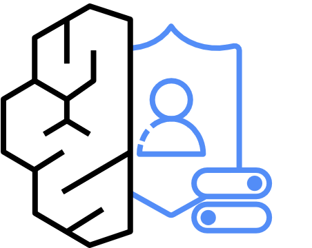

---
<!-- Slide 1: 3부 섹션 -->
@type: section
@theme: dark

# 3부: MCP Hub와 LLM Gateway

Claude Code를 하나의 통제면에서, 실제로 돌려 본 데모와 함께

:::notes
{timing: 0.5min}
[요약]
- 3부: 2부 끝에서 본 두 관문(LLM Gateway, MCP Hub)을 열어 봄
- 데모 V1(관리 설정 강제), V2(LLM Gateway DLP, 모델 allowlist, 감사 로그)를 이 블록에서 상영
- 데모는 2026.10.19 실제 실행 녹화. 단말 역할 컨테이너 + 서울 리전 Bedrock

3부에서는 길 끝에 있는 두 관문, LLM Gateway와 MCP Hub를 열어 봅니다. 중간중간 오늘 아침에 실제로 돌려서 녹화한 데모 두 편을 보여 드리겠습니다.
{cue: transition}
먼저 전체 그림입니다.
:::

---
<!-- Slide 2: 전체 구성 -->
@type: content
@theme: dark
@title: 모델은 Gateway로, 도구는 Hub로

## 모델은 Gateway로, 도구는 Hub로

:::html

  <button class="cf-btn" data-p="m">① 모델 호출</button>
  <button class="cf-btn" data-p="t">② 도구, 컨텍스트 호출</button>

  
<h5>전산실 (5호망): 개발자 단말</h5>
    
<b>Claude Code</b>터미널, IDE 플러그인

    
<b>Codex</b>같은 Gateway 뒤 보조 클라이언트

    
<b>사내 MCP 서버, 지식 원본</b>형상관리, 일정, 모니터링, 규정집, 코딩 표준

  

  
<h5>AI Platform 계정 (Workloads / Prod), DX 경유</h5>
    
<b>LLM Gateway → VPC Endpoint → Bedrock + Guardrails</b>Anthropic / OpenAI 호환 API

    
<b>MCP Hub = AgentCore Gateway</b>AgentCore Identity(AD)로 사내 시스템 호출, VPC egress → 온프렘

    
<b>감사 로그 → Log Archive</b>

  

  
<h5>AI Project 계정 (컨텍스트 계층)</h5>
    
<b>Vector: Bedrock Knowledge Bases</b>OpenSearch Serverless, 규정, 가이드 문서 의미 검색

    
<b>Graph: Neptune Analytics (+ AWS Context 검토)</b>온톨로지, 관계 검색

    
<b>ETL: Glue, Step Functions</b>파싱, 정제, 가명화, 청킹. 원본은 온프렘에 유지

  

<strong class="cf-info">왜 컨텍스트 계층까지</strong>: Claude Code가 사내 규칙을 알고 코드를 쓰려면 컨텍스트가 필요합니다. 원본은 온프렘에 두고, ETL을 거친 Vector와 Graph만 MCP Hub를 통해 검색합니다.

:::

:::notes
{timing: 2min}
[요약]
- 단말의 Claude Code(그리고 Codex)는 두 곳만 부름: 모델은 LLM Gateway, 도구와 컨텍스트는 MCP Hub
- 모델: LLM Gateway → PrivateLink → Bedrock + Guardrails
- 도구: AgentCore Gateway → Identity로 사내 시스템 호출, 또는 AI Project 계정의 Vector, Graph 검색
- 지식 원본은 온프렘 유지, 승인된 배치로 ETL만 거쳐 들어감
- 용어: MCP Target(Gateway 뒤에 등록되는 도구)

전체 그림입니다. 버튼으로 두 경로를 나눠 보겠습니다.
{cue: demo}
1번 모델 호출을 켜면 가운데 위 상자만 남습니다. Claude Code가 LLM Gateway를 거쳐 PrivateLink로 Bedrock에 갑니다. 2번 도구와 컨텍스트를 켜면 MCP Hub, 즉 AgentCore Gateway로 가서 사내 시스템이나 오른쪽 컨텍스트 계층을 검색합니다.
{cue: pause}
오른쪽 컨텍스트 계층이 중요합니다. 사내 규정집이나 코딩 표준 원본은 온프렘에 그대로 두고, 승인된 배치로 ETL에 넣어 Vector와 Graph로 만듭니다. 그 검색 기능을 MCP 도구로 등록하면, 코딩 에이전트가 사내 규칙을 찾아보면서 코드를 씁니다.
{cue: transition}
그럼 MCP와 Hub가 왜 필요한지부터 보겠습니다.
:::

---
<!-- Slide 3: MCP와 Hub -->
@type: content
@theme: dark
@title: MCP는 규약, Hub는 그 연결의 관문

## MCP는 규약, Hub는 그 연결의 관문

:::html

  <button class="compare-btn active" data-compare="why">WHY: 직접 연결하면</button>
  <button class="compare-btn" data-compare="what">WHAT: Hub가 하는 일</button>

  

    
<strong class="cf-danger">통제 지점이 없음</strong>
클라이언트마다 MCP 서버를 따로 붙이면 누가 무엇에 붙었는지 알 수 없습니다.

    
<strong class="cf-danger">신원 확인 불가</strong>
AI가 스스로 "나는 누구"라고 말하는 방식은 검증할 수 없습니다.

    
<strong class="cf-danger">정책이 제각각</strong>
보안정책, 코딩표준을 개발자 설정에 맡기면 사람마다 다릅니다.

  

  

    
<strong class="cf-success">01 중앙 중계</strong>
모든 MCP 호출이 Hub를 한 번 거쳐 나갑니다. 감사 추적이 한 곳에 모입니다.

    
<strong class="cf-success">02 통합 인증</strong>
사내 AD 계정으로 로그인하고 토큰으로 신원을 증명합니다. 권한 없는 서버는 목록에 안 보입니다.

    
<strong class="cf-success">03 정책 주입</strong>
허용 도구, 호출 정책을 Hub가 서버 측에서 적용합니다. 개발자가 지울 수 없습니다.

  

<strong class="cf-info">MCP(Model Context Protocol)</strong>: AI가 사내 시스템을 도구처럼 호출하게 해 주는 표준 인터페이스. Claude Code와 Codex 모두 지원합니다.

:::

:::notes
{timing: 1.5min}
[요약]
- MCP: AI가 사내 시스템을 도구처럼 부르는 표준 규약
- WHY: 직접 연결하면 통제 지점 없음, 신원 검증 불가, 정책 제각각
- WHAT: Hub가 중앙 중계, 통합 인증(AD 토큰), 서버 측 정책 주입

MCP는 AI가 사내 시스템을 도구처럼 부르는 표준 규약입니다. 문제는 개발자마다 따로 붙이면 통제가 안 된다는 점입니다.
{cue: demo}
토글을 WHAT으로 바꾸겠습니다. 그래서 모든 연결을 Hub 한 곳으로 모아 중계하고, 사내 AD 토큰으로 신원을 확인하고, 정책을 서버 쪽에서 적용합니다. 개발자가 자기 PC 설정으로 지울 수 없는 정책이라는 게 핵심입니다.
{cue: transition}
이 Hub를 직접 만들지 않고 관리형 서비스로 구성하는 방법을 보겠습니다.
:::

---
<!-- Slide 4: AgentCore Gateway -->
@type: content
@theme: dark
@title: MCP Hub는 AgentCore Gateway로

## MCP Hub는 AgentCore Gateway로

:::html

  
<h5>MCP 클라이언트</h5>
    
<b>Claude Code</b>

<b>Codex</b>

<b>사내 에이전트</b>

  

  
<h5>Inbound Auth</h5>
    
<b>JWT 검증</b>IdP: 사내 AD 연동 (Keycloak, Entra ID, Cognito 중 택1, 확인 필요)

  

  
<h5>AgentCore Gateway (MCP Endpoint)</h5>
    
<b>tools/list 분기</b>: 사용자 권한별로 보이는 도구가 다름

    
<b>Semantic tool search</b>: 도구가 많아도 필요한 것만 노출

    
<b>AgentCore Policy (Cedar)</b>: 호출 단위 허용 / 거부 (2026.03 GA)

    
<b>Outbound Auth: AgentCore Identity</b>: 자격증명 보관, 사용자 대신 호출. 단말에 자격증명이 남지 않음

  

  
<h5>Targets</h5>
    
<b>Lambda</b>사내 API 래핑

    
<b>OpenAPI / Smithy</b>형상관리, 배포, 티켓

    
<b>기존 MCP 서버, KB 조회</b>사내 문서, RAG

  

  
<strong class="cf-info">Observability</strong>: 호출 로그 → CloudWatch → Log Archive. 클라이언트는 Hub URL 하나만 압니다.

  
<strong class="cf-warning">서울 리전</strong>: Gateway, Identity, Policy, Observability 가용(AgentCore 리전 문서). 전용 엔드포인트 bedrock-agentcore.gateway. 확인 필요: Policy 엔진의 처리 리전

:::

:::notes
{timing: 2min}
[요약]
- Hub를 직접 만들지 않고 AgentCore Gateway로 구성. 클라이언트는 Hub URL 하나만 앎
- Inbound: JWT 검증(사내 AD 연동 IdP)
- Gateway 기능: 권한별 tools/list, semantic tool search, Policy(Cedar, 2026.03 GA), Outbound는 Identity가 자격증명 보관
- Targets: Lambda, OpenAPI/Smithy, 기존 MCP 서버, KB
- 서울: Gateway, Identity, Policy, Observability 가용(문서). Gateway 전용 인터페이스 엔드포인트 bedrock-agentcore.gateway. 확인 필요는 Policy 처리 리전만

MCP Hub를 AgentCore Gateway로 구성한 그림입니다. 왼쪽에서 Claude Code든 Codex든 같은 Hub URL로 들어옵니다.
{cue: pause}
토큰을 검증하고, 사용자에 따라 보이는 도구 목록이 달라지며, Policy로 호출 하나하나를 허용하거나 막습니다. Policy는 올해 3월에 GA가 됐습니다. 사내 시스템 자격증명은 Identity가 보관해서 단말에는 남지 않습니다.
근거: AWS What's New 2026.03 "Policy in Amazon Bedrock AgentCore is now generally available"
{cue: transition}
그런데 Hub만 있으면 끝일까요? 개발자 PC가 Hub를 우회하면 소용이 없습니다. 그래서 관문이 세 개 필요합니다.
:::

---
<!-- Slide 5: MCP 세 관문 -->
@type: content
@theme: dark
@title: 단말 설정이 없으면 Hub도 무의미하다

## 단말 설정이 없으면 Hub도 무의미하다

:::html
<table class="data-table">
  <thead><tr><th>관문</th><th>무엇을 통제하나</th><th>Claude Code 구현</th><th>Codex 구현</th></tr></thead>
  <tbody>
    <tr class="fragment fade-up" data-fragment-index="1"><td><strong>① 등록 심사</strong></td><td>사내 MCP 서버를 Hub에 올릴지</td><td>Hub 운영 조직이 기능, 권한 심사 후 Gateway Target 등록. 개발자 임의 추가 불가</td><td>동일 (Hub 공용)</td></tr>
    <tr class="fragment fade-up" data-fragment-index="2"><td><strong class="cf-accent">② 클라이언트 제한</strong></td><td>개발자 PC가 Hub 외의 MCP에 붙는 것</td><td>/etc/claude-code/managed-settings.json: <code>allowedMcpServers</code>(serverUrl), <code>allowManagedMcpServersOnly</code>, <code>allowManagedPermissionRulesOnly</code>, env로 Bedrock, Gateway, 모델 고정</td><td>관리 배포 config.toml: model_provider = 사내 Gateway, mcp_servers = Hub만 (강제 범위 PoC 확인 필요)</td></tr>
    <tr class="fragment fade-up" data-fragment-index="3"><td><strong>③ 호출 인가</strong></td><td>사용자별로 어떤 도구를 쓸 수 있나</td><td>토큰 검증 후 허용 도구 목록만 반환, Policy로 호출 단위 판정</td><td>동일 (Hub 공용)</td></tr>
  </tbody>
</table>

<strong class="cf-danger">②가 없으면 ①과 ③이 무의미</strong>: 단말 관리 설정 배포가 MCP 통제의 전제 조건입니다. 다음 장에서 실제로 동작하는 모습을 보여 드립니다.

관리 설정: 회사가 배포해 개발자가 바꿀 수 없게 고정한 도구 설정. 키 이름은 Claude Code 공식 문서(managed settings, managed MCP) 기준이며 데모에서 동작을 확인했습니다.

:::

:::notes
{timing: 2min}
[요약]
- 관문 세 개: ① 등록 심사, ② 클라이언트 제한, ③ 호출 인가
- ①③은 Hub에서 하므로 도구 무관. ②만 클라이언트별로 다름
- Claude Code: /etc/claude-code/managed-settings.json 의 allowedMcpServers, allowManagedMcpServersOnly, allowManagedPermissionRulesOnly + env로 Bedrock, Gateway, 모델 고정 (공식 문서 + 데모로 확인)
- Codex: 관리 배포 config.toml, 강제 범위는 PoC에서 확인 필요
- 원본 제안서의 enableAllProjectMcpServers 키는 문서로 확인하지 못해 뺐음

관문은 세 개입니다. 하나씩 올리겠습니다. 1번 등록 심사와 3번 호출 인가는 Hub에서 하니 클라이언트가 무엇이든 같습니다.
{cue: pause}
2번만 클라이언트별로 다릅니다. Claude Code는 리눅스 기준 /etc/claude-code 아래 managed-settings.json을 배포합니다. 여기서 허용 MCP 서버를 URL로 고정하고, 관리 설정의 목록만 쓰게 강제하고, 권한 규칙도 관리 설정 것만 인정하게 합니다. Bedrock 연결과 Gateway 주소, 모델도 같은 파일의 env로 고정합니다. Codex 쪽은 관리 배포 설정으로 하는데, 강제 범위는 PoC에서 확인하겠습니다.
{cue: pause}
2번이 없으면 1번과 3번이 의미가 없습니다. 개발자가 Hub를 우회해서 아무 MCP나 붙이면 끝이기 때문입니다. 이 2번이 실제로 어떻게 동작하는지 바로 영상으로 보겠습니다.
근거: code.claude.com 문서 managed-settings, managed-mcp, permissions (2026.10.19 확인)
{cue: transition}
첫 번째 데모 영상입니다.
:::

---
<!-- Slide 6: 데모 V1 -->
@type: content
@theme: dark
@fit: off
@title: 데모 V1: 관리 설정은 개발자가 못 푼다

## 데모 V1: 관리 설정은 개발자가 못 푼다

:::html

  

    <video class="cf-video" poster="media/r1-managed.jpg" aria-label="데모 V1 영상: Claude Code 관리 설정 강제, 실제 터미널 녹화, 무음, 1분 11초" title="데모 V1 영상: Claude Code 관리 설정 강제, 실제 터미널 녹화, 무음, 1분 11초" controls preload="metadata" muted playsinline tabindex="-1"><source src="media/r1-managed.mp4" type='video/mp4; codecs="avc1.640034"'><source src="media/r1-managed.webm" type='video/webm; codecs="vp9"'></video>
  

  
실제 터미널 녹화 (2026.10.19 13:59 UTC), Claude Code 2.1.303, 서울 리전 Bedrock. 출력이 2초 넘게 없는 구간은 2초로 줄임, 무음

:::

:::script
// While a video plays, native controls keep focus and swallow arrow keys: give focus back to the deck.
document.querySelectorAll('video.cf-video').forEach(function (v) {
  var release = function () { setTimeout(function () { if (document.activeElement === v) v.blur(); }, 0); };
  ['focus', 'play', 'pause', 'seeked', 'volumechange', 'click', 'pointerup'].forEach(function (ev) { v.addEventListener(ev, release); });
});
// Pause any video left on a slide that is no longer active.
window.addEventListener('hashchange', function () {
  document.querySelectorAll('.slide:not(.active) video.cf-video').forEach(function (v) { if (!v.paused) v.pause(); });
});
:::

:::notes
{timing: 3.5min}
[요약]
- 영상 1분 11초, 실제 실행 녹화. 개발자 단말 역할의 컨테이너(dev01@5ho-pc)에서 실행
- 1: 단말에 AWS 자격증명이 없음 (AWS_ 환경변수 0개, ~/.aws 없음)
- 2: root 소유 managed-settings.json: Bedrock 사용, Gateway 주소, 모델, MCP 허용 목록, deny 규칙
- 3: github, 로컬 npx MCP는 "not allowed by enterprise policy", Hub URL만 추가됨
- 4: 개발자가 ~/.claude/settings.json 에 curl 허용을 넣어도 무시되고 curl은 거부(permission_denials)
- 5, 6: 고객 데이터 파일 읽기는 CLAUDE.md 규칙이 먼저 거절, CLAUDE.md 없는 폴더에서는 관리 설정 deny 규칙이 Read를 막음
- 마지막에 Gateway 감사 로그에 dev01의 호출이 남는 것까지

Play를 누르고 장면마다 짧게 설명합니다. 영상은 무음입니다.
0:00 단말에서 AWS 관련 환경변수를 세어 보면 0개, ~/.aws 폴더도 없습니다. 이 단말은 Bedrock을 직접 부를 수단이 없습니다.
0:04 회사가 배포한 관리 설정입니다. root 소유라 개발자가 고칠 수 없습니다. Bedrock을 쓰되 주소는 사내 Gateway, 모델은 서울 리전의 Sonnet 5로 고정했고, MCP는 Hub URL만 허용, curl과 웹 접근, 고객 데이터 폴더 읽기는 deny입니다.
0:18 개발자가 github MCP와 로컬 npx MCP를 추가하려고 하면 "enterprise policy로 허용되지 않음"이 나옵니다. Hub URL은 추가됩니다.
{cue: pause}
0:32 개발자가 자기 설정 파일에 curl 허용을 넣고 curl을 시켜 봅니다. 사용자 설정은 무시되고, Claude가 시도한 curl 명령이 permission_denials에 그대로 찍힙니다.
0:48 고객 데이터 파일을 읽어 달라고 하면, 이 프로젝트에서는 CLAUDE.md 규칙 때문에 Claude가 먼저 거절합니다. 0:59에 CLAUDE.md가 없는 다른 폴더에서 다시 시키면 이번에는 관리 설정의 deny 규칙이 Read 도구 자체를 막습니다. 두 겹입니다.
1:06 마지막은 Gateway 운영자 화면입니다. 방금 호출들이 dev01 이름으로 남았습니다.
근거: 녹화 원본 r1-managed.cast, 드라이버 demo/rec/r1-managed.sh, media/RECORDINGS.md
{cue: transition}
영상에서 본 내용을 한 장으로 정리하겠습니다.
:::

---
<!-- Slide 7: V1 정리 -->
@type: content
@theme: dark
@title: V1에서 확인한 여섯 가지

## V1에서 확인한 여섯 가지

:::html

  
<strong class="cf-success">자격증명 없음</strong>
단말의 AWS_ 환경변수 0개, ~/.aws 없음
<code>env | grep -c "^AWS_" → 0</code>

  
<strong class="cf-success">설정은 root 소유</strong>
Gateway 주소, 모델, MCP 허용 목록, deny 규칙을 한 파일로
<code>-rw-r--r-- root root managed-settings.json</code>

  
<strong class="cf-success">Hub 외 MCP 차단</strong>
github, 로컬 npx 서버 추가 거부. Hub URL만 허용
<code>Cannot add MCP server "github": not allowed by enterprise policy</code>

  
<strong class="cf-success">사용자 allow 무시</strong>
~/.claude/settings.json 의 curl 허용이 적용되지 않음
<code>denied: ["curl -s https://example.com | head -n 1"]</code>

  
<strong class="cf-success">고객 데이터 두 겹</strong>
CLAUDE.md 규칙이 먼저 거절, 없는 폴더에서는 deny 규칙이 Read 차단
<code>denied: ["Read .../customer-data/accounts.csv"]</code>

  
<strong class="cf-success">호출은 실명으로</strong>
모든 모델 호출이 Gateway 감사 로그에 dev01로 기록
<code>{"user":"dev01","decision":"ALLOW",...}</code>

<strong class="cf-warning">한계도 정직하게</strong>: Bash deny 규칙은 명령 문자열 기준이라 /usr/bin/curl, sh -c 같은 우회는 막지 못하고, Read deny는 스크립트가 직접 여는 파일을 막지 못합니다(공식 문서). 단말 방화벽과 sandbox로 OS 수준을 보강합니다.

:::

:::notes
{timing: 1.5min}
[요약]
- V1 결과 여섯 가지: 자격증명 없음, root 소유 설정, Hub 외 MCP 차단, 사용자 allow 무시, 고객 데이터 두 겹 차단, 실명 감사 로그
- 한계(공식 permissions 문서): Bash deny는 명령 문자열 일치, Read deny는 하위 프로세스가 직접 여는 파일을 못 막음
- 보강: 5호망 방화벽(목적지는 Gateway뿐), Claude Code sandbox, EDR

영상에서 확인한 것을 여섯 장 카드로 정리했습니다. 회색 글씨가 실제 화면에 나온 출력입니다.
{cue: pause}
다만 한계도 정직하게 말씀드려야 합니다. 공식 문서에도 나와 있듯이, Bash deny 규칙은 명령 문자열을 기준으로 하기 때문에 경로를 바꿔 부르면 못 막고, Read deny는 스크립트가 직접 여는 파일까지 막지는 못합니다. 그래서 관리 설정은 첫 번째 겹이고, 5호망 방화벽처럼 단말이 나갈 수 있는 목적지를 Gateway 하나로 묶는 게 진짜 경계입니다. 필요하면 Claude Code의 sandbox 기능과 EDR로 OS 수준을 보강합니다.
근거: code.claude.com permissions 문서 "Bash deny rules match the command text", "Read deny rules do not block subprocesses"
{cue: transition}
이제 모델 호출 쪽 관문, LLM Gateway로 넘어갑니다. 먼저 요청 한 건이 어떻게 흐르는지 보겠습니다.
:::

---
<!-- Slide 8: 요청 한 건의 흐름 -->
@type: content
@theme: dark
@title: 요청 한 건이 남기는 흔적

## 요청 한 건이 남기는 흔적

:::html

  
개발자, IdP(AD)

Claude Code

LLM Gateway

Bedrock

AgentCore Gateway

사내 시스템

Log Archive

  
① AD 계정 로그인 (MFA) → ② 단기 토큰 발급

  
③ 모델 호출 + 토큰

  
④ DLP, 모델 allowlist 통과 후 PrivateLink 호출

  
⑤ 프롬프트, 응답 메타데이터 로그 (user, model, 판정, 토큰)

  
⑥ 도구 호출 + 토큰 → AgentCore Gateway

  
⑦ Policy 허용 시 Identity 자격증명으로 호출

  
⑧ 도구 호출 로그

<strong class="cf-success">한 줄로 이어지는 감사</strong>: AI가 주장하는 신원이 아니라 토큰으로 확인합니다. 모델 호출과 도구 호출이 같은 신원으로 기록되어 "누가 무엇을 했는지"가 이어집니다.

:::

:::notes
{timing: 2min}
[요약]
- ① 로그인(MFA) ② 단기 토큰 ③ 모델 호출 + 토큰 ④ DLP 통과 후 PrivateLink ⑤ 모델 호출 로그 ⑥ 도구 호출 + 토큰 ⑦ Policy 허용 시 Identity로 호출 ⑧ 도구 호출 로그
- 신원은 AI의 주장이 아니라 토큰으로 확인
- 모델 호출과 도구 호출이 같은 신원으로 기록됨

요청 한 건을 따라가 보겠습니다. 하나씩 넘기겠습니다.
{cue: pause}
개발자가 AD로 로그인해 토큰을 받고, 그 토큰으로 모델을 부릅니다. 모델 호출은 Gateway의 DLP와 모델 allowlist를 통과해야 Bedrock으로 가고, 그 결과가 5번 로그로 남습니다. 도구 호출은 AgentCore Gateway가 Policy로 판정하고 Identity가 보관한 자격증명으로 사내 시스템을 부르며, 8번 로그로 남습니다.
{cue: pause}
두 호출이 같은 신원으로 남기 때문에, 금보원이 "이 코드 변경은 누가 어떤 프롬프트로 만들었냐"고 물을 때 한 줄로 이어서 답할 수 있습니다. 3, 4, 5번을 바로 다음 데모에서 실제로 보여 드리겠습니다.
{cue: transition}
그 전에 Gateway가 Claude Code와 Codex를 어떻게 같이 받는지 보겠습니다.
:::

---
<!-- Slide 9: Claude Code와 Codex 수용 -->
@type: content
@theme: dark
@title: 도구는 개발자가, 통제는 Gateway가

## 도구는 개발자가, 통제는 Gateway가

:::html

  
<h5>클라이언트</h5>
<b>Claude Code</b>CLAUDE_CODE_USE_BEDROCK

<b>Codex</b>Responses API

  
<h5>LLM Gateway</h5>
    
<b>Bedrock InvokeModel 경로</b>ANTHROPIC_BEDROCK_BASE_URL, CLAUDE_CODE_SKIP_BEDROCK_AUTH

    
<b>OpenAI 호환 API</b>Responses / Chat Completions

    

① 인증, 인가

② DLP

③ 로깅

④ Quota

  

  
<h5>백엔드</h5>
    
<b>Claude</b>Sonnet 5 서울 in-region, Opus 5.5, Sonnet 5.5 global CRIS

    
<b>OpenAI on Bedrock</b>GPT-6 Astra, GPT-6.1 Sol 등 global / US CRIS만

    
<b>(향후) 사내 모델</b>온프렘 vLLM

  

  
<strong class="cf-info">Claude Code 연결 방식</strong>: Bedrock 모드에서 Gateway가 /model/{id}/invoke-with-response-stream 을 받아 자기 역할로 다시 서명합니다. 단말은 Gateway 토큰(Authorization: Bearer)만 가집니다.

  
<strong class="cf-warning">리스크</strong>: OpenAI 모델은 서울 in-region이 없어 Codex는 CRIS가 전제입니다. 국외 처리와 DLP 범위를 신청서에 명시하고, 지정서에 "사용 도구"를 적는 경우 도구 추가 시 변경 신고가 필요한지 확인합니다.

:::

:::notes
{timing: 1.5min}
[요약]
- Gateway가 두 API(Bedrock InvokeModel 경로, OpenAI 호환)를 열고, 인증, DLP, 로깅, Quota는 공통
- Claude Code: CLAUDE_CODE_USE_BEDROCK=1 + ANTHROPIC_BEDROCK_BASE_URL(Gateway) + CLAUDE_CODE_SKIP_BEDROCK_AUTH=1 + ANTHROPIC_AUTH_TOKEN(Gateway 토큰). 공식 LLM gateway 문서와 데모로 확인
- 모델 현황(2026.10.19 AWS 서울 리전 조회): Claude Sonnet 5 in-region, Opus 5.5, Sonnet 5.5 global. OpenAI GPT-6 Astra, GPT-6.1 Sol 등은 global 프로파일만
- Codex는 CRIS 전제 → 국외 처리 고지

Claude Code와 Codex를 같이 받는 구조입니다. Gateway가 두 가지 API를 열어 두고, 그 뒤의 인증, DLP, 로깅, 한도는 공통입니다. 도구를 바꿔도 보안대책을 다시 설계할 필요가 없다는 게 핵심입니다.
{cue: pause}
Claude Code는 Bedrock 모드로 두되 주소만 사내 Gateway로 바꾸고, AWS 서명은 끄고, Gateway 토큰만 들고 갑니다. Gateway가 받은 요청을 자기 역할로 다시 서명해서 Bedrock에 보냅니다. 오늘 아침 서울 리전에서 직접 조회한 상황은, Claude Sonnet 5는 서울 안에서 바로 되고, Opus 5.5와 Sonnet 5.5는 global CRIS입니다. OpenAI 모델은 서울 in-region이 없어서 Codex는 CRIS가 전제입니다.
근거: code.claude.com LLM gateway, Amazon Bedrock 문서. aws bedrock list-foundation-models, list-inference-profiles (ap-northeast-2, 2026.10.19)
{cue: transition}
이 Gateway를 실제로 만들어서 돌려 봤습니다. 두 번째 데모입니다.
:::

---
<!-- Slide 10: 데모 V2 -->
@type: content
@theme: dark
@fit: off
@title: 데모 V2: Gateway가 막고, 남긴다

## 데모 V2: Gateway가 막고, 남긴다

:::html

  

    <video class="cf-video" poster="media/r2-gateway.jpg" aria-label="데모 V2 영상: LLM Gateway DLP, 모델 allowlist, 토큰 인증, 감사 로그, 실제 터미널 녹화, 무음, 33초" title="데모 V2 영상: LLM Gateway, 실제 터미널 녹화, 무음, 33초" controls preload="metadata" muted playsinline tabindex="-1"><source src="media/r2-gateway.mp4" type='video/mp4; codecs="avc1.640034"'><source src="media/r2-gateway.webm" type='video/webm; codecs="vp9"'></video>
  

  
실제 터미널 녹화 (2026.10.19 14:01 UTC). Gateway는 데모용 Python 구현(약 150줄), Bedrock은 서울 리전 실호출. 대기 구간 2초로 줄임, 무음

:::

:::notes
{timing: 2min}
[요약]
- 영상 33초. 단말 → 데모 LLM Gateway → 서울 리전 Bedrock(anthropic.claude-sonnet-5)
- 1 정상 요청: ALLOW, 입력 28,950 토큰(Claude Code 시스템 프롬프트 포함), 출력 87 토큰
- 2 주민등록번호 패턴: Bedrock 전송 전 차단, 로그에는 앞 4자리만 남기고 마스킹
- 3 global.anthropic.claude-opus-5-5 요청: 승인되지 않은 모델로 거부
- 4 잘못된 토큰: 호출 자체 불가
- 5 운영자 집계: 사용자별, 판정별 호출 수
- Claude Code는 거부 응답을 한 번 재시도하므로 BLOCK이 프롬프트당 2건씩 기록됨

Play를 누르고 따라가겠습니다.
0:00 정상 요청입니다. Claude Code가 답을 주고, 바로 아래 Gateway 감사 로그에 dev01, 서울 리전 Sonnet 5, ALLOW, 토큰 수가 찍힙니다. 입력이 2만 9천 토큰인 건 Claude Code의 시스템 프롬프트와 도구 정의가 함께 가기 때문입니다.
0:09 프롬프트에 주민등록번호를 넣으면, Gateway DLP가 Bedrock으로 보내기 전에 막습니다. 개발자 화면에는 이유가 바로 나오고, 로그에는 번호를 마스킹해서 남깁니다.
{cue: pause}
0:16 개발자가 승인되지 않은 Opus 5.5 global 프로파일을 지정하면 Gateway가 거부합니다. 앞에서 본 SCP, 엔드포인트 정책과 함께 모델 allowlist의 세 겹 중 한 겹입니다.
0:23 토큰이 틀리면 호출 자체가 안 됩니다.
0:27 마지막은 운영자 집계입니다. 사용자별, 판정별로 몇 번 호출했는지가 바로 나옵니다. 차단 건이 두 개씩 찍힌 건 Claude Code가 거부 응답을 한 번 재시도하기 때문입니다.
근거: 녹화 원본 r2-gateway.cast, 감사 로그 r2-audit.jsonl, Gateway 소스 demo/gateway/gateway.py
{cue: transition}
이 로그가 실제로 어떻게 생겼는지 한 장으로 보겠습니다.
:::

---
<!-- Slide 11: V2 감사 로그 -->
@type: content
@theme: dark
@title: 감사 로그 한 줄이 점검 답변이 된다

## 감사 로그 한 줄이 점검 답변이 된다

:::html

<table class="data-table cf-log" data-reveal="static">
  <thead><tr><th>시각 (UTC)</th><th>user</th><th>model</th><th>decision</th><th>reason</th><th>in / out 토큰</th></tr></thead>
  <tbody>
    <tr class="a"><td>14:01:12</td><td>dev01</td><td>anthropic.claude-sonnet-5</td><td>ALLOW</td><td>bedrock:200</td><td>28,950 / 87</td></tr>
    <tr class="b"><td>14:01:18</td><td>dev01</td><td>anthropic.claude-sonnet-5</td><td>BLOCK</td><td>dlp:주민등록번호 (9001**********)</td><td>- (전송 안 됨)</td></tr>
    <tr class="b"><td>14:01:25</td><td>dev01</td><td>global.anthropic.claude-opus-5-5</td><td>BLOCK</td><td>model_not_allowed</td><td>-</td></tr>
    <tr class="b"><td>14:01:30</td><td>(unknown)</td><td>anthropic.claude-sonnet-5</td><td>BLOCK</td><td>auth</td><td>-</td></tr>
  </tbody>
</table>

  
<strong class="cf-accent">누가 언제 어떤 모델에</strong>
user, ts, model. 토큰은 IdP 신원과 연결

  
<strong class="cf-accent">DLP가 무엇을 막았나</strong>
reason과 마스킹된 샘플. 원문은 남기지 않음

  
<strong class="cf-accent">얼마나 썼나</strong>
입출력 토큰. 사용자 Quota와 팀 예산의 원천 데이터

<strong class="cf-info">운영 환경에서는</strong>: 이 로그를 Log Archive(S3 Object Lock)로 보내고, Bedrock Invocation Logging, CloudTrail과 함께 사내 SIEM에 연동합니다. 4부 감사 추적에서 이어집니다.

:::

:::notes
{timing: 1.5min}
[요약]
- V2 감사 로그 실제 값(r2-audit.jsonl, 재시도 중복 제거)
- 컬럼: 시각, 사용자, 모델, 판정, 사유, 토큰
- 금보원 점검 질문 세 가지에 바로 답: 누가 언제 어떤 모델에, DLP가 무엇을 막았나, 얼마나 썼나
- 운영 환경: Log Archive + Invocation Logging + CloudTrail + SIEM

방금 영상의 감사 로그를 표로 옮겼습니다. 재시도로 생긴 중복만 빼고 실제 값 그대로입니다.
{cue: pause}
초록 한 줄, 빨간 세 줄입니다. 이 표만으로 금보원 점검에서 자주 나오는 질문, 누가 언제 어떤 모델에 보냈는지, DLP가 무엇을 막았는지, 얼마나 썼는지에 답할 수 있습니다. DLP 차단 건은 원문을 남기지 않고 마스킹한 샘플만 남긴다는 것도 중요합니다. 로그 자체가 개인정보 저장소가 되면 안 되기 때문입니다.
{cue: transition}
다음은 Claude Code가 사내 규칙을 알고 코드를 쓰게 만드는 지식 계층입니다.
:::

---
<!-- Slide 12: 사내 지식 계층 -->
@type: content
@theme: dark
@title: 원본은 온프렘, AI는 ETL 결과만

## 원본은 온프렘, AI는 ETL 결과만

:::html

  
<h5>온프렘 전산실 (원본)</h5>
    
<b>사내 규정집, 디자인 가이드</b>

    
<b>코딩 표준, 아키텍처, 기술문서</b>

    
✕ AI에 원본 직접 연결 없음 DX 경유 승인 배치

  

  
<h5>AI Project 계정 (지식 계층)</h5>
    
<b>ETL: Glue, Step Functions</b>파싱, 정제, 가명화(규칙 기반), 청킹, 엔티티, 관계 추출, 등급 태깅 → S3 curated(KMS)

    
<b>Bedrock Knowledge Bases + OpenSearch Serverless</b>Vector: 문서 의미 검색 (서울 가용)

    
<b>AWS Context</b>지식 그래프: 데이터, 조직, 정책 관계 (서울 확인 필요)

    
<b>Neptune Analytics</b>그래프 질의: 규정 조항 간 관계 (서울 가용)

  

  

    <strong class="cf-accent">개발자 질의를 눌러 보세요</strong>
    <button class="cf-q" data-s="cfSv">"디자인 가이드에서 주문 버튼 색상, 문구 규칙은?"</button>
    <button class="cf-q" data-s="cfSg">"이 API 설계가 사내 보안 규정 어느 조항과 충돌하나?"</button>
    <button class="cf-q" data-s="cfSc">"이 서비스와 연결된 데이터, 담당 조직, 적용 정책은?"</button>
    
Claude Code는 AgentCore Gateway의 MCP 도구(search_policy, search_design, graph_query)로만 검색합니다.

  

<strong class="cf-warning">서울 리전 기준 설계</strong>: Amazon Bedrock Managed Knowledge Base(2026.06 GA)와 Bedrock KB GraphRAG는 서울 리전 미지원(AWS 문서)이라, 기본안은 Bedrock Knowledge Bases + OpenSearch Serverless와 Neptune Analytics입니다. AWS Context는 서울 가용성 확인 필요. ETL 가명화 규칙은 컴플라이언스 검토 대상입니다.

:::

:::script
(function () {
  var qs = document.querySelectorAll('.cf-q');
  qs.forEach(function (q) {
    q.addEventListener('click', function () {
      qs.forEach(function (x) { x.classList.toggle('on', x === q); });
      ['cfSv', 'cfSc', 'cfSg'].forEach(function (id) { var el = document.getElementById(id); if (el) el.classList.toggle('hit', id === q.dataset.s); });
    });
  });
})();
:::

:::notes
{timing: 2.5min}
[요약]
- 코딩 에이전트에는 사내 규정, 디자인 가이드, 코딩 표준 같은 지식이 필요
- 원본은 온프렘 유지, 승인된 배치로 ETL(정제, 가명화, 관계 추출) 후 Vector와 Graph로
- 질의 유형별 저장소: 문서 의미 검색은 Bedrock Knowledge Bases(OpenSearch Serverless), 규정 조항 관계는 Neptune Analytics, 데이터, 조직 관계는 AWS Context(서울 확인 필요)
- Claude Code는 MCP 도구로만 검색
- Amazon Bedrock Managed Knowledge Base, KB GraphRAG는 서울 미지원(AWS 문서, 2026.10.19 확인)이라 서울 기본안에서 제외. Neptune Analytics는 서울 API 응답으로 확인

코딩 에이전트가 제대로 일하려면 사내 규정집, 디자인 가이드, 코딩 표준 같은 지식이 필요합니다. 원본은 온프렘에 그대로 두고, 승인된 배치로 가져와 ETL에서 정제와 가명화, 관계 추출까지 합니다.
{cue: demo}
오른쪽 질의를 하나씩 눌러 보겠습니다. 디자인 가이드 질문은 문서 의미 검색이라 Bedrock Knowledge Bases가, 보안 규정 조항과의 충돌은 조항 사이 관계라 Neptune Analytics가, 서비스와 데이터, 조직의 관계는 AWS Context가 맡습니다.
{cue: pause}
올해 나온 Amazon Bedrock Managed Knowledge Base와 Knowledge Bases의 GraphRAG는 아직 서울 리전에 없어서, 서울만 쓰는 오늘의 SCP 기준으로는 기존 Bedrock Knowledge Bases와 OpenSearch Serverless, Neptune Analytics를 기본안으로 잡았습니다. AWS Context는 서울 지원을 확인해야 합니다.
{cue: transition}
구성요소별 서울 리전 상태를 한 표로 보겠습니다.
:::

---
<!-- Slide 13: 서울 리전 가용성 -->
@type: content
@theme: dark
@title: 국외 처리는 구성요소별로 확인한다

## 국외 처리는 구성요소별로 확인한다

:::html

  <button class="cf-btn on" data-f="all">전체</button>
  <button class="cf-btn" data-f="use">바로 사용</button>
  <button class="cf-btn" data-f="chk">확인 필요, 미지원</button>

<table class="data-table cf-av" id="cfAv" data-f="all">
  <thead><tr><th>구성요소</th><th>서울 리전</th><th>국외 처리 리스크</th><th>판단</th></tr></thead>
  <tbody>
    <tr data-s="use"><td>Bedrock Runtime</td><td>가용 (Sonnet 5 in-region)</td><td>CRIS 사용 시 해외 리전 처리</td><td>사용 (서울 기본, 신규 모델 CRIS)</td></tr>
    <tr data-s="use"><td>AgentCore Runtime / Gateway / Identity / Observability</td><td>가용</td><td>-</td><td>사용</td></tr>
    <tr data-s="chk"><td>AgentCore Policy</td><td>가용</td><td>정책 엔진 처리 리전 확인 필요</td><td>확인 후 사용</td></tr>
    <tr data-s="use"><td>AgentCore Memory / Evaluations</td><td>가용</td><td>교차 리전 추론 사용</td><td>CRIS 허용 정책 범위에서 사용</td></tr>
    <tr data-s="chk"><td>Amazon Bedrock Managed Knowledge Base</td><td>미지원 (2026.06 GA, 서울 미포함)</td><td>-</td><td>서울 기본안에서 제외</td></tr>
    <tr data-s="chk"><td>AWS Context (지식 그래프)</td><td>확인 필요</td><td>처리 리전, 데이터 위치</td><td>확인 후 사용</td></tr>
    <tr data-s="use"><td>Bedrock Knowledge Bases + OpenSearch Serverless</td><td>가용</td><td>임베딩 모델 리전 확인</td><td>기본안 (Vector)</td></tr>
    <tr data-s="chk"><td>Knowledge Bases GraphRAG</td><td>미지원</td><td>-</td><td>Neptune Analytics 직접 질의로 대체</td></tr><tr data-s="use"><td>Neptune Analytics</td><td>가용</td><td>-</td><td>기본안 (Graph)</td></tr>
    <tr data-s="use"><td>Glue, Step Functions (ETL)</td><td>가용</td><td>-</td><td>사용</td></tr>
  </tbody>
</table>

원본 제안서 35장을 2026.10.19 기준으로 갱신: AgentCore 지원 리전, Managed Knowledge Base 리전, Knowledge Bases 지원 리전 문서와 서울 리전 API 조회(Bedrock, Neptune Analytics).

:::

:::notes
{timing: 1.5min}
[요약]
- 2026.10.19 문서와 서울 리전 조회로 원본 제안서 표를 갱신
- 서울 가용: Bedrock Runtime(Sonnet 5 in-region), AgentCore Runtime, Gateway, Identity, Observability, Policy, Memory, Evaluations, Bedrock KB + OpenSearch Serverless, Neptune Analytics, Glue, Step Functions
- 서울 미지원: Amazon Bedrock Managed Knowledge Base, Knowledge Bases GraphRAG → 기본안에서 제외
- 확인 필요: AgentCore Policy 처리 리전, AWS Context
- 코딩 에이전트용 Gateway, Hub, 로그 체계를 상용 AI 프로젝트가 그대로 씀

구성요소별 서울 리전 상태입니다. 원본 제안서 표를 오늘 날짜 기준 AWS 문서와 서울 리전 조회로 갱신했습니다.
{cue: demo}
"확인 필요, 미지원" 버튼을 누르면 네 줄이 남습니다. 두 줄은 미지원으로 확정됐습니다. 올해 GA된 Managed Knowledge Base와 Knowledge Bases의 GraphRAG는 서울에 없어서 기본안에서 뺐고, 대신 Bedrock Knowledge Bases와 OpenSearch Serverless, Neptune Analytics를 씁니다. 남은 확인 항목은 Policy 엔진이 어느 리전에서 처리하는지와 AWS Context 두 가지입니다.
{cue: pause}
나머지는 서울에서 쓸 수 있고, CRIS를 허용하기로 했기 때문에 교차 리전 추론을 쓰는 Memory와 Evaluations도 같은 정책 안에서 쓸 수 있습니다. 다만 해외 처리라는 점은 신청서에 적어야 합니다.
근거: AgentCore 개발자 가이드 지원 리전, Managed Knowledge Base 발표 블로그(지원 리전 목록), Bedrock Knowledge Bases 지원 리전, aws neptune-graph list-graphs(ap-northeast-2)
{cue: transition}
3부를 정리하겠습니다.
:::

---
<!-- Slide 14: 3부 정리 -->
@type: content
@theme: dark
@title: 3부 정리: 관문은 둘, 겹은 여럿

## 3부 정리: 관문은 둘, 겹은 여럿

:::html

  
<strong class="cf-accent">MCP Hub = AgentCore Gateway</strong>
등록 심사, 호출 인가, Identity로 자격증명 보관. 클라이언트는 Hub URL 하나만 압니다.

  
<strong class="cf-accent">단말 관리 설정이 전제</strong>
V1: Hub 외 MCP, 사용자 allow, 고객 데이터 읽기를 개발자가 풀 수 없음을 확인했습니다.

  
<strong class="cf-success">LLM Gateway가 막고 남긴다</strong>
V2: DLP, 모델 allowlist, 토큰 인증, 실명 감사 로그를 서울 리전 실호출로 확인했습니다.

<strong class="cf-info">다음 4부</strong>: 온프렘과의 비교, 단일 통제면, 그리고 Claude Code가 사내 표준대로 일하게 만드는 하네스 데모입니다.

:::

:::notes
{timing: 1min}
[요약]
- MCP Hub는 AgentCore Gateway, 세 관문 중 ②는 단말 관리 설정
- V1: 관리 설정 강제 확인, V2: Gateway DLP, allowlist, 감사 로그 확인
- 다음: 구축 방안 비교와 하네스

3부를 정리하면, 도구는 AgentCore Gateway로 된 Hub가, 모델은 LLM Gateway가 맡고, 그 앞에 개발자가 풀 수 없는 단말 관리 설정이 있습니다. 두 데모로 각각이 실제로 동작하는 것을 보셨습니다.
{cue: transition}
마지막 4부로 넘어가겠습니다.
:::
