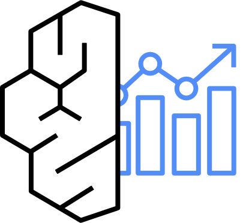

---
<!-- Slide 1: 4부 섹션 -->
@type: section
@theme: dark

# 4부: 구축 방안, 하네스, 도입 경로

온프렘과 비교하고, Claude Code가 사내 표준대로 일하게 만든다

:::notes
{timing: 0.5min}
[요약]
- 4부: 고객 질문 2-1(온프렘 비교), 2-2(단일 컨트롤 센터), 2-3(교체 가능성)
- 이어서 감사 추적, 비용, 하네스와 데모 V3, 권장 도입 경로, 확인 필요 사항

마지막 4부입니다. 온프렘과 비교하고, 통제면을 어떻게 하나로 둘지, 그리고 Claude Code가 사내 표준대로 일하게 만드는 하네스를 데모와 함께 보고, 권장 도입 경로로 마무리하겠습니다.
{cue: transition}
먼저 세 가지 구축 방안입니다.
:::

---
<!-- Slide 2: 구축 방안 비교 -->
@type: content
@theme: dark
@title: 코딩 에이전트는 모델 성능이 곧 생산성

## 코딩 에이전트는 모델 성능이 곧 생산성

:::html

  <button class="cf-btn" data-c="2">온프렘 (GPU + 오픈모델)</button>
  <button class="cf-btn" data-c="3">5호망 혁신금융 + Bedrock</button>
  <button class="cf-btn" data-c="4">연구개발망 + Bedrock</button>

<table class="data-table cf-cmp" id="cfCmp">
  <thead><tr><th>항목</th><th>온프렘 (GPU + 오픈모델)</th><th>5호망 혁신금융 + Bedrock</th><th>연구개발망 + Bedrock</th></tr></thead>
  <tbody>
    <tr><td>규제 절차</td><td>가장 단순 (내부망)</td><td>지정 + 이행점검 (약 1년)</td><td>내부 의결 (수개월)</td></tr>
    <tr><td>코딩 품질</td><td>오픈모델 한계</td><td>Claude 최신 모델</td><td>동일</td></tr>
    <tr><td>데이터, 운영계</td><td>제약 적음, 연계 가능</td><td>필터링 전제, 지정 범위 내</td><td>실데이터 금지, 연계 불가</td></tr>
    <tr><td>비용 구조</td><td>GPU CAPEX + 전력 + 전문인력</td><td>사용량 OPEX</td><td>사용량 OPEX</td></tr>
    <tr><td>최신성</td><td>직접 교체</td><td>모델 변경 간소화 절차</td><td>자율</td></tr>
    <tr><td>권장 역할</td><td>고민감 소형 업무, 백업 경로</td><td><strong class="cf-success">본 트랙</strong></td><td>대안: 독립 인프라 신규 구축 필요</td></tr>
  </tbody>
</table>

<strong class="cf-info">온프렘 단독은 권하지 않습니다</strong>: 온프렘 모델은 Gateway 뒤 백업 경로로 두면 같은 통제면에서 함께 운영할 수 있습니다.

:::

:::notes
{timing: 2min}
[요약]
- 고객 질문 2-1: 온프렘 vs 5호망 혁신금융 vs 연구개발망
- 온프렘: 규제는 쉽지만 코딩 품질(오픈모델)과 GPU, 인력 부담
- 5호망 혁신금융: 본 트랙. 최신 모델, 사용량 과금, 지정 범위 내 운영계 연계
- 연구개발망: 대안이지만 인프라 별도 구축
- 온프렘 모델은 Gateway 뒤 백업 경로로

세 가지 구축 방안입니다. 버튼으로 열을 하나씩 비교해 보겠습니다.
{cue: demo}
온프렘은 규제는 가장 쉽지만, 코딩 에이전트는 모델 성능이 곧 생산성이라 오픈모델의 한계가 그대로 생산성 한계가 됩니다. GPU와 전력, 운영 인력도 들어갑니다. 저희 권고는 5호망 혁신금융입니다. 연구개발망은 대안이지만 인프라를 공유할 수 없어 한 벌을 새로 만들어야 합니다.
{cue: pause}
온프렘 모델을 버리라는 뜻은 아닙니다. Gateway 뒤에 백업 경로로 붙이면, 같은 통제면 안에서 함께 운영할 수 있습니다.
{cue: transition}
그 "같은 통제면"이 왜 중요한지, 교체 가능성 관점에서 보겠습니다.
:::

---
<!-- Slide 3: 교체 가능한 설계 -->
@type: content
@theme: dark
@title: 벤더 종속은 통제면에서 생긴다

## 벤더 종속은 통제면에서 생긴다

:::html

  <button class="cf-layer" data-k="c"><b>클라이언트</b>Claude Code, Codex, IDE교체 가능</button>
  <button class="cf-layer" data-k="p"><b>프로토콜</b>MCP, Anthropic / OpenAI API표준</button>
  <button class="cf-layer fix" data-k="g"><b>통제면</b>Gateway, Hub, Identity, 로그고정</button>
  <button class="cf-layer" data-k="m"><b>모델, 런타임</b>Bedrock, AgentCore Runtime, 온프렘교체 가능</button>

층을 눌러 무엇이 바뀌고 어떤 절차가 필요한지 보세요.

:::

:::script
(function () {
  var info = {
    c: '코딩 도구(Claude Code ↔ Codex): 클라이언트 관리 설정만 다시 배포. 규제 절차는 지정서 기재 방식에 따라 확인 필요',
    p: '프로토콜: MCP와 Anthropic, OpenAI 호환 API는 표준이라 클라이언트와 모델을 바꿔도 그대로 둡니다',
    g: '통제면: 인증, DLP, 로그, Quota, MCP 등록과 인가. 이 층만 고정하면 위아래를 갈아끼울 수 있습니다. 보안대책 평가의 대상도 이 층입니다',
    m: '모델 버전: Gateway 라우팅 변경, 2026.04.15 간소화 절차(경미, 보통, 상당). 에이전트 프레임워크(Strands, LangGraph, Claude Agent SDK): AgentCore Runtime이 프레임워크 무관하게 실행, 내부 변경관리. MCP 서버 추가: Hub 등록 심사(관문 ①)'
  };
  var root = document.getElementById('cfLy'), out = document.getElementById('cfLyDetail');
  if (!root) return;
  root.addEventListener('click', function (e) {
    var b = e.target.closest('.cf-layer'); if (!b) return;
    root.querySelectorAll('.cf-layer').forEach(function (x) { x.classList.toggle('on', x === b); });
    out.innerHTML = '<strong class="cf-accent">' + b.querySelector('b').textContent + '</strong>
' + info[b.dataset.k] + '
';
  });
})();
:::

:::notes
{timing: 1.5min}
[요약]
- 고객 질문 2-3: Agent와 Framework가 바뀌어도 버티는 설계
- 네 층: 클라이언트(교체), 프로토콜(표준), 통제면(고정), 모델과 런타임(교체)
- 모델 교체는 2026.04 간소화 절차, 프레임워크는 AgentCore Runtime이 무관하게 실행
- 보안대책 평가의 대상은 통제면 → 통제면을 고정하면 도구 교체 때 재평가 부담이 줄어듦

도구나 프레임워크가 바뀌는 건 시간문제입니다. 그래서 네 층으로 나눴습니다. 층을 눌러 보겠습니다.
{cue: demo}
위의 클라이언트와 아래의 모델은 바뀌어도 되고, 가운데 강조한 통제면만 고정합니다. 모델 교체는 올해 간소화된 절차로 처리할 수 있고, 프레임워크는 AgentCore Runtime이 가리지 않습니다.
{cue: pause}
벤더 종속은 모델이 아니라 통제면에서 생깁니다. 통제면을 특정 클라이언트에 묶지 않고 표준 위에 두면, 내일 다른 코딩 도구가 나와도 관리 설정만 다시 배포하면 됩니다.
{cue: transition}
그 통제면을 한 곳에서 관리하는 단일 컨트롤 센터를 보겠습니다.
:::

---
<!-- Slide 4: 단일 컨트롤 센터 -->
@type: content
@theme: dark
@title: 망이 여러 개여도 정책은 한 곳에서

## 망이 여러 개여도 정책은 한 곳에서

:::html

  

    
<button class="cf-btn" id="cfCpBtn">정책 한 번 바꾸기 ▶</button>통제면에서 바꾼 정책이 모든 실행면에 같이 적용됩니다.

    
<h5>통제면 (Control Plane), AI Platform 계정</h5>
      

        
<b>IdP 연동</b>

        
<b>Gateway 정책</b>DLP, 라우팅

        
<b>MCP Hub 등록</b>

        
<b>모델 allowlist</b>

        
<b>Quota, 예산</b>

        
<b>로그, 대시보드</b>

      

    

    
<h5>실행면 (Data Plane)</h5>
      

        
<b>5호망 AI</b>코딩 에이전트

        
<b>상용 AI 프로젝트</b>AI Project 계정

        
<b>컨텍스트 계층</b>Vector, Graph

        
<b>(향후) 그룹 계열사</b>그룹 결정 사항

      

    

  

  

    <table class="data-table fragment fade-left" data-fragment-index="2">
      <thead><tr><th>통제</th><th>위치</th><th>구현</th></tr></thead>
      <tbody>
        <tr><td>누가</td><td>IdP + AgentCore Identity</td><td>AD 그룹 → 역할</td></tr>
        <tr><td>무엇을 (모델)</td><td>LLM Gateway + SCP</td><td>allowlist</td></tr>
        <tr><td>무엇을 (도구)</td><td>AgentCore Gateway + Policy</td><td>등록, 인가</td></tr>
        <tr><td>얼마나</td><td>Gateway Quota + Budgets</td><td>3겹 비용 통제</td></tr>
        <tr><td>기록</td><td>Log Archive + SIEM</td><td>감사 추적</td></tr>
      </tbody>
    </table>
    
<strong class="cf-warning">예외</strong>: 연구개발망은 완전한 망분리 대상이라 이 통제면에 붙일 수 없고, 별도 통제면이 필요합니다.

  

:::

:::script
// cfFlow: SVG connectors between DOM boxes + packets moving along them.
// Layout is measured when the slide becomes active (slides are display:none otherwise).
window.cfFlow = window.cfFlow || (function () {
  var NS = 'http://www.w3.org/2000/svg';
  var reduce = window.matchMedia && matchMedia('(prefers-reduced-motion: reduce)').matches;
  function rect(root, el) {
    var R = root.getBoundingClientRect(), r = el.getBoundingClientRect(), k = root.offsetWidth / (R.width || 1);
    return { x: (r.left - R.left) * k, y: (r.top - R.top) * k, w: r.width * k, h: r.height * k };
  }
  function route(a, b, e) {
    var ax = a.x + a.w / 2, ay = a.y + a.h / 2 + (e.dy || 0), bx = b.x + b.w / 2, by = b.y + b.h / 2 + (e.dy || 0), dx = bx - ax, dy = by - ay, o = e.off || 0;
    if (e.via === 's') return 'M' + ax + ',' + ay + ' L' + bx + ',' + by;
    if (e.via === 'r' || e.via === 'l') {
      var rt = e.via === 'r', s0 = rt ? a.x + a.w : a.x, e0 = rt ? b.x + b.w : b.x, X = rt ? Math.max(s0, e0) + (o || 18) : Math.min(s0, e0) - (o || 18);
      return 'M' + s0 + ',' + ay + ' H' + X + ' V' + by + ' H' + e0;
    }
    if (e.via === 'v' || (e.via !== 'h' && Math.abs(dx) <= (a.w + b.w) / 2)) {
      var sy = dy > 0 ? a.y + a.h : a.y, ey = dy > 0 ? b.y : b.y + b.h, my = (sy + ey) / 2 + o;
      return 'M' + (ax + o) + ',' + sy + ' V' + my + ' H' + (bx + o) + ' V' + ey;
    }
    var sx = dx > 0 ? a.x + a.w : a.x, ex = dx > 0 ? b.x : b.x + b.w, mx = (sx + ex) / 2 + o;
    return 'M' + sx + ',' + ay + ' H' + mx + ' V' + by + ' H' + ex;
  }
  function mount(root, edges) {
    var svg = document.createElementNS(NS, 'svg'), paths = {}, gen = 0, onEnter = null, onLeave = null, active = false;
    svg.setAttribute('class', 'cf-flow-svg'); svg.setAttribute('aria-hidden', 'true');
    root.classList.add('cf-flow-host'); root.appendChild(svg);
    edges.forEach(function (e) {
      var p = document.createElementNS(NS, 'path');
      p.setAttribute('class', 'cf-edge' + (e.cls ? ' ' + e.cls : '')); svg.appendChild(p); paths[e.id] = { el: p, e: e };
    });
    function node(id) { return root.querySelector('[data-n="' + id + '"]'); }
    function layout() {
      svg.setAttribute('viewBox', '0 0 ' + root.offsetWidth + ' ' + root.offsetHeight);
      Object.keys(paths).forEach(function (k) {
        var e = paths[k].e, a = node(e.from), b = node(e.to);
        if (!a || !b || !a.offsetParent || !b.offsetParent) { paths[k].el.setAttribute('d', ''); return; }
        paths[k].el.setAttribute('d', route(rect(root, a), rect(root, b), e));
      });
    }
    function packet(id, opt) {
      var my = gen, P = paths[id]; if (!P) return Promise.resolve();
      var path = P.el, len = path.getTotalLength ? path.getTotalLength() : 0;
      var g = document.createElementNS(NS, 'g'), c = document.createElementNS(NS, 'circle');
      g.setAttribute('class', 'cf-pkt' + (opt.cls ? ' ' + opt.cls : '')); c.setAttribute('r', '10'); g.appendChild(c);
      if (opt.label) { var t = document.createElementNS(NS, 'text'); t.setAttribute('x', '16'); t.setAttribute('y', '-14'); t.textContent = opt.label; g.appendChild(t); }
      svg.appendChild(g); path.classList.add('on'); if (opt.cls) path.classList.add(opt.cls);
      var dur = reduce ? 1 : (opt.dur || 1100), t0 = null;
      return new Promise(function (done) {
        function frame(ts) {
          if (my !== gen) { g.remove(); return done(); }
          if (t0 === null) t0 = ts;
          var f = Math.min(1, (ts - t0) / dur), q = f < 0.5 ? 2 * f * f : 1 - Math.pow(-2 * f + 2, 2) / 2;
          var pt = len ? path.getPointAtLength(q * len) : { x: 0, y: 0 };
          g.setAttribute('transform', 'translate(' + pt.x + ',' + pt.y + ')');
          if (f < 1) return requestAnimationFrame(frame);
          var to = node(P.e.to); if (to) { to.classList.add('cf-hit'); setTimeout(function () { to.classList.remove('cf-hit'); }, 900); }
          setTimeout(function () { g.remove(); done(); }, opt.hold || 250);
        }
        requestAnimationFrame(frame);
      });
    }
    function clear() { gen++; svg.querySelectorAll('.cf-pkt').forEach(function (g) { g.remove(); }); Object.keys(paths).forEach(function (k) { paths[k].el.setAttribute('class', 'cf-edge' + (paths[k].e.cls ? ' ' + paths[k].e.cls : '')); }); }
    // steps: [{e:[edgeIds], label, cls, dur, msg}] played in order; edges in one step run in parallel.
    function play(steps, opt) {
      clear(); var my = gen; opt = opt || {};
      return steps.reduce(function (pr, s, i) {
        return pr.then(function () {
          if (my !== gen) return;
          if (opt.onStep) opt.onStep(i, s);
          return Promise.all(s.e.map(function (id, j) { return packet(id, j ? { cls: s.cls, dur: s.dur } : s); }));
        });
      }, Promise.resolve()).then(function () {
        if (my !== gen) return;
        var left = opt.loop === true ? 3 : (opt.loop || 0);
        if (left > 1 && active && !reduce) return new Promise(function (r) { setTimeout(r, 900); }).then(function () { if (my === gen && active) return play(steps, Object.assign({}, opt, { loop: left - 1 })); });
        if (opt.onDone) opt.onDone();
      });
    }
    function sync() {
      var s = root.closest('.slide'), now = !!(s && s.classList.contains('active') && !document.querySelector('.overview-mode'));
      if (now && !active) { active = true; requestAnimationFrame(function () { layout(); if (onEnter) onEnter(); }); }
      else if (!now && active) { active = false; clear(); if (onLeave) onLeave(); }
    }
    var sl = root.closest('.slide');
    if (sl && window.MutationObserver) new MutationObserver(sync).observe(sl, { attributes: true, attributeFilter: ['class'] });
    document.addEventListener('rp:slidechange', function () { setTimeout(sync, 60); });
    if (window.ResizeObserver) new ResizeObserver(function () { if (active) layout(); }).observe(root);
    setTimeout(sync, 300);
    return {
      layout: layout, play: play, clear: clear, packet: packet,
      enter: function (f) { onEnter = f; }, leave: function (f) { onLeave = f; },
      isActive: function () { return active; }
    };
  }
  return { mount: mount };
})();

(function () {
  var root = document.getElementById('cfCp'); if (!root) return;
  var f = cfFlow.mount(root, [
    { id: 'p1', from: 'pol', to: 'd1', via: 's', cls: 'ghost' }, { id: 'p2', from: 'pol', to: 'd2', via: 's', cls: 'ghost' }, { id: 'p3', from: 'pol', to: 'd3', via: 's', cls: 'ghost' },
    { id: 'l1', from: 'd1', to: 'logs', via: 's', cls: 'ghost' }, { id: 'l2', from: 'd2', to: 'logs', via: 's', cls: 'ghost' }, { id: 'l3', from: 'd3', to: 'logs', via: 's', cls: 'ghost' }
  ]);
  var ver = 1, msg = document.getElementById('cfCpMsg');
  function run() {
    ver++;
    root.querySelectorAll('.cf-dp .v').forEach(function (v) { v.textContent = ''; });
    f.play([
      { e: ['p1', 'p2', 'p3'], dur: 1300, msg: 'Gateway 정책 v' + ver + '을 한 곳에서 배포합니다.' },
      { e: ['l1', 'l2', 'l3'], cls: 'info', dur: 1100, msg: '각 실행면의 적용 결과와 호출 로그가 같은 대시보드로 모입니다.' }
    ], {
      onStep: function (i, s) {
        msg.textContent = s.msg;
        if (i === 1) root.querySelectorAll('.cf-dp .v').forEach(function (v) { v.textContent = '정책 v' + ver + ' 적용'; });
      },
      onDone: function () { msg.textContent = '정책 v' + ver + ': 실행면 3곳 적용, 로그 수집 완료. 망별로 따로 바꾸지 않습니다.'; }
    });
  }
  document.getElementById('cfCpBtn').addEventListener('click', function () { if (f.isActive()) { f.layout(); run(); } });
})();
:::

:::notes
{timing: 1.5min}
[요약]
- 고객 질문 2-2: 단일 컨트롤 센터
- 통제면은 AI Platform 계정 하나: IdP, Gateway 정책, Hub 등록, 모델 allowlist, Quota, 로그
- 실행면: 5호망 코딩 에이전트, 상용 AI 프로젝트, 컨텍스트 계층, (향후) 계열사
- 네 질문(누가, 무엇을, 얼마나, 기록)을 한 곳에서. 정보보호위원회 보고 자료도 한 곳에서 나옴
- 연구개발망은 붙일 수 없음

단일 컨트롤 센터 질문에 대한 답입니다. 통제면은 AI Platform 계정 하나에 두고, 5호망 코딩 에이전트와 상용 프로젝트, 컨텍스트 계층이 실행면으로 붙습니다.
{cue: demo}
실행면을 띄운 뒤 "정책 한 번 바꾸기"를 누르겠습니다. Gateway 정책을 한 번 바꾸면 세 실행면에 같이 적용되고, 적용 결과와 호출 로그가 같은 대시보드로 돌아옵니다.
{cue: pause}
오른쪽 표처럼 누가, 무엇을, 얼마나, 기록, 네 가지를 한 곳에서 봅니다. 정보보호위원회 보고 자료도 여기서 나옵니다. 연구개발망은 망분리 때문에 여기에 붙일 수 없습니다. 그룹 계열사까지 넓힐지는 그룹에서 정하실 부분이라 확장 가능하다는 정도로 말씀드립니다.
{cue: transition}
"기록"을 조금 더 구체적으로, 금보원 점검 질문 기준으로 보겠습니다.
:::

---
<!-- Slide 5: 감사 추적 -->
@type: content
@theme: dark
@title: 점검 질문마다 답할 로그가 정해져 있다

## 점검 질문마다 답할 로그가 정해져 있다

:::html

  

    <strong class="cf-accent">금보원 점검 질문을 눌러 보세요</strong>
    <button class="cf-aq" data-s="gw,inv">누가 언제 어떤 모델에 무엇을 보냈나</button>
    <button class="cf-aq" data-s="obs">어떤 도구를 호출했나</button>
    <button class="cf-aq" data-s="gw">DLP가 무엇을 차단했나</button>
    <button class="cf-aq" data-s="ct">권한, 설정 변경은 누가 했나</button>
  

  

    

      
<b>Gateway 애플리케이션 로그</b>V2 데모의 감사 로그

      
<b>Bedrock Invocation Logging</b>

      
<b>AgentCore Observability</b>

      
<b>CloudTrail + Config</b>

    

    
<b>Log Archive: S3 Object Lock, KMS → 사내 SIEM / Security Lake</b>

  

<strong class="cf-info">보관 기간</strong>: 1년 이상을 기본으로 설계합니다(인터넷 접속 기록 1년 이상 기준 준용). 지정 부가조건의 보관 기간은 확인 필요입니다.

:::

:::script
(function () {
  var qs = document.querySelectorAll('#cfAq .cf-aq');
  qs.forEach(function (q) {
    q.addEventListener('click', function () {
      var ids = q.dataset.s.split(',');
      qs.forEach(function (x) { x.classList.toggle('on', x === q); });
      document.querySelectorAll('.cf-src-box').forEach(function (b) { b.classList.toggle('hit', ids.indexOf(b.dataset.id) >= 0); });
    });
  });
})();
:::

:::notes
{timing: 1.5min}
[요약]
- 로그 소스 네 개: Gateway 로그, Bedrock Invocation Logging, AgentCore Observability, CloudTrail + Config
- 모두 Log Archive(S3 Object Lock, KMS)에 변경 불가 상태로 모이고 SIEM, Security Lake로 연동
- 질문별 로그 소스를 미리 정해 두는 것이 이행점검 준비의 핵심
- 보관 1년 이상 기본, 부가조건 보관 기간은 확인 필요

감사 추적입니다. 왼쪽의 금보원 점검 질문을 하나씩 눌러 보겠습니다.
{cue: demo}
"누가 어떤 모델에 무엇을 보냈나"를 누르면 Gateway 로그와 Invocation Logging이 켜집니다. 앞에서 V2 데모로 본 그 로그입니다. 도구 호출은 AgentCore Observability, DLP 차단은 Gateway 로그, 권한 변경은 CloudTrail과 Config입니다.
{cue: pause}
네 가지 소스가 모두 Log Archive에 변경 불가 상태로 모이고, 사내 SIEM으로 연동됩니다. 질문마다 어느 로그를 보여 드리면 되는지 미리 정해 두는 게 이행점검 준비의 핵심입니다.
{cue: transition}
"얼마나"에 해당하는 비용 통제를 보겠습니다.
:::

---
<!-- Slide 6: 비용 세 겹 -->
@type: content
@theme: dark
@title: 비용은 세 겹으로, 먼저 토큰부터 잰다

## 비용은 세 겹으로, 먼저 토큰부터 잰다

:::html

  

    
<b>1 사용자 한도</b>개인별 토큰, 요청 한도. TPM / RPM 제어 (Gateway)

    
<b>2 팀 예산</b>본부, 팀 단위 월 예산, 소진율 알림 (Gateway 집계)

    
<b>3 계정 예산</b>AWS Budgets로 계정 레벨 최종 안전망

  

  

    <strong class="cf-accent">파일럿 토큰 규모 추정기</strong>
    
파일럿 인원<input type="range" id="cfU" min="5" max="200" step="5" value="20"><output id="cfUo"></output>

    
1인 하루 모델 호출<input type="range" id="cfR" min="20" max="600" step="10" value="150"><output id="cfRo"></output>

    
호출당 입력 토큰<input type="range" id="cfT" min="5000" max="80000" step="1000" value="30000"><output id="cfTo"></output>

    
근무일 / 월<input type="range" id="cfD" min="10" max="23" step="1" value="21"><output id="cfDo"></output>

    

      
<b id="cfM"></b>월 입력 토큰 (전체)

      
<b id="cfP"></b>1인 하루 입력 토큰 (Quota 기준)

    

    
기본값 30,000은 V2 데모에서 잰 호출당 입력 토큰(28,950)에 가깝게 둔 값입니다. 대부분 프롬프트 캐시 읽기라 단가가 다르므로, 금액은 Bedrock 요금표로 따로 계산합니다.

  

:::

:::script
(function () {
  function fmt(n) { return n >= 1e9 ? (n / 1e9).toFixed(2) + 'B' : n >= 1e6 ? (n / 1e6).toFixed(1) + 'M' : Math.round(n).toLocaleString('ko-KR'); }
  function calc() {
    var u = +document.getElementById('cfU').value, r = +document.getElementById('cfR').value, t = +document.getElementById('cfT').value, d = +document.getElementById('cfD').value;
    document.getElementById('cfUo').textContent = u + '명';
    document.getElementById('cfRo').textContent = r + '회';
    document.getElementById('cfTo').textContent = (t / 1000) + 'K';
    document.getElementById('cfDo').textContent = d + '일';
    document.getElementById('cfM').textContent = fmt(u * r * t * d);
    document.getElementById('cfP').textContent = fmt(r * t);
  }
  ['cfU', 'cfR', 'cfT', 'cfD'].forEach(function (id) { var el = document.getElementById(id); if (el) el.addEventListener('input', calc); });
  if (document.getElementById('cfU')) calc();
})();
:::

:::notes
{timing: 2min}
[요약]
- 비용 세 겹: 사용자 한도(TPM, RPM), 팀 예산(소진율 알림), 계정 예산(AWS Budgets)
- 추정기: 인원 x 하루 호출 x 호출당 입력 토큰 x 근무일. 금액이 아니라 토큰 규모를 먼저 잼
- 호출당 입력 토큰 기본값 30K는 V2 데모 실측(28,950)에 근거. Claude Code는 시스템 프롬프트, 도구 정의를 매번 보내며 대부분 캐시 읽기
- 금액은 Bedrock 요금표(캐시 읽기, 입력, 출력 단가)로 별도 계산
- 하루 호출 수는 가정값. 파일럿에서 Gateway 로그로 실측해 Quota를 정함

비용은 사용자, 팀, 계정 세 겹으로 막습니다. 그런데 한도를 정하려면 먼저 토큰 규모를 알아야 합니다. 오른쪽 추정기로 보겠습니다.
{cue: demo}
파일럿 20명이 하루 150번씩 모델을 부르고, 한 번에 3만 토큰을 보낸다고 하면 월 입력 토큰이 이 정도 나옵니다. 3만이라는 값은 앞의 V2 데모에서 실제로 잰 2만 9천 토큰에서 왔습니다. Claude Code는 시스템 프롬프트와 도구 정의를 매번 같이 보내기 때문입니다.
{cue: pause}
다만 그 대부분은 프롬프트 캐시에서 읽히고, 캐시 읽기는 단가가 다릅니다. 그래서 여기서는 금액이 아니라 토큰 규모만 보여 드리고, 금액은 요금표로 따로 계산하시길 권합니다. 하루 호출 수는 가정이니, 파일럿에서 Gateway 로그로 실측해서 1인 Quota를 정하는 게 정확합니다.
{cue: transition}
이제 비용보다 더 중요한 문제, 도구를 깔아도 잘 안 쓰이는 이유를 보겠습니다.
:::

---
<!-- Slide 7: 하네스 -->
@type: content
@theme: dark
@title: 도구만 깔면 세 가지 실패가 반복된다

## 도구만 깔면 세 가지 실패가 반복된다

:::html

  

    
<b>팀 컨벤션 위반</b>사내 코딩 표준을 모르는 코드가 계속 올라옴

    
▼

    
<b>01 GUIDES</b>CLAUDE.md / AGENTS.md에 규칙, Skills에 작업 절차. 위반을 미리 막음

  

  

    
<b>스스로 검증하지 않음</b>동작 확인 없이 완료했다고 보고

    
▼

    
<b>02 SENSORS</b>hooks로 테스트 자동 실행, 리뷰 서브에이전트. 스스로 검증하게 만듦

  

  

    
<b>같은 실수 반복</b>지적해도 다음 세션에서 똑같은 실수

    
▼

    
<b>03 STEERING LOOP</b>반복 실수를 관찰해 규칙 자체를 수정. 같은 실수가 줄어듦

  

<table class="data-table fragment fade-up" data-fragment-index="7">
  <thead><tr><th></th><th>Code-based: 결정론적, 빠름, 저렴</th><th>LLM-based: 확률적, 느림, 비쌈</th></tr></thead>
  <tbody>
    <tr><td>사전 안내 GUIDES</td><td>신규 서비스 세팅 스크립트, 사내 CLI, 프로젝트 템플릿</td><td>CLAUDE.md / AGENTS.md, Skills, 참조 문서 연결 (MCP)</td></tr>
    <tr><td>사후 피드백 SENSORS</td><td>Linter, 타입 체커, 유닛, 통합 테스트</td><td>AI 코드 리뷰 에이전트, LLM 기반 품질 판정</td></tr>
  </tbody>
</table>
:::

:::notes
{timing: 2.5min}
[요약]
- 도구만 깔면 반복되는 실패 셋: 컨벤션 위반, 자기 검증 없음, 같은 실수 반복
- 하네스(조직이 직접 만드는 운영 장치): GUIDES(CLAUDE.md, Skills), SENSORS(hooks로 테스트, 리뷰), STEERING LOOP(규칙 개선)
- 결정론적인 것은 코드(스크립트, 테스트)로, 의미 판단만 모델에
- 모델을 올릴 때마다 하네스를 다시 조율해야 함 → Gateway에서 모델 버전을 고정하면 계획된 시점으로 모을 수 있음
- Codex는 AGENTS.md가 같은 역할

도구만 깔면 이 세 가지 실패가 반복됩니다. 하나씩 올리겠습니다. 사내 표준을 모르는 코드, 확인 없이 "완료했습니다", 그리고 지적해도 다음 세션에서 같은 실수입니다.
{cue: pause}
그래서 조직이 직접 만들어야 하는 운영 장치, 하네스가 필요합니다. 규칙을 미리 알려 주는 GUIDES, 결과를 자동으로 검증하는 SENSORS, 반복 실수를 보고 규칙 자체를 고치는 STEERING LOOP입니다. 아래 표처럼 결정론적으로 할 수 있는 건 스크립트와 테스트로, 의미 판단만 모델에 맡깁니다.
{cue: pause}
한 가지 더, 모델을 올릴 때마다 하네스를 다시 조율해야 합니다. Gateway에서 모델 버전을 고정해 두면 그 부담을 계획된 시점으로 모을 수 있습니다. Codex에서는 AGENTS.md가 CLAUDE.md와 같은 역할을 합니다.
{cue: transition}
이 하네스를 실제 레거시 코드에 적용해 본 세 번째 데모입니다.
:::

---
<!-- Slide 8: 데모 V3 -->
@type: content
@theme: dark
@fit: off
@title: 데모 V3: 표준대로 고치고 스스로 검증

## 데모 V3: 표준대로 고치고 스스로 검증

:::html

  

    <video class="cf-video" poster="media/r3-harness.jpg" aria-label="데모 V3 영상: CLAUDE.md와 hooks로 레거시 수수료 모듈 리팩토링, 실제 Claude Code 화면 녹화, 무음, 1분 15초" title="데모 V3 영상: 하네스, 실제 Claude Code 화면 녹화, 무음, 1분 15초" controls preload="metadata" muted playsinline tabindex="-1"><source src="media/r3-harness.mp4" type='video/mp4; codecs="avc1.640034"'><source src="media/r3-harness.webm" type='video/webm; codecs="vp9"'></video>
  

  
실제 Claude Code 대화형 화면 녹화 (2026.10.19 14:52 UTC), Sonnet 5 서울 리전, LLM Gateway 경유. 대기 구간 2초로 줄임, 무음

:::

:::script
document.querySelectorAll('video.cf-video').forEach(function (v) {
  var release = function () { setTimeout(function () { if (document.activeElement === v) v.blur(); }, 0); };
  ['focus', 'play', 'pause', 'seeked', 'volumechange', 'click', 'pointerup'].forEach(function (ev) { v.addEventListener(ev, release); });
});
window.addEventListener('hashchange', function () {
  document.querySelectorAll('.slide:not(.active) video.cf-video').forEach(function (v) { if (!v.paused) v.pause(); });
});
:::

:::notes
{timing: 3min}
[요약]
- 영상 1분 15초, Claude Code 대화형 화면 실제 녹화
- 대상: 2014년 작성 위탁수수료 계산 모듈(float, round, 매직넘버). 테스트 3개 중 1개 실패
- GUIDES: CLAUDE.md(Decimal, 항목별 원 미만 절사, Side Enum, 요율 상수, 시그니처 유지, 고객 데이터 금지)
- SENSORS: PostToolUse hook이 수정 직후 pytest 실행 → "[SENSORS] pytest 통과: 3 passed"
- 결과: 32초 작업, 3 passed. Claude의 원인 설명(float 처리)은 부정확했고 실제 실패 원인은 round 반올림. 그래도 수정은 절사 규칙대로라 테스트로 판정됨
- 관리 설정의 accept edits 모드: 파일 편집은 자동 허용, pytest는 관리 설정 allow 목록

Play를 누르고 따라가겠습니다.
0:04 먼저 이 프로젝트의 CLAUDE.md, 사내 코딩 표준입니다. 금액은 Decimal, 원 미만은 수수료와 세금을 따로 절사, 매수 매도는 Enum, 기존 호출부 시그니처 유지, 고객 데이터 폴더는 읽지 않기입니다.
0:11 레거시 코드에 테스트를 돌리면 3개 중 1개가 실패합니다. 3,333주에 33,333원을 매수할 때 수수료가 16,664.83원인데, 레거시는 반올림해서 16,665원을 냅니다. 사내 규칙은 절사라 16,664원이 맞습니다.
{cue: pause}
0:22 Claude Code를 열고 "사내 표준에 맞게 리팩토링하고 실패 원인도 찾아서 고쳐 달라"고만 합니다. 파일과 줄 번호는 알려 주지 않습니다.
0:48 Claude가 파일을 고치자마자 hook이 테스트를 돌리고 "[SENSORS] pytest 통과, 3 passed"를 띄웁니다. 사람이 시킨 게 아니라 하네스가 자동으로 검증한 겁니다.
0:56 Claude의 보고입니다. Claude는 원인을 float 처리로 설명했는데, 실제로 테스트를 깨뜨린 건 16,664.83원을 round로 반올림한 부분입니다. 그래도 고친 코드는 CLAUDE.md의 항목별 절사 규칙대로라 테스트가 통과합니다. 모델의 설명은 틀릴 수 있고, 그래서 사람이 아니라 테스트가 판정하게 만든 것이 SENSORS입니다. 32초 걸렸습니다.
1:06 Claude를 끄고 git diff와 pytest로 다시 확인합니다. 3 passed이고, 1:09에 grep으로 Decimal과 ROUND_DOWN, Side Enum, 상수가 코드에 들어간 것을 보여 줍니다.
근거: 녹화 원본 r3-harness.cast, 프로젝트 demo/scenarios/fee-calc, 감사 로그 r3-audit.jsonl
{cue: transition}
영상에 다 나오지 않은 뒷이야기까지 정리하겠습니다.
:::

---
<!-- Slide 9: V3 정리 -->
@type: content
@theme: dark
@title: V3에서 하네스가 한 일

## V3에서 하네스가 한 일

:::html

<pre class="code-block" data-reveal="static"># .claude/settings.json (프로젝트 하네스)
{ "hooks": { "PostToolUse": [ {
    "matcher": "Edit|Write|MultiEdit",
    "hooks": [ { "type": "command",
      "command": ".claude/hooks/run-tests.sh" } ] } ] } }

# run-tests.sh: 실패 → exit 2, stderr가 Claude에게 전달
out=$(python3 -m pytest -q 2>&1) || { echo "$out" >&2; exit 2; }
printf '{"systemMessage": "[SENSORS] pytest 통과"}'</pre>
  

    
<strong class="cf-accent">GUIDES 결과</strong>
float → Decimal, round → ROUND_DOWN(항목별), 1/2 → Side Enum(하위 호환), 요율 상수화, 타입 힌트와 한국어 docstring. CLAUDE.md의 코드 규칙이 diff에 그대로

    
<strong class="cf-success">SENSORS 결과</strong>
수정 직후 hook이 pytest 실행: 1 failed → 3 passed. 실패했다면 exit 2로 실패 내용이 Claude에게 되돌아가 다시 고침

    
<strong class="cf-info">통제면도 함께</strong>
세션 시작 시 Claude Code가 다른 모델 11개(apac 프로파일)를 확인하려 했고, Gateway가 모두 model_not_allowed로 거부. 작업 호출 6건은 Sonnet 5로만 ALLOW

  

:::

:::notes
{timing: 1.5min}
[요약]
- 하네스 설정: 프로젝트 .claude/settings.json 의 PostToolUse hook(Edit, Write 매처) → run-tests.sh
- hook 의미(공식 hooks 문서): exit 2는 blocking, stderr가 Claude에게 전달. 성공 시 systemMessage로 개발자에게 표시
- GUIDES 결과: CLAUDE.md 항목이 diff에 일대일로 반영
- SENSORS 결과: 1 failed → 3 passed
- 감사 로그 뒷이야기: 세션 시작 때 apac 프로파일 11개 확인 호출을 Gateway가 전부 거부, 작업 호출 6건만 Sonnet 5로 허용

왼쪽이 하네스 설정의 전부입니다. 파일을 고칠 때마다 테스트 스크립트를 돌리는 hook 하나입니다. 실패하면 exit 2로 끝나고, 그러면 실패 내용이 Claude에게 되돌아가서 다시 고치게 됩니다. 성공하면 개발자 화면에 통과 메시지가 뜹니다.
{cue: pause}
오른쪽 세 번째 카드는 영상에 안 나온 이야기입니다. Gateway 로그를 보니, Claude Code가 세션을 시작할 때 다른 모델 11개를 확인하려고 호출했고 Gateway가 전부 거부했습니다. 실제 작업 호출 6건은 승인된 서울 리전 Sonnet 5로만 나갔습니다. 하네스는 품질을, 통제면은 경계를 동시에 지키는 셈입니다.
근거: code.claude.com hooks 문서(exit code 2), r3-audit.jsonl(BLOCK 11건, ALLOW 6건)
{cue: transition}
그럼 이 모든 걸 언제, 어떤 순서로 하면 되는지 보겠습니다.
:::

---
<!-- Slide 10: 권장 도입 경로 -->
@type: content
@theme: dark
@title: 권장 도입 경로: 5호망 혁신금융

## 권장 도입 경로: 5호망 혁신금융

:::html

  <button class="cf-ms" data-i="0"><b>M0~2</b>보안대책 수립, 금감원, 금보원 컨설팅</button>
  <button class="cf-ms" data-i="1"><b>M1~3</b>랜딩존, AI Platform, Gateway, Hub (PoC)</button>
  <button class="cf-ms" data-i="2"><b>회차</b>지정 신청: 파일럿, 확산 범위 명시</button>
  <button class="cf-ms" data-i="3"><b>+4개월</b>지정, 보안대책 이행</button>
  <button class="cf-ms" data-i="4"><b>+5개월</b>이행점검 → 개시</button>

단계를 눌러 오늘 본 내용 중 무엇이 들어가는지 보세요. 날짜 대신 착수 시점(M0) 기준 상대 기간으로 표기합니다.

  
<strong class="cf-success">함께 합류: 상용 AI 프로젝트</strong>: Workloads OU에 AI Project 계정을 추가해 같은 Gateway, Hub, 로그를 씁니다.

  
<strong class="cf-warning">대안: 연구개발망</strong>: 완전한 망분리 때문에 Network, Security, Gateway, 로그를 5호망과 별도로 처음부터 구축합니다.

일정은 KB증권 사례 기준 참고치이며 회차별 접수 일정에 따라 달라집니다. PoC 구간은 실데이터 없이 구성을 검증합니다.

:::

:::script
(function () {
  var d = [
    '1부 PATH B 절차 ①②. 보안대책서에 오늘의 통제(관리 설정, Gateway DLP, 모델 allowlist, 감사 로그, CRIS 국외 처리 고지)를 담습니다',
    '2, 3부 구성을 PoC로: OU와 SCP(Policy Staging 먼저), DX, TGW 5호망 RT, PrivateLink, LLM Gateway, AgentCore Gateway. 오늘 데모 V1, V2를 실데이터 없이 재현',
    '1부 ③ 회차별 접수. 2부 전제조건: 사용자 범위(파일럿, 확산)를 신청서에 함께 명시',
    '4부 하네스(CLAUDE.md, hooks, 테스트)와 운영 체계(Quota, 예산, 로그 보관 1년 이상)를 이행',
    '금보원 이행점검: 4부 감사 추적의 "질문별 로그 소스"로 답변. 개시 후 베타테스터 → 팀 단위 확산'
  ];
  var root = document.getElementById('cfRoad'), out = document.getElementById('cfRoadDetail');
  if (!root) return;
  root.addEventListener('click', function (e) {
    var b = e.target.closest('.cf-ms'); if (!b) return;
    root.querySelectorAll('.cf-ms').forEach(function (x) { x.classList.toggle('on', x === b); });
    out.innerHTML = '<strong class="cf-accent">' + b.querySelector('b').textContent + '</strong>
' + d[+b.dataset.i] + '
';
  });
})();
:::

:::notes
{timing: 1.5min}
[요약]
- M0~2 보안대책, 컨설팅 / M1~3 랜딩존과 Gateway, Hub PoC / 회차 신청 / +4개월 지정, 이행 / +5개월 이행점검, 개시
- 단계별로 오늘 1~4부 내용이 어디에 들어가는지 클릭으로 연결
- 상용 AI 프로젝트는 같은 통제면에 합류, 연구개발망은 대안이지만 별도 구축
- 일정은 KB증권 사례 기준 참고치

권장 경로는 5호망 하나입니다. 단계를 하나씩 눌러 보겠습니다.
{cue: demo}
보안대책과 컨설팅을 먼저 하고, 그 사이에 랜딩존과 Gateway, Hub를 PoC로 만들어 둡니다. 오늘 보신 데모 V1, V2가 바로 그 PoC의 축소판입니다. 접수 회차에 맞춰 사용자 범위를 담아 신청하고, 지정과 이행점검을 거쳐 개시합니다.
{cue: pause}
상용 AI 프로젝트도 같은 통제면에 합류할 수 있습니다. 연구개발망은 대안이지만 망을 완전히 분리해야 해서 이 구성을 공유하지 못하고 처음부터 다시 만들어야 합니다.
{cue: transition}
확정 전에 확인할 항목들을 정리하겠습니다.
:::

---
<!-- Slide 11: 리스크와 확인 필요 -->
@type: content
@theme: dark
@title: 확정 전에 확인할 여덟 가지

## 확정 전에 확인할 여덟 가지

:::html

<ul class="checklist cf-chk" data-reveal="static">
  <li><strong>1 CRIS 국외 처리 고지와 DLP 범위</strong> 국외이전 논리, SCP 예외 조건 → 신청서, 정보보호위원회에 명시</li>
  <li><strong>2 연구개발망 조항 번호 표기 불일치</strong> 규정 원문 대조</li>
  <li><strong>3 OpenAI 모델 서울 in-region 없음</strong> Codex는 CRIS 전제, Global / US 국외 처리 고지</li>
  <li><strong>4 AgentCore Policy 정책 엔진 처리 리전</strong> 문서 확인 (Gateway, Policy 자체는 서울 가용)</li>
  <li><strong>5 AWS Context 서울 지원</strong> 확인 필요. Managed Knowledge Base, KB GraphRAG는 서울 미지원이라 대체안으로 설계</li>
  <li><strong>6 LLM Gateway 배치 위치 (전산실 vs AWS)</strong> 금보원 컨설팅</li>
  <li><strong>7 망분리 전면 해제 일정</strong> 모니터링</li>
  <li><strong>8 KB증권 지정 부가조건 원문 미확인</strong> 보도 기반임을 명시</li>
</ul>

<strong class="cf-warning">면책</strong>: 규제 해석은 공개 자료 기반의 기술적 해석이며 법률 자문을 대체하지 않습니다. 하나증권 컴플라이언스, 법률 검토를 거쳐 확정합니다.

:::

:::notes
{timing: 2min}
[요약]
- 8개 확인 항목. 클릭하면 체크 표시(회의 중 진행 상황 표시용)
- 가장 중요한 것은 1번: 최신 모델을 위해 CRIS를 허용했으므로 국외 처리 고지와 DLP 범위를 먼저 확정
- 3번 OpenAI 모델 in-region 없음은 2026.10.19 서울 리전 조회로 재확인
- 규제 해석은 법률 자문을 대체하지 않음

마지막으로 확인이 필요한 항목들입니다. 회의 중에 항목을 누르면 체크 표시가 됩니다.
{cue: pause}
가장 중요한 건 1번입니다. 최신 모델을 쓰려고 CRIS를 허용했기 때문에, 해외 리전 처리 사실을 신청서에 어떻게 적고 DLP를 어디까지 걸지 먼저 정해야 합니다. 3번 OpenAI 모델이 서울 in-region에 없다는 점은 오늘 다시 확인했습니다. 나머지도 다음 미팅 전까지 확인해서 공유드리겠습니다.
{cue: transition}
부록 하나만 짧게 보고 정리하겠습니다.
:::

---
<!-- Slide 12: 부록 랜딩존 접근 -->
@type: content
@theme: dark
@title: [부록] 랜딩존은 구축하고 비중요로 검증

## [부록] 랜딩존은 구축하고 비중요로 검증

:::html

  
<strong class="cf-warning">유형 ①</strong>
랜딩존 없이 테스트, 비중요 서비스를 먼저 올려 봄

<b>평가</b>: 빠르지만 나중에 재구축 부담

  
<strong class="cf-success">유형 ② (권장)</strong>
랜딩존을 구축하고 테스트, 비중요 서비스로 검증

<b>평가</b>: AI PoC에 적합

  
<strong class="cf-info">유형 ③</strong>
랜딩존을 선제 구축하고 중요 서비스로 검증

<b>평가</b>: 안전하지만 초기 기간이 길어짐

<strong class="cf-info">권장 이유</strong>: 랜딩존을 먼저 깔아야 2부의 OU, SCP, 로그 체계 위에서 PoC 결과가 그대로 운영으로 이어집니다. 유형 ①은 PoC 뒤 재구축이 필요합니다.

분류 출처: 원본 제안서 부록(국내 은행 공개 구축 사례). 원 출처 확인 전이라 기간 수치는 인용하지 않았습니다.

:::

:::notes
{timing: 0.5min}
[요약]
- 국내 은행 공개 사례의 랜딩존 접근 세 유형
- AI PoC에는 유형 ②(랜딩존 구축 + 비중요 서비스로 검증) 권장
- 원 출처 미확인이라 기간 수치(원본 제안서의 "약 7개월")는 인용하지 않음

부록입니다. 국내 은행 사례에서 정리된 랜딩존 접근은 세 가지이고, AI PoC에는 두 번째, 랜딩존을 먼저 구축하고 비중요 서비스로 검증하는 방식을 권합니다.
{cue: transition}
오늘 내용을 정리하겠습니다.
:::

---
<!-- Slide 13: 최종 정리 -->
@type: content
@theme: dark
@title: 오늘의 결론, 네 줄

## 오늘의 결론, 네 줄

:::html

  
<strong class="cf-accent">1 문은 5호망으로</strong>
실업무 코드와 운영계에 닿는 유일한 경로. KB증권이 검증했고, 약 1년, 회차와 서류가 기간을 정합니다.

  
<strong class="cf-accent">2 길에 우회로가 없게</strong>
Workloads OU, SCP, DX, TGW 5호망 RT, PrivateLink. 단말에는 AWS 자격증명이 없습니다.

  
<strong class="cf-success">3 관문은 둘, 겹은 여럿</strong>
관리 설정(V1), LLM Gateway DLP와 감사 로그(V2), AgentCore Gateway. 통제면은 하나로 고정합니다.

  
<strong class="cf-success">4 하네스가 생산성을 만든다</strong>
CLAUDE.md, hooks, 테스트(V3). 도구 도입과 별개로 조직이 만들어야 하는 장치입니다.

<strong class="cf-info">다음 단계 제안</strong>: 보안대책 초안 작성과 PoC 범위 합의. 오늘 데모의 Gateway, 관리 설정, 하네스 소스는 그대로 PoC 출발점으로 드립니다.

:::

:::notes
{timing: 1.5min}
[요약]
- 결론 네 줄: 5호망 경로, 우회로 없는 길, 두 관문과 여러 겹, 하네스
- 다음 단계: 보안대책 초안, PoC 범위 합의
- 데모 소스(Gateway, managed-settings, fee-calc 하네스, 녹화 드라이버)는 덱 폴더 demo/에 포함
- 이후 Q&A

오늘 내용을 네 줄로 정리하겠습니다. 문은 5호망으로 열고, 그 길에는 우회로가 없게 만들고, 끝에는 두 관문과 여러 겹의 통제를 두고, 실제 생산성은 하네스가 만듭니다.
{cue: pause}
다음 단계로는 보안대책 초안과 PoC 범위 합의를 제안드립니다. 오늘 보여 드린 데모의 Gateway, 관리 설정, 하네스 소스는 그대로 PoC 출발점으로 드리겠습니다.
{cue: question}
질문 받겠습니다.
:::

---
<!-- Slide 14: Thank You -->
@type: thankyou
@theme: dark
@toc: toc.html
@message: Claude Code for FSI, 감사합니다

# Thank You

:::notes
{timing: 0.5min}
[요약]
- 세션 마무리, Q&A

오늘 세션 들어 주셔서 감사합니다. 남은 질문은 세션 뒤에 따로 받겠습니다.
:::
