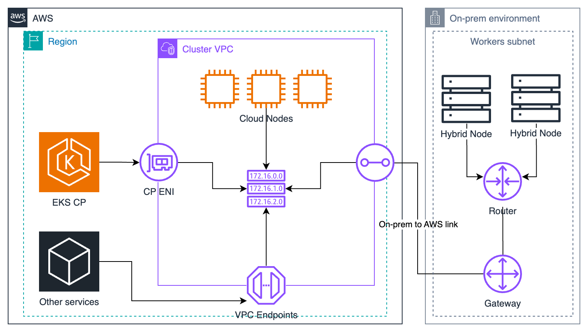

---
<!-- Slide 1: 세션 커버 -->
@type: cover

# EKS Hybrid Nodes

온프레미스를 EKS로 확장하기

개념, 아키텍처, 데모 영상

:::notes
{timing: 0.5min}
[요약]
- 1시간 L200 세션입니다. 아키텍트와 의사결정자 관점에서 개념과 구조를 다룹니다.
- 설정 파일과 명령은 다루지 않습니다. 필요한 곳은 2시간 Deep Dive 덱으로 안내합니다.
- 데모는 실측 결과를 재구성한 영상으로 보여 드립니다.

안녕하세요. 오늘은 EKS Hybrid Nodes를 한 시간 동안 다룹니다. 설정 방법보다는, 이 기능이 무엇이고 어떤 구조로 동작하며 우리 조직에 맞는지 판단하는 데 필요한 내용을 중심으로 보겠습니다.
{cue: question}
지금 온프레미스에서 쿠버네티스 컨트롤 플레인을 직접 운영하고 계신 분 계신가요?
{cue: transition}
전체 순서부터 보겠습니다.
:::

---
<!-- Slide 2: 아젠다 -->
@type: agenda

## 오늘 세션 구성

1. 왜 하이브리드인가
2. 개념과 아키텍처
3. 네트워킹
4. 운영
5. 데모 영상
6. 마무리

> 질문은 마지막에 한 번에 받겠습니다.

:::notes
{timing: 0.5min}
[요약]
- 1, 2부: 왜 필요한지, 구조, 책임, 요금, 노드 준비, 자격 증명
- 3, 4부: 네트워킹과 운영의 핵심 판단 기준
- 5, 6부: 데모 영상과 도입 판단 체크리스트

여섯 파트로 진행합니다. 먼저 왜 하이브리드가 필요한지 보고, 개념과 아키텍처, 네트워킹, 운영 순서로 갑니다. 그다음 실제 클러스터에서 측정한 결과를 영상으로 보여 드리고, 도입 판단 기준으로 마무리합니다.
{cue: pause}
질문은 마지막에 한 번에 받겠습니다.
{cue: transition}
먼저 고객들이 왜 하이브리드를 찾는지부터 보겠습니다.
:::

---
<!-- Slide 3: 고객 시나리오 -->
@type: content
@title: 온프렘을 버릴 수 없는 네 가지 이유

## 온프렘을 버릴 수 없는 네 가지 이유

:::html

  

    <strong class="text-accent">데이터 위치 요건</strong>
    
대규모 로컬 데이터를 온프레미스에 두고, 그 가까이에서 처리해야 하는 경우

  

  

    <strong class="text-accent">기존 하드웨어 투자</strong>
    
이미 보유한 서버를 계속 활용하면서 운영 방식은 EKS로 통일하고 싶은 경우

  

  

    <strong class="text-accent">엣지 처리</strong>
    
데이터가 생기는 현장 가까이에서 바로 처리해야 하는 경우

  

  

    <strong class="text-accent">온프레미스 GPU</strong>
    
보유한 GPU 서버를 클라우드 워크로드와 같은 도구로 관리하려는 경우

  

  <strong class="text-warning">공통 고민</strong>: 컨트롤 플레인 운영, 버전 업그레이드, 클라우드와 온프렘의 도구, 정책 파편화

:::

:::notes
{timing: 1.5min}
[요약]
- 대표적인 선택 이유: 로컬 데이터, 기존 하드웨어, 엣지 처리, 온프레미스 GPU
- 이런 워크로드는 클라우드로 옮기기 어렵습니다.
- 그런데 온프렘 쿠버네티스는 컨트롤 플레인 운영과 업그레이드 부담이 큽니다.

현장에서 하이브리드를 찾는 이유는 대체로 이 네 가지입니다. 데이터를 온프레미스에 둬야 하거나, 이미 사 둔 서버가 있거나, 현장 가까이에서 처리해야 하거나, GPU 서버가 온프렘에 있는 경우입니다.
{cue: pause}
이런 워크로드는 클라우드로 옮기기 어렵습니다. 그런데 온프렘에 쿠버네티스를 직접 올리면 etcd 백업, API server 가용성, 인증서 갱신, 마이너 버전 업그레이드를 팀이 다 책임져야 하고, 클라우드와 온프렘이 다른 도구와 정책으로 따로 굴러가게 됩니다. 데이터 위치 요건은 뒤에서 한 번 더 짚겠습니다. 워크로드를 온프렘에 둔다고 모든 데이터가 온프렘에 남는 것은 아니기 때문입니다.
근거: Deep Dive 1부 "온프렘 K8s, 왜 아직도 힘든가", 4부 "도입 판단은 제약 확인부터"(온프레미스 GPU, 대규모 로컬 데이터, edge 처리, 기존 하드웨어 활용).
{cue: transition}
그럼 Hybrid Nodes가 이 문제를 어떻게 푸는지 한 줄로 정의해 보겠습니다.
:::

---
<!-- Slide 4: 한 줄 정의 -->
@type: content
@title: 컨트롤 플레인만 AWS에 맡긴다

## 컨트롤 플레인만 AWS에 맡긴다

:::html

  <strong class="text-info">EKS Hybrid Nodes</strong>: 고객이 소유한 온프레미스, 엣지 서버를 AWS가 관리하는 EKS 컨트롤 플레인에 노드로 연결하는 기능

<table class="data-table fragment fade-up" data-fragment-index="1">
  <thead><tr><th>옵션</th><th>컨트롤 플레인</th><th>워커 노드</th><th>인프라 소유</th></tr></thead>
  <tbody>
    <tr><td>EKS (클라우드)</td><td>AWS 관리</td><td>AWS Region의 컴퓨팅</td><td>AWS</td></tr>
    <tr><td>EKS Anywhere</td><td>고객이 직접 운영</td><td>고객 인프라</td><td>고객</td></tr>
    <tr><td><strong>EKS Hybrid Nodes</strong></td><td><strong>AWS 관리 (EKS)</strong></td><td>고객 소유 온프레미스, 엣지 호스트</td><td>고객</td></tr>
  </tbody>
</table>

  <strong class="text-warning">AWS 인프라는 대상이 아님</strong>: Local Zone, Outposts, 다른 클라우드의 머신, EC2는 hybrid node로 쓰는 것을 지원하지 않습니다.

:::

:::notes
{timing: 1.5min}
[요약]
- 내 데이터센터의 서버를 AWS가 운영하는 EKS 컨트롤 플레인에 노드로 붙이는 기능
- 달라지는 점: 컨트롤 플레인 운영을 AWS가 맡고, 클라우드와 온프렘을 같은 EKS API와 도구로 운영
- Local Zone, Outposts, 다른 클라우드, EC2는 hybrid node 인프라로 지원하지 않음

한 줄로 말하면, 내 데이터센터 서버를 AWS가 운영하는 EKS 컨트롤 플레인에 노드로 붙이는 기능입니다. 표를 두 축으로 보시면 됩니다. 컨트롤 플레인을 누가 운영하는지, 워커 하드웨어가 누구 소유인지입니다.
{cue: pause}
EKS Anywhere는 컨트롤 플레인까지 고객이 운영하고, Hybrid Nodes는 하드웨어는 고객 것이지만 컨트롤 플레인은 AWS가 맡습니다. 그래서 클라우드와 온프렘을 같은 EKS API, 같은 도구로 다룰 수 있습니다. 다만 Local Zone이나 Outposts처럼 AWS 인프라는 hybrid node로 등록할 수 없고, EC2에 올려 테스트하는 것도 미지원인데 이때도 hybrid node 요금은 부과됩니다. Outposts 등 다른 옵션의 상세 비교는 Deep Dive 1부에 있습니다.
근거: Deep Dive 1부 "Edge 옵션, 책임 경계가 다르다", "컨트롤 플레인만 AWS에 맡긴다".
{cue: transition}
여기까지가 1부였습니다. 2부 개념과 아키텍처로 넘어가, 전체 구조를 그림으로 보겠습니다.
:::

---
<!-- Slide 5: 전체 아키텍처 -->
@type: content
@title: 2부: 전체 아키텍처, private 연결 위의 한 클러스터

## 2부: 전체 아키텍처, private 연결 위의 한 클러스터

:::html

  

    
    
그림의 Gateway는 VGW, TGW 같은 사설 연결 장치입니다.

  

  

    

      <strong class="text-warning">연결</strong>
      
VPN 또는 Direct Connect로 AWS와 안정적인 private 양방향 연결. 연결과 라우팅은 고객이 준비

    

    

      <strong class="text-info">등록</strong>
      
nodeadm이 노드를 구성하고, SSM 또는 IAM Roles Anywhere 자격 증명으로 EKS API에 인증

    

    

      <strong class="text-success">Ready</strong>
      
CNI(Cilium 또는 Calico)를 설치해야 Ready. VPC CNI는 hybrid node를 관리하지 않음

    

  

:::

:::notes
{timing: 2min}
[요약]
- AWS 쪽에는 EKS 컨트롤 플레인과 VPC, 온프렘 쪽에는 hybrid node가 있고 private 연결로 이어집니다.
- 노드는 nodeadm으로 구성하고 SSM 또는 IAM Roles Anywhere 자격 증명으로 인증합니다.
- CNI를 설치해야 Ready가 되며, 같은 클러스터에 일반 AWS 노드와 hybrid node를 함께 둘 수 있습니다.

왼쪽 그림이 전체 구조입니다. AWS 쪽에는 컨트롤 플레인과 VPC가 있고, 온프레미스의 hybrid node가 VPN이나 Direct Connect 같은 private 연결로 이어집니다. 같은 클러스터 안에 일반 AWS 노드와 hybrid node를 함께 둘 수 있습니다.
{cue: pause}
그림에 라우터와 게이트웨이가 보이는데, 여기서 Gateway는 VGW나 TGW 같은 사설 연결 장치이고 3부에서 다룰 Hybrid Nodes Gateway와는 다릅니다. 이 연결과 라우팅은 고객이 준비해야 합니다. Hybrid Nodes가 네트워크를 자동으로 만들어 주지는 않습니다. 노드는 nodeadm이라는 CLI로 구성하고, SSM이나 IAM Roles Anywhere로 받은 임시 자격 증명으로 EKS API에 인증합니다. 마지막으로 Cilium이나 Calico 같은 CNI를 설치해야 Ready가 됩니다. VPC CNI는 hybrid node를 관리하지 않습니다.
네트워크는 오늘 3부에서, 등록 단계별 설정은 Deep Dive 1부 "Ready까지 여섯 단계"와 3부에서 자세히 다룹니다.
근거: Deep Dive 1부 "컨트롤 플레인만 AWS에 맡긴다", "Ready까지 여섯 단계", Deep Dive의 high-level network 그림 재사용
{cue: transition}
이 구조에서 누가 무엇을 책임지는지 정리해 보겠습니다.
:::

---
<!-- Slide 6: 책임 분담 -->
@type: content
@title: 책임은 나뉘고, 데이터는 AWS에

## 책임은 나뉘고, 데이터는 AWS에

:::html

  

    <strong class="text-info">AWS 책임</strong>
    <ul class="on-surface-muted">
      <li>EKS API server, etcd, scheduler, controller</li>
      <li>SSM, IAM Roles Anywhere 서비스</li>
      <li>컨트롤 플레인 가용성 관리</li>
    </ul>
  

  

    <strong class="text-warning">고객 책임</strong>
    <ul class="on-surface-muted">
      <li>Host, OS, 보안 패치, kubelet, containerd 운영</li>
      <li>CNI 구성, VPN, Direct Connect, 라우팅</li>
      <li>노드 인증서, 자격 증명 준비, 워크로드 운영</li>
    </ul>
  

  <strong class="text-danger">데이터 경계 주의</strong>: Secrets, Kubernetes 객체, 로그 등 컨트롤 플레인 데이터는 AWS에 저장됩니다.

:::

:::notes
{timing: 1.5min}
[요약]
- 컨트롤 플레인은 AWS, 노드 이하는 고객 책임입니다.
- 자격 증명 서비스는 AWS가 운영하지만 인증서, activation 준비는 고객 몫입니다.
- Secrets, Kubernetes 객체, 로그는 AWS 컨트롤 플레인에 저장됩니다.

왼쪽이 AWS가 책임지는 영역, 오른쪽이 고객이 책임지는 영역입니다. 컨트롤 플레인 구성요소와 자격 증명 서비스는 AWS가 운영하지만, 노드 OS 패치, kubelet, containerd, CNI, 그리고 온프렘과 AWS 사이의 연결은 모두 고객이 운영합니다.
{cue: pause}
아까 데이터 위치 요건을 말씀드렸는데, 여기 빨간 박스가 그 답입니다. Kubernetes API 객체와 Secrets, 로그는 AWS가 관리하는 컨트롤 플레인에 저장됩니다. 그래서 node selector로 워크로드를 온프렘에 붙였다고 해서 데이터 주권이나 규정 준수가 입증되지는 않습니다. 업무 데이터, API 객체, 로그, 이미지, 자격 증명을 각각 나눠서 저장 위치를 따져 보셔야 합니다.
망분리 관점의 상세 검토는 Deep Dive 4부에 있습니다.
근거: Deep Dive 1부 "책임은 나뉘고, 데이터는 AWS에", 4부 "규제 대응은 증거로 말한다".
{cue: transition}
다음은 의사결정에서 빠질 수 없는 요금입니다.
:::

---
<!-- Slide 7: 요금 모델 -->
@type: content
@title: 요금은 vCPU-hour 구간제

## 요금은 vCPU-hour 구간제

:::html

  <table class="data-table">
    <thead><tr><th>월 누적 vCPU-hours 구간</th><th>vCPU-hour당 요금</th></tr></thead>
    <tbody>
      <tr><td>처음 576,000</td><td>$0.020</td></tr>
      <tr><td>다음 576,000</td><td>$0.014</td></tr>
      <tr><td>다음 4,608,000</td><td>$0.010</td></tr>
      <tr><td>다음 5,760,000</td><td>$0.008</td></tr>
      <tr><td>11,520,000 초과</td><td>$0.006</td></tr>
    </tbody>
  </table>
  <table class="data-table fragment fade-left" data-fragment-index="1">
    <thead><tr><th>노드</th><th>월 vCPU-h</th><th>연환산 노드 요금</th><th>+ 클러스터 1개</th></tr></thead>
    <tbody>
      <tr><td>10</td><td>233,600</td><td>$56,064</td><td>$56,940</td></tr>
      <tr><td>50</td><td>1,168,000</td><td>$236,928</td><td>$237,804</td></tr>
      <tr><td>100</td><td>2,336,000</td><td>$377,088</td><td>$377,964</td></tr>
    </tbody>
  </table>

가정: 노드당 32 vCPU, 월 730시간, 같은 월을 12번 반복, 표준 지원 클러스터 1개($0.10/시간) 포함. 청구서나 실측이 아닌 계산 모델입니다.

노드가 <strong>join된 시점부터 제거될 때까지</strong> 과금되며 workload가 idle이어도 계속됩니다. 하드웨어, 전력, 네트워크, 로그, OS 비용은 별도입니다.

:::

:::notes
{timing: 2.5min}
[요약]
- 노드가 보고한 vCPU-hours를 월 단위로 누적한 구간 요금: $0.020에서 $0.006까지
- Join부터 제거까지 과금되며 idle이어도 계속됩니다.
- 오른쪽 표는 32 vCPU, 730시간 가정의 계산 모델이지 청구서가 아닙니다.

요금은 노드가 보고하는 vCPU-hours를 월 단위로 누적해서 구간별로 계산합니다. 처음 57만 6천 vCPU-hours까지는 0.020달러이고, 사용량이 늘수록 단가가 내려가서 1,152만 초과분은 0.006달러입니다. 모든 사용량에 0.01달러가 고정으로 붙는 구조가 아닙니다.
{cue: pause}
오른쪽 표는 노드당 32 vCPU, 월 730시간을 가정한 계산 모델입니다. 50노드면 월 1,168,000 vCPU-hours이고, 구간을 적용하면 월 19,744달러, 연환산 236,928달러입니다. 클러스터 요금 876달러를 더하면 237,804달러입니다.
주의할 점이 두 가지 있습니다. 노드는 join된 시점부터 과금되고 workload가 놀아도 멈추지 않습니다. 그리고 hyperthreading을 켠 베어메탈은 코어 하나가 vCPU 2개로 보고될 수 있고, 머신당 32 vCPU를 넘으면 account team과 상담하라고 안내되어 있습니다. 하드웨어, 전력, OS 구독, 인력 비용은 빠진 숫자이니 조직의 TCO 모델에 넣어서 비교하시기 바랍니다. GPU 서버 규모로 직접 계산해 보는 계산기는 Deep Dive 1부에 있습니다.
근거: Deep Dive 1부 "요금은 vCPU-hour 구간제", 4부 "비용은 vCPU-hour 구간 과금"(가정 문단과 표). https://aws.amazon.com/eks/pricing/ (Deep Dive 확인일 2026-10-11). 발표 직전에 최신 요금표 재확인 필요.
{cue: transition}
다음은 어떤 서버를 노드로 쓸 수 있는지 보겠습니다.
:::

---
<!-- Slide 8: 지원 OS와 노드 준비 -->
@type: content
@title: 지원 OS와 노드 준비

## 지원 OS와 노드 준비

:::html

  
<strong class="text-accent">Ubuntu</strong>
지원 LTS 버전

  
<strong class="text-accent">RHEL</strong>
지원 메이저 버전

  
<strong class="text-accent">Amazon Linux 2023</strong>
온프렘 가상화 환경만, 베어메탈 아님

  
<strong class="text-warning">Bottlerocket</strong>
VMware 변형, x86_64만

  
의존성 설치 nodeadm이 kubelet, containerd 등 설치

  
→

  
호스트 구성, EKS 조인 nodeadm이 자격 증명으로 조인

  
→

  
CNI 설치 NotReady에서 Ready로

  
<strong class="text-info">nodeadm은 상시 에이전트가 아님</strong>
설치, 조인, 업그레이드용 CLI. 롤백 명령은 없으므로 업그레이드는 교체가 기본

  
<strong class="text-warning">Bottlerocket은 nodeadm 없이</strong>
자체 설정과 bootstrap 경로로 조인합니다

:::

:::notes
{timing: 2min}
[요약]
- OS: Ubuntu, RHEL, AL2023(온프렘 가상화 한정), Bottlerocket(VMware 변형, x86_64 한정). 아키텍처는 x86_64와 arm64
- 노드 준비: nodeadm으로 의존성을 설치하고 조인한 뒤 CNI를 설치하면 Ready
- Bottlerocket은 nodeadm 대신 자체 bootstrap 경로를 씁니다.

노드로 쓸 수 있는 OS는 네 가지입니다. Ubuntu와 RHEL은 지원 목록의 버전이면 되고, Amazon Linux 2023은 온프렘 가상화 환경에서만 지원되며 베어메탈은 아닙니다. Bottlerocket은 VMware 변형에 x86_64만 지원합니다. CPU 아키텍처는 x86_64와 arm64입니다.
{cue: pause}
노드 준비는 단순합니다. nodeadm install로 kubelet, containerd 같은 의존성을 설치하고, nodeadm init으로 호스트를 구성해서 클러스터에 조인합니다. 이 상태에서는 NotReady이고, CNI를 설치하면 Ready가 됩니다. nodeadm은 계속 떠 있는 에이전트가 아니라 설치, 조인, 업그레이드용 CLI이고, 롤백이나 reset 명령은 없습니다. Bottlerocket은 nodeadm을 쓰지 않고 자체 설정 경로로 조인합니다.
정확한 OS 버전, Kubernetes와 nodeadm 버전 요건, Cilium 버전은 시점에 따라 바뀝니다. 지원 매트릭스는 Deep Dive 1부, nodeadm과 Bottlerocket 조인 절차는 Deep Dive 3부에서 확인하세요. 업그레이드와 라이프사이클은 오늘 4부에서 다시 봅니다.
근거: Deep Dive 1부 "지원 매트릭스: OS, K8s, CNI", 3부 "nodeadm: 명령은 여섯 개뿐", "Bottlerocket 조인과 운영의 차이".
{cue: transition}
마지막으로 노드가 AWS에 인증하는 자격 증명 방식을 고르는 기준입니다.
:::

---
<!-- Slide 9: 자격 증명 선택 -->
@type: content
@title: 어떤 자격 증명 방식을 고를까

## 어떤 자격 증명 방식을 고를까

:::html

각 칸에 마우스를 올리면(또는 Tab으로 포커스하면) 근거와 주의점이 나옵니다. 참고: <a href="https://docs.aws.amazon.com/eks/latest/userguide/hybrid-nodes-creds.html" target="_blank" rel="noopener">자격 증명 준비</a>, <a href="https://docs.aws.amazon.com/eks/latest/best-practices/hybrid-nodes-host-creds.html" target="_blank" rel="noopener">단절 시 자격 증명 동작</a>, <a href="https://aws.amazon.com/systems-manager/pricing/" target="_blank" rel="noopener">SSM 요금</a>

  
기준

SSM hybrid activation

IAM Roles Anywhere

  
사전 준비

  
PKI 불필요, activation 코드Activation 코드와 ID만 있으면 등록합니다. 활성화는 기본 24시간, 최대 30일 유효하고 하나로 1~1000대까지 등록합니다. 코드가 노출되면 그 기간에 누구나 등록할 수 있으니 짧게 만들고 노드별로 전달하세요.

  
CA와 노드별 인증서trust anchor(CA), profile, role, 노드별 인증서와 개인 키가 필요합니다. 사내 PKI가 있으면 재사용하고, 없으면 AWS Private CA를 쓸 수 있지만 그 요금은 별도입니다.

  
단절 후 복구

  
최대 30분 지연 가능끊기면 SSM agent가 간격을 늘려 가며 재시도하고, 그 간격이 최대 30분입니다. 자격 증명이 만료되면 네트워크가 돌아와도 갱신될 때까지 재연결되지 않고, 노드마다 시점이 다릅니다. agent를 재시작하면 바로 갱신합니다.

  
보통 몇 초kubelet이 필요할 때마다 자격 증명을 받기 때문에, 네트워크가 돌아오면 보통 몇 초 안에 재연결됩니다.

  
세션 길이

  
1시간 고정바꿀 수 없습니다. 만료 전에 자동으로 교체되고, 평소에는 노드와 애플리케이션에 영향이 없습니다.

  
기본 1시간, 최대 12시간profile 설정으로 늘릴 수 있고, 노드 IAM role의 최대 세션 길이도 함께 맞춰야 합니다. 길게 잡으면 짧은 단절은 견디지만 유출 시 노출 시간도 길어집니다.

  
노드 이름

  
mi-* ID로 자동SSM이 만든 managed instance ID가 노드 이름이 됩니다. 사람이 읽기 어려우니 위치와 역할은 label로 붙이세요.

  
인증서 CN과 연결노드 이름은 인증서 CN과 맞춰야 합니다. 설정 방법은 Deep Dive 3부에 있습니다.

  
운영 부담

  
activation과 agent 관리활성화 만료와 등록 한도, SSM agent 버전, 노드 제거 시 등록 해제를 관리합니다. 등록 자체는 무료지만 hybrid 노드에 Session Manager나 Run Command를 쓰면 2026-09-30부터 사용량 과금입니다.

  
인증서 발급, 갱신, 폐기노드별 인증서 배포, 만료 전 갱신, 폐기를 운영해야 합니다. 인증서가 만료되면 자격 증명을 받을 수 없으니 만료 알림을 켜 두세요. IAM Roles Anywhere 자체는 추가 요금이 없습니다.

  
필요한 연결

  
SSM 리전 엔드포인트갱신하려면 SSM 엔드포인트에 닿아야 합니다. 사설 연결만 쓰면 interface VPC endpoint(PrivateLink)를 준비합니다.

  
Roles Anywhere 엔드포인트갱신하려면 IAM Roles Anywhere 엔드포인트에 닿아야 합니다. 로컬 CA가 있어도 AWS 없이 자격 증명을 발급받을 수는 없습니다.

  
<strong class="text-info">SSM이 맞는 경우</strong>
사내 PKI가 없고 빨리 시작해야 할 때, 연결이 안정적이어서 단절 후 복구 지연을 감수할 수 있을 때.

  
<strong class="text-success">IAM RA가 맞는 경우</strong>
PKI와 인증서 수명 관리 체계가 이미 있을 때, 단절 후 빠른 복구나 긴 세션이 필요할 때.

  
<strong class="text-warning">공통</strong>
한 클러스터에서는 한 방식만 쓰는 것이 권장입니다. 두 방식 모두 갱신에 AWS 연결이 필요합니다.

:::

:::notes
{timing: 2.5min}
[요약]
- PKI가 없으면 SSM, 사내 PKI와 인증서 수명 관리 체계가 있으면 IAM Roles Anywhere
- 단절 후 복구: SSM은 최대 30분 지연 가능, IAM RA는 보통 몇 초. 세션은 SSM 1시간 고정, IAM RA 기본 1시간 최대 12시간
- 한 클러스터에서는 한 방식만, 두 방식 모두 갱신에 AWS 연결 필요

노드가 EKS API에 인증하려면 AWS 임시 자격 증명이 필요하고, 받는 방법이 두 가지입니다. SSM hybrid activation과 IAM Roles Anywhere입니다. 칸별 근거는 마우스를 올리면 나오니 질문이 나올 때 열어 보세요.
가장 먼저 물어볼 것은 사내 PKI가 있는지입니다. 없으면 SSM이 훨씬 빨리 시작할 수 있고, 이미 인증서를 발급하고 갱신하는 체계가 있으면 IAM Roles Anywhere가 자연스럽습니다.
{cue: pause}
두 번째는 네트워크 단절에 얼마나 민감한지입니다. SSM 자격 증명은 1시간 고정이고, 오래 끊기면 agent가 최대 30분 간격으로 재시도해서 재연결이 늦어질 수 있습니다. IAM Roles Anywhere는 보통 몇 초 안에 재연결되고 세션도 최대 12시간까지 늘릴 수 있습니다. 단절 동작은 4부에서 다시 봅니다.
운영 부담은 종류가 다릅니다. SSM은 activation 만료와 agent 버전을, IAM Roles Anywhere는 인증서 배포와 갱신, 폐기를 챙겨야 합니다. 요금 차이는 해당 칸의 설명에 있습니다.
마지막으로 한 클러스터에서는 한 방식만 쓰는 것이 AWS 권장이고, 어느 쪽이든 갱신에는 AWS 연결이 필요합니다. NodeConfig 설정과 provider별 준비물은 Deep Dive 1부와 3부에 있습니다.
{cue: transition}
여기까지가 2부 개념과 아키텍처였습니다. 3부에서는 이 구조의 핵심인 네트워킹을 보겠습니다.

[출처]
- https://docs.aws.amazon.com/eks/latest/userguide/hybrid-nodes-creds.html (PKI 유무에 따른 권장, 한 방식 사용)
- https://docs.aws.amazon.com/eks/latest/best-practices/hybrid-nodes-host-creds.html (SSM 1시간 고정, 최대 30분 백오프, IAM RA 최대 12시간과 수 초 재연결)
- https://aws.amazon.com/systems-manager/pricing/ (Advanced tier 폐지, 2026-09-30부터 Session Manager와 Run Command 과금)
- https://aws.amazon.com/blogs/security/planning-for-your-iam-roles-anywhere-deployment/ (AWS Private CA 비용 고려)
:::
