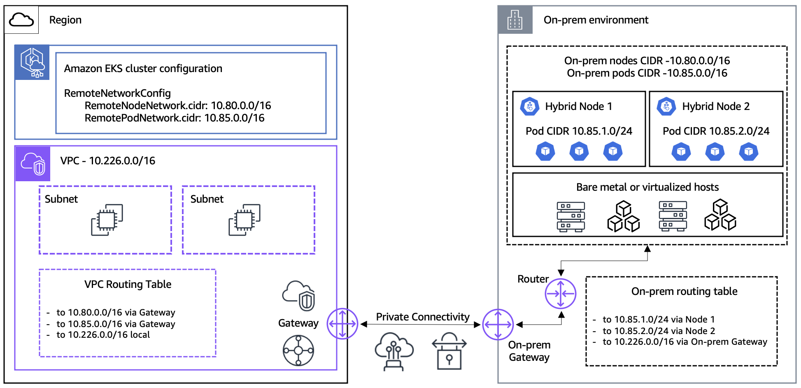

---
<!-- Slide 1: 3부 구분 (Section) -->
@type: section

# 3부: 네트워킹

연결은 고객이 준비하고, Pod 경로는 세 가지 중에서 고른다

:::notes
{timing: 0.5min}
[요약]
- 3부의 질문: AWS 컨트롤 플레인, VPC와 온프레미스 Pod가 어떻게 서로를 찾는가
- 순서: 필수 연결과 CIDR, Pod 라우팅 3가지, Gateway, CNI 선택, 트래픽 방향, 비용
- 설정 값과 방화벽 표 전체는 Deep Dive 2부에 있습니다.

3부는 네트워킹입니다. 도입에서 시간이 가장 많이 드는 부분이고, 연결과 라우팅 설계가 먼저 끝나야 노드가 제대로 동작합니다.
연결과 CIDR, Pod 경로 세 가지, Gateway, CNI, 트래픽 방향, 비용 순서로 보겠습니다.
{cue: transition}
가장 기본인 연결부터 보겠습니다.
:::

---
<!-- Slide 2: 필수 연결과 CIDR -->
@type: content
@title: 연결이 먼저, CIDR은 겹치지 않게

## 연결이 먼저, CIDR은 겹치지 않게

:::html

  

    
    
그림의 Gateway는 VGW, TGW 같은 사설 연결 장치입니다. 뒤에 나올 Hybrid Nodes Gateway와는 다릅니다.

  

  

    

      <strong class="text-info">사설 연결과 양방향 route</strong>
      
Direct Connect 또는 Site-to-Site VPN. VPC에서 온프렘 node, Pod CIDR로, 온프렘에서 VPC CIDR로 가는 경로가 모두 있어야 합니다.

    

    

      <strong class="text-warning">서로 겹치면 안 되는 4개 CIDR</strong>
      

        
VPC CIDR

        
Service CIDR

        
Remote node CIDR

        
Remote Pod CIDR

      

    

    

      <strong class="text-accent">포트는 방향으로 구분</strong>
      
노드가 여는 API 연결(443), 컨트롤 플레인이 여는 kubelet, webhook 연결, hybrid 노드 간 VXLAN

    

  

:::

:::notes
{timing: 2min}
[요약]
- Direct Connect 또는 VPN 사설 연결이 전제이고, 라우팅은 양방향이어야 합니다.
- VPC, Service, remote node, remote Pod CIDR 네 가지는 서로 겹치면 안 됩니다.
- 포트는 누가 연결을 시작하는지로 나눕니다: 노드가 여는 443, 컨트롤 플레인이 여는 kubelet과 webhook, 노드 간 VXLAN

온프레미스 노드가 AWS 컨트롤 플레인에 붙는 구조라 연결 설계가 가장 먼저입니다. Direct Connect나 Site-to-Site VPN을 쓰고, AWS 일반 권장은 대역폭 100 Mbps 이상, RTT 200 ms 이하입니다. 보장값이 아니라 권장값입니다.
라우팅은 양방향입니다. VPC에서 온프렘 node와 Pod CIDR로, 온프렘에서 VPC CIDR로 가는 경로가 모두 있어야 합니다. 한쪽만 있으면 노드는 붙어도 logs나 exec가 막힙니다.
{cue: pause}
CIDR은 VPC, Service, remote node, remote Pod 네 가지가 서로 겹치면 안 되고, remote CIDR은 RFC1918 또는 CGNAT 범위의 IPv4입니다. 나중에 바꾸기 어려우니 설계 단계에서 확정하세요.
포트는 방향으로 기억하시면 됩니다. 443은 온프렘에서 나가는 연결이고, 컨트롤 플레인이 여는 kubelet과 webhook 연결은 들어오는 연결입니다. 그래서 "outbound만 열면 된다"는 설명은 틀립니다. hybrid 노드끼리는 Cilium VXLAN을 씁니다.
CIDR 개수 제한, 포트 번호 전체, 모드별 방화벽 표, VPC 엔드포인트는 Deep Dive 2부에 있습니다.
근거: Deep Dive 2부 "연결이 먼저, 쿠버네티스는 그다음", "CIDR 설계: 겹치면 모든 게 막힌다", "443은 안에서 열고, 10250은 밖에서 온다", "방화벽 규칙: 모드별로 달라진다". Deep Dive의 prereq 그림 재사용
{cue: transition}
연결이 준비되면 다음 질문은 VPC에서 온프렘 Pod IP까지 어떻게 가느냐입니다.
:::

---
<!-- Slide 3: Pod 라우팅 3가지 -->
@type: content
@title: Pod 라우팅: static, BGP, Gateway

## Pod 라우팅: static, BGP, Gateway

:::html

<table class="data-table hn3-table">
  <thead><tr><th>비교 항목</th><th>static route</th><th>Cilium BGP</th><th>Hybrid Nodes Gateway</th></tr></thead>
  <tbody>
    <tr><td>Pod CIDR 도달 방법</td><td>온프렘 라우터에 node별 prefix를 수동 등록</td><td>Cilium이 Pod CIDR을 라우터에 광고</td><td>Pod CIDR당 VPC route 1건, leader에서 VXLAN</td></tr>
    <tr><td>온프렘 라우터 변경</td><td>필요 (route 유지, drift 추적)</td><td>필요 (peering, ASN, prefix filter)</td><td>Pod CIDR route 불필요 (node IP, VXLAN 포트는 필요)</td></tr>
    <tr><td>HA, 처리량</td><td>라우터와 링크 한계</td><td>라우터와 링크 한계</td><td>active, standby. 활성 Gateway 1대가 한계</td></tr>
    <tr><td>cross-AZ 비용</td><td>Pod의 AZ에서 바로 나감</td><td>Pod의 AZ에서 바로 나감</td><td>모두 leader AZ 경유, 다른 AZ는 cross-AZ 요금</td></tr>
  </tbody>
</table>

  
<strong class="text-success">BGP 우선</strong>
라우터 팀이 BGP를 운영할 수 있을 때, 트래픽이 큰 경로. AWS 가이드 권장

  
<strong class="text-warning">static은 소규모, 고정 환경</strong>
CIDR이 바뀔 때마다 수동 갱신

  
<strong class="text-info">Gateway는 라우터 변경이 어려울 때</strong>
Cilium 제약과 추가 hop을 받아들일 수 있다면

:::

:::notes
{timing: 2min}
[요약]
- static과 BGP는 온프렘 Pod CIDR을 직접 라우팅하고, Gateway는 VXLAN 터널로 우회합니다.
- 판단 기준: 라우터 팀이 BGP를 운영할 수 있는지, Cilium 제약과 추가 hop을 받아들일 수 있는지
- Gateway는 leader AZ로 트래픽이 모여 cross-AZ 요금이 생기므로 대용량 경로는 BGP

클라우드 Pod, 컨트롤 플레인의 webhook 호출, ALB의 IP 타깃이 온프렘 Pod IP에 닿으려면 VPC가 그 Pod CIDR로 가는 길을 알아야 합니다. 방법은 세 가지입니다.
static은 라우터에 prefix를 직접 넣는 방식이라 단순하지만, 노드와 Pod CIDR이 바뀔 때마다 사람이 따라가야 합니다. BGP는 Cilium이 Pod CIDR을 라우터에 광고하므로 노드가 늘어도 유연하지만, 라우터 팀과 peering, ASN, prefix filter를 합의해야 합니다.
{cue: pause}
Gateway는 온프렘 Pod CIDR을 VPC에서 라우팅 가능하게 만들 필요가 없다는 것이 핵심입니다. 대신 활성 Gateway 한 대를 거치는 hop이 생기고, 그 한 대가 처리량의 한계입니다. 비용 행의 cross-AZ 차이는 3부 마지막에 다시 봅니다.
{cue: question}
Gateway가 필수라고 오해하시는 경우가 많습니다. Gateway 없이도 BGP나 static으로 Pod를 라우팅 가능하게 설계하면 webhook과 ALB IP 타깃이 됩니다. 우리 환경에서 가장 큰 변수는 라우터 팀의 협조 가능성입니다.
전체 비교표와 BGP 설정 예제는 Deep Dive 2부에 있습니다.
근거: Deep Dive 2부 "라우팅 선택: static, BGP, Gateway"(비교표에서 4행 발췌, 선택 카드), "Cilium BGP v2: Pod CIDR만 광고"
{cue: transition}
그럼 Gateway가 실제로 어떻게 동작하는지 보겠습니다.
:::

---
<!-- Slide 4: Gateway 동작 -->
@type: content
@title: Gateway: VPC route 하나와 VXLAN 터널

## Gateway: VPC route 하나와 VXLAN 터널

:::html

  

    
VPC

    
Cloud Pod, 컨트롤 플레인, ALB목적지: 온프렘 Pod IP

    
route tablePod CIDR당 1건, leader ENI로

  

  
→

  

    
Gateway (EC2 2대)

    
leader트래픽 처리, VXLAN 캡슐화

    
standby터널 상태만 유지

  

  
 → DX, VPN →

  

    
온프렘

    
Cilium (VTEP)decap 후 전달

    
Hybrid Pod

  

  
<strong class="text-info">장애 시 3~5초</strong>
standby가 leader를 이어받고 VPC route를 자기 ENI로 바꿉니다. AWS 예상치이며 보장값은 아닙니다.

  
<strong class="text-warning">노드 선택은 자유</strong>
Auto Mode 또는 관리형, 자체 관리 노드 그룹. Gateway 소프트웨어 자체 요금은 없습니다.

  
<strong class="text-danger">알고 쓸 제약</strong>
VXLAN은 암호화 없음, 클러스터당 1개, Cilium L7 proxy를 꺼야 함

:::

:::notes
{timing: 2min}
[요약]
- VPC route table에 Pod CIDR마다 route 1건, 대상은 leader Gateway의 ENI. leader가 VXLAN으로 온프렘 Cilium에 전달
- Gateway는 2대가 active, standby로 동작하고, 장애 시 인계는 AWS 예상 3~5초(보장 아님)
- 제약: 암호화 없음, 클러스터당 1개, Cilium L7 proxy 끔. 소프트웨어 요금은 없고 EC2와 데이터 전송 비용만

Hybrid Nodes Gateway는 2026년 4월에 GA 된 오픈소스 구성요소이고, 선택 사항입니다. VPC 안의 EC2 노드 두 대에 뜹니다.
흐름은 왼쪽에서 오른쪽입니다. VPC route table에 온프렘 Pod CIDR마다 route가 하나 들어가고, 대상은 leader Gateway의 ENI입니다. 노드가 늘어도 route 수는 그대로입니다. leader가 패킷을 VXLAN으로 감싸 온프렘 Cilium으로 보내고, Cilium이 풀어서 Pod에 전달합니다.
{cue: pause}
두 대 중 한 대만 일합니다. leader가 죽으면 standby가 이어받고 VPC route를 자기 ENI로 바꿉니다. AWS는 이 인계를 3~5초 정도로 안내하는데 보장값은 아니고, 5부 영상에서 측정 결과를 보여 드립니다. Gateway 노드는 Auto Mode, 관리형, 자체 관리 노드 그룹 모두 되고, 요금은 3부 마지막에 봅니다.
제약은 세 가지입니다. VXLAN은 암호화가 없어 민감 트래픽은 MACsec이나 IPsec VPN으로 보호하고, 클러스터당 하나이며, Cilium L7 proxy를 꺼야 해서 같은 Cilium의 Ingress, Gateway API, L7 정책을 쓸 수 없습니다. Helm으로 지워도 VPC route는 남습니다.
설치 순서, IAM 권한, 메트릭, 인스턴스 크기 가이드는 Deep Dive 2부에 있습니다.
근거: Deep Dive 2부 "Gateway는 Pod CIDR 라우팅 숙제를 던다", "Gateway 데이터 플레인: 한 경로로 읽기", "Gateway HA: active/standby, scale-up", "Gateway 운영: 관측과 제약"
{cue: transition}
Gateway를 쓸 수 있는지는 CNI 구성과도 연결됩니다.
:::

---
<!-- Slide 5: CNI 선택 -->
@type: content
@title: CNI 구성: Cilium만 쓸까, VPC CNI와 섞을까

## CNI 구성: Cilium만 쓸까, VPC CNI와 섞을까

:::html

<strong class="text-info">전제</strong>: VPC CNI는 hybrid 노드와 호환되지 않습니다. hybrid 노드는 항상 Cilium(또는 Calico). 질문은 "클라우드 노드에 무엇을 쓸까"입니다.

<table class="data-table hn3-cni fragment fade-up" data-fragment-index="1">
  <thead><tr><th>기준</th><th>hybrid 전용 (Cilium만)</th><th>혼합 (클라우드 VPC CNI + hybrid Cilium)</th></tr></thead>
  <tbody>
    <tr><td>AWS 지원</td><td>지원</td><td>지원, AWS 혼합 모드 권장안</td></tr>
    <tr><td>webhook 위치</td><td>hybrid 노드, 온프렘 Pod CIDR 라우팅 필요</td><td>클라우드 노드에 두면 Pod CIDR 라우팅 불필요</td></tr>
    <tr><td>버스팅, Auto Mode</td><td>불가 (클라우드 용량 없음)</td><td>가능</td></tr>
    <tr><td>Hybrid Nodes Gateway</td><td>해당 없음</td><td>사용 가능 (Gateway 노드를 포함한 클라우드 노드는 VPC CNI)</td></tr>
  </tbody>
</table>

  
<strong class="text-success">클라우드 노드가 있으면 혼합</strong>
AWS 지원 범위 안의 구성. webhook은 클라우드에, 버스팅과 Gateway도 가능

  
<strong class="text-info">온프렘만 쓰면 Cilium만</strong>
CNI가 하나라 단순. 대신 webhook을 위해 온프렘 Pod CIDR 라우팅

  
<strong class="text-warning">클라우드까지 Cilium은 신중히</strong>
클라우드 노드의 Cilium은 AWS 미지원, Gateway와 Auto Mode를 쓸 수 없음

:::

:::notes
{timing: 2min}
[요약]
- VPC CNI는 hybrid 노드와 호환되지 않으므로 hybrid 노드는 항상 Cilium(또는 Calico)
- 클라우드 노드가 있으면 VPC CNI와 Cilium 혼합이 AWS 권장: webhook을 클라우드에 두고 버스팅과 Gateway 사용
- 클라우드 노드까지 Cilium으로 통일하면 AWS 미지원이고 Gateway, Auto Mode를 쓸 수 없음

"Cilium 하나로 통일하는 게 낫지 않나"는 자주 받는 질문입니다. 전제부터 말씀드리면 VPC CNI는 hybrid 노드와 호환되지 않으니 hybrid 노드에는 항상 Cilium이 들어갑니다. 그래서 실제 질문은 클라우드 노드에 무엇을 쓰느냐입니다.
{cue: pause}
클라우드 노드가 있는 혼합 클러스터라면 클라우드는 VPC CNI, hybrid는 Cilium으로 나누는 것이 AWS 문서의 권장 구성입니다. webhook을 클라우드 노드에 두면 온프렘 Pod CIDR을 라우팅하지 않아도 되고, Karpenter 버스팅과 Hybrid Nodes Gateway도 이 구성을 전제로 합니다. Gateway는 gateway 노드를 포함한 클라우드 노드가 VPC CNI여야 하고, Auto Mode 노드라면 내장 네트워킹이면 됩니다.
온프렘만 쓰는 클러스터라면 Cilium 하나라 단순합니다. 대신 webhook이 hybrid 노드에서 돌기 때문에 컨트롤 플레인이 들어올 수 있게 온프렘 Pod CIDR을 BGP나 static으로 라우팅해야 합니다.
클라우드 노드까지 Cilium으로 맞추고 싶다는 요청도 있는데, AWS Cloud의 노드에서 실행하는 Cilium은 AWS가 지원하지 않고, Gateway와 Auto Mode도 쓸 수 없습니다. 정책과 관측 일관성 비교, 칸별 근거는 Deep Dive 2부에 있습니다.
근거: Deep Dive 2부 "CNI 구성: Cilium만 쓸까, VPC CNI와 섞을까"(①, ② 열과 ③ 경고 카드)
{cue: transition}
이제 트래픽이 어느 방향에서 오느냐에 따라 경로가 어떻게 달라지는지 보겠습니다.
:::

---
<!-- Slide 6: 트래픽 방향 -->
@type: content
@title: 어디서 들어오느냐로 경로가 갈린다

## 어디서 들어오느냐로 경로가 갈린다

:::html

  
<strong class="text-success">VPC에서 hybrid Pod로</strong>
Cloud Pod, 컨트롤 플레인, ALB → Gateway 또는 BGP, static route → 온프렘 Pod

ALB IP 타깃 등록과 해제는 AWS Load Balancer Controller(LBC)가 하고, Gateway나 라우팅은 Pod IP까지 가는 경로만 줍니다.

  
<strong class="text-info">온프렘에서 리전 Pod로</strong>
온프렘 → DX, VPN → internal ALB → 리전 Pod

일반 VPC 경로라 Gateway가 관여하지 않습니다. 온프렘 DNS가 ALB 이름을 private IP로 풀어야 합니다.

  
<strong class="text-warning">온프렘에서 hybrid Pod로: hairpin</strong>
온프렘 → ALB → Gateway → 다시 온프렘

동작은 하지만 DX를 두 번 지나 지연과 전송 비용이 늘어납니다.

<strong class="text-info">AWS 권장</strong>: 리전에서 오는 트래픽은 ALB, 온프렘에서 오는 트래픽은 온프렘 쪽 Ingress나 LB로 받습니다. Gateway를 쓰면 Cilium L7 기능이 꺼지므로 온프렘은 L4 LoadBalancer나 기존 LB를 씁니다.

:::

:::notes
{timing: 2min}
[요약]
- VPC에서 hybrid Pod로: Gateway 또는 직접 라우팅이 경로를 주고, ALB 타깃 관리는 Load Balancer Controller
- 온프렘에서 리전으로: internal ALB를 쓰는 일반 VPC 경로, Gateway 불필요. 온프렘 DNS에서 private IP로 풀려야 함
- 온프렘 클라이언트가 ALB로 hybrid Pod를 부르면 hairpin. 온프렘 트래픽은 온프렘 LB로

방향을 세 가지로 나눠 보겠습니다. 첫째, VPC에서 hybrid Pod로 가는 경우입니다. 클라우드 Pod, 컨트롤 플레인의 webhook, ALB가 여기에 해당하고, 앞에서 본 Gateway나 BGP, static route가 경로를 줍니다. 자주 받는 질문이 "온프렘 Pod IP는 계속 바뀌는데 ALB 타깃은 누가 바꿔 주나"인데, AWS Load Balancer Controller, 줄여서 LBC가 등록과 해제를 하고 Gateway는 경로만 줍니다.
{cue: pause}
둘째, 온프렘에서 리전 서비스로 들어오는 경우입니다. 온프렘 호스트가 사설 연결을 지나 internal ALB에 닿고 리전 Pod로 가는 평범한 VPC 경로라 Gateway는 관여하지 않습니다. 다만 온프렘 DNS가 ALB 이름을 private IP로 풀어야 하므로 Route 53 Resolver inbound endpoint 같은 준비가 필요합니다.
셋째, 온프렘 클라이언트가 같은 ALB로 온프렘 Pod를 부르면 AWS로 갔다가 Gateway를 지나 다시 온프렘으로 돌아옵니다. 동작은 하지만 DX를 두 번 지나니 지연과 비용이 늘어납니다.
그래서 AWS 문서도 리전 트래픽은 ALB, 온프렘 트래픽은 온프렘 쪽 Ingress로 받으라고 권장합니다. Gateway를 켜면 Cilium Ingress와 Gateway API를 쓸 수 없으니 온프렘은 L4 LoadBalancer나 기존 LB를 씁니다. 실제 호출 결과는 5부 영상에서 봅니다.
근거: Deep Dive 5부 "ALB ip 타깃: hybrid Pod IP가 바뀌어도 LBC가 따라간다", "반대 방향: 온프렘에서 LB로 들어오면", Deep Dive 2부 "Pod 간 통신: VXLAN과 Cloud↔Hybrid". AWS docs hybrid-nodes-ingress (트래픽 출발지별 ALB와 온프렘 Ingress 권장)
{cue: transition}
마지막으로 Gateway를 쓸 때 놓치기 쉬운 비용 이야기입니다.
:::

---
<!-- Slide 7: 비용과 대용량 -->
@type: content
@title: Gateway 비용: leader AZ로 모인다

## Gateway 비용: leader AZ로 모인다

:::html

  

AZ a
Gateway leader Cloud Pod, ALB
같은 AZ라 cross-AZ hop 없음

  
← cross-AZ 요금 ← 모든 hybrid 트래픽

  

AZ b
Gateway standby (일하지 않음) Cloud Pod, ALB
leader AZ로 건너간 뒤 DX, VPN

  
<strong class="text-warning">replica는 처리량이 아님</strong>
활성 1대가 모든 트래픽을 처리. 늘리려면 인스턴스 크기를 키웁니다.

  
<strong class="text-info">비용 구성</strong>
Gateway 소프트웨어는 무료. EC2, 데이터 전송, Auto Mode 노드일 때만 관리 요금

  
<strong class="text-success">대용량은 BGP로 직접</strong>
Gateway는 webhook, 적은 양의 Pod 간 통신에. 큰 경로는 Cilium BGP

:::

:::notes
{timing: 1.5min}
[요약]
- Gateway를 두 AZ에 나눠도 활성 leader는 하나라서, 다른 AZ의 hybrid 트래픽은 leader AZ로 건너가 표준 cross-AZ 요금을 냅니다.
- replica를 늘려도 처리량은 그대로이고, 활성 1대의 인스턴스 크기가 한계입니다.
- 대용량 경로는 Cilium BGP로 직접 라우팅하고, Gateway는 webhook과 적은 양의 통신에 둡니다.

Gateway는 두 AZ에 나눠 두지만 일하는 leader는 하나라서, 다른 AZ의 Pod나 ALB에서 온프렘으로 가는 트래픽은 모두 leader AZ로 먼저 건너가고 표준 cross-AZ 요금이 붙습니다.
{cue: pause}
standby는 패킷을 나르지 않으니 replica를 늘려도 처리량은 그대로이고, 늘리려면 인스턴스 크기를 키웁니다. Gateway 소프트웨어는 무료이고 EC2와 데이터 전송 비용을 내며, Auto Mode 노드에 올렸을 때만 Auto Mode 관리 요금이 더해집니다.
그래서 큰 경로는 Cilium BGP로 직접 라우팅하고, Gateway는 webhook이나 적은 양의 통신에 둡니다. 둘을 함께 쓰면 같은 CIDR route의 소유자를 먼저 정하세요. Gateway 설치가 기존 route를 바꿀 수 있습니다.
인스턴스 크기 가이드와 HA 배치 규칙은 Deep Dive 2부에 있습니다.
근거: Deep Dive 2부 "라우팅 선택: static, BGP, Gateway"(cross-AZ 비용 행, BGP 카드, 노트), "Gateway HA: active/standby, scale-up", "Gateway는 Pod CIDR 라우팅 숙제를 던다"(노트의 요금 설명), "Gateway 운영: 관측과 제약"(설치는 route cutover). AWS docs hybrid-nodes-gateway-operations (cross-AZ 표준 요금)
{cue: transition}
여기까지가 3부 네트워킹이었습니다. 4부에서는 이렇게 붙인 노드를 어떻게 운영하는지 보겠습니다.
:::
