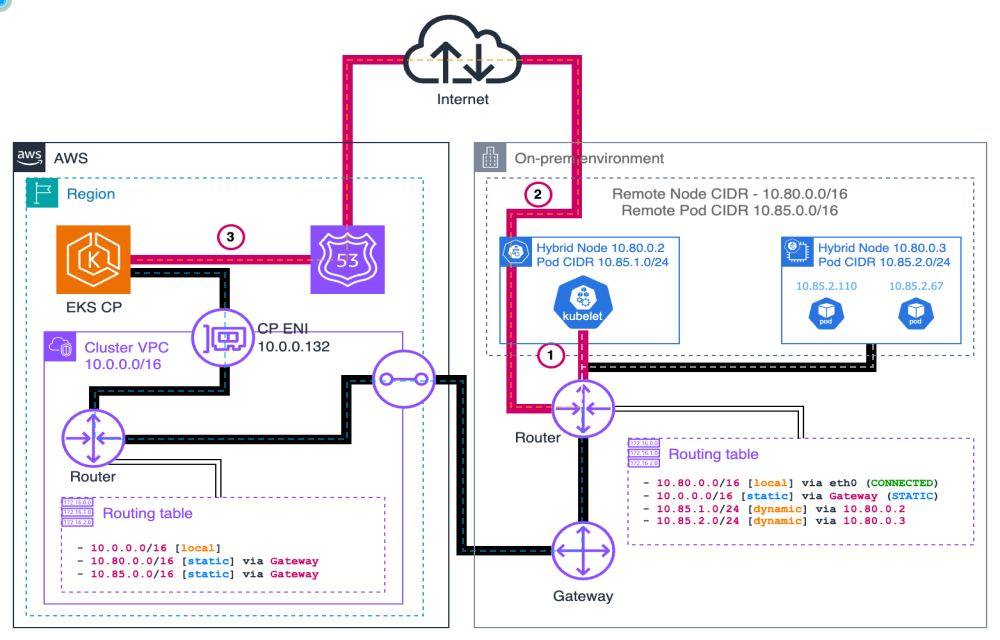
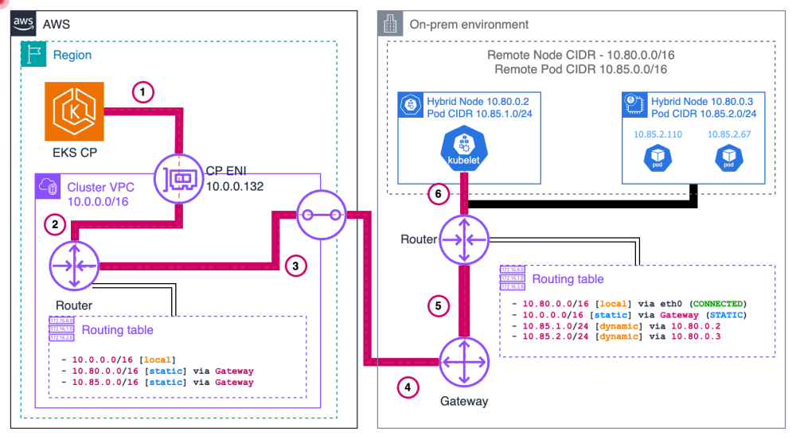
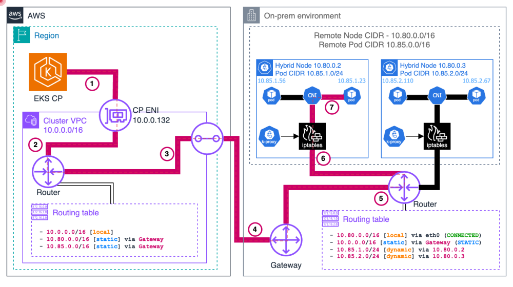
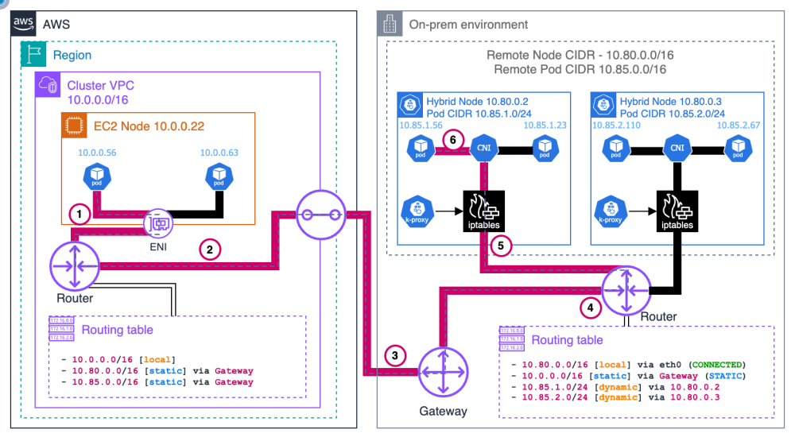

---
<!-- Slide 1: 2부 구분 (Section) -->
@type: section

# 2부: 네트워킹 & Hybrid Nodes Gateway

누가 세션을 열고, Pod CIDR은 어떻게 도달하며, Gateway는 언제 쓰는가

:::notes
{timing: 0.5min}
[요약]
• 이 파트의 질문은 하나입니다: "AWS 컨트롤 플레인과 온프레미스 Pod가 어떻게 서로를 찾는가"
• 순서: 전제 조건 → CIDR → 세션 방향 → 6가지 트래픽 패턴 → 라우팅 선택지 → Gateway
• Gateway는 선택 사항이며, 먼저 direct routing(static/BGP)을 이해해야 비교가 됩니다
2부에서는 네트워크 이야기를 합니다. 먼저 연결 전제와 CIDR 설계, 그다음 누가 세션을 여는지, 그리고 트래픽 패턴 6가지를 봅니다.
후반 절반은 Pod CIDR을 라우팅하는 세 가지 방법, 즉 static, Cilium BGP, 그리고 2026년 4월에 GA 된 Hybrid Nodes Gateway를 비교합니다.
{cue: transition}
먼저 가장 기본인 연결 전제부터 보겠습니다.
:::

---
<!-- Slide 2: 네트워크 전제 조건 -->
@type: content
@title: 연결이 먼저, 쿠버네티스는 그다음

## 연결이 먼저, 쿠버네티스는 그다음

:::html
<style>
.hn-split { display: grid; grid-template-columns: 1.3fr 1fr; gap: var(--space-4); align-items: center; }
.hn-stack { display: flex; flex-direction: column; gap: var(--space-3); }
.hn-img { width: 100%; max-height: 21rem; object-fit: contain; border-radius: var(--radius-md); background: var(--surface-1); }
.hn-cap { font-size: var(--fs-caption); color: var(--text-secondary); margin-top: var(--space-2); word-break: keep-all; overflow-wrap: break-word; }
.text-accent  { color: var(--accent);  font-weight: var(--weight-bold); }
.text-info    { color: var(--info);    font-weight: var(--weight-bold); }
.text-success { color: var(--success); font-weight: var(--weight-bold); }
.text-warning { color: var(--warning); font-weight: var(--weight-bold); }
.text-danger  { color: var(--danger);  font-weight: var(--weight-bold); }
.on-surface-muted { color: var(--text-secondary); font-size: var(--fs-card); margin-top: var(--space-2); word-break: keep-all; overflow-wrap: anywhere; }
.hn-code { font-family: var(--font-mono); font-size: var(--fs-caption); white-space: pre; background: var(--surface-2); border: 1px solid var(--surface-3); border-radius: var(--radius-md); padding: var(--space-3); overflow: hidden; line-height: 1.6; }
.hn-tabimg { display: block; margin: 0 auto; max-height: 19rem; width: auto; max-width: 100%; border-radius: var(--radius-md); }
.hn-takeaway { margin-top: var(--space-3); }
.hn-note { font-size: var(--fs-caption); color: var(--text-secondary); margin-top: var(--space-2); word-break: keep-all; overflow-wrap: break-word; }
.hn-table { width: 100%; font-size: var(--fs-caption); word-break: keep-all; overflow-wrap: break-word; }
.hn-table code { font-family: var(--font-mono); }
</style>
<div class="hn-split">
  <div>
    
    <div class="hn-cap">그림의 Gateway = VGW/TGW 같은 사설 연결 게이트웨이입니다. 뒤에 나올 Hybrid Nodes Gateway와는 다른 물건입니다.</div>
  </div>
  <div class="hn-stack fragment" data-reveal="stagger" data-reveal-anim="left" data-fragment-index="1">
    <div class="metric-card"><strong class="text-accent">사설 연결</strong><div class="on-surface-muted">Direct Connect 또는 Site-to-Site VPN. 공용 인터넷 경로와 사설 경로를 구분해 설계</div></div>
    <div class="metric-card"><strong class="text-info">권장 품질</strong><div class="on-surface-muted">대역폭 ≥100 Mbps, RTT ≤200 ms (AWS 일반 권장, 보장값 아님)</div></div>
    <div class="metric-card"><strong class="text-success">양방향 route</strong><div class="on-surface-muted">VPC → remote node/Pod CIDR, 온프렘 → VPC CIDR. 한쪽만 있으면 join 후 logs/exec가 막힘</div></div>
  </div>
</div>
:::

:::notes
{timing: 1min}
[요약]
• 사설 연결(DX 또는 VPN)이 전제이고, 라우팅은 양방향이어야 함
• AWS 일반 권장: 대역폭 100 Mbps 이상, RTT 200 ms 이하
• 그림 속 Gateway는 VGW/TGW 같은 연결 장치이며 Hybrid Nodes Gateway와 다름
Hybrid Nodes는 온프레미스 노드가 AWS 컨트롤 플레인에 붙는 구조라서, 연결이 끊기면 노드는 NotReady가 됩니다. 그래서 쿠버네티스 설정보다 연결 설계가 먼저입니다.
연결은 Direct Connect나 Site-to-Site VPN 같은 사설 경로를 쓰고, AWS 일반 권장은 대역폭 100 Mbps 이상, RTT 200 ms 이하입니다. 예전 자료에 있던 "DX는 항상 10 ms 미만" 같은 값은 검증되지 않은 수치라서 쓰지 않습니다.
{cue: pause}
라우팅은 양방향입니다. VPC 쪽 route table에 remote node와 Pod CIDR이 사설 게이트웨이로 향해야 하고, 온프렘 쪽에는 VPC CIDR로 가는 경로가 있어야 합니다.
이 그림의 Gateway는 VGW나 TGW 같은 연결 장치입니다. 잠시 후 나오는 Hybrid Nodes Gateway와 이름이 같아 혼동하기 쉬우니 구분해 주세요.
{cue: transition}
다음은 CIDR을 어떻게 잡아야 나중에 안 막히는지 체크리스트로 보겠습니다.
[근거]
• AWS docs hybrid-nodes-networking (RTT ≤200 ms / 100 Mbps 일반 권장), 내부 문서 D/02 "읽기 전용 연결 진단" 절
:::

---
<!-- Slide 3: CIDR 설계 체크리스트 -->
@type: checklist

## CIDR 설계: 겹치면 모든 게 막힌다

- [ ] Remote node CIDR 최대 15개, remote Pod CIDR 최대 15개
- [ ] IPv4 전용, RFC1918 또는 CGNAT(`100.64.0.0/10`) 범위
- [ ] node/Pod CIDR끼리, 그리고 VPC, Service CIDR과도 겹치지 않을 것
- [ ] 기존 클러스터에도 remote network 구성을 추가할 수 있음 (생성 시점 전용 아님)
  ```json
  "remoteNetworkConfig": {
    "remoteNodeNetworks": [{ "cidrs": ["10.80.0.0/16"] }],
    "remotePodNetworks":  [{ "cidrs": ["10.85.0.0/16"] }]
  }
  ```
- [ ] Pod CIDR을 라우팅 가능하게 만들지(BGP/static) 결정, webhook, Cloud↔Hybrid Pod 통신이 여기에 달림
- [ ] Cilium cluster-pool: 기존 항목, MaskSize 변경 금지, 확장은 새 항목 추가 (Cilium 문서 기준)

:::notes
{timing: 1min}
[요약]
• remote node/Pod CIDR은 각각 최대 15개, IPv4, RFC1918 또는 CGNAT
• VPC CIDR, Service CIDR과 겹치면 안 됨
• 기존 클러스터에도 remote network를 추가할 수 있음
• Pod CIDR을 routable로 둘지가 이후 선택(BGP/static/Gateway)을 결정
체크리스트를 하나씩 눌러 가면서 보겠습니다. 가장 흔한 사고는 Service CIDR이나 VPC CIDR과 Pod CIDR이 겹치는 경우입니다. 나중에 바꾸기 어렵기 때문에 설계 단계에서 확정해야 합니다.
예전에는 클러스터 생성 시점에만 설정할 수 있다고 알려졌지만, 현재 EKS API는 기존 클러스터에도 remote network 구성을 추가할 수 있습니다.
{cue: pause}
Cilium cluster-pool IPAM을 쓴다면 이미 쓰고 있는 pool 항목이나 마스크 크기를 바꾸지 마세요. 확장이 필요하면 새 항목을 추가하는 방식이 Cilium 문서 기준입니다. AWS 가이드는 설치 후 변경 금지로 더 보수적으로 안내하니 두 문서를 같이 확인하세요.
{cue: transition}
CIDR이 정해졌으면, 이제 누가 먼저 연결을 여는지를 볼 차례입니다.
[근거]
• 내부 문서 D/02 "CIDR 범위 요구 사항", D/01 CreateCluster 예시(remoteNetworkConfig), D/04 Cilium IPAM
:::

---
<!-- Slide 4: 세션은 누가 여는가 -->
@type: content
@title: 443은 안에서 열고, 10250은 밖에서 온다

## 443은 안에서 열고, 10250은 밖에서 온다

:::html
<div class="hn-split">
  <div>
    
    <div class="hn-cap">그림 속 Gateway도 사설 연결 게이트웨이입니다 (Hybrid Nodes Gateway 아님).</div>
  </div>
  <div class="hn-stack">
    <div class="callout callout-success fragment fade-left" data-fragment-index="1"><strong class="text-success">온프렘이 연다 (outbound)</strong><div class="on-surface-muted">kubelet, Pod → Kubernetes API, TCP 443. 노드가 먼저 연결을 시작</div></div>
    <div class="callout callout-warning fragment fade-left" data-fragment-index="2"><strong class="text-warning">AWS가 연다 (inbound)</strong><div class="on-surface-muted">CP → kubelet TCP 10250 (logs/exec/port-forward), CP → webhook Pod의 실제 설정 port</div></div>
    <div class="callout callout-info fragment zoom-in" data-fragment-index="3"><strong class="text-info">응답 허용 ≠ 신규 inbound 허용</strong><div class="on-surface-muted">443 세션의 stateful return이 10250 신규 연결을 열어 주지 않음. 별도 방화벽 규칙 필요</div></div>
  </div>
</div>
:::

:::notes
{timing: 2min}
[요약]
• 노드, Pod가 API 서버로 여는 TCP 443은 온프렘 outbound
• CP가 kubelet(10250)과 webhook으로 여는 연결은 온프렘 inbound
• 443 세션의 응답이 허용된다고 10250 신규 연결이 열리지는 않음
• 보안팀에는 "누가 어떤 세션을 시작하는가" 기준으로 설명
이 슬라이드가 방화벽, 보안팀과 대화할 때 제일 중요한 한 장입니다. 세션은 서로 다른 두 종류가 있습니다.
첫째, 노드와 Pod가 Kubernetes API로 여는 TCP 443입니다. 온프렘에서 밖으로 나가는 연결이라 outbound 규칙만 있으면 됩니다.
둘째, 컨트롤 플레인이 시작하는 연결입니다. kubectl logs, exec, port-forward 때문에 kubelet 10250으로 들어오고, 온프렘에서 webhook을 돌린다면 그 webhook의 실제 포트로도 들어옵니다. 이건 온프렘 입장에서 inbound입니다.
{cue: question}
"outbound만 열어 주면 되는 거 아니냐"는 질문을 자주 받습니다. 노드가 연 443 세션의 응답은 허용되지만, 그것이 10250 신규 연결을 열어 주지는 않습니다.
{cue: pause}
그래서 "outbound-only agent"로 소개하면 안 됩니다. 이 방향은 뒤에 나오는 6가지 트래픽 패턴과 방화벽 표의 기준이 됩니다.
{cue: transition}
이제 이 방향 개념으로 6가지 트래픽 패턴을 하나씩 보겠습니다.
[근거]
• 내부 문서 D/11 "실제로 누가 연결을 시작하는가", D/02 "필수 방화벽 포트"; AWS docs hybrid-nodes-networking
:::

---
<!-- Slide 5: 패턴 1, 2 kubelet ↔ CP -->
@type: content
@title: kubelet과 CP, 세션 방향이 다르다

## kubelet과 CP, 세션 방향이 다르다

:::html
<div class="tab-set" onclick="(function(e){var b=e.target.closest('.tab-btn');if(!b)return;var bar=b.parentNode,p=bar.parentNode,i=[].indexOf.call(bar.children,b);bar.querySelectorAll('.tab-btn').forEach(function(x){x.classList.remove('active')});b.classList.add('active');p.querySelectorAll('.tc').forEach(function(c,j){c.hidden=j!==i})})(event)">
  <button class="tab-btn active">① kubelet → CP (443)</button>
  <button class="tab-btn">② CP → kubelet (10250)</button>
</div>
<div class="tc">
  
  <div class="hn-note"><strong class="text-accent">public/private 중 하나를 선택</strong>: 경로가 다르므로 endpoint 설정에 따라 방화벽, DNS가 달라집니다. EKS 관리 PrivateLink(<code>eks</code>)와 Kubernetes API endpoint는 별개입니다.</div>
</div>
<div class="tc" hidden>
  
  <div class="hn-note"><strong class="text-warning">보고된 node IP의 TCP 10250</strong>으로 CP ENI에서 접속합니다. return route, 방화벽, kubelet 인증이 모두 필요하고, logs/exec/port-forward에 쓰입니다.</div>
</div>
<div class="callout callout-info hn-takeaway fragment zoom-in" data-fragment-index="1"><strong class="text-info">한 줄 정리</strong><div class="on-surface-muted">443은 온프렘이 열고, 10250은 CP가 엽니다, 같은 노드라도 방화벽 규칙의 방향이 다릅니다.</div></div>
:::

:::notes
{timing: 2min}
[요약]
• 패턴 1: kubelet이 API endpoint로 TCP 443 접속 (public/private 경로 선택)
• 패턴 2: CP ENI가 node IP의 TCP 10250으로 접속 (logs/exec/port-forward)
• 두 패턴은 시작 주체와 방화벽 방향이 정반대
• 그림의 애니메이션 점이 패킷 이동 방향
탭을 눌러 두 패턴을 비교해 보겠습니다. 첫 번째 탭은 kubelet이 컨트롤 플레인에 붙는 경로입니다. 클러스터 endpoint는 public-only 또는 private-only가 권장입니다. 둘 다 켜면 VPC 밖 노드에서 endpoint가 public IP로 해석되어 join이 실패할 수 있습니다. 이 그림에서 주황은 public, 파랑은 private 경로입니다.
{cue: pause}
두 번째 탭이 반대 방향입니다. 컨트롤 플레인이 CP ENI를 통해 보고된 node IP의 10250으로 들어옵니다. 사설 연결과 on-prem 라우터를 거치므로 return route와 방화벽 규칙이 있어야 합니다.
그림에서 보이는 on-prem 라우팅 테이블에는 Pod CIDR 항목도 있는데, 이는 direct routing 설계의 예시입니다. Gateway를 쓰면 이 부분이 달라지는데 뒤에서 다룹니다.
{cue: transition}
다음은 Pod가 API 서버로 나가는 경로입니다.
[근거]
• 내부 문서 D/02 패턴 1, 2, 클러스터 endpoint 제약은 fact sheet(공개/비공개 중 선택). 그림은 AWS 개념도를 바탕으로 제작된 자료
:::

---
<!-- Slide 6: 패턴 3 Pod → CP -->
@type: content
@title: Pod→API: Service 변환과 SNAT

## Pod→API: Service 변환과 SNAT

:::html
<div class="hn-split">
  <div>
    
    <div class="hn-cap">그림은 kube-proxy/iptables 기준의 설명용입니다. Cilium eBPF kube-proxy replacement에서는 처리 방식이 다르고, 번호도 보편적 hook 순서가 아닙니다.</div>
  </div>
  <div class="hn-stack fragment" data-reveal="stagger" data-reveal-anim="left" data-fragment-index="1">
    <div class="metric-card"><strong class="text-accent">SNAT 있음</strong><div class="on-surface-muted">응답이 node 주소로 돌아오고 conntrack이 역변환. Pod CIDR return route 불필요</div></div>
    <div class="metric-card"><strong class="text-warning">SNAT 없음</strong><div class="on-surface-muted">Pod 주소 그대로 나가므로 VPC → Pod CIDR return route 필요 (routable Pod 설계)</div></div>
    <div class="callout callout-info"><div class="on-surface-muted">Service IP를 쓰는 Pod는 선택한 API endpoint로의 Service 변환이 먼저 일어남</div></div>
  </div>
</div>
:::

:::notes
{timing: 1min}
[요약]
• Pod → API는 Service 변환 후 node를 거쳐 나감
• SNAT가 있으면 응답은 node 주소로 오고, 없으면 Pod CIDR return route 필요
• 그림의 단계 번호는 설명용이며 dataplane마다 다름
Pod가 Kubernetes API를 호출하는 경로입니다. Pod는 대개 Service IP로 호출하므로 먼저 Service 변환이 필요합니다.
CNI가 SNAT를 하면 응답이 node 주소로 돌아오고 connection tracking이 되돌려 주기 때문에 Pod CIDR return route가 필요 없습니다. SNAT가 없으면 Pod 주소가 그대로 나가기 때문에 VPC 쪽에서 Pod CIDR로 돌아오는 경로가 있어야 합니다.
{cue: pause}
그림은 kube-proxy와 iptables 기준으로 그려진 설명용 자료입니다. kube-proxy replacement를 켠 경우에는 실제 처리 순서가 다릅니다(AWS 예제 values의 기본값은 kubeProxyReplacement: "false"). 번호를 보편적인 hook 순서로 외우지는 말아 주세요.
{cue: transition}
다음은 반대 방향, 컨트롤 플레인이 Pod의 webhook을 호출하는 경우입니다.
[근거]
• 내부 문서 D/02 패턴 3, 지원 Cilium 범위는 fact sheet
:::

---
<!-- Slide 7: 패턴 4 CP → Pod (웹훅) -->
@type: content
@title: 웹훅: CP가 Pod IP로 직접 들어온다

## 웹훅: CP가 Pod IP로 직접 들어온다

:::html
<div class="tab-set" onclick="(function(e){var b=e.target.closest('.tab-btn');if(!b)return;var bar=b.parentNode,p=bar.parentNode,i=[].indexOf.call(bar.children,b);bar.querySelectorAll('.tab-btn').forEach(function(x){x.classList.remove('active')});b.classList.add('active');p.querySelectorAll('.tc').forEach(function(c,j){c.hidden=j!==i})})(event)">
  <button class="tab-btn active">직접 라우팅 (BGP/static)</button>
  <button class="tab-btn">Gateway</button>
  <button class="tab-btn">대안: cloud에 배치</button>
</div>
<div class="tc">
  
  <div class="hn-note"><strong class="text-accent">Pod CIDR route가 있어야 합니다.</strong> CP ENI → VPC route → 사설 연결 → 온프렘 라우터 → node → Pod. 포트는 실제 설정한 webhook port이며 "8443 이상 전체"가 아닙니다.</div>
</div>
<div class="tc" hidden>
  <div class="card-grid">
    <div class="metric-card"><strong class="text-info">① VPC route</strong><div class="on-surface-muted">pod CIDR마다 route 1건 → Gateway leader ENI</div></div>
    <div class="metric-card"><strong class="text-info">② VXLAN</strong><div class="on-surface-muted"><code>hybrid_vxlan0</code>, VNI 2, UDP 8472 → hybrid node IP</div></div>
    <div class="metric-card"><strong class="text-info">③ Cilium</strong><div class="on-surface-muted">VTEP decap 후 webhook Pod 전달. 응답은 CiliumVTEPConfig 경로로 반환</div></div>
  </div>
  <div class="callout callout-warning" style="margin-top: var(--space-3);"><div class="on-surface-muted">Gateway 설치만으로 완성되지 않습니다. remote Pod network, CP subnet route, webhook Service/endpoint/TLS, 방화벽, return path를 확인해야 합니다. Pod를 직접 라우팅해도 webhook은 지원됩니다.</div></div>
</div>
<div class="tc" hidden>
  <pre class="hn-code">affinity:
  nodeAffinity:
    requiredDuringSchedulingIgnoredDuringExecution:
      nodeSelectorTerms:
      - matchExpressions:
        - key: eks.amazonaws.com/compute-type
          operator: NotIn
          values:
          - hybrid</pre>
  <div class="hn-note"><strong class="text-success">webhook을 cloud 노드에 두면</strong> CP → 온프렘 Pod 경로가 필요 없습니다. Pod-template affinity 조각이며, AWS Load Balancer Controller, cert-manager 등의 webhook 배치를 검토하세요. 단 kubelet 10250 inbound는 별개입니다.</div>
</div>
<div class="callout callout-info hn-takeaway fragment zoom-in" data-fragment-index="1"><strong class="text-info">한 줄 정리</strong><div class="on-surface-muted">CP가 Pod에 닿지 못하면 해당 webhook 호출이 실패합니다, Pod route를 만들거나(BGP/static/Gateway) webhook을 cloud에 두세요.</div></div>
:::

:::notes
{timing: 2min}
[요약]
• 웹훅, aggregated API는 CP가 Pod IP + 설정 포트로 직접 호출
• direct routing이면 Pod CIDR route와 return path가 필수
• Gateway는 같은 경로를 VXLAN으로 대신 제공하지만 설치만으로 완성되진 않음
• 대안: webhook을 cloud 노드에 배치하면 이 경로 자체가 불필요
세 개의 탭으로 설명합니다. 첫 번째, 직접 라우팅입니다. API 서버가 선택한 webhook Pod IP와 포트로 들어와야 하므로 BGP나 static으로 Pod CIDR route를 만들어야 합니다. 포트는 실제로 설정한 포트이며, 예전 그림에 있던 "8443 이상" 범위는 유효한 요구 사항이 아닙니다.
{cue: pause}
두 번째, Gateway입니다. VPC route table의 Pod CIDR route가 Gateway leader ENI를 가리키고, 거기서 VXLAN으로 온프렘 node에 전달됩니다. 이 경로는 뒤의 "Gateway 데이터 플레인" 슬라이드에서 자세히 보겠습니다. 중요한 건 Gateway를 설치했다고 webhook이 자동으로 된다는 뜻이 아니라는 점입니다. route, TLS, 방화벽, 반환 경로는 여전히 확인해야 하고, Pod를 직접 라우팅해도 webhook은 지원됩니다.
{cue: question}
세 번째는 아예 webhook을 cloud 노드에 두는 대안입니다. NotIn hybrid affinity 하나로 CP에서 온프렘 Pod로 들어오는 경로를 없앨 수 있습니다. 여러분 환경의 webhook은 어디에 떠 있나요?
{cue: transition}
다음은 Pod끼리의 통신, 즉 hybrid 노드 간과 cloud↔hybrid 구간입니다.
[근거]
• 내부 문서 D/02 패턴 4, "웹훅 구성", D/10 "패턴 3: Control Plane에서 Webhook으로"
:::

---
<!-- Slide 8: 패턴 5, 6 Pod ↔ Pod -->
@type: content
@title: Pod 간 통신: VXLAN과 Cloud↔Hybrid

## Pod 간 통신: VXLAN과 Cloud↔Hybrid

:::html
<style>
.hn-ew-img { max-height: 27rem; }
.hn-ew-note { margin-top: var(--space-3); }
.hn-takeaway.hn-ew-take { display: flex; align-items: baseline; gap: var(--space-3); padding-top: var(--space-2); padding-bottom: var(--space-2); }
.hn-ew-take .on-surface-muted { margin-top: 0; }
</style>
<div class="tab-set" onclick="(function(e){var b=e.target.closest('.tab-btn');if(!b)return;var bar=b.parentNode,p=bar.parentNode,i=[].indexOf.call(bar.children,b);bar.querySelectorAll('.tab-btn').forEach(function(x){x.classList.remove('active')});b.classList.add('active');p.querySelectorAll('.tc').forEach(function(c,j){c.hidden=j!==i})})(event)">
  <button class="tab-btn active">Hybrid ↔ Hybrid</button>
  <button class="tab-btn">Cloud ↔ Hybrid: 직접 라우팅</button>
  <button class="tab-btn">Cloud ↔ Hybrid: Gateway</button>
</div>
<div class="tc">
  <div class="flow-h">
    <div class="flow-group"><div class="flow-group-label">node 1</div><div class="flow-box">Pod A<br>10.85.1.x</div><div class="flow-box">Cilium VXLAN encap</div></div>
    <div class="flow-arrow">→ UDP 8472 →</div>
    <div class="flow-group"><div class="flow-group-label">underlay (outer packet)</div><div class="flow-box">src node 1 IP<br>dst node 2 IP</div></div>
    <div class="flow-arrow">→</div>
    <div class="flow-group"><div class="flow-group-label">node 2</div><div class="flow-box">Cilium decap</div><div class="flow-box">Pod B<br>10.85.2.x</div></div>
  </div>
  <div class="hn-note"><strong class="text-accent">outer packet은 node IP로 라우팅</strong>됩니다. 캡슐화 운반만을 위해 underlay에 Pod CIDR route가 필요하지는 않습니다(같은 L2 node끼리는 router hop 없이 직접 통신할 수도 있음). IPv4 VXLAN overhead 50바이트 → MTU 1500이면 1450 예시. 이 UDP 8472는 direct routing, Gateway 두 모드 모두에서 필요합니다.</div>
</div>
<div class="tc" hidden>
  
  <div class="hn-note hn-ew-note"><strong class="text-warning">VPC, WAN, 온프렘의 Pod route가 모두 필요</strong>합니다. Pod-IP 직접 통신에는 Service 변환이 본질적으로 필요하지 않으며(그림의 kube-proxy 블록은 dataplane에 따라 다름), 요청 대상이 Service VIP일 때만 변환이 일어납니다.</div>
</div>
<div class="tc" hidden>
  <div class="flow-h">
    <div class="flow-group"><div class="flow-group-label">VPC</div><div class="flow-box">Cloud Pod</div><div class="flow-box">route: pod CIDR마다 → leader ENI</div></div>
    <div class="flow-arrow">→</div>
    <div class="flow-group"><div class="flow-group-label">Gateway EC2</div><div class="flow-box"><code>hybrid_vxlan0</code><br>VNI 2, UDP 8472</div></div>
    <div class="flow-arrow"><br>→ DX/VPN →</div>
    <div class="flow-group"><div class="flow-group-label">온프렘</div><div class="flow-box">Cilium (VTEP) decap</div><div class="flow-box">Hybrid Pod</div></div>
  </div>
  <div class="hn-note"><strong class="text-info">온프렘 Pod CIDR을 VPC에서 routable하게 만들 필요가 없습니다.</strong> 반대 방향(Hybrid → VPC)은 Cilium이 CiliumVTEPConfig를 보고 VPC CIDR 목적지를 Gateway로 VXLAN 전송합니다. 상세는 "Gateway 데이터 플레인" 슬라이드.</div>
</div>
<div class="callout callout-info hn-takeaway hn-ew-take fragment zoom-in" data-fragment-index="1"><strong class="text-info">한 줄 정리</strong><div class="on-surface-muted">UDP 8472는 어느 모드에서든 열려 있어야 합니다 (hybrid 노드 간 VXLAN).</div></div>
:::

:::notes
{timing: 1.5min}
[요약]
• Hybrid↔Hybrid: Cilium VXLAN(UDP 8472), outer는 node IP로 라우팅
• Cloud↔Hybrid 직접 라우팅: VPC, WAN, 온프렘에 Pod route 필요
• Cloud↔Hybrid Gateway: VPC route + VXLAN 터널이 Pod 경로를 대신 제공
• UDP 8472는 두 모드 모두에서 필요
세 탭입니다. 첫 번째, hybrid 노드끼리입니다. Cilium이 VXLAN으로 캡슐화하고, 바깥 패킷의 주소는 node IP입니다. 그래서 캡슐화된 패킷을 나르기 위해 underlay에 Pod CIDR route가 있어야 하는 것은 아닙니다. 오버헤드는 IPv4 기준 50바이트라서 MTU 1500 환경이면 1450을 예로 듭니다. 중요한 포인트는 이 UDP 8472가 direct routing이든 Gateway든 모두 필요하다는 점입니다. 꼭 기억해 두세요.
{cue: pause}
두 번째, cloud와 hybrid Pod가 직접 통신하려면 VPC와 사설 연결, 온프렘까지 Pod route가 있어야 합니다. 이 route를 만드는 방법이 다음 슬라이드의 주제입니다.
세 번째, Gateway는 그 route를 만들지 않고 VXLAN 터널로 대신합니다. 구조는 뒤의 "Gateway 데이터 플레인" 슬라이드에서 자세히 보겠습니다.
{cue: transition}
라우팅 방법을 보기 전에, 클라우드 노드에는 어떤 CNI를 쓸지부터 정리하겠습니다.
[근거]
• 내부 문서 D/02 패턴 5, 6 (MTU/VXLAN overhead, UDP 8472), D/10 "패턴 1, 2"
:::

---
<!-- Slide 6b: CNI 구성 선택 -->
@type: content
@title: CNI 구성: Cilium만 쓸까, VPC CNI와 섞을까

## CNI 구성: Cilium만 쓸까, VPC CNI와 섞을까

:::html
<style>
.text-success { color: var(--success); font-weight: var(--weight-bold); }
.text-info    { color: var(--info);    font-weight: var(--weight-bold); }
.text-warning { color: var(--warning); font-weight: var(--weight-bold); }
.on-surface-muted { color: var(--text-secondary); font-size: var(--fs-card); margin-top: var(--space-2); word-break: keep-all; overflow-wrap: anywhere; }
.hn-cmp { display: grid; grid-template-columns: 1.2fr 2fr 2fr 2fr; gap: var(--space-1) var(--space-3); margin-bottom: var(--space-3); font-size: var(--fs-card); }
.hn-cmp .hn-head { font-weight: var(--weight-bold); color: var(--accent); padding: var(--space-1) var(--space-2); }
.hn-crit { color: var(--text-secondary); padding: var(--space-1) var(--space-2); }
.hn-tip { position: relative; padding: var(--space-1) var(--space-2); border-radius: var(--radius-sm); border-bottom: 1px dashed var(--border); cursor: help; outline: none; }
.hn-tip:hover, .hn-tip:focus { background: var(--accent-subtle); }
.hn-pop { position: absolute; left: 0; top: calc(100% + var(--space-1)); width: calc(var(--space-8) * 5); padding: var(--space-3); border-radius: var(--radius-md); border: 1px solid var(--border); background: var(--bg-card); color: var(--text-primary); box-shadow: var(--shadow-3); z-index: var(--z-overlay); opacity: 0; visibility: hidden; transition: opacity .15s; word-break: keep-all; overflow-wrap: anywhere; line-height: 1.5; }
.hn-right .hn-pop { left: auto; right: 0; }
.hn-up .hn-pop { top: auto; bottom: calc(100% + var(--space-1)); }
.hn-tip:hover .hn-pop, .hn-tip:focus .hn-pop { opacity: 1; visibility: visible; }
.hn-hint { font-size: var(--fs-card); color: var(--text-secondary); margin-bottom: var(--space-2); }
.hn-hint a { color: var(--accent); }
</style>
<div class="hn-hint">칸에 마우스를 올리면(또는 Tab으로 포커스하면) 근거가 나옵니다. 참고: <a href="https://docs.aws.amazon.com/eks/latest/userguide/hybrid-nodes-cni.html" target="_blank" rel="noopener">CNI 구성</a>, <a href="https://docs.aws.amazon.com/eks/latest/userguide/hybrid-nodes-webhooks.html" target="_blank" rel="noopener">혼합 모드 고려 사항</a>, <a href="https://docs.aws.amazon.com/eks/latest/userguide/hybrid-nodes-gateway-getting-started.html" target="_blank" rel="noopener">Gateway 전제 조건</a></div>
<div class="hn-cmp fragment fade-up" data-fragment-index="1">
  <div class="hn-head">기준</div><div class="hn-head">① hybrid 전용 (Cilium만)</div><div class="hn-head">② 혼합 (VPC CNI + Cilium)</div><div class="hn-head">③ 클라우드까지 Cilium</div>
  <div class="hn-crit">AWS 지원</div>
  <div class="hn-tip" tabindex="0">지원<span class="hn-pop">hybrid 노드의 Cilium은 AWS가 지원하는 CNI입니다. VPC CNI는 hybrid 노드와 호환되지 않습니다.</span></div>
  <div class="hn-tip" tabindex="0">지원, 혼합 모드 권장안<span class="hn-pop">AWS 문서의 혼합 모드 권장 사항이 이 구성입니다. 클라우드 노드는 VPC CNI, hybrid 노드는 Cilium(또는 Calico)입니다.</span></div>
  <div class="hn-tip hn-right" tabindex="0">클라우드 쪽은 미지원<span class="hn-pop">AWS 문서: AWS Cloud의 노드에서 실행하는 Cilium은 AWS가 지원하지 않습니다. 벤더 지원 계약이 있을 때만 검토합니다.</span></div>
  <div class="hn-crit">webhook 위치</div>
  <div class="hn-tip" tabindex="0">hybrid 노드에서 실행<span class="hn-pop">컨트롤 플레인이 webhook Pod IP로 직접 들어오므로 온프렘 Pod CIDR을 BGP나 static으로 라우팅해야 합니다.</span></div>
  <div class="hn-tip" tabindex="0">클라우드 노드에 배치<span class="hn-pop">webhook을 클라우드 노드에 두면 온프렘 Pod CIDR을 라우팅하지 않아도 됩니다. AWS 혼합 모드 권장 사항입니다.</span></div>
  <div class="hn-tip hn-right" tabindex="0">직접 검증 필요<span class="hn-pop">클라우드 노드의 Cilium IPAM과 라우팅 방식에 따라 컨트롤 플레인 도달 여부가 달라지고, AWS 지원 범위 밖입니다.</span></div>
  <div class="hn-crit">클라우드와 온프렘 Pod 통신</div>
  <div class="hn-tip" tabindex="0">해당 없음<span class="hn-pop">클라우드 노드가 없으므로 east-west 경로를 고려할 필요가 없습니다.</span></div>
  <div class="hn-tip" tabindex="0">Pod CIDR 라우팅 또는 Gateway<span class="hn-pop">클라우드 Pod가 hybrid Pod와 직접 통신하려면 온프렘 Pod CIDR을 라우팅하거나 Hybrid Nodes Gateway를 씁니다.</span></div>
  <div class="hn-tip hn-right" tabindex="0">Cilium 구성에 따름<span class="hn-pop">터널이나 라우팅을 직접 설계하고 운영합니다. Hybrid Nodes Gateway는 클라우드 노드에 VPC CNI가 필요해 쓸 수 없습니다.</span></div>
  <div class="hn-crit">버스팅과 Auto Mode</div>
  <div class="hn-tip hn-up" tabindex="0">불가<span class="hn-pop">클라우드 용량이 없으므로 Karpenter 버스팅이나 클라우드 GPU 같은 확장이 없습니다.</span></div>
  <div class="hn-tip hn-up" tabindex="0">가능<span class="hn-pop">Karpenter NodePool로 클라우드 노드를 늘릴 수 있고, Auto Mode 노드는 내장 네트워킹을 씁니다.</span></div>
  <div class="hn-tip hn-right hn-up" tabindex="0">제약 큼<span class="hn-pop">Auto Mode는 내장 네트워킹이라 CNI를 바꿀 수 없습니다. Karpenter 노드에 Cilium을 붙이는 것도 직접 운영합니다.</span></div>
  <div class="hn-crit">정책과 관측 일관성</div>
  <div class="hn-tip hn-up" tabindex="0">Cilium 하나로 통일<span class="hn-pop">NetworkPolicy, Cilium 정책, Hubble을 한 CNI로 운영합니다.</span></div>
  <div class="hn-tip hn-up" tabindex="0">두 CNI를 나눠 운영<span class="hn-pop">표준 Kubernetes NetworkPolicy는 양쪽 CNI가 각각 적용합니다. Cilium 전용 정책과 Hubble은 hybrid 쪽에만 있습니다.</span></div>
  <div class="hn-tip hn-right hn-up" tabindex="0">통일되지만 책임은 고객<span class="hn-pop">한 CNI로 통일되는 대신 클라우드 쪽 장애 대응과 업그레이드 책임이 고객이나 벤더에게 있습니다.</span></div>
</div>
<div class="card-grid fragment" data-reveal="stagger" data-fragment-index="2">
  <div class="callout callout-success"><strong class="text-success">클라우드 노드가 있으면 ②</strong><div class="on-surface-muted">AWS 지원 범위 안의 혼합 구성입니다. webhook은 클라우드에 두고, 버스팅과 Hybrid Nodes Gateway도 쓸 수 있습니다.</div></div>
  <div class="callout callout-info"><strong class="text-info">온프렘만 쓰면 ①</strong><div class="on-surface-muted">CNI가 하나라 단순합니다. 대신 webhook을 위해 온프렘 Pod CIDR을 라우팅해야 합니다.</div></div>
  <div class="callout callout-warning"><strong class="text-warning">③은 신중히</strong><div class="on-surface-muted">클라우드 노드의 Cilium은 AWS 미지원이고 Hybrid Nodes Gateway와 Auto Mode를 쓸 수 없습니다.</div></div>
</div>
:::


:::notes
{timing: 2.5min}
[요약]
• VPC CNI는 hybrid 노드와 호환되지 않으므로 hybrid 노드는 항상 Cilium(또는 Calico)
• 선택지는 hybrid 전용 클러스터(①), 혼합 모드(②), 클라우드 노드까지 Cilium(③)
• 클라우드 노드가 있으면 ②가 AWS 권장안: webhook을 클라우드에 두고 버스팅과 Gateway 사용 가능
• 온프렘만 쓰면 ①: CNI 하나로 단순하지만 webhook을 위해 온프렘 Pod CIDR 라우팅 필요
• ③은 클라우드 쪽 Cilium이 AWS 미지원이고 Hybrid Nodes Gateway와 Auto Mode를 쓸 수 없음

"Cilium만 쓰는 게 좋은가, VPC CNI와 섞는 게 좋은가"는 자주 받는 질문입니다. 먼저 전제부터 말씀드리면, VPC CNI는 hybrid 노드와 호환되지 않으니 hybrid 노드에는 항상 Cilium이 들어갑니다. 그래서 질문은 사실 "클라우드 노드에 무엇을 쓸 것인가"입니다.
{cue: pause}
클라우드 노드가 있는 혼합 클러스터라면 클라우드는 VPC CNI, hybrid는 Cilium으로 나누는 것이 AWS 문서의 권장 구성입니다. webhook을 클라우드 노드에 두면 온프렘 Pod CIDR을 라우팅하지 않아도 되고, Karpenter 버스팅과 Hybrid Nodes Gateway도 이 구성을 전제로 합니다.
온프렘만 쓰는 클러스터라면 Cilium 하나로 끝나서 단순합니다. 대신 webhook이 hybrid 노드에서 돌기 때문에 컨트롤 플레인이 들어올 수 있도록 온프렘 Pod CIDR을 BGP나 static으로 라우팅해야 합니다.
클라우드 노드까지 Cilium으로 통일하고 싶다는 요청도 있는데, AWS Cloud의 노드에서 실행하는 Cilium은 AWS가 지원하지 않습니다. Hybrid Nodes Gateway는 gateway 노드를 포함한 클라우드 노드가 VPC CNI(Auto Mode면 내장 네트워킹)여야 하고, Auto Mode는 CNI를 바꿀 수 없다는 점도 함께 말씀드립니다.
{cue: transition}
그러면 온프렘 Pod CIDR을 어떻게 라우팅할지, 방법별로 보겠습니다.

[출처]
• https://docs.aws.amazon.com/eks/latest/userguide/hybrid-nodes-cni.html (Cilium은 hybrid 노드용, AWS Cloud 노드의 Cilium은 미지원, VPC CNI는 hybrid와 비호환)
• https://docs.aws.amazon.com/eks/latest/userguide/hybrid-nodes-webhooks.html (혼합 모드 권장 사항)
• https://docs.aws.amazon.com/eks/latest/userguide/hybrid-nodes-gateway-getting-started.html (Hybrid Nodes Gateway 전제: gateway 노드와 클라우드 노드의 VPC CNI)
• https://aws.amazon.com/blogs/containers/deep-dive-into-cluster-networking-for-amazon-eks-hybrid-nodes/
:::

---
<!-- Slide 9: 라우팅 선택지 비교 -->
@type: content
@title: 라우팅 선택: static, BGP, Gateway

## 라우팅 선택: static, BGP, Gateway

:::html
<table class="data-table hn-table">
  <thead><tr><th>비교 항목</th><th>static route</th><th>Cilium BGP v2</th><th>Gateway</th></tr></thead>
  <tbody>
    <tr><td>Pod CIDR 도달 방법</td><td>온프렘 라우터에 node별 prefix를 수동 등록</td><td>Cilium이 Pod CIDR을 라우터에 광고</td><td>pod CIDR당 VPC route 1건 → leader ENI + VXLAN</td></tr>
    <tr><td>온프렘 라우터 변경</td><td>필요 (route 유지, drift 추적)</td><td>필요 (peering, ASN, prefix filter)</td><td>Pod CIDR route는 불필요 (node IP, UDP 8472은 필요)</td></tr>
    <tr><td>CNI 제약</td><td>지원되는 routable Pod 설계</td><td>Cilium BGP Control Plane</td><td>AWS Cilium VTEP + <code>l7Proxy=false</code></td></tr>
    <tr><td>HA / 처리량</td><td>네트워크 팀 설계, 라우터/링크 한계</td><td>네트워크 팀 설계, 라우터/링크 한계</td><td>Lease active-standby, 활성 Gateway 1대 한계</td></tr>
    <tr><td>cross-AZ 비용</td><td>Pod가 있는 AZ의 TGW/VGW로 바로 나감</td><td>Pod가 있는 AZ의 TGW/VGW로 바로 나감</td><td>모든 트래픽이 leader AZ를 지남, 다른 AZ 워크로드는 cross-AZ 요금</td></tr>
    <tr><td>정리(제거)</td><td>소유한 route 정리</td><td>소유한 route/peering 정리</td><td>Helm 제거해도 VPC route는 남음</td></tr>
  </tbody>
</table>
<div class="card-grid fragment" style="margin-top: var(--space-3);" data-reveal="stagger" data-fragment-index="1">
  <div class="callout callout-success"><strong class="text-success">BGP 우선</strong><div class="on-surface-muted">라우터 팀이 BGP를 운영할 수 있고 노드가 늘어날 환경, 트래픽이 큰 경로. leader 1대와 cross-AZ hop이 없음. AWS 가이드가 권장하는 방식</div></div>
  <div class="callout callout-warning"><strong class="text-warning">static은 소규모, 고정 환경</strong><div class="on-surface-muted">노드, Pod CIDR 변경 때마다 수동 갱신과 장애 추적 부담</div></div>
  <div class="callout callout-info"><strong class="text-info">Gateway는 라우터 변경이 어려울 때</strong><div class="on-surface-muted">VTEP/<code>l7Proxy=false</code> 제약과 추가 hop을 수용할 수 있다면</div></div>
</div>
:::

:::notes
{timing: 2min}
[요약]
• static/BGP는 direct routing, Gateway는 VXLAN 터널로 우회
• Gateway가 없어도 routable Pod 설계로 webhook, ALB/NLB IP target 가능
• BGP는 네트워크 팀의 peering 운영 능력, Gateway는 CNI 제약 수용이 판단 기준
• 대용량 경로는 BGP: Gateway는 leader AZ로 트래픽이 모여 cross-AZ 요금과 처리량 한계가 생김
• 정답은 하나가 아니며 비용, 운영 역량, 제약으로 결정
세 가지 방법을 나란히 놓았습니다. static은 라우터에 prefix를 직접 넣는 방식이라 단순하지만 노드와 Pod CIDR이 바뀔 때마다 사람이 따라가야 합니다. BGP는 Cilium BGP Control Plane이 Pod CIDR을 광고하므로 노드 증감에 유연하지만 라우터 팀과 ASN, prefix filter, graceful restart를 합의해야 합니다.
Gateway는 온프렘 Pod CIDR을 VPC에서 routable하게 만들 필요가 없다는 것이 핵심입니다. 대신 AWS가 지원하는 Cilium의 VTEP을 켜고 l7Proxy를 꺼야 하며, 활성 Gateway 한 대를 거치는 추가 hop이 생깁니다.
비용도 봐야 합니다. Gateway를 두 AZ에 나눠도 활성 leader는 하나라서, 리더와 다른 AZ에 있는 Pod나 ALB의 hybrid 트래픽은 모두 리더의 AZ로 건너가고 AWS 문서대로 cross-AZ 전송 요금이 붙습니다. BGP나 static은 Pod가 있는 AZ에서 TGW나 VGW로 바로 나가므로 이 hop이 없습니다. 그래서 트래픽이 큰 경로는 BGP로 직접 라우팅하고, Gateway는 webhook이나 적은 양의 Pod 간 통신에 두는 구성을 권합니다.
{cue: question}
오해하시면 안 되는 점은 Gateway가 필수가 아니라는 겁니다. Gateway 없이도 BGP나 static으로 routable Pod를 설계하면 webhook이나 ALB IP target이 가능합니다. 우리 환경은 어느 쪽이 맞을까요? 라우터 팀의 협조 가능성이 가장 큰 변수입니다.
{cue: transition}
먼저 BGP 최소 예제부터 보겠습니다.
[근거]
• 내부 문서 D/10 "비교: 게이트웨이 사용 vs 미사용" 표, D/10 FAQ Q6, D/02 "라우팅 가능한 Pod CIDR 구성". 판단 가이드(우선순위)는 발표자 의견
• https://docs.aws.amazon.com/eks/latest/userguide/hybrid-nodes-gateway-operations.html (Gateway와 VPC 리소스 간 cross-AZ 트래픽은 표준 요금)
:::

---
<!-- Slide 10: Cilium BGP v2 최소 예제 -->
@type: tabs

## Cilium BGP v2: Pod CIDR만 광고

### ClusterConfig
hybrid 노드를 선택해 라우터와 peering (`localASN` = Cilium node, `peerASN` = 온프렘 라우터)
```yaml
apiVersion: cilium.io/v2alpha1
kind: CiliumBGPClusterConfig
metadata:
  name: hybrid-bgp-config
spec:
  nodeSelector:
    matchLabels:
      eks.amazonaws.com/compute-type: hybrid
  bgpInstances:
  - name: hybrid-instance
    localASN: 65001
    peers:
    - name: on-prem-router
      peerASN: 65000
      peerAddress: 10.80.1.1
      peerConfigRef:
        name: on-prem-peer
```

### PeerConfig
timer와 graceful restart, 광고 selector 연결
```yaml
apiVersion: cilium.io/v2alpha1
kind: CiliumBGPPeerConfig
metadata:
  name: on-prem-peer
spec:
  timers:
    holdTimeSeconds: 90
    keepAliveTimeSeconds: 30
  gracefulRestart:
    enabled: true
    restartTimeSeconds: 120
  families:
  - afi: ipv4
    safi: unicast
    advertisements:
      matchLabels:
        advertise: hybrid-pods
```

### Advertisement
Pod CIDR만 광고 (Service, LB IP는 별도 설계)
```yaml
apiVersion: cilium.io/v2alpha1
kind: CiliumBGPAdvertisement
metadata:
  name: hybrid-pod-cidrs
  labels:
    advertise: hybrid-pods
spec:
  advertisements:
  - advertisementType: PodCIDR
```

### 활성화, 확인
Helm values로 BGP Control Plane 활성화 후 상태 확인
```yaml
bgpControlPlane:
  enabled: true
operator:
  rollOutPods: true
```
```bash
cilium bgp peers
cilium bgp routes
```

:::notes
{timing: 1.5min}
[요약]
• v2 리소스 3종: CiliumBGPClusterConfig, CiliumBGPPeerConfig, CiliumBGPAdvertisement
• Pod CIDR만 광고하고, 라우터와 ASN, TCP 179, prefix filter를 합의
• 이전 CiliumBGPPeeringPolicy는 사용하지 않음
• Established ≠ 의도한 prefix가 라우터에 설치됨
네 탭으로 최소 구성을 봅니다. ClusterConfig가 어떤 노드가 어떤 라우터와 peering 할지를 정하고, PeerConfig가 timer와 graceful restart, 그리고 어떤 advertisement를 붙일지를 정하며, Advertisement가 Pod CIDR을 광고하도록 합니다.
{cue: pause}
ASN은 조율된 기존 값을 쓰세요. private 범위는 64512–65534와 4200000000–4294967294입니다. 예제의 65001은 Cilium 쪽, 65000은 온프렘 라우터입니다.
BGP 세션이 Established 됐다고 끝이 아닙니다. 라우터에 의도한 prefix가 실제 수락되고 forwarding table에 설치됐는지 cilium bgp routes와 라우터 쪽에서 둘 다 확인하세요.
참고로 예제의 apiVersion은 AWS 예제를 따라 v2alpha1이고, 검토한 Cilium 1.18.3 CRD에서 v2도 지원됩니다. 이 때문에 CRD를 교체할 필요는 없습니다. 이 예제들은 로컬 schema로 검토한 것이며 실제 클러스터에서 실행해 검증한 결과는 아니라는 점도 밝혀 둡니다.
{cue: transition}
Pod CIDR이 라우팅되면 SNAT를 끌 수 있습니다. 방화벽이 Pod IP를 보게 되는 구성을 먼저 보겠습니다.
[근거]
• 내부 문서 D/02 "옵션 1: BGP" 및 "ASN과 Router 구성"; AWS docs hybrid-nodes-cilium-bgp
:::

---
<!-- Slide 10b: masquerade 끄기와 native routing -->
@type: content
@title: SNAT를 끄면 방화벽이 Pod IP를 본다

## SNAT를 끄면 방화벽이 Pod IP를 본다

:::html
<style>
.text-success { color: var(--success); font-weight: var(--weight-bold); }
.text-info    { color: var(--info);    font-weight: var(--weight-bold); }
.text-warning { color: var(--warning); font-weight: var(--weight-bold); }
.text-danger  { color: var(--danger);  font-weight: var(--weight-bold); }
.on-surface-muted { color: var(--text-secondary); font-size: var(--fs-card); margin-top: var(--space-2); word-break: keep-all; overflow-wrap: anywhere; }
.hn-table { width: 100%; font-size: var(--fs-caption); word-break: keep-all; overflow-wrap: break-word; }
.hn-note { font-size: var(--fs-caption); color: var(--text-secondary); margin-top: var(--space-2); word-break: keep-all; overflow-wrap: break-word; }
.hn-code { font-family: var(--font-mono); font-size: var(--fs-caption); white-space: pre; background: var(--surface-2); border: 1px solid var(--surface-3); border-radius: var(--radius-md); padding: var(--space-3); overflow: hidden; line-height: 1.6; }
.hn-nat-cols { display: grid; grid-template-columns: 1fr 1fr; gap: var(--space-3); align-items: start; }
</style>
<div class="tab-set" onclick="(function(e){var b=e.target.closest('.tab-btn');if(!b)return;var bar=b.parentNode,p=bar.parentNode,i=[].indexOf.call(bar.children,b);bar.querySelectorAll('.tab-btn').forEach(function(x){x.classList.remove('active')});b.classList.add('active');p.querySelectorAll('.tc').forEach(function(c,j){c.hidden=j!==i})})(event)">
  <button class="tab-btn active">세 가지 구성</button>
  <button class="tab-btn">바꿀 설정</button>
  <button class="tab-btn">실측과 함정</button>
</div>
<div class="tc">
  <table class="data-table hn-table">
    <thead><tr><th>구성</th><th>방화벽이 Pod IP를 보는 구간</th><th>AWS 지원</th><th>Gateway</th></tr></thead>
    <tbody>
      <tr><td>VXLAN + masquerade (기본)</td><td>없음 (클러스터 밖으로 나가면 노드 IP)</td><td>지원</td><td>사용 가능</td></tr>
      <tr><td><strong class="text-success">VXLAN + masquerade 끔 + BGP</strong></td><td>클라우드와 온프렘 사이, 온프렘 서버. hybrid 노드 사이는 VXLAN 바깥 헤더(노드 IP)</td><td>지원</td><td>필요 없음 (Pod CIDR이 라우팅됨)</td></tr>
      <tr><td>native routing + masquerade 끔</td><td>위 구간 + hybrid 노드 사이</td><td><strong class="text-danger">지원 범위 밖</strong></td><td>사용 불가 (VTEP은 VXLAN 필요)</td></tr>
    </tbody>
  </table>
  <div class="hn-note">AWS가 지원하는 Cilium Networking Mode는 VXLAN뿐입니다. masquerade를 끄면 Pod CIDR이 온프렘 네트워크에서 라우팅 가능해야 하고, AWS 문서는 이를 위해 Cilium BGP Control Plane을 권장합니다.</div>
</div>
<div class="tc" hidden>
  <div class="hn-nat-cols">
    <div class="hn-code"># Cilium values (기본 values 위에 덧씌움)
enableIPv4Masquerade: false
# 지원 구성은 여기까지 (VXLAN 유지 + BGP)

# native routing을 시험할 때만 추가
routingMode: native
ipv4NativeRoutingCIDR: "10.85.0.0/16"
autoDirectNodeRoutes: false  # 온프렘 라우터가 전달
vtep:
  enabled: false</div>
    <div>
      <div class="metric-card"><strong class="text-accent">온프렘 라우터</strong><div class="on-surface-muted">노드별 Pod 블록을 해당 노드로 보내는 경로. 앞 슬라이드의 BGP로 광고합니다.</div></div>
      <div class="metric-card"><strong class="text-info">클라우드 쪽</strong><div class="on-surface-muted">VPC route table, TGW에 Pod CIDR을 DX/VPN 방향으로. native routing이면 호스트의 source/destination check도 끔.</div></div>
      <div class="metric-card"><strong class="text-warning">VPC CNI</strong><div class="on-surface-muted"><code>AWS_VPC_K8S_CNI_EXCLUDE_SNAT_CIDRS</code>에 온프렘 Pod와 노드 대역. 빠지면 클라우드 Pod가 노드 IP로 나갑니다.</div></div>
    </div>
  </div>
  <div class="hn-note">Cilium chart는 ConfigMap이 바뀌어도 agent를 재시작하지 않으므로 <code>rollout restart ds/cilium</code>이 필요합니다.</div>
</div>
<div class="tc" hidden>
  <div class="card-grid">
    <div class="callout callout-success"><strong class="text-success">38개 연결 검사 PASS</strong><div class="on-surface-muted">native routing으로 측정(2026-10-19). Pod에서 출발한 요청은 서버 로그의 출발지가 Pod IP. 상세는 5부.</div></div>
    <div class="callout callout-info"><strong class="text-info">AWS SG로도 구분된다</strong><div class="on-surface-muted">PrivateLink endpoint SG를 Pod 대역에만 열자 같은 노드에서 Pod는 통과, hostNetwork(노드 IP)는 타임아웃.</div></div>
    <div class="callout callout-warning"><strong class="text-warning">hostNetwork는 노드 IP</strong><div class="on-surface-muted">hostNetwork Pod의 DNS가 실패: 클러스터 SG에 노드 대역 53번이 없었음. 노드 대역 규칙은 따로 둡니다.</div></div>
    <div class="callout callout-warning"><strong class="text-warning">BGP 구성은 측정하지 않음</strong><div class="on-surface-muted">VXLAN + masquerade 끔 + BGP는 문서 기준의 설계입니다. 도입 전에 직접 확인하세요.</div></div>
  </div>
</div>
<div class="callout callout-info hn-takeaway fragment zoom-in" data-fragment-index="1"><strong class="text-info">한 줄 정리</strong><div class="on-surface-muted">방화벽이 Pod IP를 봐야 한다면 VXLAN을 유지한 채 masquerade를 끄고 BGP로 Pod CIDR을 광고하는 구성이 지원 범위 안의 출발점입니다.</div></div>
:::

:::notes
{timing: 2.5min}
[요약]
• 요구사항 "방화벽이 온프렘 Pod를 노드 IP가 아니라 Pod IP로 구분"에 대한 답
• 지원 범위 안: VXLAN 유지 + masquerade 끔 + BGP. Gateway가 데이터 경로에서 빠짐
• native routing은 hybrid 노드 사이까지 Pod IP가 보이지만 AWS 지원 범위 밖, Gateway와 함께 못 씀
• 함정: VPC CNI SNAT 제외 대역, hostNetwork는 노드 IP, Cilium agent 재시작
고객에게서 "방화벽이 온프렘 Pod를 노드 IP가 아니라 Pod IP로 구분해야 한다"는 요구를 자주 받습니다. 기본 구성에서는 Pod 트래픽이 클러스터 밖으로 나갈 때 Cilium이 노드 IP로 masquerade하고, hybrid 노드 사이는 VXLAN 바깥 헤더로 감싸기 때문에 방화벽은 Pod IP를 볼 수 없습니다.
{cue: pause}
첫 번째 탭의 가운데 줄이 지원 범위 안의 답입니다. VXLAN은 그대로 두고 masquerade만 끈 뒤, 앞 슬라이드의 BGP로 Pod CIDR을 광고합니다. 그러면 클라우드와 온프렘 사이, 그리고 온프렘 서버가 Pod IP를 봅니다. Pod CIDR이 라우팅되므로 Gateway도 필요 없습니다. hybrid 노드 사이까지 보려면 native routing이 필요한데, AWS가 지원하는 Networking Mode는 VXLAN뿐이라 지원 범위 밖이고, Gateway의 VTEP도 VXLAN이 필요해서 함께 쓸 수 없습니다.
두 번째 탭이 바꿀 설정입니다. 지원 구성은 enableIPv4Masquerade false 한 줄과 라우팅 준비입니다. 잊기 쉬운 것은 VPC CNI입니다. 클라우드 Pod가 온프렘으로 갈 때 VPC CNI가 노드 IP로 SNAT하므로, 제외 대역에 온프렘 Pod와 노드 대역을 모두 넣어야 합니다.
{cue: question}
세 번째 탭은 5부에서 보여 드릴 실측입니다. native routing으로 38개 연결 검사가 모두 통과했고, AWS 쪽 SG로도 같은 노드의 Pod와 hostNetwork를 구분할 수 있었습니다. 다만 BGP 구성 자체는 이번에 측정하지 않았으니 도입 전에 직접 확인해 주세요. 여러분 환경에서 방화벽 규칙은 노드 IP 기준인가요, Pod IP 기준인가요?
{cue: transition}
이제 Pod CIDR을 라우팅할 수 없을 때의 선택지, Gateway로 넘어갑니다.
[출처]
• https://docs.aws.amazon.com/eks/latest/userguide/hybrid-nodes-cni.html (지원 Networking Mode: VXLAN encapsulation, masquerade를 끄면 Pod CIDR이 온프렘에서 라우팅 가능해야 함, Cilium BGP 권장)
• 데모 저장소 results/connectivity-20261019-1050.md, 1400.md (native routing 38 PASS), RUNBOOK 5.1절 (2026-10-19 실측)
:::

---
<!-- Slide 11: Gateway ① 무엇이고 왜 -->
@type: content
@title: Gateway는 Pod CIDR 라우팅 숙제를 던다

## Gateway는 Pod CIDR 라우팅 숙제를 던다

:::html
<style>.hn-grid2 { grid-template-columns: repeat(2, 1fr); }</style>
<div style="display: flex; gap: var(--space-2); flex-wrap: wrap; margin-bottom: var(--space-3);" data-reveal="stagger" data-reveal-anim="zoom" data-reveal-pace="fast">
  <span class="badge badge-green">GA 2026-04-21</span>
  <span class="badge badge-blue">오픈소스 (Apache-2.0)</span>
  <span class="badge badge-green">Gateway 추가 요금 없음</span>
  <span class="badge badge-yellow">선택 사항</span>
</div>
<div class="columns">
  <div>
    <div class="on-surface-muted" style="margin-bottom: var(--space-2);">가능하게 해 주는 흐름</div>
    <div class="card-grid hn-grid2 fragment" data-reveal="stagger" data-fragment-index="1">
      <div class="metric-card"><strong class="text-accent">CP → webhook</strong><div class="on-surface-muted">hybrid Pod의 webhook 호출</div></div>
      <div class="metric-card"><strong class="text-accent">Cloud ↔ Hybrid Pod</strong><div class="on-surface-muted">양방향 Pod IP 통신</div></div>
      <div class="metric-card"><strong class="text-accent">ALB/NLB IP target</strong><div class="on-surface-muted">VPC → hybrid Pod 등록</div></div>
      <div class="metric-card"><strong class="text-accent">AMP managed collector</strong><div class="on-surface-muted">private cluster endpoint 필요</div></div>
    </div>
  </div>
  <div>
    <div class="on-surface-muted" style="margin-bottom: var(--space-2);">솔직한 한계</div>
    <div class="stack fragment" style="display: flex; flex-direction: column; gap: var(--space-2);" data-reveal="stagger" data-reveal-anim="left" data-fragment-index="2">
      <div class="callout callout-warning"><div class="on-surface-muted">설치만으로 모든 조건이 충족되지 않음, route, return path, TLS, 방화벽은 별도 검증</div></div>
      <div class="callout callout-warning"><div class="on-surface-muted">AWS Cilium + VTEP, <code>l7Proxy=false</code> 필요 (Cilium Ingress/Gateway API/L7 policy와 같은 설치에서 충돌)</div></div>
      <div class="callout callout-danger"><div class="on-surface-muted">VXLAN은 암호화 없음, 클러스터당 1개, 활성 Gateway 1대가 처리량 한계</div></div>
    </div>
  </div>
</div>
:::

:::notes
{timing: 2min}
[요약]
• 2026-04-21 GA, 오픈소스(Apache-2.0), Gateway 소프트웨어 추가 요금 없음, 선택 사항
• 목적: 온프렘 Pod CIDR을 VPC에서 routable하게 만들지 않고도 CP→webhook, Cloud↔Hybrid Pod, ALB/NLB IP target 지원
• 한계: AWS Cilium VTEP, l7Proxy=false, 암호화 없음, 클러스터당 1개, 설치만으로 완성되지 않음
Hybrid Nodes Gateway는 2026년 4월 21일에 GA 된 오픈소스 프로젝트입니다. 가격은 Gateway 자체 요금이 없고, Gateway가 도는 EC2와 데이터 전송 비용만 냅니다. Gateway 노드는 Auto Mode 노드든 관리형이나 자체 관리 노드 그룹이든 상관없고, Auto Mode 노드에 올렸을 때만 그 노드의 Auto Mode 관리 요금이 더해집니다.
무엇을 해 주느냐면, 온프렘 Pod CIDR을 VPC에서 라우팅 가능하게 만드는 숙제를 없애 줍니다. 그래서 컨트롤 플레인에서 hybrid webhook으로, cloud와 hybrid Pod 사이로, 그리고 ALB나 NLB의 IP target과 AMP managed collector로 가는 흐름이 가능해집니다. AMP는 private cluster endpoint와 route, 방화벽이 맞아야 합니다.
{cue: pause}
그런데 한계도 정직하게 말씀드립니다. 첫째, 설치만으로 모든 조건이 충족되진 않습니다. 둘째, AWS 빌드의 Cilium VTEP이 필요하고 l7Proxy를 꺼야 하므로 같은 설치에서 Cilium Ingress나 Gateway API, L7 정책을 같이 쓸 수 없습니다. 셋째, VXLAN은 암호화를 제공하지 않으며, 클러스터당 하나만 배포하고, 활성 Gateway 한 대가 처리량의 한계입니다.
{cue: transition}
그러면 패킷이 실제로 어떻게 흐르는지 데이터 플레인을 보겠습니다.
[근거]
• AWS What's New 2026-04-21, github.com/aws/eks-hybrid-nodes-gateway, 내부 문서 D/10 "개요" 및 "트래픽 흐름 패턴 4"
:::

---
<!-- Slide 12: Gateway ② 데이터 플레인 -->
@type: content
@title: Gateway 데이터 플레인: 한 경로로 읽기

## Gateway 데이터 플레인: 한 경로로 읽기

:::html
<style>
.hn-region { border-left: 4px solid var(--accent); }
.hn-region.info { border-left-color: var(--info); }
.hn-region.success { border-left-color: var(--success); }
.hn-pulse { display: inline-block; animation: hnPulse 1.6s ease-in-out infinite; color: var(--accent); font-weight: var(--weight-bold); }
@keyframes hnPulse { 0%, 100% { opacity: 0.35; } 50% { opacity: 1; } }
.hn-ico { width: 48px; height: 48px; vertical-align: middle; margin-right: var(--space-2); }
.hn-flow-fs { margin: 0 0 var(--space-3); font-size: var(--fs-caption); word-break: keep-all; overflow-wrap: break-word; }
</style>
<div class="flow-h hn-flow-fs">
  <div class="flow-group hn-region fragment fade-right" data-fragment-index="1">
    <div class="flow-group-label">① VPC</div>
    <div class="flow-box">Cloud Pod / CP / ALB<br>dst = Hybrid Pod IP</div>
    <div class="flow-box">route table<br>hybrid pod CIDR마다 1건 → leader ENI<br>(ReplaceRoute)</div>
  </div>
  <div class="flow-arrow fragment fade-right" data-fragment-index="2"><span class="hn-pulse">→</span></div>
  <div class="flow-group hn-region info fragment fade-right" data-fragment-index="2">
    <div class="flow-group-label">② Gateway leader (EC2)</div>
    <div class="flow-box"><code>hybrid_vxlan0</code>, VNI 2<br>UDP 8472, IP 없음</div>
    <div class="flow-box">CiliumNode watch →<br>로컬 FDB, ARP, onlink route</div>
  </div>
  <div class="flow-arrow fragment fade-right" data-fragment-index="3"><span class="hn-pulse">→</span><br><br><br>DX/VPN</div>
  <div class="flow-group hn-region success fragment fade-right" data-fragment-index="3">
    <div class="flow-group-label">③ 온프렘</div>
    <div class="flow-box">Cilium agent (VTEP)<br>decap</div>
    <div class="flow-box">Hybrid Pod</div>
  </div>
</div>
<div class="card-grid fragment" style="margin-top: var(--space-3);" data-reveal="stagger" data-fragment-index="4">
  <div class="callout callout-info"><strong class="text-info">역방향</strong><div class="on-surface-muted">leader가 <code>CiliumVTEPConfig</code> <code>hybrid-gateway</code>(tunnelEndpoint, cidr, mac)를 갱신 → Cilium이 VPC CIDR 목적지를 VXLAN으로 leader에 전송</div></div>
  <div class="callout callout-success"><strong class="text-success">두 종류의 상태</strong><div class="on-surface-muted">AWS route는 pod CIDR당 1건(노드가 늘어도 그대로), 노드별 터널 정보는 각 replica가 CiliumNode watch로 로컬에서 갱신</div></div>
</div>
:::

:::notes
{timing: 2min}
[요약]
• VPC route table에 pod CIDR마다 route 1건, 대상은 leader의 primary ENI (ReplaceRoute)
• leader의 hybrid_vxlan0(VNI 2, UDP 8472)이 hybrid node IP로 캡슐화 전달
• 온프렘 Cilium은 CiliumVTEPConfig hybrid-gateway를 보고 VPC CIDR을 Gateway로 보냄
• 노드별 FDB/ARP/route는 CiliumNode watch로 각 replica가 로컬 갱신
화면을 클릭하면 순서대로 나옵니다. 먼저 VPC입니다. VPC route table에는 podCIDRs 값에 지정한 CIDR마다 route가 하나 들어가고, 그 대상은 leader Gateway의 primary ENI입니다. 쓸 때는 ReplaceRoute를 사용하고 DeleteRoute는 호출하지 않습니다.
{cue: pause}
두 번째로 Gateway leader입니다. hostNetwork로 뜬 Pod가 hybrid_vxlan0이라는 VXLAN 인터페이스를 만듭니다. VNI는 2, UDP 포트는 8472이고 IP 주소는 할당하지 않습니다. 각 replica는 hybrid label이 붙은 CiliumNode를 watch해서 node IP와 Pod CIDR로 로컬 FDB, ARP, onlink route를 만듭니다. 그러니까 "노드가 늘면 VPC route가 자동으로 늘어난다"가 아니라, VPC route는 pod CIDR당 하나로 고정되고 노드별 상태는 로컬에서 갱신됩니다. 이전 자료의 이 부분이 틀렸기에 정정합니다.
세 번째로 온프렘입니다. Cilium이 decap 해서 Pod로 전달합니다. 반대 방향은 leader가 갱신하는 CiliumVTEPConfig를 Cilium이 읽고, VPC CIDR로 가는 패킷을 VXLAN으로 Gateway에 보냅니다.
{cue: transition}
leader가 죽으면 어떻게 되는지, HA를 보겠습니다.
[근거]
• 내부 문서 D/10 "핵심 구성 요소 상세"(1.0.2 구현 확인), "VPC 라우트 테이블 자동 관리", "패턴 1, 2"
:::

---
<!-- Slide 13: Gateway ③ HA -->
@type: content
@title: Gateway HA: active/standby, scale-up

## Gateway HA: active/standby, scale-up

:::html
<div class="flow-h hn-flow-fs">
  <div class="flow-group fragment fade-right" data-fragment-index="1"><div class="flow-group-label">① 갱신 실패</div><div class="flow-box">leader가 Lease 갱신 못함<br>renew deadline 2s</div></div>
  <div class="flow-arrow">→</div>
  <div class="flow-group fragment fade-right" data-fragment-index="2"><div class="flow-group-label">② 인계</div><div class="flow-box">Lease 만료 3s<br>standby가 획득 (retry 1s)</div></div>
  <div class="flow-arrow">→</div>
  <div class="flow-group fragment fade-right" data-fragment-index="3"><div class="flow-group-label">③ route</div><div class="flow-box">ReplaceRoute →<br>새 leader ENI</div></div>
  <div class="flow-arrow">→</div>
  <div class="flow-group fragment fade-right" data-fragment-index="4"><div class="flow-group-label">④ VTEP</div><div class="flow-box"><code>CiliumVTEPConfig</code><br>IP, MAC 갱신</div></div>
</div>
<div class="card-grid fragment" style="margin-top: var(--space-3);" data-reveal="stagger" data-reveal-anim="zoom" data-fragment-index="5">
  <div class="metric-card"><strong class="text-warning">3–5초는 가이드, 보장 아님</strong><div class="on-surface-muted">AWS 안내 예상치. AWS 블로그 측정은 약 6.2초. API, route, Cilium, 앱 복구를 실제로 검증</div></div>
  <div class="metric-card"><strong class="text-accent">replica는 처리량이 아님</strong><div class="on-surface-muted">standby는 터널 상태만 warm 유지. 처리량은 인스턴스 크기를 키워(scale-up) 해결</div></div>
  <div class="metric-card"><strong class="text-info">2 AZ에 2대</strong><div class="on-surface-muted">chart는 host 분리 필수, AZ 분리 선호. AWS 가이드: 10–100 노드 c6in.xlarge, 더 크면 c6in.2xlarge/4xlarge</div></div>
</div>
:::

:::notes
{timing: 2min}
[요약]
• Deployment 2 replica, Kubernetes Lease hybrid-gateway-leader로 leader 1대 선출
• lease 3s / renew 2s / retry 1s는 binary flag이며 Helm values로 바꾸는 항목이 아님
• 인계 순서: Lease 획득 → ReplaceRoute → CiliumVTEPConfig 갱신, 중단 시간은 보장되지 않음
• 처리량은 scale-up, 2개 AZ에 분산
HA는 단순합니다. Gateway는 replica 2개로 뜨고, 쿠버네티스 Lease 하나를 잡은 쪽이 leader입니다. Lease duration 3초, renew deadline 2초, retry period 1초가 기본이고, 이건 바이너리 flag이지 Helm values가 아닙니다. values에 leaderElection을 추가해도 적용되지 않습니다.
leader가 갱신을 못 하면 standby가 Lease를 가져가고, 새 leader가 VPC route를 자기 ENI로 바꾼 다음 CiliumVTEPConfig의 IP와 MAC을 갱신합니다. standby는 이미 로컬 터널 상태를 유지하고 있어서 그 부분은 준비되어 있습니다.
{cue: pause}
AWS는 3–5초 정도를 예상치로 안내하지만 보장값은 아닙니다. AWS 블로그의 측정은 약 6.2초였습니다. 그리고 이전 문서에 있던 "AZ 장애 시 65–70초" 같은 표는 측정 근거가 없어 쓰지 않습니다. 실제로는 API, route, Cilium 반영, 애플리케이션 복구를 직접 시험해야 합니다.
replica를 늘린다고 처리량이 늘지 않습니다. active/standby라서 활성 한 대가 모든 트래픽을 처리합니다. 그래서 scale-up입니다. AWS 가이드의 예는 10에서 100노드 규모에 c6in.xlarge, 더 크거나 트래픽이 많으면 c6in.2xlarge나 4xlarge입니다. 단 이 크기표도 실제 PPS와 대역폭으로 검증해야 합니다. 배치는 host는 필수 분리, AZ는 선호 분리이므로 서로 다른 두 AZ에 적격 노드를 준비하세요.
{cue: transition}
설치 단계를 보겠습니다.
[근거]
• 내부 문서 D/10 "Lease 기반 리더 선출", "페일오버 동작", "스케일링 고려 사항" 및 fact sheet(AWS Gateway operations 가이드, AWS 블로그 ~6.2초 측정). instance 크기는 D/10가 "미검증 추정"으로 표기하므로 규모 판단 전 재검증 필요
• 데모 1 (gateway 설치와 리더 전환): https://github.com/Atom-oh/eks-hybrid-demo 의 RUNBOOK.md 데모 1, demo1-gateway/verify.sh와 failover.sh (private 저장소, 실측 인계 3~5초)
:::

---
<!-- Slide 14: Gateway ④ 설치 단계 -->
@type: tabs

## Gateway 설치: 노드→IAM→VTEP→Helm

### ① Auto Mode 노드
Auto Mode NodeClass의 source/dest check 해제 (필드 발췌)
```yaml
# NodeClass.spec
advancedNetworking:
  sourceDestCheck: DisabledPrimaryENI
```
NodePool 쪽은 Gateway 노드에 label을 붙입니다 (chart `nodeLabel`과 일치)
```yaml
# 노드 label
hybrid-gateway-node: "true"
```
NodePool은 label `hybrid-gateway-node: "true"`와 taint `hybrid-gateway-node:NoSchedule`을 사용합니다(전체 manifest는 AWS getting-started 문서). 관리형/자체 관리 노드는 primary ENI source/dest check를 별도로 끄고 `autoMode.enabled=false`

### ② IAM, VPC CNI
```bash
aws eks create-pod-identity-association \
  --cluster-name "$CLUSTER_NAME" --namespace eks-hybrid-nodes-gateway \
  --service-account eks-hybrid-nodes-gateway --role-arn "$GATEWAY_ROLE_ARN" \
  --no-disable-session-tags
# 필요 권한 4개: ec2:DescribeRouteTables, DescribeInstances, CreateRoute, ReplaceRoute
kubectl -n kube-system set env daemonset/aws-node \
  AWS_VPC_K8S_CNI_EXCLUDE_SNAT_CIDRS="$SNAT_EXCLUDE_CIDRS"
```
`SNAT_EXCLUDE_CIDRS`는 기존 제외 범위와 모든 hybrid Pod CIDR의 합집합입니다. Auto Mode는 `aws-node` DaemonSet이 없고, `serviceAccount.annotations`는 1.0.2에서 무시됩니다.

### ③ Cilium VTEP
```bash
helm upgrade cilium oci://public.ecr.aws/eks/cilium/cilium \
  --version "$CILIUM_VERSION" --namespace kube-system --reuse-values \
  --set vtep.enabled=true --set l7Proxy=false
kubectl -n kube-system rollout restart daemonset/cilium
kubectl -n kube-system get configmap cilium-config \
  -o jsonpath='{.data.enable-vtep}{"\n"}{.data.enable-l7-proxy}{"\n"}'
# 기대 출력: true / false
```
AWS Cilium 최소 버전: 1.17.13-1, 1.18.8-1, 1.19.2-1. Cilium minor를 바꾸는 업그레이드에서는 `--reuse-values`를 주의하세요.

### ④ Helm 설치
```yaml
# values.yaml (podCIDRs, routeTableIDs는 CSV 문자열)
vpcCIDR: "10.226.0.0/16"  # 예시 값
podCIDRs: "10.85.0.0/16"
routeTableIDs: "rtb-0abc123456789def0,rtb-0def456789abc1230"
replicas: 2
nodeLabel: hybrid-gateway-node
autoMode:
  enabled: false  # Auto Mode 노드는 true
```
```bash
helm upgrade --install eks-hybrid-nodes-gateway \
  oci://public.ecr.aws/eks/eks-hybrid-nodes-gateway \
  --version 1.0.2 --namespace eks-hybrid-nodes-gateway --create-namespace \
  --values values.yaml
```

:::notes
{timing: 2min}
[요약]
• 순서: 적격 EC2 노드 준비 → IAM(Pod Identity) → Cilium VTEP → Helm 설치 → 검증
• namespace는 eks-hybrid-nodes-gateway (kube-system 아님), chart는 --version 1.0.2 고정
• podCIDRs, routeTableIDs는 YAML 배열이 아닌 CSV 문자열
• 설치는 route cutover, 같은 CIDR의 기존 route를 ReplaceRoute가 바꿀 수 있음
네 개의 탭이 설치 순서입니다. 먼저 Gateway가 돌 EC2 노드를 준비합니다. Auto Mode라면 NodeClass에서 sourceDestCheck를 DisabledPrimaryENI로 두어 포워딩을 허용하고, 노드에 hybrid-gateway-node 라벨을 붙입니다. 관리형이나 자체 관리 노드라면 primary ENI의 source/dest check를 직접 끄고 autoMode.enabled를 false로 둡니다. NodePool taint와 전체 manifest는 이 자료에 수록하지 않았으니 AWS getting-started 문서를 확인하세요.
{cue: pause}
Helm 설치는 namespace가 eks-hybrid-nodes-gateway입니다. 이전 자료는 kube-system이라고 했는데 틀렸습니다. 값 파일에서 podCIDRs와 routeTableIDs는 CSV 문자열이라 --set 대신 values 파일을 쓰세요. 그리고 latest 대신 1.0.2처럼 버전을 고정합니다.
Cilium은 vtep.enabled=true와 l7Proxy=false로 업데이트하고, cilium-config의 값이 true와 false로 나오는지 확인합니다. 최소 버전은 브랜치별로 1.17.13-1, 1.18.8-1, 1.19.2-1입니다. 같은 release를 쓰지 않고 minor를 바꾸는 업그레이드라면 reuse-values를 조심하세요.
IAM은 Pod Identity로 연결합니다. 권한은 Describe 두 개와 CreateRoute, ReplaceRoute, 총 4개입니다. VPC CNI를 쓰는 cloud 노드에서는 hybrid Pod CIDR을 SNAT 제외 목록에 추가합니다. 기존 제외 범위를 지우지 말고 합집합으로 넣어야 합니다.
{cue: question}
마지막으로 반드시 기억하실 점입니다. 이 Helm 설치는 단순 배포가 아니라 route를 바꾸는 cutover입니다. 같은 CIDR에 이미 BGP나 static route가 있으면 ReplaceRoute가 바꿀 수 있으니 소유자와 롤백 계획을 먼저 정하세요. 이 YAML과 명령은 로컬 구성 검증을 거친 것이며 실제 설치 성공 기록은 아닙니다.
{cue: transition}
설치한 뒤 운영에서는 무엇을 보고 무엇을 조심할지 정리합니다.
[근거]
• 내부 문서 D/10 "설치 및 구성", "CNI 구성", "IAM 구성" (chart 1.0.2 기준), fact sheet. NodeClass 필드는 D/10 본문 서술에서 발췌. 이 값과 명령은 D/10이 "로컬 구성 검증"이라고 밝힌 내용
:::

---
<!-- Slide 15: Gateway ⑤ 운영, 제약 -->
@type: content
@title: Gateway 운영: 관측과 제약

## Gateway 운영: 관측과 제약

:::html
<div class="tab-set" onclick="(function(e){var b=e.target.closest('.tab-btn');if(!b)return;var bar=b.parentNode,p=bar.parentNode,i=[].indexOf.call(bar.children,b);bar.querySelectorAll('.tab-btn').forEach(function(x){x.classList.remove('active')});b.classList.add('active');p.querySelectorAll('.tc').forEach(function(c,j){c.hidden=j!==i})})(event)">
  <button class="tab-btn active">관측</button>
  <button class="tab-btn">제약</button>
  <button class="tab-btn">설치, 제거 위험</button>
</div>
<div class="tc">
  <table class="data-table hn-table">
    <thead><tr><th>메트릭 (포트 10080 <code>/metrics</code>)</th><th>의미 / 쓰는 법</th></tr></thead>
    <tbody>
      <tr><td><code>hybrid_gateway_leader_is_active</code></td><td>replica의 leader 여부. <code>sum()</code>이 1이어야 하며 route 성공의 증거는 아님</td></tr>
      <tr><td><code>hybrid_gateway_hybrid_nodes_configured</code></td><td>replica별 로컬 구성 노드 수 (leader+standby 합산 금지)</td></tr>
      <tr><td><code>hybrid_gateway_vxlan_{tx,rx}_{bytes,packets}_total</code></td><td>Counter, <code>rate()</code>로 처리량 확인</td></tr>
      <tr><td><code>hybrid_gateway_aws_route_table_update_errors_total</code></td><td>Counter, <code>increase(…[5m])</code>로 최근 실패만 판단</td></tr>
    </tbody>
  </table>
  <div class="hn-note">health는 TCP 8088 <code>/healthz</code>, <code>/readyz</code>. chart는 Service, ServiceMonitor, PDB를 만들지 않으므로 직접 구성하고, readiness만으로 forwarding 성공을 판단하지 마세요.</div>
</div>
<div class="tc" hidden>
  <div class="card-grid">
    <div class="callout callout-danger"><strong class="text-danger">암호화 없음</strong><div class="on-surface-muted">VXLAN 자체는 비암호화 → MACsec/IPsec VPN 등 별도 보호</div></div>
    <div class="callout callout-warning"><strong class="text-warning">클러스터당 1개</strong><div class="on-surface-muted">하나의 Gateway deployment는 하나의 EKS cluster용</div></div>
    <div class="callout callout-warning"><strong class="text-warning">Cilium + VTEP, IPv4</strong><div class="on-surface-muted">AWS Cilium 빌드만. <code>l7Proxy=false</code>는 Ingress/Gateway API/L7 policy와 같은 설치에서 충돌</div></div>
    <div class="callout callout-info"><strong class="text-info">인터넷 egress/NAT 아님</strong><div class="on-surface-muted">지정 VPC prefix용 경로. 단방향 보안 게이트웨이도 아님</div></div>
  </div>
</div>
<div class="tc" hidden>
  <div class="card-grid">
    <div class="callout callout-warning"><strong class="text-warning">설치 = route cutover</strong><div class="on-surface-muted">같은 CIDR의 기존 route를 ReplaceRoute가 가져갈 수 있음. 소유자, 롤백 사전 합의</div></div>
    <div class="callout callout-danger"><strong class="text-danger">uninstall은 VPC route를 안 지움</strong><div class="on-surface-muted">제거 전 table, CIDR, target 기록 → 복구/삭제는 수동</div></div>
    <div class="callout callout-info"><strong class="text-info">그 밖에 남는 것</strong><div class="on-surface-muted">CiliumVTEPConfig <code>hybrid-gateway</code>, Pod Identity association, 전용 capacity는 IaC 소유자가 정리</div></div>
  </div>
  <div class="hn-code" style="margin-top: var(--space-3);">kubectl -n eks-hybrid-nodes-gateway get lease hybrid-gateway-leader -o yaml
kubectl get ciliumvtepconfig hybrid-gateway -o yaml</div>
</div>
<div class="callout callout-info hn-takeaway fragment zoom-in" data-fragment-index="1"><strong class="text-info">한 줄 정리</strong><div class="on-surface-muted">설치, 제거는 결국 route 소유권 문제입니다, 바꾸기 전에 table, CIDR, target을 기록하세요.</div></div>
:::

:::notes
{timing: 1.5min}
[요약]
• 관측: 10080 /metrics, 8088 /healthz, /readyz, 핵심 메트릭 4군
• 제약: 암호화 없음, 클러스터당 1개, AWS Cilium+VTEP, IPv4, l7Proxy=false 트레이드오프
• 위험: 설치는 route cutover, uninstall은 VPC route를 안 지움
• 검증은 Lease와 CiliumVTEPConfig를 직접 대조
운영 슬라이드도 탭 세 개입니다. 관측은 TCP 10080의 메트릭과 8088의 health endpoint입니다. leader_is_active의 합이 1인지, hybrid_nodes_configured는 replica별 값이니 합치지 말고, VXLAN 바이트와 패킷은 Counter이므로 rate로 보고, route 오류는 최근 5분 증가분만 봅니다. 이 chart는 Service나 ServiceMonitor를 만들지 않아서 직접 만들어야 합니다.
{cue: pause}
제약 탭에서는 두 가지를 강조합니다. 하나는 VXLAN이 암호화되지 않는다는 점이라 민감 트래픽이면 MACsec이나 IPsec VPN이 별도로 필요합니다. 다른 하나는 l7Proxy=false의 트레이드오프로, Cilium Ingress나 Gateway API, L7 정책을 같은 Cilium 설치에서 쓰려는 계획이 있다면 Gateway와 충돌합니다.
마지막 탭이 가장 현실적인 위험입니다. 설치는 route를 바꾸는 cutover이고, uninstall은 VPC route를 지우지 않습니다. 지우기 전에 table, CIDR, 현재 target을 반드시 기록해 두세요. 다른 소유자가 target을 바꿨을 수도 있으므로 CIDR 전체를 무조건 삭제하지도 마세요.
{cue: transition}
이제 방화벽 규칙을 모드별로 정리합니다.
[근거]
• 내부 문서 D/10 "Prometheus 메트릭", "제거와 외부 라우트 정리", "FAQ", D/11 FAQ (Gateway는 단방향 보안 게이트웨이가 아님)
:::

---
<!-- Slide 16: 방화벽 규칙 표 -->
@type: content
@title: 방화벽 규칙: 모드별로 달라진다

## 방화벽 규칙: 모드별로 달라진다

:::html
<div class="tab-set" onclick="(function(e){var b=e.target.closest('.tab-btn');if(!b)return;var bar=b.parentNode,p=bar.parentNode,i=[].indexOf.call(bar.children,b);bar.querySelectorAll('.tab-btn').forEach(function(x){x.classList.remove('active')});b.classList.add('active');p.querySelectorAll('.tc').forEach(function(c,j){c.hidden=j!==i})})(event)">
  <button class="tab-btn active">공통</button>
  <button class="tab-btn">direct routing</button>
  <button class="tab-btn">Gateway</button>
</div>
<div class="tc">
  <table class="data-table hn-table">
    <thead><tr><th>Flow</th><th>포트</th><th>시작 주체</th></tr></thead>
    <tbody>
      <tr><td>Node/Pod → Kubernetes API</td><td>TCP 443 (실제 endpoint)</td><td>온프렘</td></tr>
      <tr><td>CP ENI → kubelet</td><td>TCP 10250</td><td>AWS (inbound)</td></tr>
      <tr><td>CP → webhook/aggregated API Pod</td><td>실제 설정한 TCP port</td><td>AWS (inbound)</td></tr>
      <tr><td>DNS client ↔ 실제 resolver</td><td>UDP/TCP 53</td><td>구성별</td></tr>
      <tr><td>hybrid 노드 간 Cilium VXLAN</td><td>UDP 8472 (Geneve 선택 시 UDP 6081)</td><td>노드</td></tr>
      <tr><td>Cilium health</td><td>TCP 4240 (+ICMP)</td><td>노드</td></tr>
    </tbody>
  </table>
  <div class="hn-note">VPN을 쓰면 UDP 500/4500. 광범위한 허용(<code>10.0.0.0/8</code> 등)이나 인증 없는 kubelet 10255는 열지 마세요.</div>
</div>
<div class="tc" hidden>
  <table class="data-table hn-table">
    <thead><tr><th>Flow</th><th>포트</th><th>비고</th></tr></thead>
    <tbody>
      <tr><td>BGP node ↔ router</td><td>TCP 179</td><td>설정한 active/passive peer 기준, BGP 사용 시</td></tr>
      <tr><td>CP/Cloud → hybrid Pod</td><td>실제 앱, webhook port</td><td>Pod CIDR route + return path 필요</td></tr>
      <tr><td>static route</td><td>(포트 없음)</td><td>node별 prefix → node IP 수동 유지</td></tr>
      <tr><td>masquerade 끔</td><td>규칙을 Pod CIDR 기준으로</td><td>출발지가 Pod IP. hostNetwork Pod는 노드 IP라 노드 대역 규칙(DNS 53 등)도 유지</td></tr>
    </tbody>
  </table>
  <div class="hn-note">UDP 8472는 hybrid 노드 간 VXLAN으로 이 모드에서도 필요합니다.</div>
</div>
<div class="tc" hidden>
  <table class="data-table hn-table">
    <thead><tr><th>Flow</th><th>포트</th><th>비고</th></tr></thead>
    <tbody>
      <tr><td>Gateway 노드 ↔ hybrid 노드</td><td>UDP 8472 양방향</td><td>SG, NACL, 온프렘 방화벽. Gateway 노드 <strong>private IP</strong> (EIP 아님), leader/standby 후보, 교체 노드 모두</td></tr>
      <tr><td>Cloud workload ↔ hybrid Pod</td><td>실제 앱 port</td><td>반환 트래픽 포함</td></tr>
      <tr><td>Prometheus → Gateway</td><td>TCP 10080</td><td>승인된 scraper만</td></tr>
      <tr><td>health probe</td><td>TCP 8088</td><td><code>/healthz</code> <code>/readyz</code></td></tr>
    </tbody>
  </table>
  <div class="hn-note">UDP 8472 하나가 모든 연결을 보장하지 않습니다. 443/10250/DNS는 공통 탭 그대로 유지됩니다.</div>
</div>
<div class="callout callout-info hn-takeaway fragment zoom-in" data-fragment-index="1"><strong class="text-info">한 줄 정리</strong><div class="on-surface-muted">먼저 '누가 시작하는가'로 방향을 정하고, 모드별 추가 포트만 더하세요.</div></div>
:::

:::notes
{timing: 1.5min}
[요약]
• 공통: 443(온프렘 시작), 10250, webhook port(AWS 시작), DNS 53, UDP 8472, TCP 4240
• direct routing 추가: BGP 사용 시 TCP 179, Pod CIDR route와 앱 포트
• Gateway 추가: Gateway 노드 private IP ↔ hybrid 노드 UDP 8472 양방향, metrics 10080
• UDP 8472는 두 모드 모두에서 필요
세 탭으로 나눴습니다. 공통 탭이 모든 환경의 기본입니다. 443은 온프렘이 열고, 10250과 webhook 포트는 AWS가 엽니다. 웹훅 포트는 실제 설정한 포트이며 "8443 이상"이 아닙니다. 인증 없는 kubelet 10255를 현대적 요구로 열지는 마세요.
direct routing 탭에서는 BGP를 쓰면 라우터와의 TCP 179가 추가되고, Pod CIDR route와 return path가 필요합니다. masquerade를 끄면 출발지가 Pod IP가 되므로 규칙을 Pod CIDR 기준으로 쓰되, hostNetwork Pod는 여전히 노드 IP로 나가니 노드 대역의 DNS 53 같은 규칙도 남겨 두세요. UDP 8472는 hybrid 노드 간 VXLAN 때문에 이 모드에서도 필요합니다.
{cue: pause}
Gateway 탭은 Gateway 노드와 hybrid 노드 사이의 UDP 8472 양방향이 핵심입니다. 허용 대상은 Gateway 노드의 private IP이며 Elastic IP가 아닙니다. leader와 standby 후보, 교체될 노드까지 모두 반영해야 하고, 노드가 바뀔 때 방화벽 인벤토리를 갱신해야 합니다. 보안 그룹은 stateful이지만 NACL은 stateless이므로 반환 규칙도 따로 확인하세요.
{cue: transition}
마지막으로 VPC 엔드포인트가 언제 필요한지 보겠습니다.
[근거]
• 내부 문서 D/02 "필수 방화벽 포트", D/10 "보안 그룹", "온프레미스 방화벽 규칙", D/11 포트 표
:::

---
<!-- Slide 17: VPC 엔드포인트 표 -->
@type: content
@title: VPC 엔드포인트: 쓰는 만큼만

## VPC 엔드포인트: 쓰는 만큼만

:::html
<div class="tab-set" onclick="(function(e){var b=e.target.closest('.tab-btn');if(!b)return;var bar=b.parentNode,p=bar.parentNode,i=[].indexOf.call(bar.children,b);bar.querySelectorAll('.tab-btn').forEach(function(x){x.classList.remove('active')});b.classList.add('active');p.querySelectorAll('.tc').forEach(function(c,j){c.hidden=j!==i})})(event)">
  <button class="tab-btn active">노드 인증, 관리</button>
  <button class="tab-btn">이미지, 아티팩트</button>
  <button class="tab-btn">워크로드, 선택</button>
</div>
<div class="tc">
  <div class="card-grid">
    <div class="metric-card"><strong class="text-accent">eks</strong><div class="on-surface-muted">DescribeCluster 등 EKS 관리 API (Kubernetes API endpoint와 다름)</div></div>
    <div class="metric-card"><strong class="text-accent">ssm, ssmmessages</strong><div class="on-surface-muted">SSM 하이브리드 활성화를 쓸 때 (SSM provider)</div></div>
    <div class="metric-card"><strong class="text-accent">rolesanywhere</strong><div class="on-surface-muted">IAM Roles Anywhere provider를 쓸 때</div></div>
  </div>
</div>
<div class="tc" hidden>
  <div class="card-grid">
    <div class="metric-card"><strong class="text-info">ecr.api, ecr.dkr</strong><div class="on-surface-muted">private ECR API/registry 사용 시</div></div>
    <div class="metric-card"><strong class="text-info">s3 (interface)</strong><div class="on-surface-muted">image layer용. 온프렘에서는 gateway endpoint를 직접 못 쓰므로 interface endpoint</div></div>
  </div>
  <div class="hn-note">private ECR endpoint가 public ECR, CloudFront, 임의 package repo를 private으로 만들지는 않습니다.</div>
</div>
<div class="tc" hidden>
  <div class="card-grid">
    <div class="metric-card"><strong class="text-success">eks-auth</strong><div class="on-surface-muted">EKS Pod Identity 사용 시</div></div>
    <div class="metric-card"><strong class="text-warning">sts</strong><div class="on-surface-muted">필수 아님, client가 STS(IRSA/<wbr>AssumeRole)를 실제 호출할 때만</div></div>
    <div class="metric-card"><strong class="text-info">logs, monitoring</strong><div class="on-surface-muted">해당 agent가 호출할 때만</div></div>
    <div class="metric-card"><strong class="text-info">oidc-eks</strong><div class="on-surface-muted">지원 리전의 OIDC discovery/JWKS</div></div>
  </div>
</div>
<div class="callout callout-info hn-takeaway fragment zoom-in" data-fragment-index="1"><strong class="text-info">한 줄 정리</strong><div class="on-surface-muted">엔드포인트 목록은 provider와 사용 기능을 정한 뒤에 확정하세요.</div></div>
:::

:::notes
{timing: 1min}
[요약]
• 노드 인증: eks, ssm/ssmmessages(SSM) 또는 rolesanywhere(IRA)
• 이미지: ecr.api, ecr.dkr, S3 interface endpoint
• 워크로드: eks-auth(Pod Identity), 나머지는 호출할 때만
• sts는 필수가 아님
엔드포인트는 "다 만든다"가 아니라 쓰는 기능에 맞춰 만듭니다. 노드 인증과 관리에는 eks 관리 API 엔드포인트와, 사용하는 provider에 따라 SSM 계열이나 rolesanywhere가 필요합니다. 이 eks 엔드포인트는 EKS 관리 API용이고 Kubernetes API endpoint나 10250 경로와는 별개입니다.
{cue: pause}
이미지는 private ECR의 ecr.api와 ecr.dkr에 더해 layer 전달에 S3가 필요하고, 온프렘에서는 S3 gateway endpoint에 접근할 수 없으므로 interface endpoint를 씁니다. 워크로드 쪽은 Pod Identity를 쓰면 eks-auth, 그 밖에 sts나 logs, monitoring은 해당 client가 실제로 호출할 때만 만듭니다. 과거 자료에서 STS를 필수라고 한 것은 오류입니다. 이 구성은 인터넷 제한 환경을 뜻할 뿐 AWS와 단절된 구성은 아닙니다.
{cue: transition}
다음은 3부, 노드 부트스트랩과 라이프사이클입니다.
[근거]
• 내부 문서 D/02 "AWS 엔드포인트 접근"
:::
